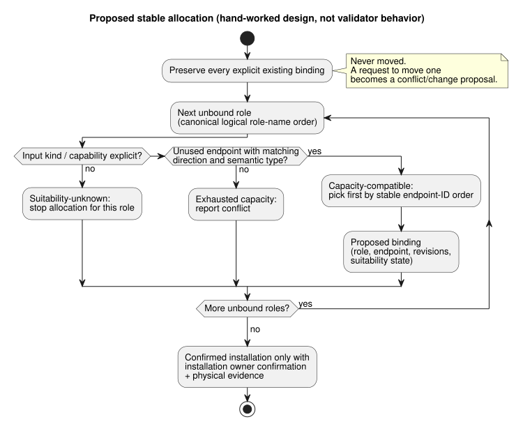

# GF-COMPOSE R4: ports and bindings

This research note asks how composed behaviors should claim inputs and outputs
on a board without moving existing wiring. It covers typed logical ports,
binding revisions, capacity accounting, and the diagnostics that separate a
proposal from an installed fact.

In this document:

- **User problem** — what the farmer and engineer need.
- **Evidence at examined revision** — what current contracts and code already
  establish.
- **Tables and examples** — the proposal contract, resource ledgers, a stable
  allocation order, and failure cases.
- **Recommendation**, **Unresolved questions and owners**, and
  **Verification**.

Terms used throughout:

| Term | Meaning |
| --- | --- |
| Logical role (port) | A named, typed input or output that a behavior needs, such as `irrigation.pump` / `Bool` output. |
| Endpoint | A board-profile entry with direction, semantic type, driver, address, active level, and safe level. |
| Binding | An explicit map from a logical name to an endpoint ID, versioned by a `bindingRevision`. |
| DI / RO | Physical digital input / relay output channels on the board. |

## User problem

A farmer should be able to apply a prepared behavior without calculating
channel allocations. Adding another behavior must not silently move existing
wiring.

The composition boundary therefore needs four things:

- typed logical ports;
- explicit binding revisions;
- capacity accounting; and
- diagnostics that distinguish a proposal from an installed fact.

Scope: this document is bounded research/design. It does not authorize
discovery, wiring, deployment, or a new wire schema.

## Evidence at examined revision

Evidence was examined at language commit
`ffdbc96461eca67908252507fb851fa4dabd9a2c`, the requested baseline.

**Integration contract.** The integration README defines a board endpoint with
direction, semantic type, driver, address, active level, and safe level. A
binding is an explicit logical-name-to-endpoint-ID dictionary. Manifest
input/output names require exact bindings with matching direction and type.
Declaration order has no effect. v1 rejects aliasing one endpoint under
multiple logical names.

**Software inputs.** The same contract explicitly permits a software input
endpoint. Its `software-input` driver/address identify a logical input; it does
not consume a physical DI. Runtime adapters supply that input. This is contract
evidence, not a claim that a particular installation has such an endpoint.

**Checker.** `tools/integration-contract.mjs` checks for:

- unknown endpoints;
- duplicate endpoint driver/address pairs;
- duplicate bindings;
- missing bindings;
- direction mismatches; and
- type mismatches.

It hashes the supplied board profile and installation mapping and compares them
against pinned release identities. The pure checker does not contact a device
or establish electrical or physical truth.

**Package and implementation docs.** `docs/PORTABLE-PACKAGE.md` requires
capability matching and carries an exact `bindingRevision`. It says the API and
Device owners must validate the actual DI/RO map. `docs/IMPLEMENTATION.md` says
installation records provide names, capabilities, bindings, and site facts,
while binding records cannot override program semantics. Startup, fail-safe
behavior, output application, and driver-disconnect behavior remain consumer
policy.

**Driver boundary.** Driver Source/Intent separation is an existing boundary:

- Driver backing may be software, specialized hardware, or both.
- Precision measurement, protocol handling, raw ISR-versus-scan capture
  choices, and physical capture stay at that boundary. The core sees meaningful
  typed events/measurements.
- Farm policy must not be hidden in a driver.
- Capture time, receipt/evaluation time, and quality remain distinct.
- A command acknowledgement is not proof of physical effect.

See [`LANGUAGE.md`](../LANGUAGE.md) section 2, “프로그램 모델” (program model),
and [`IMPLEMENTATION.md`](../IMPLEMENTATION.md) section “Executable path.”

**R2 dependency: source versus instance.** R2 fixes the source/instance
distinction and says installation bindings remain external to executable
control source. Its #62 installation-constraint boundary is unresolved. This
document does not settle whether constraints are a separate artifact or an
explicit cross-project boundary revision. That decision remains with the #62
system owner and language/API owners.

**R2 dependency: memory (#68).** Updated R2 also records system/API issue #68:
conversational memory is provenance and authoring context. It is not executable
source, automatic execution-rule authority, or physical-binding authority. A
remembered equipment fact or exception cannot authorize a binding change
without a confirmed decision, the installation contract, and current device
evidence. Lineage, retention and tombstones, and memory-to-decision linkage
remain open #68 owner questions; they do not change this ports/capacity
analysis.

## Tables and examples

### Proposal contract

The following is a proposal for composition review. It deliberately names
conceptual fields only; it is not a final wire schema.

| Required logical role/type | Required physical or software capability | Supplied profile/binding revision | Suitability evidence | Outcome | Diagnostic subject |
| --- | --- | --- | --- | --- | --- |
| `irrigation.pump` / `Bool` output | Unused compatible RO endpoint | Pinned board profile plus installation `bindingRevision` | Direction/type match; profile review and physical acceptance separately required | Capacity-compatible; propose binding, then confirm installation | Pump role, candidate endpoint, profile and binding revisions |
| `irrigation.low_water` / `Bool` input | Compatible DI capability, or explicit software-input capability | Same pinned profile/mapping context | Direction/type match; DI versus software driver is explicit | Capacity-compatible only after capability kind is known | Low-water role, input kind, endpoint/driver |
| `irrigation.manual_start` / `Bool` input | Compatible DI, or explicit software input | Same pinned profile/mapping context | Software input does not consume DI; no implicit substitution | Proposed binding only when the supplied kind is explicit | Manual-start role and missing input-kind evidence |
| `ventilation.fan_1..4` / `Bool` outputs | Four distinct unused compatible RO endpoints | Pinned profile and new or extended mapping revision | Direction/type match; unique endpoint ownership | Propose in stable order; confirm only after installation evidence | Fan role, endpoint, ownership and capacity |
| Any required role / declared type | Endpoint with wrong direction or type | Supplied revisions may still be internally pinned | Validator mismatch is concrete evidence of incompatibility | Reject; do not coerce or retype | Logical role, endpoint, expected/actual direction/type |

The outcome column uses four distinct states. No state implies a later one:

| State | What it means | Caveat |
| --- | --- | --- |
| Capacity-compatible | Only that a distinct endpoint of the required direction and semantic type appears available in the supplied profile. | Does not prove wiring, polarity, fail-safe suitability, load compatibility, or physical operation. |
| Suitability-unknown | The facts above (wiring, polarity, fail-safe suitability, load compatibility, physical operation) are missing. | Do not claim safe operation. If the missing fact is the input kind or capability itself, allocation stops for that role. |
| Proposed binding | An allocation result. | Not an installed fact. |
| Confirmed installation | Requires the existing owner’s binding confirmation and physical evidence. | **Never** inferred from a host validator pass. |

### Resource ledgers

These are hand-worked ledgers, not execution evidence. The fixture assumes:

- TwoZoneIrrigation has one pump output, two valve outputs, one low-water
  input, and one manual-start input.
- FourFanVentilation has four fan outputs.
- The umbrella example fixes the combined physical counts at DI 2 and RO 7.

| Composition fixture and input assumption | Physical DI consumed | Software inputs | Physical RO consumed | Total requested roles |
| --- | ---: | ---: | ---: | ---: |
| Irrigation + ventilation; both irrigation inputs are wired digital inputs | 2 | 0 | 7 (3 + 4) | 9 (2 inputs + 7 outputs) |
| Irrigation + ventilation; manual-start is an explicit software input and only low-water is wired DI | 1 | 1 | 7 (3 + 4) | 9 (2 inputs + 7 outputs) |

The second row is intentionally not “two DIs.” A `Bool` declaration describes
semantic type, not electrical consumption. The software input still requires
an explicit logical endpoint and binding. If an input kind is not declared, or
the profile does not supply the corresponding capability, suitability is
unknown and allocation must stop for that role.

### Stable allocation decision

**Proposal.** This stable order is a recommendation, not an existing validator
behavior:

1. Preserve every explicit existing binding first.
2. For each unbound role, consider only endpoints with matching direction and
   semantic type that are not already owned.
3. Order roles by their canonical logical role name.
4. Order candidate endpoints by the profile’s stable endpoint ID, in
   lexicographic order.
5. Emit a conflict rather than move an explicit binding.

The flow below summarizes the proposed allocation for each role and where each
of the four states arises.



Two separate concerns must not be mixed:

- **Logical output authority.** Each output channel has one authoritative
  definition, and duplicate direct writers are compile errors. Explicit
  station resource arbitration remains; station requests are not competing
  direct channel writes.
- **Physical endpoint/resource accounting.** This is what the allocator does.
  Endpoint alias checks remain a separate binding validation.

| Step | Existing or requested role | Decision | Evidence/diagnostic |
| ---: | --- | --- | --- |
| 1 | `pump -> RO3` | Preserve explicit binding | Existing mapping is authoritative input; no reallocation |
| 2 | `valve_a -> RO1`, `valve_b -> RO2` | Preserve both explicit bindings | Existing mappings remain owned and distinct |
| 3 | `fan_1..fan_4` | Select four unused compatible ROs in stable endpoint-ID order | Each proposal records role, endpoint, revisions, and suitability state |
| 4 | Any request that would require `pump -> RO4` | Report explicit conflict/change proposal | Existing `pump -> RO3` cannot be silently moved |

Worked before/after example (hand-worked, not execution evidence):

```text
Before irrigation: pump -> RO3, valve_a -> RO1, valve_b -> RO2
After adding ventilation: pump -> RO3, valve_a -> RO1, valve_b -> RO2,
  fan_1..fan_4 -> four unused compatible ROs in stable endpoint-ID order
```

The invariant is exact: adding ventilation leaves all three irrigation
assignments unchanged. Two edge cases follow from it:

- If fewer than four compatible unused ROs exist, the result is exhausted
  capacity.
- If a requested fan is compatible only with RO3, the result is a
  conflict/change proposal, not automatic relocation.

### Failure and unknown cases

| Case | Affected roles | Missing or conflicting evidence | Required outcome and owner |
| --- | --- | --- | --- |
| Wrong direction or semantic type | The role bound to that endpoint | Profile endpoint does not match manifest direction/type; checker reports mismatch | Reject binding. Profile/integration owner corrects the profile or supplied role; no coercion |
| Exhausted capacity | Every unbound role requiring the exhausted direction/type | No unused compatible endpoint remains after preserving explicit bindings | Report capacity conflict with the preserved owners and candidate set. API/composition owner chooses a revised installation or rejects composition |
| Unknown polarity or fail-safe evidence | Affected digital input/output role | `activeLevel`/`safeLevel` may be metadata, but suitability or physical acceptance is not established by this checker | Mark suitability unknown. Board/profile owner supplies profile evidence; Device/physical owner supplies acceptance. Do not claim safe operation |
| Duplicate output ownership | Both logical output roles and the shared endpoint | v1 rejects duplicate binding to one endpoint; endpoint driver/address duplicates are also invalid | Reject and identify both roles plus endpoint. Site/installation owner resolves mapping; Device confirms applied binding |

Ownership outside this contract:

- System #62 owns the installation-constraint boundary decision.
- System #74 owns Device Query, and therefore the device-side
  query/observation path.

This language contract can report pinned profile/mapping identities and
validation results. It cannot assign either owner’s physical acceptance or
discovery responsibilities.

## Recommendation

Adopt a composition planner with four explicit states: capacity-compatible,
suitability-unknown, proposed binding, and confirmed installation. In that
planner:

- Preserve explicit bindings before considering unused endpoints.
- Use a documented stable role and endpoint order for proposals.
- Keep logical names and semantic types separate from physical endpoint IDs.
- Model software inputs as explicit logical capabilities so they do not
  consume DI capacity.

R4 allocation and resource accounting are separate from Driver capture
semantics. This document does not claim Device has implemented or physically
verified these boundaries.

Every proposal must carry the supplied profile identity and binding revision,
the affected role, the candidate endpoint, and the diagnostic state.
Confirmation must carry the existing installation owner’s evidence. Never:

- silently rewrite an explicit binding;
- infer polarity/fail-safe suitability; or
- turn a validator pass into a physical acceptance.

## Unresolved questions and owners

- API/composition owner: define the eventual proposal/confirmation record and
  how a revised installation mapping is approved. This document intentionally
  does not declare its wire schema.
- Board/profile owner: define the authoritative stable endpoint ordering and
  supply reviewed capacity, polarity, safe-level, driver, and address evidence.
- Site/installation owner: confirm the logical-name-to-endpoint mapping and
  binding revision actually selected for an installation.
- Device owner, with system #74 for Device Query: define what observation can
  confirm an applied binding and what remains physical acceptance evidence.
- Device/Driver owner: define capture-to-core event/measurement representation
  and evidence; keep capture time, receipt/evaluation time, and quality
  distinct. This remains separate from binding/resource accounting.
- System #62 owner with language/API owners: resolve the installation-
  constraint boundary identified by R2. This document preserves that open
  decision and does not place constraints in the binding planner.
- System/API #68 owner: define memory lineage, retention/tombstone behavior,
  and memory-to-decision linkage. This planner must not treat memory retrieval
  as binding evidence or an automatic binding authority.
- Composition owner: decide whether a profile may expose multiple candidate
  capability kinds for one logical role. Until decided, require one explicit
  compatible capability kind and report ambiguity as suitability-unknown.

## Verification

- [x] Examined commit recorded: `ffdbc96461eca67908252507fb851fa4dabd9a2c`.
- [x] Read targeted sections of `contracts/integration-v1/README.md`,
  `docs/PORTABLE-PACKAGE.md`, `docs/IMPLEMENTATION.md`, and
  `tools/integration-contract.mjs`, plus dependency draft R2.
- [x] Both ledgers have exact DI 2 / RO 7 and DI 1 / RO 7 plus one software
  input totals, with their input-kind assumptions stated.
- [x] The before/after example preserves pump -> RO3, valve_a -> RO1, and
  valve_b -> RO2, and explains stable-order and override/conflict behavior.
- [x] Wrong type, exhausted capacity, unknown polarity/fail-safe evidence, and
  duplicate output ownership name affected roles and missing/conflicting
  evidence. Profile, binding confirmation, and physical acceptance owners are
  assigned.
- [x] Claims from contracts/code, proposals, unresolved decisions, and the
  hand-worked example are labeled distinctly. No runtime or physical test was
  run or claimed.
- [x] Updated R2 boundary preserved: memory is provenance/authoring context,
  not execution-rule or physical-binding authority; lineage, retention/
  tombstones, and decision linkage remain unresolved under #68.
