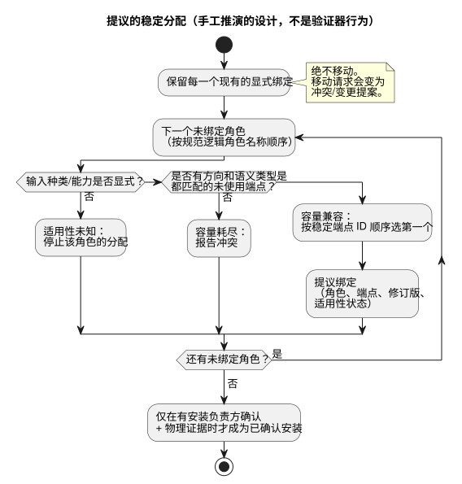

<!-- translation-source: docs/research/GF-COMPOSE-R4-PORTS-BINDINGS.md -->
[英文原文](GF-COMPOSE-R4-PORTS-BINDINGS.md)

# GF-COMPOSE R4：端口与绑定

本研究笔记探讨：组合后的行为应如何在控制板上占用输入和输出，同时不移动现有接线。内容涵盖类型化的逻辑端口、绑定修订版、容量核算，以及区分“提案”与“已安装事实”的诊断。

本文内容：

- **用户问题** —— 农户和工程师需要什么。
- **被检查修订版中的证据** —— 现有契约和代码已经确立了什么。
- **表格与示例** —— 提案契约、资源台账、稳定的分配顺序以及失败情形。
- **建议**、**未决问题与负责方**，以及 **验证**。

全文使用的术语：

| 术语 | 含义 |
| --- | --- |
| 逻辑角色（端口） | 行为所需的、具名且有类型的输入或输出，例如 `irrigation.pump` / `Bool` 输出。 |
| 端点（endpoint） | 板卡配置文件（board profile）中的一个条目，包含方向、语义类型、驱动程序、地址、有效电平和安全电平。 |
| 绑定 | 从逻辑名称到端点 ID 的显式映射，由 `bindingRevision` 标识版本。 |
| DI / RO | 控制板上的物理数字输入 / 继电器输出通道。 |

## 用户问题

农户应当能够直接应用一个预先准备好的行为，而无需自己计算通道分配。添加另一个行为时，不得悄悄移动现有接线。

因此，组合边界需要四样东西：

- 类型化的逻辑端口；
- 显式的绑定修订版；
- 容量核算；以及
- 能够区分提案与已安装事实的诊断。

范围：本文是有边界的研究/设计。它不授权设备发现、接线、部署或新的传输格式（wire schema）。

## 被检查修订版中的证据

证据检查基于语言仓库提交 `ffdbc96461eca67908252507fb851fa4dabd9a2c`，即所要求的基线。

**集成契约。** 集成 README 将板卡端点定义为包含方向、语义类型、驱动程序、地址、有效电平和安全电平的条目。绑定是一个从逻辑名称到端点 ID 的显式字典。清单（manifest）中的输入/输出名称要求有方向和类型都匹配的精确绑定。声明顺序不产生影响。v1 拒绝用多个逻辑名称为同一个端点取别名。

**软件输入。** 同一契约明确允许软件输入端点。其 `software-input` 驱动程序/地址标识一个逻辑输入；它不占用物理 DI。该输入由运行时适配器提供。这是契约层面的证据，并不表示某个具体安装中确实存在这样的端点。

**检查器。** `tools/integration-contract.mjs` 检查以下内容：

- 未知端点；
- 重复的端点驱动程序/地址对；
- 重复绑定；
- 缺失绑定；
- 方向不匹配；以及
- 类型不匹配。

它对所提供的板卡配置文件和安装映射计算哈希，并与固定的发布身份标识进行比较。这个纯检查器不会连接设备，也不会确立电气或物理层面的事实。

**包与实现文档。** `docs/PORTABLE-PACKAGE.md` 要求进行能力匹配，并携带精确的 `bindingRevision`。它指出 API 和 Device 负责方必须验证实际的 DI/RO 映射。`docs/IMPLEMENTATION.md` 指出，安装记录提供名称、能力、绑定和现场事实，而绑定记录不能覆盖程序语义。启动、故障安全行为、输出应用以及驱动程序断开时的行为仍属于使用方策略。

**驱动程序边界。** 驱动程序 Source/Intent 分离是一条已有的边界：

- 驱动程序的实现可以是软件、专用硬件或二者兼有。
- 精密测量、协议处理、原始 ISR 捕获与扫描捕获之间的选择以及物理捕获，都停留在该边界上。核心看到的是有意义的、带类型的事件/测量值。
- 农场策略不得隐藏在驱动程序中。
- 捕获时间、接收/求值时间和品质始终相互区分。
- 命令确认（acknowledgement）不是物理效果的证明。

参见 [`LANGUAGE.md`](../LANGUAGE.zh.md) 第 2 节“프로그램 모델”（程序模型），以及 [`IMPLEMENTATION.md`](../IMPLEMENTATION.zh.md) 中的“Executable path”一节。

**R2 依赖：源与实例。** R2 确定了源与实例的区分，并指出安装绑定始终位于可执行控制源之外。其 #62 安装约束边界尚未解决。本文不决定约束是独立制品，还是一次显式的跨项目边界修订。这一决定仍由 #62 系统负责方与语言/API 负责方作出。

**R2 依赖：记忆（#68）。** 更新后的 R2 还记录了系统/API 议题 #68：对话记忆是来源（provenance）和编写上下文。它不是可执行源，不是自动执行规则的权威，也不是物理绑定的权威。被记住的设备事实或例外情况，在没有经确认的决定、安装契约和当前设备证据的情况下，不能授权更改绑定。谱系（lineage）、保留与墓碑（tombstone）以及记忆到决定的关联，仍是 #68 负责方的开放问题；它们不影响本文关于端口/容量的分析。

## 表格与示例

### 提案契约

以下是供组合评审使用的提案。它刻意只列出概念性字段，并非最终的传输格式。

| 所需逻辑角色/类型 | 所需物理或软件能力 | 提供的配置文件/绑定修订版 | 适用性证据 | 结果 | 诊断对象 |
| --- | --- | --- | --- | --- | --- |
| `irrigation.pump` / `Bool` 输出 | 未使用的兼容 RO 端点 | 固定的板卡配置文件加上安装 `bindingRevision` | 方向/类型匹配；配置文件评审和物理验收需另行进行 | 容量兼容；提出绑定，然后确认安装 | 水泵角色、候选端点、配置文件与绑定修订版 |
| `irrigation.low_water` / `Bool` 输入 | 兼容的 DI 能力，或显式的软件输入能力 | 相同的固定配置文件/映射上下文 | 方向/类型匹配；DI 与软件驱动程序的区别是显式的 | 仅在能力种类已知后才是容量兼容 | 低水位角色、输入种类、端点/驱动程序 |
| `irrigation.manual_start` / `Bool` 输入 | 兼容的 DI，或显式的软件输入 | 相同的固定配置文件/映射上下文 | 软件输入不占用 DI；不做隐式替换 | 仅当所提供的种类是显式的时才给出提议绑定 | 手动启动角色以及缺失的输入种类证据 |
| `ventilation.fan_1..4` / `Bool` 输出 | 四个互不相同的未使用兼容 RO 端点 | 固定的配置文件以及新的或扩展的映射修订版 | 方向/类型匹配；端点所有权唯一 | 按稳定顺序提出；仅在取得安装证据后才确认 | 风机角色、端点、所有权与容量 |
| 任意所需角色 / 声明类型 | 方向或类型错误的端点 | 所提供的修订版本身可能仍然是固定的 | 验证器报告的不匹配是不兼容的具体证据 | 拒绝；不做强制转换或重新指定类型 | 逻辑角色、端点、期望/实际的方向/类型 |

“结果”列使用四个彼此不同的状态。任何一个状态都不意味着后面的状态：

| 状态 | 含义 | 注意事项 |
| --- | --- | --- |
| 容量兼容 | 仅表示在所提供的配置文件中，似乎存在一个方向和语义类型都符合要求的独立端点可用。 | 不证明接线、极性、故障安全适用性、负载兼容性或物理运行。 |
| 适用性未知 | 上述事实（接线、极性、故障安全适用性、负载兼容性、物理运行）缺失。 | 不得声称可以安全运行。如果缺失的事实是输入种类或能力本身，则该角色的分配停止。 |
| 提议绑定 | 分配的结果。 | 不是已安装的事实。 |
| 已确认安装 | 需要现有负责方的绑定确认和物理证据。 | **绝不**根据宿主验证器的通过结果推断得出。 |

### 资源台账

以下是手工推演的台账，不是执行证据。该示例假设：

- TwoZoneIrrigation 有一个水泵输出、两个阀门输出、一个低水位输入和一个手动启动输入。
- FourFanVentilation 有四个风机输出。
- 总括示例将合计的物理数量固定为 DI 2 和 RO 7。

| 组合示例及输入假设 | 占用的物理 DI | 软件输入 | 占用的物理 RO | 所需角色总数 |
| --- | ---: | ---: | ---: | ---: |
| 灌溉 + 通风；两个灌溉输入都是接线的数字输入 | 2 | 0 | 7 (3 + 4) | 9（2 个输入 + 7 个输出） |
| 灌溉 + 通风；手动启动是显式的软件输入，只有低水位是接线的 DI | 1 | 1 | 7 (3 + 4) | 9（2 个输入 + 7 个输出） |

第二行刻意不是“两个 DI”。`Bool` 声明描述的是语义类型，而不是电气占用。软件输入仍然需要显式的逻辑端点和绑定。如果没有声明输入种类，或者配置文件没有提供相应的能力，则适用性未知，该角色的分配必须停止。

### 稳定的分配决策

**提案。** 下面的稳定顺序是一项建议，而不是现有验证器的行为：

1. 首先保留每一个现有的显式绑定。
2. 对每个未绑定的角色，只考虑方向和语义类型都匹配且尚未被占用的端点。
3. 按规范的逻辑角色名称对角色排序。
4. 按配置文件中稳定的端点 ID 以字典序对候选端点排序。
5. 报告冲突，而不是移动显式绑定。

下面的流程图概括了每个角色的提议分配过程，以及四个状态各自出现的位置。



有两个独立的关注点不得混淆：

- **逻辑输出权威。** 每个输出通道只有一个权威定义，重复的直接写入者属于编译错误。显式的工作站（station）资源仲裁仍然保留；工作站请求不是相互竞争的通道直接写入。
- **物理端点/资源核算。** 这正是分配器所做的工作。端点别名检查仍是一项独立的绑定验证。

| 步骤 | 现有或请求的角色 | 决策 | 证据/诊断 |
| ---: | --- | --- | --- |
| 1 | `pump -> RO3` | 保留显式绑定 | 现有映射是权威输入；不重新分配 |
| 2 | `valve_a -> RO1`、`valve_b -> RO2` | 保留这两个显式绑定 | 现有映射仍被占用且互不相同 |
| 3 | `fan_1..fan_4` | 按稳定的端点 ID 顺序选择四个未使用的兼容 RO | 每个提案都记录角色、端点、修订版和适用性状态 |
| 4 | 任何需要 `pump -> RO4` 的请求 | 报告显式冲突/变更提案 | 现有的 `pump -> RO3` 不能被悄悄移动 |

前后对比示例（手工推演，不是执行证据）：

```text
添加灌溉前：pump -> RO3, valve_a -> RO1, valve_b -> RO2
添加通风后：pump -> RO3, valve_a -> RO1, valve_b -> RO2,
  fan_1..fan_4 -> 按稳定端点 ID 顺序选出的四个未使用兼容 RO
```

不变量是精确的：添加通风后，三个灌溉分配全部保持不变。由此得出两个边界情形：

- 如果兼容的未使用 RO 少于四个，结果是容量耗尽。
- 如果某个请求的风机只与 RO3 兼容，结果是冲突/变更提案，而不是自动迁移。

### 失败与未知情形

| 情形 | 受影响的角色 | 缺失或冲突的证据 | 要求的结果与负责方 |
| --- | --- | --- | --- |
| 方向或语义类型错误 | 绑定到该端点的角色 | 配置文件端点与清单的方向/类型不匹配；检查器报告不匹配 | 拒绝绑定。由配置文件/集成负责方修正配置文件或所提供的角色；不做强制转换 |
| 容量耗尽 | 所有需要已耗尽方向/类型的未绑定角色 | 保留显式绑定之后，不再有未使用的兼容端点 | 报告容量冲突，并附上被保留的占用者和候选集合。由 API/组合负责方选择修订后的安装方案或拒绝该组合 |
| 极性或故障安全证据未知 | 受影响的数字输入/输出角色 | `activeLevel`/`safeLevel` 可能作为元数据存在，但本检查器并不确立适用性或物理验收 | 标记为适用性未知。由板卡/配置文件负责方提供配置文件证据；由 Device/物理负责方提供验收。不得声称可以安全运行 |
| 输出所有权重复 | 两个逻辑输出角色及共享端点 | v1 拒绝向同一端点重复绑定；端点驱动程序/地址重复同样无效 | 拒绝，并指出两个角色和该端点。由现场/安装负责方解决映射；由 Device 确认已应用的绑定 |

本契约之外的所有权：

- 系统 #62 负责安装约束边界的决定。
- 系统 #74 负责 Device Query，因此也负责设备侧的查询/观测路径。

本语言契约可以报告固定的配置文件/映射身份标识和验证结果。它不能承担上述任一负责方的物理验收或设备发现职责。

## 建议

采用一个具有四个显式状态的组合规划器：容量兼容、适用性未知、提议绑定和已确认安装。在该规划器中：

- 在考虑未使用端点之前，先保留显式绑定。
- 为提案使用有文档说明的稳定角色顺序和端点顺序。
- 将逻辑名称和语义类型与物理端点 ID 分开。
- 将软件输入建模为显式的逻辑能力，使其不占用 DI 容量。

R4 的分配和资源核算与驱动程序的捕获语义相互独立。本文不声称 Device 已经实现或在物理上验证了这些边界。

每个提案都必须携带所提供的配置文件身份标识和绑定修订版、受影响的角色、候选端点以及诊断状态。确认必须携带现有安装负责方的证据。绝不：

- 悄悄改写显式绑定；
- 推断极性/故障安全适用性；或
- 把验证器的通过结果当作物理验收。

## 未决问题与负责方

- API/组合负责方：定义最终的提案/确认记录，以及修订后的安装映射如何获批。本文刻意不声明其传输格式。
- 板卡/配置文件负责方：定义权威的稳定端点排序，并提供经过评审的容量、极性、安全电平、驱动程序和地址证据。
- 现场/安装负责方：确认某次安装实际选定的逻辑名称到端点映射以及绑定修订版。
- Device 负责方（与负责 Device Query 的系统 #74 一起）：定义哪些观测可以确认已应用的绑定，以及哪些仍属于物理验收证据。
- Device/驱动程序负责方：定义从捕获到核心的事件/测量表示及其证据；保持捕获时间、接收/求值时间和品质相互区分。这与绑定/资源核算是分开的。
- 系统 #62 负责方与语言/API 负责方：解决 R2 指出的安装约束边界。本文保留这一开放决定，不把约束放入绑定规划器。
- 系统/API #68 负责方：定义记忆谱系、保留/墓碑行为以及记忆到决定的关联。本规划器不得把记忆检索当作绑定证据或自动绑定权威。
- 组合负责方：决定一个配置文件是否可以为一个逻辑角色提供多种候选能力种类。在作出决定之前，要求恰好一种显式的兼容能力种类，并将歧义报告为适用性未知。

## 验证

- [x] 已记录被检查的提交：`ffdbc96461eca67908252507fb851fa4dabd9a2c`。
- [x] 已阅读 `contracts/integration-v1/README.md`、`docs/PORTABLE-PACKAGE.md`、`docs/IMPLEMENTATION.md` 和 `tools/integration-contract.mjs` 的相关章节，以及依赖草案 R2。
- [x] 两个台账的合计分别精确为 DI 2 / RO 7，以及 DI 1 / RO 7 加一个软件输入，并说明了各自的输入种类假设。
- [x] 前后对比示例保留了 pump -> RO3、valve_a -> RO1 和 valve_b -> RO2，并解释了稳定顺序以及覆盖/冲突行为。
- [x] 类型错误、容量耗尽、极性/故障安全证据未知以及输出所有权重复，均指出了受影响的角色和缺失/冲突的证据。配置文件、绑定确认和物理验收的负责方均已指定。
- [x] 来自契约/代码的陈述、提案、未决决定和手工推演示例分别作了标注。没有运行或声称运行任何运行时或物理测试。
- [x] 保留了更新后的 R2 边界：记忆是来源/编写上下文，不是执行规则或物理绑定的权威；谱系、保留/墓碑和决定关联在 #68 下仍未解决。
