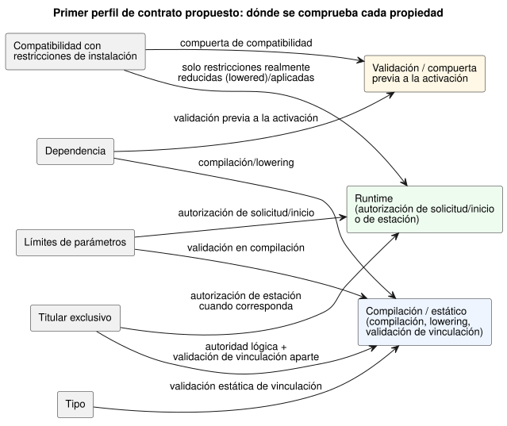
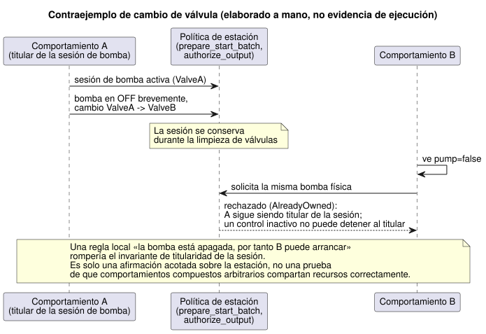

<!-- translation-source: docs/research/GF-COMPOSE-R5-CONTRACTS.md -->
[Original en inglés](GF-COMPOSE-R5-CONTRACTS.md)

# GF-COMPOSE R5: contratos y diagnósticos de composición

Esta nota de investigación propone un primer perfil de contrato para componer
comportamientos: qué propiedades se comprueban, en qué fase, qué puede afirmar
honestamente cada comprobación y cómo se informa de un fallo a agricultores e
ingenieros.

En este documento:

- **Problema del usuario**: por qué la composición necesita motivos concretos y
  respaldados por evidencia.
- **Evidencia en la revisión examinada**: lo que establecen las herramientas,
  la documentación y el código de runtime actuales, y las cuatro clases de
  evidencia.
- **Tablas y ejemplos**: el perfil propuesto, exactamente cuatro ejemplos de
  diagnóstico y el contraejemplo del cambio de válvula.
- **Recomendación**, **Preguntas abiertas y responsables** y
  **Verificación**.

## Problema del usuario

Un agricultor necesita un motivo claro cuando unos comportamientos no pueden
coexistir. Los ingenieros necesitan el requisito en conflicto, las identidades
afectadas y la evidencia, sin un resultado general de «seguro» que no esté
respaldado.

Este documento define un primer perfil de contrato propuesto para la
composición. Es investigación y diseño, no implementación.

El perfil cubre cinco propiedades:

- tipo;
- dependencia;
- límites de parámetros;
- titularidad exclusiva de las salidas; y
- compatibilidad con las restricciones de instalación.

Fuera de alcance y fronteras de autoridad:

- El arbitraje más amplio de recursos de actuadores compartidos sigue en #95.
- La fuente canónica `.ghost.md` es la dueña de las reglas ejecutables.
- El núcleo en Rust es el dueño de la ejecución.
- El contexto de instalación y el despliegue siguen siendo fronteras de
  autoridad externas.

## Evidencia en la revisión examinada

La evidencia se examinó en `ffdbc96461eca67908252507fb851fa4dabd9a2c`. No se
ejecutó ninguna batería de pruebas de runtime. Los documentos de dependencia R3
y R4 se leyeron como propuestas y resúmenes de evidencia; sus decisiones
abiertas siguen abiertas aquí.

La evidencia actual establece lo siguiente:

- **Compilador de restricciones.** `compileConstraints` acepta `exclusive`,
  formas acotadas de `require`, las formas independientes `allow(enter/apply)`,
  `limit on_time`, `once` y el `check pump_capacity` no bloqueante; las
  expresiones no admitidas hacen fallar la compilación
  ([`tools/constraints.mjs`](../../tools/constraints.mjs)).
- **Estado histórico de `allow apply`.** Es evidencia histórica del compilador
  independiente. La referencia del lenguaje conserva `allow enter(...)` para
  el parser de `ghostrules` e indica que la regla anterior
  `allow apply(settings) ... Configure` quedó sustituida por la decisión
  aprobada sobre el evento de propiedades en vivo; consulte
  [Referencia §4.10](../reference/04-sensors-constraints-control.es.md).
- **La fase de la restricción importa.** Las relaciones de salida se aplican a
  los candidatos de salida finales; las reglas enter/apply se aplican a la
  entrada de solicitudes; las comprobaciones de capacidad se aplican a una ruta
  de autorización de trabajo nuevo ([`docs/CONSTRAINTS.md`](../CONSTRAINTS.es.md)).
- **Selección de arranque de la estación.** `prepare_start_batch` selecciona
  el ID de solicitud más bajo de una única instantánea del mismo tick. No
  establece un arbitraje universal de composición
  ([`station.rs`](../../crates/ghostflow-core/src/station.rs)).
- **Autorización de salidas de la estación.** `authorize_output` requiere la
  sesión activa y valida la titularidad de las válvulas, el número de válvulas y
  la seguridad de bomba con válvula. Una estación posee una bomba física; es una
  política de estación acotada, no una prueba general de composición de
  comportamientos.
- **Integración v1.** Exige vinculaciones (bindings) exactas por nombre lógico
  con dirección y tipo semántico coincidentes. Sus compuertas independientes de
  host, hardware y física usan `unknown` cuando la evidencia no puede
  establecer un resultado; el paso de un validador no es aceptación física
  ([`contracts/integration-v1/README.md`](../../contracts/integration-v1/README.md)).
- **Traza de fuente.** Une la identidad de la fuente, las vinculaciones, los
  índices de restricciones y las observaciones de runtime. Los campos que
  faltan quedan sin observar; la traza no infiere el funcionamiento eléctrico ni
  mecánico ([`docs/SOURCE-SAFETY-TRACE.md`](../SOURCE-SAFETY-TRACE.es.md)).
- **Fronteras de R2 fijadas y abiertas.** La memoria de sistema #68 de R2 es
  una frontera fijada para este documento: la memoria conversacional es
  procedencia/contexto de autoría, no autoridad sobre reglas de ejecución ni
  sobre vinculaciones ([R2: autoridad e identidad](GF-COMPOSE-R2-AUTHORITY-IDENTITY.es.md)).
  La autoridad sobre las restricciones de instalación bajo el sistema #62 sigue
  abierta. Consulte también [R3: ejecución de la composición](GF-COMPOSE-R3-EXECUTION.es.md)
  para la propuesta de ejecución relacionada y sus límites.

### Clases de evidencia

Un diagnóstico debe indicar cuán sólida es su evidencia. El perfil distingue
cuatro clases:

| Clase | Significado en este perfil | Ejemplo |
|---|---|---|
| Supuesto declarado | Entrada suministrada para la planificación, no establecida de forma independiente | Una vinculación propuesta nombra `MainPump` |
| Propiedad probada | Una prueba o una compuerta registrada estableció el resultado indicado dentro de su alcance | Una compuerta de host de integración está en `pass` con una referencia |
| Propiedad establecida estáticamente | El compilador o el validador demuestra un hecho estructural acotado | Una salida requerida tiene dirección y tipo semántico coincidentes |
| Restricción aplicada en runtime | La ruta de ejecución rechaza o bloquea la solicitud/salida inválida | `authorize_output` rechaza una salida de bomba encendida sin válvula |

El perfil puede informar de las cuatro clases, con estos límites:

- No debe elevar un supuesto o una coincidencia estructural a seguridad física.
- Una compuerta de instalación ausente es `unknown`, no `pass`.
- La identidad de la traza de fuente mejora la trazabilidad, pero no demuestra
  que un dispositivo haya aplicado el comando.

## Tablas y ejemplos

### Primer perfil de contrato propuesto

La tabla indica, para cada propiedad, sus entradas, la fase de comprobación,
la afirmación que puede sostener y lo que sigue sin respaldo o desconocido.

| Propiedad | Entradas requeridas | Fase de comprobación | Afirmación respaldada | Caso sin respaldo o desconocido |
|---|---|---|---|---|
| Tipo | Rol/tipo canónico del manifiesto; dirección/tipo del endpoint del perfil; vinculación explícita | Validación estática de vinculación | El rol lógico es estructuralmente compatible con el endpoint suministrado | No se demuestran conversiones forzadas, semántica analógica ni comportamiento no documentado del driver |
| Dependencia | Nombres de dependencias declaradas y nodos de la traza de fuente; mapa completo de entradas compuestas | Compilación/lowering y validación previa a la activación | El invariante existente rechaza los ciclos de expresiones instantáneos; se rechazan los destinos faltantes | El lowering entre módulos en el mismo escaneo sigue sin resolverse; las restricciones existentes de fase/referencia a next siguen fijadas |
| Límites de parámetros | Valores enteros/de duración declarados; límites del perfil y de la estación | Validación en compilación y luego autorización de solicitud/inicio | Los valores encajan en los límites declarados del compilador/estación; las comprobaciones finitas de cuota/presupuesto pueden rechazar solicitudes | La capacidad física, la presión, el caudal o la semántica de parámetros no modelada siguen siendo desconocidos |
| Titular exclusivo | ID de salidas lógicas, vinculaciones explícitas a endpoints, ID de titular/reclamación | Comprobación de autoridad lógica en compilación; validación de vinculación aparte; autorización de estación cuando corresponda | Una única definición autoritativa por canal de salida; los escritores directos duplicados hacen fallar la compilación y no pueden desplegarse | No hay un resolutor automático; el arbitraje declarado existente de recursos de estación sigue aparte |
| Compatibilidad con restricciones de instalación | Revisiones fijadas de placa/perfil y de instalación; evidencia de compuertas independientes; artefacto de restricciones o decisión de autoridad | Compuerta de compatibilidad previa a la activación; en runtime solo para las restricciones realmente reducidas (lowered)/aplicadas | Se pueden informar identidades coincidentes y restricciones compatibles explícitas | #62 no ha elegido la autoridad de artefacto/superposición/aplicación; la evidencia ausente es desconocida |

El diagrama relaciona cada propiedad con la fase o las fases que la comprueban.

**«Compatible» tiene un alcance deliberadamente limitado.** Significa que el
requisito comprobado está respaldado por la entrada y la fase indicadas. No
significa que toda la instalación sea segura. La identidad de la
restricción/fuente debería usar los campos existentes de la traza de fuente,
incluidos los digests de la fuente y del bytecode, en lugar de una identidad
inventada.

**Invariantes de ejecución existentes que la composición debe conservar:**

- Se rechazan los ciclos de expresiones instantáneos. Es un invariante
  existente, no una elección de política abierta.
- La retroalimentación de estado cruza la frontera entre estado anterior y
  estado siguiente.
- Todas las transiciones usan una única instantánea de entradas/estado
  anterior.
- Las referencias a next solo se permiten en expresiones de salida, nunca en
  otras transiciones next ni en lets.
- La consolidación lógica es simultánea.

### Exactamente cuatro ejemplos de diagnóstico

Cada ejemplo tiene un código de motivo estable propuesto, un mensaje para el
agricultor, los ID afectados, la evidencia y un resultado requerido u opción
correctiva.

1. **Dos titulares exclusivos de la bomba.**

   - Código de motivo: `GF-COMPOSE-EXCLUSIVE-OUTPUT`.
   - Mensaje para el agricultor: «Estos dos comportamientos requieren la misma
     bomba. Elija un comportamiento o instale una bomba independiente antes de
     aplicar ambos».
   - ID afectados: `irrigation.pump`, `fertigation.pump`, endpoint
     `MainPump`.
   - Evidencia: requisito declarado de titular exclusivo; revisión de
     vinculación e identidad del endpoint; nodos de la traza de fuente de ambas
     intenciones de salida.
   - Resultado requerido: hacer fallar la compilación por definiciones
     autoritativas de salida duplicadas, nombrando ambas definiciones y la
     salida afectada. El candidato no puede desplegarse. Resuelva las
     definiciones de la fuente; un endpoint distinto por sí solo no legitima
     dos escritores en un mismo canal lógico. Las solicitudes de recursos de
     estación se siguen arbitrando por separado.

2. **Puerto incompatible.**

   - Código de motivo: `GF-COMPOSE-PORT-INCOMPATIBLE`.
   - Mensaje para el agricultor: «La bomba solicitada está conectada a un
     puerto que no coincide con el tipo de salida requerido por el
     comportamiento. Seleccione un puerto compatible o corrija el registro de
     la instalación».
   - ID afectados: rol lógico `irrigation.pump`; endpoint `DI-2`; se esperaba
     `output/Bool` y se suministró `input/Bool`.
   - Evidencia: revisión fijada del perfil de placa, `bindingRevision` de la
     instalación y la discrepancia de dirección/tipo del validador.
   - Opción correctiva: vincular el rol a una salida coincidente no usada, o
     que el responsable del perfil/instalación corrija el mapeo. No se implica
     ninguna conversión forzada.

3. **Dependencia faltante.**

   - Código de motivo: `GF-COMPOSE-DEPENDENCY-MISSING`.
   - Mensaje para el agricultor: «Este comportamiento necesita `water_ok`, pero
     ningún comportamiento ni entrada suministrados lo proporciona. Añada esa
     entrada o elimine la dependencia».
   - ID afectados: consumidor `irrigation.start`; dependencia requerida
     `water_ok`; cite el tramo/nodo de la fuente canónica solo si está presente
     en el mapa de fuentes compilado. Un nodo del mapa de dependencias
     compuesto es una propuesta, no algo establecido por los contratos
     actuales.
   - Evidencia: la declaración/tramo de la fuente canónica cuando esté
     disponible y el mapa de entradas compuesto; marque explícitamente como
     ausente/sin resolver cualquier destino del mapa de fuentes o de la traza
     que no esté disponible. No invente un nodo ni un registro de procedencia.
   - Opción correctiva: proporcionar una entrada/resultado `water_ok`
     vinculado explícitamente, o revisar la fuente. No se infiere la
     temporización del resultado en el mismo escaneo.

4. **Evidencia de instalación requerida desconocida.**

   - Código de motivo: `GF-COMPOSE-INSTALL-EVIDENCE-UNKNOWN`.
   - Mensaje para el agricultor: «Los requisitos del comportamiento coinciden
     con el perfil registrado, pero falta la evidencia de instalación necesaria
     para confirmar esta configuración. Pida al instalador que la verifique
     antes de arrancar».
   - ID afectados: restricción `SharedPump`; instalación `site-a/rev-7`;
     conjunto de endpoints `MainPump`, `ValveA`.
   - Evidencia: existen las identidades fijadas de perfil y de vinculación; la
     compuerta de hardware o física requerida está en `unknown` o `not_run`
     sin ninguna referencia válida.
   - Opción correctiva: obtener la evidencia actual de hardware/física del
     responsable, o dejar el resultado como desconocido y no afirmar una
     instalación confirmada.

### Contraejemplo del cambio de válvula y frontera de la estación

Este contraejemplo está elaborado a mano; no es evidencia de ejecución. Muestra
por qué una comprobación local no es una garantía de composición.

1. El comportamiento A es titular de una sesión de bomba.
2. Al cambiar de `ValveA` a `ValveB`, A apaga brevemente la bomba (OFF).
3. El comportamiento B ve `pump=false` y solicita la misma bomba física.

Una regla local como «la bomba está apagada, por tanto B puede arrancar»
rompería el invariante de titularidad de la sesión. La política de estación
existente conserva explícitamente la sesión durante la limpieza de válvulas e
indica que un control inactivo no puede detener al titular.

El diagrama muestra el comportamiento de la estación; en la revisión examinada,
`prepare_start` rechaza un nuevo arranque con `AlreadyOwned` mientras haya una
sesión activa. Por tanto, `prepare_start_batch` y `authorize_output` respaldan
esta afirmación acotada sobre la estación, cuando el host suministra la
solicitud de estación y el estado de la sesión. No demuestran que
comportamientos compuestos arbitrarios compartan recursos correctamente.

Lo que queda para otros responsables:

- La incidencia #95 puede definir arbitraje adicional de actuadores compartidos
  y respaldo (fallback). Esto no reabre la regla de una única definición
  autoritativa para un canal de salida.
- Este documento no añade un árbitro ni un motor temporal o de demostración de
  teoremas.
- R2/#62 debe decidir dónde son autoritativas las restricciones de instalación
  y cómo se suministra su evidencia.

Hasta que se revisen ambas decisiones, el perfil informa de la compatibilidad
solo para las entradas y fases admitidas.

## Recomendación

Adoptar lo siguiente como hipótesis de revisión:

- Rechazar la composición antes de la activación cuando falle una comprobación
  admitida de tipo, dependencia, límite o titular exclusivo.
- Conservar en el diagnóstico el requisito exacto y las referencias a la
  evidencia.
- Usar `unknown` para la evidencia de instalación ausente.
- Reutilizar la identidad existente de la traza de fuente y la aplicación de la
  estación donde su alcance coincida.
- No afirmar un resultado global de seguridad, aceptación física, prioridad ni
  arbitraje a partir de comprobaciones locales.

## Preguntas abiertas y responsables

- **Responsable de lenguaje/compilador:** definir la representación de
  dependencias compuestas que conserve la regla de ciclos existente, y definir
  el registro de códigos de motivo estables. Conservar las reglas de old/next y
  de escritor único; el lowering entre módulos en el mismo escaneo sigue sin
  resolverse.
- **Responsable de la ABI de lenguaje/runtime:** definir la envoltura del
  diagnóstico y cómo se unen los ID de instancia, los ID de endpoint, los nodos
  de fuente, los índices de restricciones y las referencias de evidencia sin
  cambiar implícitamente la ABI actual.
- **Sistema #62 con los responsables de API/lenguaje:** decidir la autoridad
  sobre las restricciones de instalación, la forma del artefacto y la fase de
  aplicación. Este documento no elige ninguna intencionadamente.
- **Responsable de #95/estación:** definir cualquier arbitraje adicional de
  recursos compartidos y respaldo. La política de estación existente sigue
  limitada a una estación de bomba física y debe auditarse, no generalizarse.
  Esto no autoriza varios escritores directos en un mismo canal de salida.
- **Responsable de API/integración:** definir cómo se actualiza y aprueba la
  evidencia faltante u obsoleta de perfil, vinculación y compuertas. La memoria
  #68 no puede autorizarlo.
- **Responsables de Device/instalación:** aportar la aceptación física y la
  evidencia de vinculación aplicada. La validación del host no puede
  establecer esos hechos.

## Verificación

- [x] Revisión examinada registrada como `ffdbc96461eca67908252507fb851fa4dabd9a2c`.
- [x] Se comprobaron secciones específicas de `docs/CONSTRAINTS.md`,
  `station.rs`, `tools/constraints.mjs`, `docs/SOURCE-SAFETY-TRACE.md` y
  `contracts/integration-v1/README.md`.
- [x] Se leyeron los hallazgos de las dependencias R3 y R4; sus decisiones
  abiertas se conservan en lugar de tratarse como aprobación de la
  arquitectura.
- [x] La tabla separa la fase de comprobación de la solidez de la evidencia y
  mantiene sin respaldo la evidencia desconocida.
- [x] Se incluyen exactamente cuatro diagnósticos. Cada uno tiene un código
  estable propuesto, un mensaje para el agricultor, los ID afectados, las
  referencias de evidencia y una opción correctiva.
- [x] El contraejemplo del cambio de válvula identifica el límite de las
  garantías locales y asigna el seguimiento a #95 y a R2/#62 sin añadir un
  motor de políticas.
- [x] Los ejemplos se etiquetan como elaborados a mano cuando corresponde. No
  se afirma ninguna ejecución de runtime ni física; no se ejecutaron las
  baterías de runtime.
