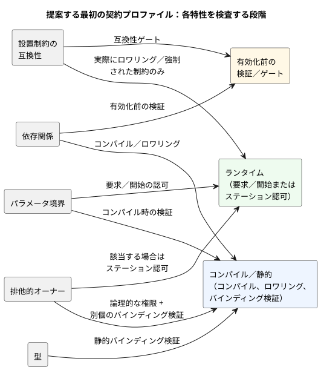
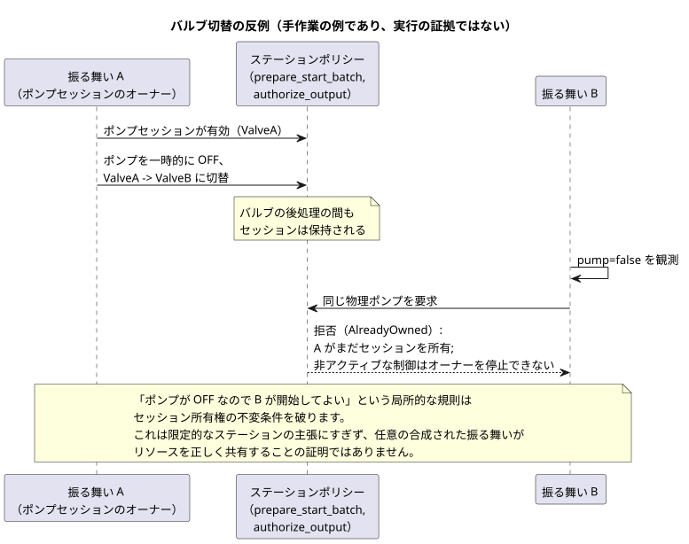

<!-- translation-source: docs/research/GF-COMPOSE-R5-CONTRACTS.md -->
[英語の原文](GF-COMPOSE-R5-CONTRACTS.md)

# GF-COMPOSE R5：合成の契約と診断

この調査ノートは、振る舞いを合成するための最初の契約プロファイルを提案します。どの特性を、どの段階で検査するのか、各検査が正直に主張できることは何か、そして失敗を農家とエンジニアにどう報告するのかを扱います。

この文書の内容：

- **ユーザーの課題** — 合成に、証拠に裏付けられた具体的な理由が必要な理由。
- **調査したリビジョンでの証拠** — 現在のツール、文書、ランタイムコードが確立していることと、4 つの証拠クラス。
- **表と例** — 提案するプロファイル、ちょうど 4 つの診断例、バルブ切替の反例。
- **推奨事項**、**未解決の問題と担当オーナー**、**検証**。

## ユーザーの課題

複数の振る舞いが共存できない場合、農家には明確な理由が必要です。エンジニアには、競合する要件、影響を受ける同一性、そして証拠が必要です。根拠のない一律の「安全」という結果は不要です。

この文書は、合成のために提案する最初の契約プロファイルを定義します。これは調査／設計であり、実装ではありません。

プロファイルは次の 5 つの特性を対象とします。

- 型
- 依存関係
- パラメータの境界
- 排他的な出力所有権
- 設置制約との互換性

範囲外の事項と権限の境界：

- より広範な共有アクチュエータのリソース調停は、引き続き #95 の対象です。
- 正本の `.ghost.md` ソースが実行規則を所有します。
- Rust コアが実行を所有します。
- 設置の文脈とデプロイは、引き続き外部の権限境界です。

## 調査したリビジョンでの証拠

証拠は `ffdbc96461eca67908252507fb851fa4dabd9a2c` で調査しました。ランタイムのテストスイートは実行していません。依存する R3 と R4 の文書は、提案および証拠の要約として読みました。そこで未解決の選択は、ここでも未解決のままです。

現在の証拠は次のことを確立しています。

- **制約コンパイラ。** `compileConstraints` は、`exclusive`、範囲を限定した `require` の形式、単独の `allow(enter/apply)` の形式、`limit on_time`、`once`、ブロックしない `check pump_capacity` を受け付けます。サポートされていない式はコンパイルに失敗します（[`tools/constraints.mjs`](../../tools/constraints.mjs)）。
- **`allow apply` の歴史的な位置付け。** これは単独コンパイラに関する歴史的な証拠です。言語リファレンスは `ghostrules` パーサー向けに `allow enter(...)` を残しており、以前の `allow apply(settings) ... Configure` 規則は承認済みのライブプロパティイベントの決定によって置き換えられたと述べています。[リファレンス §4.10](../reference/04-sensors-constraints-control.ja.md) を参照してください。
- **制約の段階が重要。** 出力の関係は最終的な出力候補に適用されます。enter/apply 規則は要求の入口で適用されます。容量検査は新しい作業の認可経路に適用されます（[`docs/CONSTRAINTS.md`](../CONSTRAINTS.ja.md)）。
- **ステーションの開始選択。** `prepare_start_batch` は、同じ tick の 1 つのスナップショットから最小の要求 ID を選びます。これは普遍的な合成の調停を確立するものではありません（[`station.rs`](../../crates/ghostflow-core/src/station.rs)）。
- **ステーションの出力認可。** `authorize_output` は有効なセッションを要求し、バルブの所有権、バルブの数、ポンプとバルブの安全性（ポンプはバルブを伴うこと）を検証します。ステーションは物理ポンプを 1 台所有します。これは範囲を限定したステーションポリシーであり、振る舞いの合成に関する一般的な証明ではありません。
- **Integration v1。** 方向と意味型が一致する、厳密な論理名のバインディングを要求します。独立したホスト、ハードウェア、物理のゲートは、証拠から結果を確立できない場合に `unknown` を使います。バリデータの合格は物理的な受け入れではありません（[`contracts/integration-v1/README.md`](../../contracts/integration-v1/README.md)）。
- **ソーストレース。** ソースの同一性、バインディング、制約のインデックス、ランタイムの観測を結合します。欠けているフィールドは未観測のままであり、トレースは電気的・機械的な動作を推論しません（[`docs/SOURCE-SAFETY-TRACE.md`](../SOURCE-SAFETY-TRACE.ja.md)）。
- **確定した R2 の境界と未解決の R2 の境界。** R2 のシステムメモリ #68 は、この文書にとって確定した境界です。会話のメモリは来歴／オーサリングの文脈であり、実行規則やバインディングの権限ではありません（[R2：権限と同一性](GF-COMPOSE-R2-AUTHORITY-IDENTITY.ja.md)）。システム #62 のもとでの設置制約の権限は未解決のままです。関連する実行の提案とその限界については、[R3：合成の実行](GF-COMPOSE-R3-EXECUTION.ja.md) も参照してください。

### 証拠クラス

診断は、その証拠がどの程度強いのかを述べなければなりません。プロファイルは 4 つのクラスを区別します。

| クラス | このプロファイルでの意味 | 例 |
|---|---|---|
| 宣言された仮定 | 計画のために与えられた入力で、独立には確立されていないもの | 提案されたバインディングが `MainPump` を指定している |
| テストされた特性 | テストまたは記録されたゲートが、述べられた範囲の結果を確立したもの | 統合ホストのゲートが参照付きで `pass` である |
| 静的に確立された特性 | コンパイラまたはバリデータが、範囲を限定した構造上の事実を証明したもの | 必要な出力の方向と意味型が一致している |
| ランタイムで強制される制約 | 実行経路が無効な要求／出力を拒否またはブロックするもの | `authorize_output` が、バルブなしでポンプを ON にする出力を拒否する |

プロファイルは 4 つのクラスすべてを報告してかまいませんが、次の制限があります。

- 仮定や構造上の一致を、物理的な安全性に格上げしてはなりません。
- 欠けている設置のゲートは `unknown` であり、`pass` ではありません。
- ソーストレースの同一性は追跡可能性を高めますが、デバイスがコマンドを適用したことは証明しません。

## 表と例

### 提案する最初の契約プロファイル

この表は、各特性について、入力、検査段階、裏付けられる主張、そして裏付けがない、または不明のまま残るものを示します。

| 特性 | 必要な入力 | 検査段階 | 裏付けられる主張 | 裏付けがない、または不明のケース |
|---|---|---|---|---|
| 型 | 正準なマニフェストのロール／型、プロファイルのエンドポイントの方向／型、明示的なバインディング | 静的なバインディング検証 | 論理ロールが、与えられたエンドポイントと構造的に互換である | 強制変換、アナログのセマンティクス、文書化されていないドライバの振る舞いは証明されない |
| 依存関係 | 宣言された依存関係名とソーストレースのノード、完全な合成入力マップ | コンパイル／ロワリングと有効化前の検証 | 既存の不変条件により、瞬時の式の循環は拒否される。欠けている対象は拒否される | モジュールをまたぐ同一スキャンのロワリングは未解決。既存の段階／next 参照の制限は確定したまま |
| パラメータの境界 | 宣言された整数／継続時間の値、プロファイルとステーションの制限 | コンパイル時の検証、その後の要求／開始の認可 | 値は宣言されたコンパイラ／ステーションの境界に収まる。有限のクォータ／予算の検査で要求を拒否できる | 物理的な容量、圧力、流量、モデル化されていないパラメータのセマンティクスは不明のまま |
| 排他的オーナー | 論理出力 ID、明示的なエンドポイントバインディング、オーナー／クレーム ID | コンパイル時の論理的な権限チェック、別個のバインディング検証、該当する場合はステーション認可 | 出力チャネルごとに権威ある定義は 1 つ。重複する直接の書き込み元はコンパイルに失敗し、デプロイできない | 自動的なリゾルバはない。既存の宣言されたステーションのリソース調停は別個のまま |
| 設置制約との互換性 | 固定されたボード／プロファイルと設置のリビジョン、独立したゲートの証拠、制約の成果物または権限の決定 | 有効化前の互換性ゲート。ランタイムは実際にロワリング／強制された制約のみ | 一致する同一性と、明示的に互換な制約を報告できる | #62 は成果物／オーバーレイ／強制の権限を選んでいない。証拠がなければ不明 |

次の図は、各特性を、それを検査する段階に対応付けたものです。

**「互換」の範囲は意図的に限定しています。** これは、検査された要件が、指定された入力と段階によって裏付けられていることを意味します。設置全体が安全であることを意味するものではありません。制約／ソースの同一性には、新たに考案した同一性ではなく、ソースとバイトコードのダイジェストを含む既存のソーストレースのフィールドを使うべきです。

**合成が保持しなければならない既存の実行の不変条件：**

- 瞬時の式の循環は拒否されます。これは既存の不変条件であり、未決定のポリシー上の選択ではありません。
- 状態のフィードバックは、前状態／次状態の境界をまたぎます。
- すべての遷移は、1 つの入力／旧状態のスナップショットを使います。
- next 参照は出力式でのみ許され、他の next 遷移や let では決して許されません。
- 論理的な確定は同時に行われます。

### ちょうど 4 つの診断例

各例には、提案する安定した理由コード、農家向けメッセージ、影響を受ける ID、証拠、そして必要な結果または是正の選択肢があります。

1. **排他的なポンプオーナーが 2 つ。**

   - 理由コード：`GF-COMPOSE-EXCLUSIVE-OUTPUT`。
   - 農家向けメッセージ：「この 2 つの振る舞いは、どちらも同じポンプを必要とします。どちらか一方の振る舞いを選ぶか、両方を適用する前に別のポンプを設置してください。」
   - 影響を受ける ID：`irrigation.pump`、`fertigation.pump`、エンドポイント `MainPump`。
   - 証拠：宣言された排他的オーナーの要件、バインディングリビジョンとエンドポイントの同一性、両方の出力意図に対するソーストレースのノード。
   - 必要な結果：権威ある出力定義の重複としてコンパイルを失敗させ、両方の定義と影響を受ける出力を示します。その候補はデプロイできません。ソースの定義を解決してください。別のエンドポイントを用意するだけでは、1 つの論理チャネルへの 2 つの書き込み元は正当化されません。ステーションのリソース要求は引き続き別途調停されます。

2. **互換性のないポート。**

   - 理由コード：`GF-COMPOSE-PORT-INCOMPATIBLE`。
   - 農家向けメッセージ：「要求されたポンプは、振る舞いが必要とする出力の型に合わないポートに接続されています。互換性のあるポートを選ぶか、設置レコードを修正してください。」
   - 影響を受ける ID：論理ロール `irrigation.pump`、エンドポイント `DI-2`、期待値 `output/Bool`、与えられた値 `input/Bool`。
   - 証拠：固定されたボードプロファイルのリビジョン、設置の `bindingRevision`、バリデータによる方向／型の不一致。
   - 是正の選択肢：ロールを、一致する未使用の出力にバインドするか、プロファイル／設置オーナーにマッピングを修正してもらいます。強制変換は意味しません。

3. **依存関係の欠落。**

   - 理由コード：`GF-COMPOSE-DEPENDENCY-MISSING`。
   - 農家向けメッセージ：「この振る舞いには `water_ok` が必要ですが、与えられた振る舞いや入力のどれもそれを提供していません。その入力を追加するか、依存関係を削除してください。」
   - 影響を受ける ID：利用側 `irrigation.start`、必要な依存関係 `water_ok`。正準なソースのスパン／ノードは、コンパイル済みソースマップに存在する場合にのみ引用します。合成された依存関係マップのノードは提案であり、現在の契約では確立されていません。
   - 証拠：利用可能な場合は正準なソースの宣言／スパンと、合成された入力マップ。利用できないソースマップやトレースの対象は、明示的に欠落／未解決として示します。ノードや来歴レコードを捏造してはなりません。
   - 是正の選択肢：明示的にバインドした `water_ok` の入力／結果を提供するか、ソースを修正します。同一スキャンでの結果のタイミングは推論しません。

4. **必要な設置の証拠が不明。**

   - 理由コード：`GF-COMPOSE-INSTALL-EVIDENCE-UNKNOWN`。
   - 農家向けメッセージ：「振る舞いの要件は記録されたプロファイルと一致しますが、この構成を確認するのに必要な設置の証拠がありません。開始する前に、設置担当者に確認を依頼してください。」
   - 影響を受ける ID：制約 `SharedPump`、設置 `site-a/rev-7`、エンドポイント集合 `MainPump`、`ValveA`。
   - 証拠：固定されたプロファイルとバインディングの同一性は存在するが、必要なハードウェアまたは物理のゲートが、条件を満たす参照なしに `unknown` または `not_run` である。
   - 是正の選択肢：オーナーから現在のハードウェア／物理の証拠を入手するか、結果を不明のままにして、確認済みの設置を主張しないようにします。

### バルブ切替の反例とステーションの境界

この反例は手作業の例であり、実行の証拠ではありません。局所的な検査が合成の保証にならない理由を示します。

1. 振る舞い A がポンプセッションを所有しています。
2. `ValveA` から `ValveB` に切り替える間、A はポンプを一時的に OFF にします。
3. 振る舞い B は `pump=false` を見て、同じ物理ポンプを要求します。

「ポンプが OFF なので B が開始してよい」といった局所的な規則は、セッション所有権の不変条件を破ります。既存のステーションポリシーは、バルブの後処理の間もセッションを明示的に保持し、非アクティブな制御はオーナーを停止できないと述べています。

図はステーションの振る舞いを示しています。調査したリビジョンでは、セッションが有効な間、`prepare_start` は新しい開始を `AlreadyOwned` で拒否します。したがって、ホストがステーションの要求とセッション状態を与える場合、`prepare_start_batch` と `authorize_output` はこの範囲を限定したステーションの主張を裏付けます。任意の合成された振る舞いがリソースを正しく共有することを証明するものではありません。

他のオーナーに残る事項：

- issue #95 は、追加の共有アクチュエータの調停とフォールバックを定義する可能性があります。これは、出力チャネルについての権威ある定義を 1 つに限る規則を再検討するものではありません。
- この文書は、調停器（arbiter）や時相論理／定理証明のエンジンを追加しません。
- R2/#62 は、設置制約がどこで権威を持つのか、その証拠をどのように提供するのかを決定しなければなりません。

両方の決定がレビューされるまで、プロファイルは裏付けのある入力と段階についてのみ互換性を報告します。

## 推奨事項

これをレビューのための仮説として採用します。

- 裏付けのある型、依存関係、境界、排他的オーナーの検査が失敗した場合は、有効化の前に合成を拒否します。
- 診断には、正確な要件と証拠への参照を保持します。
- 設置の証拠がない場合は `unknown` を使います。
- 範囲が一致する場合は、既存のソーストレースの同一性とステーションの強制を再利用します。
- 局所的な検査から、全体的な安全の結果、物理的な受け入れ、優先度、調停を主張してはなりません。

## 未解決の問題と担当オーナー

- **言語／コンパイラのオーナー：** 既存の循環規則を保持する合成依存関係の表現と、安定した理由コードのレジストリを定義します。old/next と単一書き込み元の規則を保持します。モジュールをまたぐ同一スキャンのロワリングは未解決のままです。
- **言語／ランタイム ABI のオーナー：** 診断のエンベロープと、インスタンス ID、エンドポイント ID、ソースノード、制約のインデックス、証拠の参照を、現在の ABI を暗黙に変えずに結合する方法を定義します。
- **システム #62（API／言語オーナーと共同）：** 設置制約の権限、成果物の形式、強制の段階を決定します。この文書は意図的にどれも選びません。
- **#95／ステーションのオーナー：** 追加の共有リソースの調停とフォールバックを定義します。既存のステーションポリシーは物理ポンプ 1 台のステーションに限定されたままであり、一般化するのではなく監査しなければなりません。これは 1 つの出力チャネルへの複数の直接の書き込み元を認可するものではありません。
- **API／統合のオーナー：** 欠けている、または古いプロファイル、バインディング、ゲートの証拠を、どのように更新して承認するかを定義します。メモリ #68 はそれを認可できません。
- **Device／設置のオーナー：** 物理的な受け入れと、適用されたバインディングの証拠を提供します。ホストでの検証では、これらの事実を確立できません。

## 検証

- [x] 調査したリビジョンを `ffdbc96461eca67908252507fb851fa4dabd9a2c` として記録しました。
- [x] `docs/CONSTRAINTS.md`、`station.rs`、`tools/constraints.mjs`、`docs/SOURCE-SAFETY-TRACE.md`、`contracts/integration-v1/README.md` の該当箇所を確認しました。
- [x] 依存する R3 と R4 の知見を読みました。そこで未解決の決定は、アーキテクチャの承認として扱わず、そのまま保持しています。
- [x] 表は検査段階と証拠の強さを分離し、不明な証拠を裏付けのないものとして扱っています。
- [x] 診断はちょうど 4 つです。それぞれに、提案する安定したコード、農家向けメッセージ、影響を受ける ID、証拠の参照、是正の選択肢があります。
- [x] バルブ切替の反例は局所的な保証の限界を示し、ポリシーエンジンを追加せずに、後続の作業を #95 と R2/#62 に割り当てています。
- [x] 該当する例は手作業の例と表示しています。ランタイムや物理的な実行は主張しておらず、ランタイムのスイートは実行していません。
