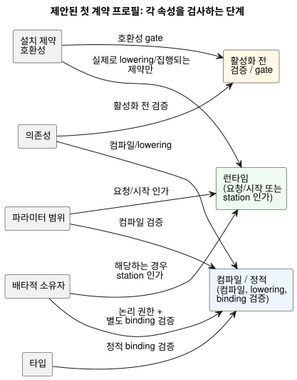
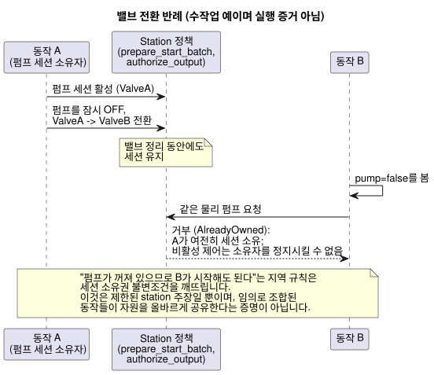

<!-- translation-source: docs/research/GF-COMPOSE-R5-CONTRACTS.md -->
[영문 원문](GF-COMPOSE-R5-CONTRACTS.md)

# GF-COMPOSE R5: 조합 계약과 진단

이 연구 노트는 동작(behavior)을 조합할 때 쓸 첫 계약 프로필을 제안합니다. 어떤 속성을
어느 단계에서 검사하는지, 각 검사가 정직하게 주장할 수 있는 것이 무엇인지, 실패를 농부와
엔지니어에게 어떻게 보고하는지 다룹니다.

이 문서의 구성:

- **사용자 문제** — 조합에 구체적이고 증거에 기반한 이유가 필요한 까닭.
- **조사한 revision의 증거** — 현재 도구, 문서, 런타임 코드가 확립한 것과 네 가지 증거
  종류.
- **표와 예** — 제안 프로필, 정확히 네 가지 진단 예, 밸브 전환 반례.
- **권고**, **미해결 질문과 소유자**, **검증**.

## 사용자 문제

동작들이 함께 존재할 수 없을 때 농부에게는 명확한 이유가 필요합니다. 엔지니어에게는
근거 없는 일괄적인 “안전” 결과가 아니라, 충돌하는 요구 사항, 영향받는 identity, 그리고
증거가 필요합니다.

이 문서는 조합을 위한 첫 계약 프로필을 제안합니다. 구현이 아니라 연구/설계입니다.

프로필은 다섯 가지 속성을 다룹니다.

- 타입
- 의존성
- 파라미터 범위
- 배타적 출력 소유권
- 설치 제약 호환성

범위 밖의 사항과 권한 경계:

- 더 넓은 공유 액추에이터 자원 중재는 #95에 남습니다.
- 실행 규칙은 정본 `.ghost.md` 소스가 소유합니다.
- 실행은 Rust 코어가 소유합니다.
- 설치 문맥과 배포는 외부 권한 경계로 남습니다.

## 조사한 revision의 증거

증거는 `ffdbc96461eca67908252507fb851fa4dabd9a2c`에서 조사했습니다. 런타임 테스트
스위트는 실행하지 않았습니다. R3와 R4 의존성 문서는 제안과 증거 요약으로 읽었으며, 그
문서들의 미해결 선택은 여기서도 미해결로 남습니다.

현재 증거가 확립하는 내용은 다음과 같습니다.

- **제약 컴파일러.** `compileConstraints`는 `exclusive`, 범위가 정해진 `require` 형식,
  독립형 `allow(enter/apply)` 형식, `limit on_time`, `once`, 차단하지 않는
  `check pump_capacity`를 받아들입니다. 지원하지 않는 식은 컴파일에 실패합니다
  ([`tools/constraints.mjs`](../../tools/constraints.mjs)).
- **`allow apply`의 역사적 위치.** 이것은 독립형 컴파일러의 과거 증거입니다. 언어
  레퍼런스는 `ghostrules` 파서를 위해 `allow enter(...)`를 유지하며, 이전의
  `allow apply(settings) ... Configure` 규칙은 승인된 live 속성 이벤트 결정으로
  대체되었다고 말합니다. [레퍼런스 §4.10](../reference/04-sensors-constraints-control.md#410-mode와-live-settings)을
  참고하십시오.
- **제약의 단계가 중요합니다.** 출력 관계는 최종 출력 후보에 적용되고, enter/apply 규칙은
  요청 진입 시점에 적용되며, 용량 검사는 새 작업의 인가 경로에 적용됩니다
  ([`docs/CONSTRAINTS.md`](../CONSTRAINTS.md)).
- **Station 시작 선택.** `prepare_start_batch`는 같은 tick의 snapshot 하나에서 가장
  작은 요청 ID를 선택합니다. 이것이 보편적인 조합 중재를 확립하지는 않습니다
  ([`station.rs`](../../crates/ghostflow-core/src/station.rs)).
- **Station 출력 인가.** `authorize_output`은 활성 세션을 요구하고, 밸브 소유권, 밸브
  개수, 밸브와 함께인 펌프의 안전성을 검증합니다. station은 물리 펌프 하나를 소유합니다.
  이것은 범위가 제한된 station 정책이지, 일반적인 동작 조합의 증명이 아닙니다.
- **통합 v1.** direction과 semantic type이 일치하는 정확한 논리 이름 바인딩을
  요구합니다. 독립적인 host, 하드웨어, 물리 gate는 증거로 결과를 확립할 수 없을 때
  `unknown`을 사용합니다. validator 통과는 물리적 인수가 아닙니다
  ([`contracts/integration-v1/README.md`](../../contracts/integration-v1/README.ko.md)).
- **소스 추적.** 소스 identity, 바인딩, 제약 인덱스, 런타임 관측을 결합합니다. 누락된
  필드는 관측되지 않은 상태로 남으며, 추적은 전기적·기계적 동작을 추론하지 않습니다
  ([`docs/SOURCE-SAFETY-TRACE.md`](../SOURCE-SAFETY-TRACE.ko.md)).
- **고정된 R2 경계와 열린 R2 경계.** R2의 system-memory #68은 이 문서에서 고정된
  경계입니다. 대화 memory는 provenance(출처)이자 작성 문맥이며, 실행 규칙이나 바인딩의
  권한이 아닙니다([R2: 권한과 identity](GF-COMPOSE-R2-AUTHORITY-IDENTITY.ko.md)). system
  #62 아래의 설치 제약 권한은 열려 있습니다. 관련 실행 제안과 그 한계는
  [R3: 조합 실행](GF-COMPOSE-R3-EXECUTION.ko.md)도 참고하십시오.

### 증거 종류

진단은 자신의 증거가 얼마나 강한지 말해야 합니다. 프로필은 네 가지 종류를 구분합니다.

| 종류 | 이 프로필에서의 의미 | 예 |
|---|---|---|
| 선언된 가정 | 계획을 위해 제공된 입력. 독립적으로 확립되지 않음 | 제안된 바인딩이 `MainPump`를 지정함 |
| 테스트된 속성 | 테스트나 기록된 gate가 명시된 범위의 결과를 확립함 | 통합 host gate가 참조와 함께 `pass`임 |
| 정적으로 확립된 속성 | 컴파일러나 validator가 범위가 정해진 구조적 사실을 증명함 | 필수 출력의 direction과 semantic type이 일치함 |
| 런타임에 집행되는 제약 | 실행 경로가 무효한 요청/출력을 거부하거나 차단함 | `authorize_output`이 밸브 없는 펌프 ON 출력을 거부함 |

프로필은 네 종류를 모두 보고할 수 있으며, 다음 한계가 있습니다.

- 가정이나 구조적 일치를 물리적 안전으로 격상해서는 안 됩니다.
- 누락된 설치 gate는 `pass`가 아니라 `unknown`입니다.
- 소스 추적 identity는 추적 가능성을 높이지만, 장치가 명령을 적용했다는 것을 증명하지
  않습니다.

## 표와 예

### 제안된 첫 계약 프로필

이 표는 속성별로 입력, 검사 단계, 뒷받침할 수 있는 주장, 그리고 지원되지 않거나 알 수
없는 채로 남는 것을 나열합니다.

| 속성 | 필요한 입력 | 검사 단계 | 뒷받침되는 주장 | 지원되지 않거나 알 수 없는 경우 |
|---|---|---|---|---|
| 타입 | 정본 manifest의 역할/타입, 프로필 endpoint의 direction/타입, 명시적 바인딩 | 정적 바인딩 검증 | 논리 역할이 제공된 endpoint와 구조적으로 호환됨 | 강제 변환, 아날로그 의미, 문서화되지 않은 드라이버 동작은 증명되지 않음 |
| 의존성 | 선언된 의존성 이름과 소스 추적 노드, 완전한 조합 입력 맵 | 컴파일/lowering 및 활성화 전 검증 | 기존 불변조건이 즉시 식 순환을 거부하고, 누락된 대상을 거부함 | 모듈 간 동일 스캔 lowering은 미해결. 기존 단계/next 참조 제한은 고정 |
| 파라미터 범위 | 선언된 정수/지속 시간 값, 프로필과 station 한계 | 컴파일 검증, 이어서 요청/시작 인가 | 값이 선언된 컴파일러/station 범위에 맞음. 유한한 할당량/예산 검사가 요청을 거부할 수 있음 | 물리 용량, 압력, 유량, 모델링되지 않은 파라미터 의미는 알 수 없음 |
| 배타적 소유자 | 논리 출력 ID, 명시적 endpoint 바인딩, 소유자/claim ID | 컴파일 시 논리 권한 검사, 별도의 바인딩 검증, 해당하는 경우 station 인가 | 출력 채널마다 권위 있는 정의가 하나. 중복 직접 작성자는 컴파일에 실패하고 배포될 수 없음 | 자동 해결기 없음. 기존에 선언된 station 자원 중재는 별개로 유지 |
| 설치 제약 호환성 | 고정된 보드/프로필 및 설치 revision, 독립적인 gate 증거, 제약 아티팩트 또는 권한 결정 | 활성화 전 호환성 gate. 런타임은 실제로 lowering/집행되는 제약에 대해서만 | 일치하는 identity와 명시적으로 호환되는 제약을 보고할 수 있음 | #62가 아티팩트/overlay/집행 권한을 선택하지 않음. 증거가 없으면 unknown |

다이어그램은 각 속성을 그것을 검사하는 단계에 대응시킵니다.

**“호환”의 범위는 의도적으로 한정되어 있습니다.** 검사한 요구 사항이 명시된 입력과
단계로 뒷받침된다는 뜻입니다. 설치 전체가 안전하다는 뜻이 아닙니다. 제약/소스 identity는
새로 만든 identity가 아니라, 소스와 바이트코드 digest를 포함한 기존 소스 추적 필드를
사용하는 것이 좋습니다.

**조합이 보존해야 하는 기존 실행 불변조건:**

- 즉시 식 순환은 거부됩니다. 이것은 열린 정책 선택이 아니라 기존 불변조건입니다.
- 상태 피드백은 이전 상태/다음 상태 경계를 넘어갑니다.
- 모든 전이는 하나의 입력/이전 상태 snapshot을 사용합니다.
- next 참조는 출력 식에서만 허용되며, 다른 next 전이나 let에서는 절대 허용되지 않습니다.
- 논리적 확정은 동시에 이루어집니다.

### 정확히 네 가지 진단 예

각 예에는 제안된 안정적 이유 코드, 농부용 메시지, 영향받는 ID, 증거, 그리고 필요한 결과
또는 수정 방법이 있습니다.

1. **배타적 펌프 소유자가 둘인 경우.**

   - 이유 코드: `GF-COMPOSE-EXCLUSIVE-OUTPUT`.
   - 농부용 메시지: “두 동작이 모두 같은 펌프를 필요로 합니다. 하나의 동작을
     선택하거나, 둘 다 적용하기 전에 별도의 펌프를 설치하십시오.”
   - 영향받는 ID: `irrigation.pump`, `fertigation.pump`, endpoint `MainPump`.
   - 증거: 선언된 배타적 소유자 요구 사항, 바인딩 revision과 endpoint identity, 두 출력
     의도에 대한 소스 추적 노드.
   - 필요한 결과: 중복된 권위 있는 출력 정의에 대해 컴파일을 실패시키고, 두 정의와
     영향받는 출력을 지목합니다. 후보는 배포될 수 없습니다. 소스 정의를 해결하십시오.
     endpoint를 따로 두는 것만으로는 하나의 논리 채널에 대한 두 작성자가 정당화되지
     않습니다. station 자원 요청은 별도로 중재됩니다.

2. **호환되지 않는 포트.**

   - 이유 코드: `GF-COMPOSE-PORT-INCOMPATIBLE`.
   - 농부용 메시지: “요청한 펌프가 동작에 필요한 출력 타입과 맞지 않는 포트에 연결되어
     있습니다. 호환되는 포트를 선택하거나 설치 기록을 수정하십시오.”
   - 영향받는 ID: 논리 역할 `irrigation.pump`, endpoint `DI-2`, 기대값 `output/Bool`,
     제공값 `input/Bool`.
   - 증거: 고정된 보드 프로필 revision, 설치 `bindingRevision`, validator의
     direction/타입 불일치.
   - 수정 방법: 역할을 사용되지 않은 일치하는 출력에 바인딩하거나, 프로필/설치 소유자가
     매핑을 수정합니다. 강제 변환은 함축되지 않습니다.

3. **누락된 의존성.**

   - 이유 코드: `GF-COMPOSE-DEPENDENCY-MISSING`.
   - 농부용 메시지: “이 동작에는 `water_ok`가 필요하지만, 제공된 동작이나 입력 중
     그것을 공급하는 것이 없습니다. 그 입력을 추가하거나 의존성을 제거하십시오.”
   - 영향받는 ID: 소비자 `irrigation.start`, 필요한 의존성 `water_ok`. 정본 소스
     span/노드는 컴파일된 소스 맵에 있을 때만 인용합니다. 조합 의존성 맵 노드는
     제안이며 현재 계약으로 확립되어 있지 않습니다.
   - 증거: 사용 가능한 경우 정본 소스의 선언/span과 조합 입력 맵. 사용할 수 없는 소스
     맵이나 추적 대상은 명시적으로 부재/미해결로 표시합니다. 노드나 provenance 기록을
     지어내지 마십시오.
   - 수정 방법: 명시적으로 바인딩된 `water_ok` 입력/결과를 제공하거나 소스를
     수정합니다. 같은 스캔 안의 결과 타이밍은 추론하지 않습니다.

4. **필요한 설치 증거를 알 수 없음.**

   - 이유 코드: `GF-COMPOSE-INSTALL-EVIDENCE-UNKNOWN`.
   - 농부용 메시지: “동작 요구 사항은 기록된 프로필과 일치하지만, 이 구성을 확인하는 데
     필요한 설치 증거가 없습니다. 시작하기 전에 설치 담당자에게 확인을 요청하십시오.”
   - 영향받는 ID: 제약 `SharedPump`, 설치 `site-a/rev-7`, endpoint 집합 `MainPump`,
     `ValveA`.
   - 증거: 고정된 프로필과 바인딩 identity는 존재합니다. 필요한 하드웨어 또는 물리 gate가
     `unknown`이거나 `not_run`이며, 자격을 갖춘 참조가 없습니다.
   - 수정 방법: 소유자의 현재 하드웨어/물리 증거를 확보하거나, 결과를 unknown으로 두고
     확인된 설치를 주장하지 않습니다.

### 밸브 전환 반례와 station 경계

이 반례는 수작업이며 실행 증거가 아닙니다. 지역 검사가 왜 조합의 보장이 아닌지
보여 줍니다.

1. 동작 A가 펌프 세션을 소유합니다.
2. `ValveA`에서 `ValveB`로 바꾸는 동안 A가 펌프를 잠시 OFF합니다.
3. 동작 B가 `pump=false`를 보고 같은 물리 펌프를 요청합니다.

“펌프가 꺼져 있으므로 B가 시작해도 된다”와 같은 지역 규칙은 세션 소유권 불변조건을
깨뜨립니다. 기존 station 정책은 밸브 정리 동안에도 세션을 명시적으로 유지하며, 비활성
제어가 소유자를 정지시킬 수 없다고 말합니다.

다이어그램은 station의 동작을 보여 줍니다. 조사한 revision에서 `prepare_start`는 세션이
활성인 동안 새 시작을 `AlreadyOwned`로 거부합니다. 따라서 host가 station 요청과 세션
상태를 제공할 때 `prepare_start_batch`와 `authorize_output`은 이 제한된 station 주장을
뒷받침합니다. 그러나 임의로 조합된 동작들이 자원을 올바르게 공유한다는 것을 증명하지는
않습니다.

다른 소유자에게 남는 일:

- 이슈 #95는 추가적인 공유 액추에이터 중재와 fallback을 정의할 수 있습니다. 이것이
  출력 채널의 단일 권위 정의 규칙을 다시 여는 것은 아닙니다.
- 이 문서는 중재기(arbiter)나 시간/정리 증명 엔진을 추가하지 않습니다.
- R2/#62는 설치 제약이 어디서 권위를 갖는지, 그 증거를 어떻게 제공하는지 결정해야
  합니다.

두 결정이 모두 검토되기 전까지 프로필은 지원되는 입력과 단계에 대해서만 호환성을
보고합니다.

## 권고

다음을 검토 가설로 채택합니다.

- 지원되는 타입, 의존성, 범위, 배타적 소유자 검사가 실패하면 활성화 전에 조합을
  거부합니다.
- 진단에 정확한 요구 사항과 증거 참조를 보존합니다.
- 설치 증거가 없으면 `unknown`을 사용합니다.
- 범위가 맞는 경우 기존 소스 추적 identity와 station 집행을 재사용합니다.
- 지역 검사로부터 전역 안전 결과, 물리적 인수, 우선순위, 중재를 주장하지 않습니다.

## 미해결 질문과 소유자

- **언어/컴파일러 소유자:** 기존 순환 규칙을 보존하는 조합 의존성 표현을 정의하고,
  안정적 이유 코드 레지스트리를 정의합니다. old/next 규칙과 단일 작성자 규칙을
  보존합니다. 모듈 간 동일 스캔 lowering은 미해결로 남습니다.
- **언어/런타임 ABI 소유자:** 진단 envelope를 정의하고, 인스턴스 ID, endpoint ID, 소스
  노드, 제약 인덱스, 증거 참조가 현재 ABI를 암묵적으로 바꾸지 않고 어떻게 결합되는지
  정의합니다.
- **System #62와 API/언어 소유자:** 설치 제약의 권한, 아티팩트 형태, 집행 단계를
  결정합니다. 이 문서는 의도적으로 하나를 선택하지 않습니다.
- **#95/station 소유자:** 추가적인 공유 자원 중재와 fallback을 정의합니다. 기존 station
  정책은 물리 펌프 station 하나로 범위가 제한되며, 일반화하지 말고 감사해야 합니다.
  이것이 하나의 출력 채널에 대한 여러 직접 작성자를 허용하는 것은 아닙니다.
- **API/통합 소유자:** 누락되거나 오래된(stale) 프로필, 바인딩, gate 증거를 어떻게
  갱신하고 승인할지 정의합니다. memory #68은 이를 승인할 수 없습니다.
- **Device/설치 소유자:** 물리적 인수와 적용된 바인딩의 증거를 제공합니다. host 검증은
  그런 사실을 확립할 수 없습니다.

## 검증

- [x] 조사한 revision을 `ffdbc96461eca67908252507fb851fa4dabd9a2c`로 기록했습니다.
- [x] `docs/CONSTRAINTS.md`, `station.rs`, `tools/constraints.mjs`,
  `docs/SOURCE-SAFETY-TRACE.md`, `contracts/integration-v1/README.md`의 해당 절을
  확인했습니다.
- [x] R3와 R4 의존성 결과를 읽었으며, 그 미해결 결정은 아키텍처 승인으로 취급하지 않고
  그대로 보존했습니다.
- [x] 표는 검사 단계와 증거 강도를 분리하고, 알 수 없는 증거는 지원되지 않는 것으로
  둡니다.
- [x] 정확히 네 가지 진단을 포함했습니다. 각 진단에는 제안된 안정적 코드, 농부용 메시지,
  영향받는 ID, 증거 참조, 수정 방법이 있습니다.
- [x] 밸브 전환 반례는 지역 보장의 한계를 밝히고, 정책 엔진을 추가하지 않고 후속 작업을
  #95와 R2/#62에 배정합니다.
- [x] 해당하는 예에는 수작업임을 표시했습니다. 런타임 또는 물리 실행을 주장하지 않으며,
  런타임 스위트는 실행하지 않았습니다.
