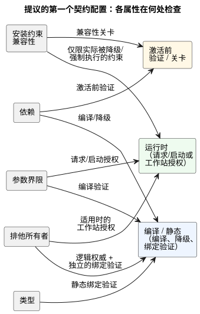
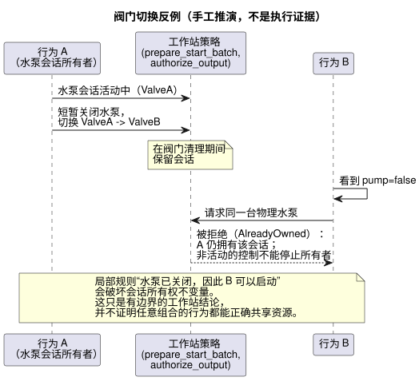

<!-- translation-source: docs/research/GF-COMPOSE-R5-CONTRACTS.md -->
[英文原文](GF-COMPOSE-R5-CONTRACTS.md)

# GF-COMPOSE R5：组合契约与诊断

本研究笔记为行为组合提出第一个契约配置（contract profile）：检查哪些属性、在哪个阶段检查、每项检查能如实支持什么结论，以及如何向农户和工程师报告失败。

本文内容：

- **用户问题** —— 为什么组合需要具体且有证据支撑的理由。
- **被检查修订版中的证据** —— 现有工具、文档和运行时代码确立了什么，以及四种证据类别。
- **表格与示例** —— 提议的配置、恰好四个诊断示例，以及阀门切换反例。
- **建议**、**未决问题与负责方**，以及 **验证**。

## 用户问题

当多个行为无法共存时，农户需要一个清楚的理由。工程师需要知道相互冲突的要求、受影响的身份标识以及证据——而不是一个缺乏依据的笼统“安全”结论。

本文定义一个提议的、用于组合的第一个契约配置。它属于研究/设计，而非实现。

该配置涵盖五项属性：

- 类型；
- 依赖；
- 参数界限；
- 排他的输出所有权；以及
- 安装约束兼容性。

范围之外及权威边界：

- 更广泛的共享执行器资源仲裁仍由 #95 负责。
- 规范的 `.ghost.md` 源拥有可执行规则。
- Rust 核心负责执行。
- 安装上下文和部署仍是外部的权威边界。

## 被检查修订版中的证据

证据检查基于 `ffdbc96461eca67908252507fb851fa4dabd9a2c`。没有运行任何运行时测试套件。R3 和 R4 依赖文档被作为提案和证据摘要阅读；其中未解决的选择在本文中仍然未解决。

当前证据确立了以下内容：

- **约束编译器。** `compileConstraints` 接受 `exclusive`、有界的 `require` 形式、独立的 `allow(enter/apply)` 形式、`limit on_time`、`once` 以及非阻塞的 `check pump_capacity`；不支持的表达式会导致编译失败（[`tools/constraints.mjs`](../../tools/constraints.mjs)）。
- **`allow apply` 的历史状态。** 这是来自独立编译器的历史证据。语言参考为 `ghostrules` 解析器保留了 `allow enter(...)`，并指出早先的 `allow apply(settings) ... Configure` 规则已被获批的 live 属性事件决定取代；参见[参考 §4.10](../reference/04-sensors-constraints-control.zh.md)。
- **约束阶段很重要。** 输出关系作用于最终的输出候选；enter/apply 规则作用于请求进入时；容量检查作用于新工作的授权路径（[`docs/CONSTRAINTS.md`](../CONSTRAINTS.zh.md)）。
- **工作站启动选择。** `prepare_start_batch` 从同一 tick 的一个快照中选择请求 ID 最小的请求。它并不确立通用的组合仲裁（[`station.rs`](../../crates/ghostflow-core/src/station.rs)）。
- **工作站输出授权。** `authorize_output` 要求存在活动会话，并验证阀门所有权、阀门数量以及“水泵必须伴随阀门”的安全条件。一个工作站拥有一台物理水泵；这是一项有边界的工作站策略，而不是对一般行为组合的证明。
- **Integration v1。** 它要求方向和语义类型都匹配的精确逻辑名称绑定。其独立的宿主、硬件和物理关卡（gate）在证据无法确立结果时使用 `unknown`；验证器通过不等于物理验收（[`contracts/integration-v1/README.md`](../../contracts/integration-v1/README.md)）。
- **源追踪（source trace）。** 它把源身份标识、绑定、约束索引和运行时观测关联起来。缺失的字段保持为未观测；该追踪不推断电气或机械运行情况（[`docs/SOURCE-SAFETY-TRACE.md`](../SOURCE-SAFETY-TRACE.zh.md)）。
- **已固定与仍开放的 R2 边界。** R2 系统记忆 #68 是本文的一条固定边界：对话记忆是来源（provenance）/编写上下文，而不是执行规则或绑定的权威（[R2：权威与身份标识](GF-COMPOSE-R2-AUTHORITY-IDENTITY.zh.md)）。系统 #62 下的安装约束权威仍然开放。相关的执行提案及其限制另见 [R3：组合执行](GF-COMPOSE-R3-EXECUTION.zh.md)。

### 证据类别

诊断必须说明其证据有多强。该配置区分四种类别：

| 类别 | 在本配置中的含义 | 示例 |
|---|---|---|
| 声明的假设 | 为规划而提供的输入，未经独立确立 | 某个提议绑定指定了 `MainPump` |
| 已测试属性 | 测试或记录在案的关卡确立了所述的、有范围限定的结果 | 某个集成宿主关卡为 `pass` 并附有引用 |
| 静态确立的属性 | 编译器或验证器证明了一个有边界的结构性事实 | 某个所需输出的方向和语义类型都匹配 |
| 运行时强制的约束 | 执行路径会拒绝或阻止无效的请求/输出 | `authorize_output` 拒绝“水泵开启但无阀门”的输出 |

该配置可以报告全部四种类别，但有以下限制：

- 不得把假设或结构匹配提升为物理安全。
- 缺失的安装关卡是 `unknown`，而不是 `pass`。
- 源追踪身份标识提高了可追溯性，但不能证明设备已经应用了命令。

## 表格与示例

### 提议的第一个契约配置

下表针对每项属性列出其输入、检查阶段、能够支持的结论，以及仍不受支持或未知的部分。

| 属性 | 所需输入 | 检查阶段 | 可支持的结论 | 不受支持或未知的情形 |
|---|---|---|---|---|
| 类型 | 规范清单中的角色/类型；配置文件端点的方向/类型；显式绑定 | 静态绑定验证 | 逻辑角色与所提供的端点在结构上兼容 | 强制转换、模拟量语义或未文档化的驱动程序行为未被证明 |
| 依赖 | 声明的依赖名称和源追踪节点；完整的组合输入映射 | 编译/降级（lowering）以及激活前验证 | 现有不变量拒绝瞬时表达式环；缺失的目标被拒绝 | 跨模块的同扫描降级仍未解决；现有的阶段/next 引用限制保持不变 |
| 参数界限 | 声明的整数/时长值；配置文件和工作站限制 | 编译验证，然后是请求/启动授权 | 值符合声明的编译器/工作站界限；有限的配额/预算检查可以拒绝请求 | 物理容量、压力、流量或未建模的参数语义仍然未知 |
| 排他所有者 | 逻辑输出 ID、显式端点绑定、所有者/声明 ID | 编译期逻辑权威检查；独立的绑定验证；适用时的工作站授权 | 每个输出通道只有一个权威定义；重复的直接写入者导致编译失败且无法部署 | 没有自动解析器；现有声明的工作站资源仲裁保持独立 |
| 安装约束兼容性 | 固定的板卡/配置文件和安装修订版；独立的关卡证据；约束制品或权威决定 | 激活前兼容性关卡；运行时仅针对实际被降级/强制执行的约束 | 可以报告匹配的身份标识和显式兼容的约束 | #62 尚未选定制品/叠加层/强制执行的权威；缺失的证据即为未知 |

下图将每项属性映射到检查它的一个或多个阶段。

**“兼容”的范围是刻意限定的。** 它表示所检查的要求得到了指定输入和阶段的支持。它并不表示整个安装是安全的。约束/源身份标识应使用现有的源追踪字段（包括源摘要和字节码摘要），而不是另行发明的身份标识。

**组合必须保持的现有执行不变量**：

- 瞬时表达式环被拒绝。这是现有的不变量，而不是开放的策略选择。
- 状态反馈跨越前一状态/下一状态边界。
- 所有转移都使用同一个输入/旧状态快照。
- next 引用只允许出现在输出表达式中，绝不能出现在其他 next 转移或 let 中。
- 逻辑提交是同时发生的。

### 恰好四个诊断示例

每个示例都包含一个提议的稳定原因代码、面向农户的消息、受影响的 ID、证据，以及要求的结果或纠正选项。

1. **两个排他的水泵所有者。**

   - 原因代码：`GF-COMPOSE-EXCLUSIVE-OUTPUT`。
   - 农户消息：“这两个行为都需要同一台水泵。请只选择其中一个行为，或者在同时应用两者之前另外安装一台水泵。”
   - 受影响的 ID：`irrigation.pump`、`fertigation.pump`，端点 `MainPump`。
   - 证据：声明的排他所有者要求；绑定修订版和端点身份标识；两个输出意图对应的源追踪节点。
   - 要求的结果：对重复的权威输出定义使编译失败，并指出两个定义及受影响的输出。该候选无法部署。应修正源定义；仅仅换一个不同的端点，并不能使同一逻辑通道上的两个写入者合法。工作站资源请求仍另行仲裁。

2. **不兼容的端口。**

   - 原因代码：`GF-COMPOSE-PORT-INCOMPATIBLE`。
   - 农户消息：“所请求的水泵连接到了一个与该行为所需输出类型不匹配的端口。请选择一个兼容的端口，或更正安装记录。”
   - 受影响的 ID：逻辑角色 `irrigation.pump`；端点 `DI-2`；期望 `output/Bool`，实际提供 `input/Bool`。
   - 证据：固定的板卡配置文件修订版、安装 `bindingRevision`，以及验证器报告的方向/类型不匹配。
   - 纠正选项：将该角色绑定到一个未使用且匹配的输出，或由配置文件/安装负责方更正映射。不意味着任何强制转换。

3. **缺失的依赖。**

   - 原因代码：`GF-COMPOSE-DEPENDENCY-MISSING`。
   - 农户消息：“此行为需要 `water_ok`，但所提供的行为或输入都没有提供它。请添加该输入或移除该依赖。”
   - 受影响的 ID：使用方 `irrigation.start`；所需依赖 `water_ok`；仅当已编译的源映射中存在时，才引用规范源的范围（span）/节点。组合依赖映射节点只是提议，并未由当前契约确立。
   - 证据：可用时提供规范源声明/范围以及组合输入映射；对任何不可用的源映射或追踪目标，显式标记为缺失/未解析。不得编造节点或来源记录。
   - 纠正选项：提供一个显式绑定的 `water_ok` 输入/结果，或修改源。不推断同扫描内的结果时序。

4. **所需安装证据未知。**

   - 原因代码：`GF-COMPOSE-INSTALL-EVIDENCE-UNKNOWN`。
   - 农户消息：“行为要求与记录的配置文件相符，但确认此设置所需的安装证据缺失。请在启动前让安装人员进行核实。”
   - 受影响的 ID：约束 `SharedPump`；安装 `site-a/rev-7`；端点集合 `MainPump`、`ValveA`。
   - 证据：固定的配置文件和绑定身份标识存在；所需的硬件或物理关卡为 `unknown` 或 `not_run`，且没有合格的引用。
   - 纠正选项：获取负责方当前的硬件/物理证据，或保持结果为未知，并且不声称安装已确认。

### 阀门切换反例与工作站边界

该反例是手工推演的，不是执行证据。它说明了为什么局部检查不是组合保证。

1. 行为 A 拥有一个水泵会话。
2. 在从 `ValveA` 切换到 `ValveB` 期间，A 短暂关闭水泵。
3. 行为 B 看到 `pump=false`，于是请求同一台物理水泵。

像“水泵已关闭，因此 B 可以启动”这样的局部规则会破坏会话所有权不变量。现有的工作站策略明确规定在阀门清理期间保留该会话，并指出非活动的控制不能停止所有者。

该图展示的是工作站的行为；在被检查的修订版中，当有会话处于活动状态时，`prepare_start` 会以 `AlreadyOwned` 拒绝新的启动。因此，当宿主提供工作站请求和会话状态时，`prepare_start_batch` 和 `authorize_output` 支持这一有边界的工作站结论。它们并不证明任意组合的行为都能正确共享资源。

留给其他负责方的事项：

- 议题 #95 可以定义额外的共享执行器仲裁和 fallback。这不会重新打开“一个输出通道只有一个权威定义”的规则。
- 本文不添加仲裁器，也不添加时序/定理证明引擎。
- R2/#62 必须决定安装约束在哪里具有权威性，以及其证据如何提供。

在这两项决定都经过评审之前，该配置只针对受支持的输入和阶段报告兼容性。

## 建议

将以下内容作为评审假设采纳：

- 当受支持的类型、依赖、界限或排他所有者检查失败时，在激活前拒绝该组合。
- 在诊断中保留确切的要求和证据引用。
- 对缺失的安装证据使用 `unknown`。
- 在范围相符时，复用现有的源追踪身份标识和工作站强制执行。
- 不要从局部检查中声称全局安全结果、物理验收、优先级或仲裁。

## 未决问题与负责方

- **语言/编译器负责方**： 定义一种保持现有环规则的组合依赖表示，并定义稳定的原因代码注册表。保持 old/next 和单一写入者规则；跨模块的同扫描降级仍未解决。
- **语言/运行时 ABI 负责方**： 定义诊断信封（envelope），以及实例 ID、端点 ID、源节点、约束索引和证据引用如何关联，而不隐式改变当前 ABI。
- **系统 #62 与 API/语言负责方**： 决定安装约束的权威、制品形式和强制执行阶段。本文刻意不作选择。
- **#95/工作站负责方**： 定义任何额外的共享资源仲裁和 fallback。现有的工作站策略仍局限于一个物理水泵工作站，必须经过审计，而不能被推广。这并不授权同一输出通道存在多个直接写入者。
- **API/集成负责方**： 定义缺失或过时（stale）的配置文件、绑定和关卡证据如何刷新与审批。记忆 #68 不能授权这些操作。
- **Device/安装负责方**： 提供物理验收和已应用绑定的证据。宿主验证无法确立这些事实。

## 验证

- [x] 已记录被检查的修订版：`ffdbc96461eca67908252507fb851fa4dabd9a2c`。
- [x] 已检查 `docs/CONSTRAINTS.md`、`station.rs`、`tools/constraints.mjs`、`docs/SOURCE-SAFETY-TRACE.md` 和 `contracts/integration-v1/README.md` 的相关章节。
- [x] 已阅读 R3 和 R4 依赖文档的结论；其中未解决的决定被保留，而没有被当作架构批准。
- [x] 表格将检查阶段与证据强度分开，并让未知证据保持为不受支持。
- [x] 恰好包含四个诊断。每个都有稳定的提议代码、农户消息、受影响的 ID、证据引用和纠正选项。
- [x] 阀门切换反例指出了局部保证的极限，并将后续工作分配给 #95 和 R2/#62，而没有添加策略引擎。
- [x] 适用之处均标注为手工推演的示例。没有声称任何运行时或物理执行；未运行运行时测试套件。
