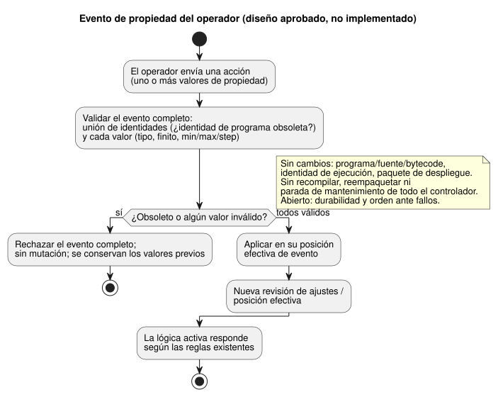

<!-- translation-source: docs/research/GF-COMPOSE-R6-OVERRIDES.md -->
[Original en inglés](GF-COMPOSE-R6-OVERRIDES.md)

# GF-COMPOSE R6: anulaciones e identidad del ciclo de vida

Esta nota de investigación separa las identidades que pueden cambiar durante la
vida de un comportamiento —fuente, programa compilado, ajustes, vinculación
(binding) de la instalación, paquete de despliegue y ejecución (run)— e indica
qué cambio afecta a cada identidad.

En este documento:

- **Problema del usuario**: por qué un cambio de ajustes no debe cambiar el
  cableado ni la lógica.
- **Evidencia en la revisión examinada**: la evidencia actual del compilador,
  los ajustes, el paquete y la interacción, más el diseño aprobado del evento
  de propiedades en vivo.
- **Tablas y ejemplos**: una matriz de cambios, tres ejemplos desarrollados y
  casos de rechazo y de unión obsoleta.
- **Conflicto con la especificación actual que requiere conciliación**: texto
  normativo anterior que el diseño aprobado sustituye.
- **Recomendación**, **Preguntas abiertas y responsables** y
  **Verificación**.

## Problema del usuario

Un agricultor que cambia el tiempo de riego no debe cambiar por accidente el
cableado ni la lógica del programa. Los ingenieros deben poder identificar el
contexto exacto de fuente, ajustes, instalación y despliegue que afectó a una
ejecución.

Este documento define un diseño acotado de identidad y validación. No
implementa superposiciones (overlays), mutación en vivo ni un nuevo formato de
despliegue.

## Evidencia en la revisión examinada

La evidencia se examinó en `ffdbc96461eca67908252507fb851fa4dabd9a2c`, el
`HEAD` del árbol de trabajo. Los números de línea citados abajo se refieren a
esa revisión.

**Dependencia de R2.** También se leyó el borrador actualizado de la
dependencia R2. Este documento conserva la distinción fijada por R2 entre
revisión de la fuente e instancia del comportamiento. La memoria conversacional
es procedencia/contexto de autoría, no autoridad automática sobre reglas de
ejecución ni sobre vinculaciones físicas. Este documento no elige ni resuelve
la frontera de restricciones de instalación que R2 dejó abierta.

**Compilador y control.**

- `tools/compile-source.mjs` acepta una única fuente canónica `.ghost.md` y
  registra el SHA-256 UTF-8 de la fuente, mientras que la salida del
  compilador lleva la procedencia del manifiesto/módulo.
- El compilador actual no expone una identidad general de composición ni de
  anulación.
- `tools/control.mjs` valida los literales de config, los metadatos del
  operador, los rangos y `apply: stopped`; reduce (lowers) los descriptores. No
  implementa un protocolo de superposición de ajustes.

**Asistente de ajustes actual = edición de la fuente.**
`createOperatingSettingsCandidate` en `tools/operating-settings.mjs` comprueba
un hash de fuente esperado, edita solo los tramos de literales de config
declarados y recompila un candidato. Por tanto, el comportamiento actual cambia
la identidad de la fuente y la compilada. Es un flujo de trabajo distinto de
edición de la fuente, no una ruta de ajustes en vivo.

**Diseño aprobado: eventos de propiedades en vivo.** La enmienda de diseño
aprobada por el usuario establece que los cambios de propiedades del operador
son eventos en vivo sobre el mismo programa y la misma ejecución:

- Una acción sobre varias propiedades es un único evento atómico.
- Se valida cada valor. Si algún valor es inválido, se rechaza el evento
  completo sin mutación. En caso contrario, se aplica en su posición efectiva de
  evento.
- La lógica activa puede responder según las reglas existentes.
- La identidad del programa/fuente/bytecode y de la ejecución no cambia; sí
  cambia la revisión de ajustes/posición efectiva.
- Los ajustes aceptados persisten tras un reinicio real del ESP, aunque ese
  reinicio crea una nueva identidad de ejecución.
- La durabilidad exacta y el orden ante fallos siguen sin resolverse.

Las propuestas de los responsables son [#89
Runtime Settings Overlay](https://github.com/callin2/ghostflow-language/issues/89)
y [#90 Periodic Schedule](https://github.com/callin2/ghostflow-language/issues/90),
inspeccionadas el 2026-09-20. Son evidencia de propuesta, no evidencia de
implementación.

El flujo siguiente muestra el comportamiento aprobado del evento de
propiedades. Es diseño, no una ruta de runtime implementada.

**Conflicto con documentos anteriores.** Este contrato aprobado de evento en
vivo entra en conflicto con el comportamiento documentado anteriormente
`apply: stopped` en [CONSTRAINTS](../CONSTRAINTS.es.md), líneas 179–204;
[LANGUAGE-SURFACE](../LANGUAGE-SURFACE.es.md), líneas 66–69;
[LANGUAGE](../LANGUAGE.es.md), líneas 460–461; y la propuesta #89 anterior.
Esos documentos siguen siendo el contrato anterior y requieren alineación; no
establecen un soporte actual de runtime en vivo. Las actualizaciones de
propiedades no reempaquetan, no recompilan ni provocan la parada de
mantenimiento de todo el controlador que se exige para las actualizaciones de
programa/firmware.

**Identidad del paquete y de la interacción.**

- El paquete portable vincula la fuente, el manifiesto generado, la
  compatibilidad de ejecución y `bindingRevision`, con un digest de la carga
  útil y firmas.
- El contrato de interacción v0 une el esquema, el
  documento/revisión/SHA de la fuente, la identidad del módulo y `runId`.
- `scanId` solo está ordenado dentro de una ejecución.
- Una unión obsoleta la deriva el validador; no la autodeclara una
  instantánea.

## Tablas y ejemplos

### Matriz de cambios

Cada fila es un tipo de cambio; cada columna es una identidad o un punto de
decisión.

| Cambio | Revisión de fuente/composición | Bytes/hash del programa compilado | Revisión de ajustes | Revisión de instalación | Paquete de despliegue | Identidad de ejecución | Punto de validación/aplicación |
|---|---|---|---|---|---|---|---|
| Parámetro de importación | Nueva revisión de fuente/composición si cambia la especialización ejecutable | Recompilar; los bytes/hash pueden cambiar | No es un ajuste de runtime | Instalación existente solo si es compatible | Nueva decisión de paquete/firma; formato sin cambios | Nueva ejecución tras el despliegue | Validación de compilación/importación; se aplica al seleccionar/desplegar el paquete |
| Evento de ajuste del operador | Misma revisión de fuente/composición | Bytes/hash del programa sin cambios; el asistente de edición de la fuente sigue aparte | Nueva revisión/digest de ajustes y posición efectiva de evento | Revisión de instalación sin cambios salvo que la política del host indique otra cosa | Sin reempaquetado automático; se conserva la autenticidad; el vínculo entre ajustes y firma sigue sin resolverse | Mismo programa y misma ejecución; efecto en vivo cuando se procesa el evento | Validar el evento completo de forma atómica; un evento inválido no produce mutación; el orden de durabilidad sigue sin resolverse |
| Reemplazo de dependencia | Nueva revisión de composición fijada a la revisión exacta de la dependencia | Normalmente se recompila; el hash debe registrarse | Nueva unión de ajustes si los valores predeterminados/ajustes difieren | Revalidar capacidades y vinculaciones | Nuevo paquete y nueva decisión de firma | Nueva ejecución | Validación del cierre de importación y de la compatibilidad antes del despliegue |
| Vinculación física RO3→RO8 | Revisión de fuente/composición sin cambios | Bytes/hash sin cambios | Revisión de ajustes sin cambios | Nueva revisión/digest de vinculación | Nuevo registro de paquete/aplicación; formato de firma sin cambios | Nueva ejecución o época de despliegue explícita | Device/API validan la capacidad lógica y aplican la vinculación; el responsable de la evidencia física sigue siendo Device |

Estado: solo la compilación de la fuente, las comprobaciones de candidatos de
literales, la identidad del paquete y las uniones de interacción anteriores son
evidencia actual. Las superposiciones sobre el mismo programa, el ciclo de vida
del reemplazo de dependencias y los resultados de aplicación de vinculaciones
son propuestas o contratos de responsables sin resolver.

El diagrama muestra cómo se relacionan estas identidades separadas. Observe que
un evento de ajustes en vivo se asocia a la ejecución existente, mientras que un
nuevo despliegue inicia una nueva ejecución.

### Ejemplos desarrollados

Son ejemplos de identidad elaborados a mano, no evidencia de ejecución.

1. **Riego de 10m → 5m.** Hay dos formas distintas de hacer este cambio:

   - *Editar el valor predeterminado de la fuente* es una revisión de la fuente
     y un cambio de SHA de la fuente, y puede cambiar los bytes/hash
     compilados. No es un evento de ajustes del operador.
   - *Un evento de propiedad en vivo válido*, en cambio, conserva los bytes del
     programa P, la identidad del programa y la identidad de la ejecución
     actual. Crea una nueva revisión de ajustes y una nueva posición efectiva.

   Por ejemplo, mientras está activo un intervalo de riego controlado por una
   regla, un evento atómico que cambia `duration` de `10min` a `5min` se aplica
   cuando se procesa. La regla existente se evalúa con ese ajuste efectivo y
   puede solicitar OFF en el nuevo instante calculado. No hay reescritura de la
   fuente, recompilación, paquete nuevo ni ejecución nueva. Si la misma acción
   también suministra una propiedad inválida, se rechaza el lote completo y se
   conservan todos los valores efectivos anteriores. El orden exacto del acuse
   de recibo durable y el vínculo entre ajustes y autenticidad siguen abiertos.

2. **El RainSensor opcional pasa a estar presente.** Reemplazar una dependencia
   ausente por la definición fijada de RainSensor cambia la revisión de
   composición/dependencias y, normalmente, los bytes/hash del programa
   compilado. Requiere validar capacidades y vinculaciones, una nueva decisión
   de paquete de despliegue y una nueva ejecución. Si la ausencia es una rama
   compilada válida o requiere dos variantes de fuente distintas sigue sin
   resolverse y corresponde a los responsables de composición/API; este
   documento no lo infiere.

3. **Vinculación de la bomba RO3 → RO8.** La identidad de la salida lógica y
   los bytes/hash del programa no cambian. Cambia la revisión/digest de la
   vinculación de la instalación, y el registro del paquete o de la aplicación
   debe reflejar ese cambio. La nueva ejecución debe unirse a la nueva revisión
   de vinculación. La evidencia de Device debe demostrar el endpoint aplicado;
   este repositorio del lenguaje no puede afirmar que RO8 se haya accionado
   físicamente.

### Ejemplos de rechazo y de unión obsoleta

- **Valor inválido.** Una Duration suministrada como cadena, un valor no finito
  o un valor fuera del min/max/step declarado invalida todo el evento de
  propiedades antes de la mutación. La evidencia actual del asistente cubre las
  comprobaciones de candidatos de fuente; la validación de eventos en vivo es un
  requisito de aceptación propuesto, no evidencia implementada.
- **Identidad de programa obsoleta.** Los ajustes que llevan una identidad
  antigua de fuente/programa se rechazan por obsoletos. Una revisión de ajustes
  no puede asociarse a otra revisión de la fuente, huella de módulo o digest de
  bytecode. El registro de transmisión exacto de los ajustes sigue sin
  resolverse.
- **Instantánea de una ejecución antigua.** La unión de interacción rechaza una
  instantánea de una ejecución antigua incluso cuando su `scanId` es igual al
  `scanId=0` de la nueva ejecución. Las identidades de esquema, fuente, módulo
  y ejecución deben coincidir con los valores esperados; `stale` es una salida
  del validador.

## Conflicto con la especificación actual que requiere conciliación

El diseño aprobado de eventos en vivo sustituye el comportamiento anterior de
Configure con parada que se documenta actualmente en
[CONSTRAINTS](../CONSTRAINTS.es.md), sección «Stopped settings apply behavior»
(líneas 179–204 en la revisión examinada, el ejemplo titulado «운전 설정은
정지한 설정 모드에서만 적용», es decir, «los ajustes operativos solo se
aplican en el modo de configuración detenido»);
[LANGUAGE-SURFACE](../LANGUAGE-SURFACE.es.md), líneas 66–69; y
[LANGUAGE](../LANGUAGE.es.md), líneas 460–461. Esos documentos normativos no
han cambiado por ello, y no se afirma un soporte actual en runtime. La
[propuesta #89](https://github.com/callin2/ghostflow-language/issues/89)
anterior también especifica la aplicación con parada/nueva ejecución. Concilie
ese contrato y la documentación normativa con la enmienda aprobada; no trate
esta nota de diseño como prueba de que el mecanismo en vivo exista.

Resumen del estado:

- Los ajustes de runtime en vivo son un diseño aprobado por el usuario, no una
  capacidad implementada.
- Deben conciliarse el contrato anterior de Configure con parada y la propuesta
  #89 de parada/nueva ejecución.
- El mecanismo/ABI, el orden de durabilidad, la verificación y la alineación de
  la especificación normativa siguen abiertos.
- Las programaciones parametrizadas de #90 siguen siendo una propuesta del
  responsable.
- Ni esas incidencias ni esta investigación establecen el reemplazo de
  dependencias ni la aplicación física.
- Los cambios derivados de la memoria deben enlazarse mediante una decisión
  confirmada y las revisiones de fuente/ajustes/instalación; una memoria
  obsoleta o sustituida no debe actualizar en silencio los ajustes activos.

## Recomendación

Usar un registro tipado de eventos de ajustes con identidades separadas para:

- la revisión de fuente/composición;
- la identidad del programa compilado;
- la revisión de ajustes/posición efectiva;
- la revisión de instalación/vinculación;
- la identidad del paquete de despliegue; y
- la identidad de ejecución.

Aplicar estas reglas:

- Tratar la especialización por importación como generadora de un programa
  nuevo.
- Tratar los cambios aprobados de propiedades del operador como eventos en vivo
  atómicos sobre el mismo programa/ejecución.
- Mantener la edición/recompilación de la fuente y la parada de mantenimiento
  de programa/firmware de todo el controlador separadas de la aplicación de
  eventos de propiedades.
- Validar las uniones en las fronteras aplicables y derivar el estado obsoleto
  durante la validación.

No elegir aquí un nuevo formato de paquete, ABI, runtime, motor de
almacenamiento ni autoridad canónica. Conservar la frontera de restricciones de
instalación que R2 dejó abierta.

## Preguntas abiertas y responsables

- Responsables de API/runtime de
  [#89](https://github.com/callin2/ghostflow-language/issues/89): definir el
  registro de eventos de ajustes, el digest/revisión/posición efectiva, el
  mecanismo/ABI, la unión con la autenticidad del paquete y el orden exacto
  ante fallos de persistencia/acuse de recibo. El comportamiento en vivo en la
  misma ejecución está aprobado; no lo reabra como una pregunta de elección del
  usuario.
- Responsable de [#90](https://github.com/callin2/ghostflow-language/issues/90):
  definir la identidad de las programaciones parametrizadas y si los parámetros
  de programación son especialización de la fuente o ajustes de runtime.
- Responsables de composición/API: definir la semántica del reemplazo de
  dependencias y de las dependencias opcionales, incluido el comportamiento de
  RainSensor ausente frente a presente.
- Responsables de Device/API: definir la evidencia de aplicación de la
  vinculación y la época de despliegue; no inferir el éxito físico a partir de
  un digest de paquete.
- Responsable de sistema/instalación con los responsables de lenguaje/API:
  resolver la alternativa de R2 entre un artefacto de restricciones separado y
  una revisión explícita de frontera entre proyectos. Esto sigue sin resolverse
  y no es un mecanismo de anulación elegido aquí.
- Responsable de memoria operativa de API/sistema: definir el linaje y el
  enlace con decisiones de los cambios derivados de la memoria, además del
  comportamiento de retención/exportación/borrado y si el borrado deja una
  lápida (tombstone)/digest de procedencia. Siguen siendo preguntas de R2, no
  una concesión de autoridad a la memoria ni una implementación de ajustes de
  R6.
- Responsable del contrato: ampliar la identidad de interacción para las
  uniones de instancia/ajustes/vinculación sin reemplazar el `runId` existente
  ni redefinir `scanId`.

## Verificación

- [x] Revisión inspeccionada registrada: `ffdbc96461eca67908252507fb851fa4dabd9a2c`.
- [x] Se leyeron secciones específicas del compilador, control, ajustes
  operativos, paquete e interacción, además del borrador completo de la
  dependencia R2.
- [x] La matriz de cuatro filas incluye todas las identidades y puntos de
  aplicación solicitados, con el estado actual/propuesto/sin resolver indicado.
- [x] Los ejemplos distinguen los valores predeterminados de la fuente, los
  ajustes de runtime, las dependencias y las vinculaciones. Se reconocen los
  efectos sobre la firma del paquete sin elegir un formato.
- [x] Los ejemplos de rechazo cubren valores inválidos, ajustes de programa
  obsoletos e instantáneas de ejecuciones antiguas. No se ejecutó ni se afirma
  ninguna batería de pruebas de runtime.

Las comprobaciones de aceptación del coordinador son `git diff --check`, la
inspección de enlaces relativos y la confirmación de que no cambió ningún
archivo fuente. Este documento no contiene ninguna afirmación de ejecución ni
de resultado físico.
