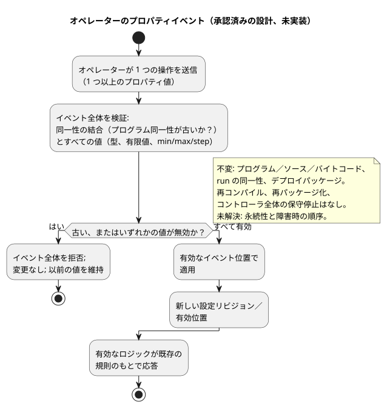
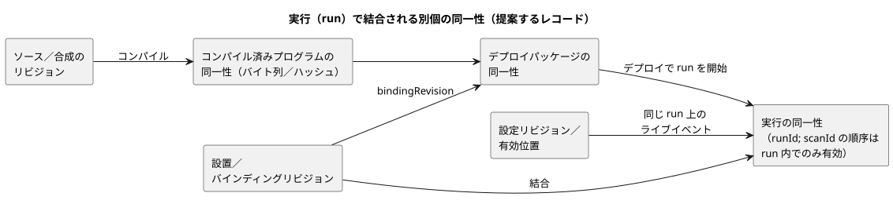

<!-- translation-source: docs/research/GF-COMPOSE-R6-OVERRIDES.md -->
[英語の原文](GF-COMPOSE-R6-OVERRIDES.md)

# GF-COMPOSE R6：オーバーライドとライフサイクルの同一性

この調査ノートは、振る舞いのライフサイクルの中で変わりうる同一性 — ソース、コンパイル済みプログラム、設定、設置のバインディング、デプロイパッケージ、実行（run） — を分離し、どの変更がどの同一性に影響するのかを示します。

この文書の内容：

- **ユーザーの課題** — 設定の変更が配線やロジックを変えてはならない理由。
- **調査したリビジョンでの証拠** — 現在のコンパイラ、設定、パッケージ、インタラクションの証拠と、承認済みのライブプロパティイベントの設計。
- **表と例** — 変更マトリクス、3 つの具体例、拒否／古い結合（stale join）のケース。
- **調整が必要な現行仕様との矛盾** — 承認済みの設計によって置き換えられる、以前の規範的な記述。
- **推奨事項**、**未解決の問題と担当オーナー**、**検証**。

## ユーザーの課題

灌水時間を変更する農家が、誤って配線やプログラムのロジックを変えてしまってはなりません。エンジニアは、ある run に影響した正確なソース、設定、設置、デプロイの文脈を特定できなければなりません。

この文書は、範囲を限定した同一性と検証の設計を定義します。オーバーレイ、ライブでの変更、新しいデプロイ形式を実装するものではありません。

## 調査したリビジョンでの証拠

証拠は、作業ツリーの `HEAD` である `ffdbc96461eca67908252507fb851fa4dabd9a2c` で調査しました。以下で引用する行番号はそのリビジョンのものです。

**R2 への依存。** 更新された R2 の依存ドラフトも読みました。この文書は、ソースリビジョンと振る舞いのインスタンスを区別するという、R2 で確定した区別を保持します。会話のメモリは来歴／オーサリングの文脈であり、実行規則や物理バインディングの自動的な権限ではありません。R2 で未解決の設置制約の境界は、この文書では選択も決着もしません。

**コンパイラと制御。**

- `tools/compile-source.mjs` は 1 つの正本の `.ghost.md` ソースを受け付け、ソースの UTF-8 SHA-256 を記録します。コンパイラの出力はマニフェスト／モジュールの来歴を保持します。
- 現在のコンパイラは、一般的な合成やオーバーライドの同一性を公開していません。
- `tools/control.mjs` は、config リテラル、オペレーター向けメタデータ、範囲、`apply: stopped` を検証し、ディスクリプタをロワリングします。設定オーバーレイのプロトコルは実装していません。

**現在の設定ヘルパー＝ソースの編集。** `tools/operating-settings.mjs` の `createOperatingSettingsCandidate` は、期待されるソースハッシュを検査し、宣言された config リテラルのスパンだけを編集して、候補を再コンパイルします。したがって、現在の振る舞いはソースとコンパイル済みの同一性を変えます。これはライブ設定の経路ではなく、別個のソース編集のワークフローです。

**承認済みの設計：ライブプロパティイベント。** ユーザーが承認した設計修正では、オペレーターによるプロパティの変更は、同じプログラムと run の上のライブイベントです。

- 複数のプロパティを扱う 1 つの操作は、1 つのアトミックなイベントです。
- すべての値を検証します。いずれかの値が無効なら、変更を一切加えずにイベント全体を拒否します。そうでなければ、有効なイベント位置で適用します。
- 有効なロジックは、既存の規則のもとで応答できます。
- プログラム／ソース／バイトコードと run の同一性は変わりません。変わるのは設定リビジョン／有効位置です。
- 受け入れられた設定は ESP の実際の再起動をまたいで保持されますが、その再起動は新しい run の同一性を作ります。
- 正確な永続性と障害時の順序は未解決のままです。

オーナーの提案は [#89
Runtime Settings Overlay](https://github.com/callin2/ghostflow-language/issues/89)
と [#90 Periodic Schedule](https://github.com/callin2/ghostflow-language/issues/90)
で、2026-09-20 に確認しました。これらは提案の証拠であり、実装の証拠ではありません。

以下のフローは、承認済みのプロパティイベントの振る舞いを示します。これは設計であり、実装済みのランタイム経路ではありません。

**以前の文書との矛盾。** この承認済みのライブイベントの契約は、[CONSTRAINTS](../CONSTRAINTS.ja.md) の 179–204 行目、[LANGUAGE-SURFACE](../LANGUAGE-SURFACE.ja.md) の 66–69 行目、[LANGUAGE](../LANGUAGE.ja.md) の 460–461 行目、および以前の #89 の提案に記載された、従来の `apply: stopped` の振る舞いと矛盾します。これらの文書は以前の契約のままであり、整合させる必要があります。現在のライブランタイムのサポートを確立するものではありません。プロパティの更新は、再パッケージ化も再コンパイルも行わず、プログラム／ファームウェアの更新に必要なコントローラ全体の保守停止も引き起こしません。

**パッケージとインタラクションの同一性。**

- ポータブルパッケージは、ソース、生成されたマニフェスト、実行の互換性、`bindingRevision` を、ペイロードのダイジェストと署名とともに結び付けます。
- インタラクション v0 の契約は、スキーマ、ソース文書／リビジョン／SHA、モジュールの同一性、`runId` を結合します。
- `scanId` の順序は 1 つの run の中でのみ有効です。
- 古い結合（stale join）はバリデータが導出するものであり、スナップショット自身が宣言するものではありません。

## 表と例

### 変更マトリクス

各行は変更の種類、各列は同一性または決定点です。

| 変更 | ソース／合成のリビジョン | コンパイル済みプログラムのバイト列／ハッシュ | 設定リビジョン | 設置リビジョン | デプロイパッケージ | run の同一性 | 検証／適用の時点 |
|---|---|---|---|---|---|---|---|
| インポートパラメータ | 実行可能な特殊化を変える場合は新しいソース／合成のリビジョン | 再コンパイル。バイト列／ハッシュが変わりうる | ランタイム設定ではない | 互換性がある場合にのみ既存の設置 | 新しいパッケージ／署名の決定。形式は不変 | デプロイ後に新しい run | コンパイル／インポートの検証。パッケージの選択／デプロイ時に適用 |
| オペレーターの設定イベント | 同じソース／合成のリビジョン | プログラムのバイト列／ハッシュは不変。ソース編集ヘルパーは別個のまま | 新しい設定リビジョン／ダイジェストと有効なイベント位置 | ホストのポリシーが別に定めない限り設置リビジョンは不変 | 自動的な再パッケージ化はない。真正性を保持。設定と署名の結び付けは未解決 | 同じプログラムと run。イベントの処理時にライブで反映 | イベント全体をアトミックに検証。無効なイベントは変更なし。永続性の順序は未解決 |
| 依存関係の置換 | 正確な依存関係リビジョンに固定した新しい合成リビジョン | 通常は再コンパイル。ハッシュを記録しなければならない | 既定値／設定が異なれば新しい設定の結合 | ケイパビリティとバインディングを再検証 | 新しいパッケージと署名の決定 | 新しい run | デプロイ前にインポート閉包と互換性を検証 |
| 物理バインディング RO3→RO8 | ソース／合成のリビジョンは不変 | バイト列／ハッシュは不変 | 設定リビジョンは不変 | 新しいバインディングリビジョン／ダイジェスト | 新しいパッケージ／適用レコード。署名形式は不変 | 新しい run または明示的なデプロイエポック | Device/API が論理ケイパビリティを検証してバインディングを適用。物理的な証拠のオーナーは引き続き Device |

状態：上記のうち、ソースのコンパイル、リテラル候補の検査、パッケージの同一性、インタラクションの結合だけが現在の証拠です。同一プログラムのオーバーレイ、依存関係置換のライフサイクル、バインディング適用の結果は、提案または未解決のオーナー契約です。

次の図は、これらの別個の同一性がどのように関係するかを示します。ライブの設定イベントは既存の run に付属し、新しいデプロイは新しい run を開始することに注意してください。

### 具体例

これらは手作業による同一性の例であり、実行の証拠ではありません。

1. **灌水 10 分 → 5 分。** この変更には 2 つの異なる方法があります。

   - *ソースの既定値を編集する*のはソースリビジョンとソース SHA の変更であり、コンパイル済みのバイト列／ハッシュを変える可能性があります。これはオペレーターの設定イベントではありません。
   - *有効なライブプロパティイベント*は、代わりにプログラム P のバイト列、プログラムの同一性、現在の run の同一性を保持します。新しい設定リビジョンと有効位置を作ります。

   たとえば、規則で制御される灌水区間が有効な間に、`duration` を `10min` から `5min` に変えるアトミックなイベントは、処理された時点で適用されます。既存の規則はその有効な設定のもとで評価され、新たに計算された時刻に OFF を要求する場合があります。ソースの書き換え、再コンパイル、新しいパッケージ、新しい run はいずれも発生しません。同じ操作に無効なプロパティも含まれている場合は、バッチ全体を拒否し、以前の有効値をすべて保持します。永続的な応答（acknowledgement）の正確な順序と、設定と真正性の結び付けは未解決のままです。

2. **オプションの RainSensor が存在するようになる。** 欠落している依存関係を、固定された RainSensor の定義で置き換えると、合成／依存関係のリビジョンが変わり、通常はコンパイル済みプログラムのバイト列／ハッシュも変わります。ケイパビリティとバインディングの検証、新しいデプロイパッケージの決定、新しい run が必要です。欠落を有効なコンパイル済みの分岐とするのか、2 つの別個のソースの変種を必要とするのかは未解決であり、合成／API オーナーの担当です。この文書はそれを推論しません。

3. **ポンプのバインディング RO3 → RO8。** 論理出力の同一性とプログラムのバイト列／ハッシュは変わりません。設置のバインディングリビジョン／ダイジェストが変わり、パッケージまたは適用レコードはその変更を認識しなければなりません。新しい run は新しいバインディングリビジョンと結合しなければなりません。適用されたエンドポイントは Device の証拠で証明しなければなりません。この言語リポジトリは、RO8 が物理的に作動したと主張することはできません。

### 拒否と古い結合の例

- **無効な値。** 文字列として与えられた Duration、有限でない値、宣言された min/max/step の範囲外の値は、変更が行われる前にプロパティイベント全体を無効にします。現在のヘルパーの証拠はソース候補の検査を対象としています。ライブイベントの検証は提案された受け入れ要件であり、実装の証拠ではありません。
- **古いプログラムの同一性。** 古いソース／プログラムの同一性を持つ設定は、古い（stale）ものとして拒否されます。設定リビジョンを、別のソースリビジョン、モジュールのフィンガープリント、バイトコードのダイジェストに付けることはできません。正確な設定のワイヤレコードは未解決です。
- **古い run のスナップショット。** 古い run のスナップショットは、その `scanId` が新しい run の `scanId=0` と等しい場合でも、インタラクションの結合によって拒否されます。スキーマ、ソース、モジュール、run の同一性は期待値と一致しなければなりません。`stale` はバリデータの出力です。

## 調整が必要な現行仕様との矛盾

承認済みのライブイベントの設計は、現在 [CONSTRAINTS](../CONSTRAINTS.ja.md) の「Stopped settings apply behavior」の節（調査したリビジョンでは 179–204 行目、見出し「운전 설정은 정지한 설정 모드에서만 적용」の例）、[LANGUAGE-SURFACE](../LANGUAGE-SURFACE.ja.md) の 66–69 行目、[LANGUAGE](../LANGUAGE.ja.md) の 460–461 行目に記載されている、従来の停止中 Configure の振る舞いを置き換えます。これによってそれらの規範文書が変わったわけではなく、現在のランタイムでのサポートも主張しません。以前の [#89 の提案](https://github.com/callin2/ghostflow-language/issues/89) も、停止中／新しい run での適用を規定しています。その契約と規範文書を承認済みの修正と整合させてください。この設計ノートを、ライブの仕組みが存在する証明として扱ってはなりません。

状態のまとめ：

- ライブのランタイム設定は、ユーザーが承認した設計であり、実装済みの機能ではありません。
- 従来の停止中 Configure の契約と、#89 の停止中／新しい run の提案は整合させなければなりません。
- 仕組み／ABI、永続性の順序、検証、規範仕様との整合は未解決のままです。
- #90 のパラメータ化されたスケジュールは、引き続きオーナーの提案です。
- 依存関係の置換と物理的な適用は、それらの issue でもこの調査でも確立されていません。
- メモリに由来する変更は、確認済みの決定とソース／設定／設置のリビジョンを通じて結び付けなければなりません。古い、または置き換えられたメモリが、有効な設定を黙って更新してはなりません。

## 推奨事項

次の項目に別個の同一性を持つ、型付きの設定イベントレコードを使います。

- ソース／合成のリビジョン
- コンパイル済みプログラムの同一性
- 設定リビジョン／有効位置
- 設置／バインディングのリビジョン
- デプロイパッケージの同一性
- run の同一性

次の規則を適用します。

- インポートの特殊化は、新しいプログラムを生み出すものとして扱います。
- 承認済みのオペレーターによるプロパティの変更は、同じプログラム／run の上のアトミックなライブイベントとして扱います。
- ソースの編集／再コンパイルと、コントローラ全体のプログラム／ファームウェアの保守停止は、プロパティイベントの適用とは分けておきます。
- 該当する境界で結合を検証し、古い状態（stale）は検証の中で導出します。

ここでは、新しいパッケージ形式、ABI、ランタイム、ストレージエンジン、正本の権限を選びません。R2 で未解決の設置制約の境界は保持します。

## 未解決の問題と担当オーナー

- [#89](https://github.com/callin2/ghostflow-language/issues/89) の API／ランタイムオーナー：設定イベントのレコード、ダイジェスト／リビジョン／有効位置、仕組み／ABI、パッケージの真正性との結合、正確な永続化／応答の障害時の順序を定義します。同一 run でのライブの振る舞いは承認済みであり、ユーザーの選択の問題として蒸し返してはなりません。
- [#90](https://github.com/callin2/ghostflow-language/issues/90) のオーナー：パラメータ化されたスケジュールの同一性と、スケジュールのパラメータがソースの特殊化なのかランタイム設定なのかを定義します。
- 合成／API オーナー：依存関係の置換とオプションの依存関係のセマンティクスを定義します。RainSensor の欠落と存在の振る舞いも含みます。
- Device／API オーナー：バインディング適用の証拠とデプロイエポックを定義します。パッケージのダイジェストから物理的な成功を推論してはなりません。
- システム／設置オーナー（言語／API オーナーと共同）：R2 の、別個の制約成果物か、プロジェクトをまたぐ明示的な境界リビジョンかという問題を解決します。これは未解決のままであり、ここで選ぶオーバーライドの仕組みではありません。
- API／システムの運用メモリのオーナー：メモリに由来する変更の系譜と決定の結び付け、さらに保持／エクスポート／削除の振る舞いと、削除が来歴のトゥームストーン／ダイジェストを残すかどうかを定義します。これらは R2 の問題であり、メモリへの権限付与や R6 の設定の実装ではありません。
- 契約のオーナー：既存の `runId` を置き換えたり `scanId` を再定義したりせずに、インスタンス／設定／バインディングの結合のためにインタラクションの同一性を拡張します。

## 検証

- [x] 調査したリビジョンを記録：`ffdbc96461eca67908252507fb851fa4dabd9a2c`。
- [x] コンパイラ、制御、運用設定、パッケージ、インタラクションの該当箇所と、完成した R2 の依存ドラフトを読みました。
- [x] 4 行のマトリクスには、要求されたすべての同一性と適用の時点が含まれ、現在／提案／未解決の状態が記載されています。
- [x] 例は、ソースの既定値、ランタイム設定、依存関係、バインディングを区別しています。パッケージの署名への影響は、形式を選ばずに認めています。
- [x] 拒否の例は、無効な値、古いプログラムの設定、古い run のスナップショットを扱っています。ランタイムのテストスイートは実行しておらず、実行したとも主張していません。

コーディネーターの受け入れ検査は、`git diff --check`、相対リンクの確認、ソースファイルが変更されていないことの確認です。この文書には、実行や物理的な結果についての主張は含まれていません。
