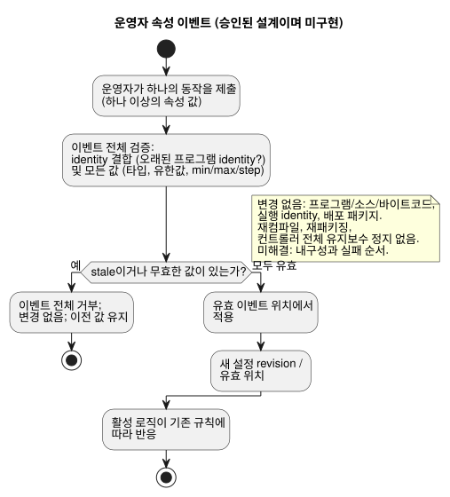
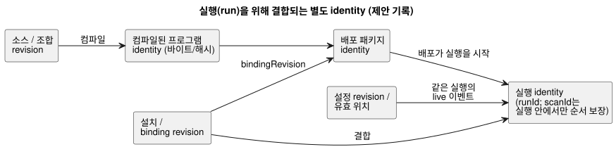

<!-- translation-source: docs/research/GF-COMPOSE-R6-OVERRIDES.md -->
[영문 원문](GF-COMPOSE-R6-OVERRIDES.md)

# GF-COMPOSE R6: override와 생애주기 identity

이 연구 노트는 동작(behavior)의 생애 동안 바뀔 수 있는 identity — 소스, 컴파일된
프로그램, 설정, 설치 바인딩, 배포 패키지, 실행(run) — 를 분리하고, 어떤 변경이 어떤
identity에 영향을 주는지 정리합니다.

이 문서의 구성:

- **사용자 문제** — 설정 변경이 배선이나 로직을 바꾸어서는 안 되는 이유.
- **조사한 revision의 증거** — 현재 컴파일러, 설정, 패키지, 상호작용 증거와 승인된 live
  속성 이벤트 설계.
- **표와 예** — 변경 매트릭스, 세 가지 풀이 예, 거부/stale 결합 사례.
- **조정이 필요한 현재 명세 충돌** — 승인된 설계가 대체하는 이전의 규범 문서.
- **권고**, **미해결 질문과 소유자**, **검증**.

## 사용자 문제

관수 시간을 바꾸는 농부가 실수로 배선이나 프로그램 로직을 바꾸어서는 안 됩니다.
엔지니어는 어떤 실행에 영향을 준 정확한 소스, 설정, 설치, 배포 문맥을 식별할 수 있어야
합니다.

이 문서는 범위가 한정된 identity 및 검증 설계를 정의합니다. overlay, live 변경, 새 배포
형식을 구현하지 않습니다.

## 조사한 revision의 증거

증거는 작업 트리 `HEAD`인 `ffdbc96461eca67908252507fb851fa4dabd9a2c`에서 조사했습니다.
아래에서 인용하는 줄 번호는 그 revision 기준입니다.

**R2 의존성.** 갱신된 R2 의존성 초안도 읽었습니다. 이 문서는 소스 revision과 동작
인스턴스를 구분하는 R2의 고정된 구분을 보존합니다. 대화 memory는 provenance(출처)이자
작성 문맥이며, 자동 실행 규칙의 권한이나 물리 바인딩의 권한이 아닙니다. R2의 미해결
설치 제약 경계는 이 문서에서 선택하거나 확정하지 않습니다.

**컴파일러와 제어.**

- `tools/compile-source.mjs`는 하나의 정본 `.ghost.md` 소스를 받아 소스의 UTF-8 SHA-256을
  기록하고, 컴파일러 출력은 manifest/모듈 provenance를 담습니다.
- 현재 컴파일러는 일반적인 조합 identity나 override identity를 노출하지 않습니다.
- `tools/control.mjs`는 config 리터럴, 운영자 메타데이터, 범위, `apply: stopped`를
  검증하고 descriptor를 lowering합니다. 설정 overlay 프로토콜은 구현하지 않습니다.

**현재 설정 도우미 = 소스 편집.** `tools/operating-settings.mjs`의
`createOperatingSettingsCandidate`는 기대하는 소스 해시를 확인하고, 선언된 config 리터럴
span만 편집한 뒤 후보를 재컴파일합니다. 따라서 현재 동작은 소스와 컴파일된 identity를
바꿉니다. 이것은 live 설정 경로가 아니라 별개의 소스 편집 워크플로입니다.

**승인된 설계: live 속성 이벤트.** 사용자가 승인한 설계 수정은, 운영자의 속성 변경이 같은
프로그램과 같은 실행 위에서 일어나는 live 이벤트라는 것입니다.

- 여러 속성을 바꾸는 하나의 동작은 하나의 원자적 이벤트입니다.
- 모든 값을 검증합니다. 하나라도 무효하면 이벤트 전체를 변경 없이 거부합니다. 그렇지
  않으면 유효 이벤트 위치에서 적용합니다.
- 활성 로직은 기존 규칙에 따라 반응할 수 있습니다.
- 프로그램/소스/바이트코드와 실행 identity는 바뀌지 않으며, 설정 revision/유효 위치가
  바뀝니다.
- 받아들여진 설정은 실제 ESP 재시작 후에도 유지되며, 그 재시작은 새 실행 identity를
  만듭니다.
- 정확한 내구성과 실패 순서는 미해결로 남습니다.

소유자 제안은 [#89
Runtime Settings Overlay](https://github.com/callin2/ghostflow-language/issues/89)와
[#90 Periodic Schedule](https://github.com/callin2/ghostflow-language/issues/90)이며,
2026-09-20에 조사했습니다. 이것들은 제안의 증거이지 구현의 증거가 아닙니다.

아래 흐름은 승인된 속성 이벤트의 동작을 보여 줍니다. 이것은 설계이며 구현된 런타임 경로가
아닙니다.

**이전 문서와의 충돌.** 이 승인된 live 이벤트 계약은 [CONSTRAINTS](../CONSTRAINTS.md)
179–204행, [LANGUAGE-SURFACE](../LANGUAGE-SURFACE.md) 66–69행,
[LANGUAGE](../LANGUAGE.md) 460–461행에 문서화된 이전의 `apply: stopped` 동작, 그리고
이전 #89 제안과 충돌합니다. 그 문서들은 이전 계약으로 남아 있으며 정렬이 필요합니다.
그 문서들이 현재의 live 런타임 지원을 확립하는 것은 아닙니다. 속성 갱신은 재패키징이나
재컴파일을 하지 않으며, 프로그램/펌웨어 갱신에 필요한 컨트롤러 전체 유지보수 정지를
일으키지 않습니다.

**패키지와 상호작용 identity.**

- 이식 가능한 패키지는 소스, 생성된 manifest, 실행 호환성, `bindingRevision`을 payload
  digest 및 서명과 함께 묶습니다.
- 상호작용 v0 계약은 schema, 소스 문서/revision/SHA, 모듈 identity, `runId`를
  결합합니다.
- `scanId`는 한 실행 안에서만 순서가 정해집니다.
- stale 결합은 snapshot이 스스로 선언하는 것이 아니라 validator가 도출합니다.

## 표와 예

### 변경 매트릭스

각 행은 한 종류의 변경이고, 각 열은 하나의 identity 또는 결정 지점입니다.

| 변경 | 소스/조합 revision | 컴파일된 프로그램 바이트/해시 | 설정 revision | 설치 revision | 배포 패키지 | 실행 identity | 검증/적용 지점 |
|---|---|---|---|---|---|---|---|
| import 파라미터 | 실행 가능한 특수화를 바꾸면 새 소스/조합 revision | 재컴파일. 바이트/해시가 바뀔 수 있음 | 런타임 설정이 아님 | 호환되는 경우에만 기존 설치 유지 | 새 패키지/서명 결정. 형식은 그대로 | 배포 후 새 실행 | 컴파일/import 검증. 패키지 선택/배포 시 적용 |
| 운영자 설정 이벤트 | 같은 소스/조합 revision | 프로그램 바이트/해시 그대로. 소스 편집 도우미는 별개로 유지 | 새 설정 revision/digest와 유효 이벤트 위치 | host 정책이 달리 정하지 않는 한 설치 revision 그대로 | 자동 재패키징 없음. 진정성 보존. 설정/서명 연결은 미해결 | 같은 프로그램과 실행. 이벤트가 처리될 때 live 효과 | 이벤트 전체를 원자적으로 검증. 무효한 이벤트는 변경 없음. 내구성 순서는 미해결 |
| 의존성 교체 | 정확한 의존성 revision에 고정된 새 조합 revision | 보통 재컴파일. 해시를 기록해야 함 | 기본값/설정이 다르면 새 설정 결합 | capability와 바인딩 재검증 | 새 패키지와 서명 결정 | 새 실행 | 배포 전 import closure와 호환성 검증 |
| 물리 바인딩 RO3→RO8 | 소스/조합 revision 그대로 | 바이트/해시 그대로 | 설정 revision 그대로 | 새 바인딩 revision/digest | 새 패키지/적용 기록. 서명 형식은 그대로 | 새 실행 또는 명시적 배포 epoch | Device/API가 논리 capability를 검증하고 바인딩을 적용. 물리 증거의 소유자는 계속 Device |

상태: 위 내용 중 소스 컴파일, 리터럴 후보 검사, 패키지 identity, 상호작용 결합만 현재의
증거입니다. 같은 프로그램 위의 overlay, 의존성 교체 생애주기, 바인딩 적용 결과는 제안이거나
미해결된 소유자 계약입니다.

다이어그램은 이 별개의 identity들이 어떻게 연결되는지 보여 줍니다. live 설정 이벤트는
기존 실행에 붙고, 새 배포는 새 실행을 시작한다는 점에 주목하십시오.

### 풀이 예

다음은 수작업 identity 예이며 실행 증거가 아닙니다.

1. **관수 10분 → 5분.** 이 변경에는 서로 다른 두 가지 방법이 있습니다.

   - *소스 기본값을 편집하는 것*은 소스 revision이자 소스 SHA의 변경이며, 컴파일된
     바이트/해시를 바꿀 수 있습니다. 운영자 설정 이벤트가 아닙니다.
   - *유효한 live 속성 이벤트*는 반대로 Program P의 바이트, 프로그램 identity, 현재 실행
     identity를 보존합니다. 새 설정 revision과 유효 위치를 만듭니다.

   예를 들어 규칙이 제어하는 관수 구간이 활성인 동안, `duration`을 `10min`에서
   `5min`으로 바꾸는 원자적 이벤트는 처리되는 시점에 적용됩니다. 기존 규칙은 그 유효
   설정 아래에서 평가되며, 새로 계산된 시각에 OFF를 요청할 수 있습니다. 소스 재작성,
   재컴파일, 새 패키지, 새 실행은 일어나지 않습니다. 같은 동작에 무효한 속성이 함께
   있으면 묶음 전체를 거부하고 이전의 유효값을 모두 유지합니다. 정확한 내구성
   acknowledgement 순서와 설정/진정성 연결은 열려 있습니다.

2. **선택적 RainSensor가 존재하게 됨.** 부재한 의존성을 고정된 RainSensor 정의로
   교체하면 조합/의존성 revision이 바뀌고, 보통 컴파일된 프로그램 바이트/해시도
   바뀝니다. capability와 바인딩 검증, 새 배포 패키지 결정, 새 실행이 필요합니다.
   부재가 유효한 컴파일된 분기인지, 아니면 두 개의 별개 소스 변형이 필요한지는
   미해결이며 조합/API 소유자의 몫입니다. 이 문서는 그것을 추론하지 않습니다.

3. **펌프 바인딩 RO3 → RO8.** 논리 출력 identity와 프로그램 바이트/해시는 그대로입니다.
   설치 바인딩 revision/digest가 바뀌며, 패키지 또는 적용 기록이 그 변경을 반영해야
   합니다. 새 실행은 새 바인딩 revision과 결합되어야 합니다. 적용된 endpoint는 Device
   증거가 증명해야 합니다. 이 언어 저장소는 RO8이 물리적으로 구동되었다고 주장할 수
   없습니다.

### 거부와 stale 결합 예

- **무효한 값.** 문자열로 제공된 Duration, 유한하지 않은 값, 또는 선언된 min/max/step을
  벗어난 값은 변경 전에 속성 이벤트 전체를 무효로 만듭니다. 현재 도우미의 증거는 소스
  후보에 대한 검사를 다룹니다. live 이벤트 검증은 제안된 인수 요건이며 구현된 증거가
  아닙니다.
- **오래된 프로그램 identity.** 이전 소스/프로그램 identity를 담은 설정은 stale로
  거부됩니다. 설정 revision은 다른 소스 revision, 모듈 fingerprint, 바이트코드 digest에
  붙을 수 없습니다. 정확한 설정 wire 기록은 미해결입니다.
- **이전 실행의 snapshot.** 이전 실행의 snapshot은 `scanId`가 새 실행의 `scanId=0`과
  같더라도 상호작용 결합에서 거부됩니다. schema, 소스, 모듈, 실행 identity가 기대값과
  일치해야 합니다. `stale`은 validator의 출력입니다.

## 조정이 필요한 현재 명세 충돌

승인된 live 이벤트 설계는 현재 다음 문서에 기술된 이전의 정지 상태 Configure 동작을
대체합니다. [CONSTRAINTS](../CONSTRAINTS.md)의 “Stopped settings apply behavior” 절(조사한
revision 기준 179–204행, 예제 제목 “운전 설정은 정지한 설정 모드에서만 적용”),
[LANGUAGE-SURFACE](../LANGUAGE-SURFACE.md) 66–69행, [LANGUAGE](../LANGUAGE.md)
460–461행. 그렇다고 해서 그 규범 문서들이 바뀐 것은 아니며, 현재 런타임 지원을 주장하지도
않습니다. 이전 [#89 제안](https://github.com/callin2/ghostflow-language/issues/89)도
정지/새 실행 적용을 명시합니다. 그 계약과 규범 문서를 승인된 수정과 조정하십시오. 이 설계
노트를 live 메커니즘이 존재한다는 증거로 취급하지 마십시오.

상태 요약:

- live 런타임 설정은 사용자가 승인한 설계이며, 구현된 기능이 아닙니다.
- 이전의 정지 상태 Configure 계약과 #89의 정지/새 실행 제안은 조정되어야 합니다.
- 메커니즘/ABI, 내구성 순서, 검증, 규범 명세 정렬은 열려 있습니다.
- #90의 파라미터화된 예약은 소유자 제안으로 남습니다.
- 의존성 교체와 물리적 적용은 그 이슈들이나 이 연구로 확립되지 않습니다.
- memory에서 비롯된 변경은 확인된 결정과 소스/설정/설치 revision을 통해 연결되어야
  합니다. 오래되었거나 대체된 memory가 활성 설정을 조용히 갱신해서는 안 됩니다.

## 권고

다음 identity를 각각 분리한, 타입이 있는 설정 이벤트 기록을 사용합니다.

- 소스/조합 revision
- 컴파일된 프로그램 identity
- 설정 revision/유효 위치
- 설치/바인딩 revision
- 배포 패키지 identity
- 실행 identity

다음 규칙을 적용합니다.

- import 특수화는 새 프로그램을 만드는 것으로 취급합니다.
- 승인된 운영자 속성 변경은 같은 프로그램/실행 위의 원자적 live 이벤트로 취급합니다.
- 소스 편집/재컴파일과 컨트롤러 전체의 프로그램/펌웨어 유지보수 정지를 속성 이벤트
  적용과 분리합니다.
- 해당하는 경계에서 결합을 검증하고, stale 상태는 검증 중에 도출합니다.

여기서 새 패키지 형식, ABI, 런타임, 저장 엔진, 정본 권한을 선택하지 않습니다. R2의 미해결
설치 제약 경계를 보존합니다.

## 미해결 질문과 소유자

- [#89](https://github.com/callin2/ghostflow-language/issues/89) API/런타임 소유자: 설정
  이벤트 기록, digest/revision/유효 위치, 메커니즘/ABI, 패키지 진정성 결합, 정확한
  영속화/acknowledgement 실패 순서를 정의합니다. 같은 실행 위의 live 동작은 승인되었으므로
  사용자 선택 질문으로 다시 열지 마십시오.
- [#90](https://github.com/callin2/ghostflow-language/issues/90) 소유자: 파라미터화된 예약의
  identity를 정의하고, 예약 파라미터가 소스 특수화인지 런타임 설정인지 정합니다.
- 조합/API 소유자: 부재/존재하는 RainSensor 동작을 포함해 의존성 교체와 선택적 의존성의
  의미를 정의합니다.
- Device/API 소유자: 바인딩 적용 증거와 배포 epoch를 정의합니다. 패키지 digest로부터
  물리적 성공을 추론하지 마십시오.
- 시스템/설치 소유자와 언어/API 소유자: R2의 별도 제약 아티팩트와 명시적 프로젝트 간 경계
  revision 사이의 선택을 해결합니다. 이것은 미해결로 남으며, 여기서 선택한 override
  메커니즘이 아닙니다.
- API/시스템 운영 memory 소유자: memory에서 비롯된 변경의 lineage와 결정 연결, 그리고
  보존/내보내기/삭제 동작과 삭제 후 provenance tombstone/digest가 남는지를 정의합니다.
  이것들은 R2의 질문으로 남으며, memory에 권한을 부여하거나 R6 설정을 구현하는 것이
  아닙니다.
- 계약 소유자: 기존 `runId`를 대체하거나 `scanId`를 재정의하지 않고, 인스턴스/설정/바인딩
  결합을 위해 상호작용 identity를 확장합니다.

## 검증

- [x] 조사한 revision 기록: `ffdbc96461eca67908252507fb851fa4dabd9a2c`.
- [x] 컴파일러, 제어, 운영 설정, 패키지, 상호작용의 해당 절과 완료된 R2 의존성 초안을
  읽었습니다.
- [x] 네 행의 매트릭스에 요청된 모든 identity와 적용 지점이 있으며, 현재/제안/미해결
  상태를 명시합니다.
- [x] 예는 소스 기본값, 런타임 설정, 의존성, 바인딩을 구분합니다. 패키지 서명에 대한
  영향은 형식을 선택하지 않고 인정합니다.
- [x] 거부 예는 무효한 값, 오래된 프로그램 설정, 이전 실행 snapshot을 다룹니다. 런타임
  테스트 스위트를 실행하거나 주장하지 않았습니다.

코디네이터의 인수 검사는 `git diff --check`, 상대 링크 점검, 소스 파일이 바뀌지 않았다는
확인입니다. 이 문서에는 실행이나 물리적 결과에 대한 주장이 없습니다.
