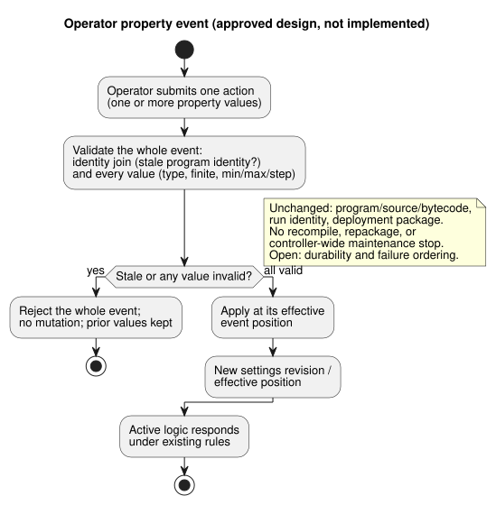
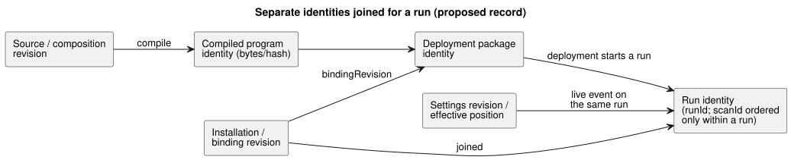

# GF-COMPOSE R6: overrides and lifecycle identity

This research note separates the identities that can change during a
behavior’s life — source, compiled program, settings, installation binding,
deployment package, and run — and states which change affects which identity.

In this document:

- **User problem** — why a settings change must not change wiring or logic.
- **Evidence at examined revision** — current compiler, settings, package, and
  interaction evidence, plus the approved live property-event design.
- **Tables and examples** — a change matrix, three worked examples, and
  rejection/stale-join cases.
- **Current-spec conflict requiring reconciliation** — older normative text
  that the approved design supersedes.
- **Recommendation**, **Unresolved questions and owners**, and
  **Verification**.

## User problem

A farmer changing watering time must not accidentally change wiring or program
logic. Engineers must identify the exact source, settings, installation, and
deployment context that affected a run.

This document defines a bounded identity and validation design. It does not
implement overlays, live mutation, or a new deployment format.

## Evidence at examined revision

Evidence was examined at `ffdbc96461eca67908252507fb851fa4dabd9a2c`, the
working-tree `HEAD`. Line numbers cited below refer to that revision.

**R2 dependency.** The updated R2 dependency draft was also read. This document
preserves R2’s fixed distinction between source revision and behavior
instance. Conversational memory is provenance/authoring context, not automatic
execution-rule or physical-binding authority. R2's unresolved
installation-constraint boundary is not selected or settled by this document.

**Compiler and control.**

- `tools/compile-source.mjs` accepts one canonical `.ghost.md` source and
  records source UTF-8 SHA-256, while compiler output carries manifest/module
  provenance.
- The current compiler does not expose a general composition or override
  identity.
- `tools/control.mjs` validates config literals, operator metadata, ranges, and
  `apply: stopped`; it lowers descriptors. It does not implement a settings
  overlay protocol.

**Current settings helper = source edit.** `createOperatingSettingsCandidate`
in `tools/operating-settings.mjs` checks an expected source hash, edits only
declared config literal spans, and recompiles a candidate. Therefore current
behavior changes source and compiled identity. It is a distinct source-edit
workflow, not a live settings path.

**Approved design: live property events.** The user-approved design amendment
is that operator property changes are live events on the same program and run:

- One multi-property action is one atomic event.
- Validate every value. If any value is invalid, reject the whole event without
  mutation. Otherwise apply it at its effective event position.
- Active logic can respond under existing rules.
- Program/source/bytecode and run identity do not change; settings
  revision/effective position does.
- Accepted settings persist across a real ESP restart, while that restart
  creates a new run identity.
- Exact durability and failure ordering remain unresolved.

Owner proposals are [#89
Runtime Settings Overlay](https://github.com/callin2/ghostflow-language/issues/89)
and [#90 Periodic Schedule](https://github.com/callin2/ghostflow-language/issues/90),
inspected 2026-09-20. They are proposal evidence, not implementation evidence.

The flow below shows the approved property-event behavior. It is design, not
an implemented runtime path.

**Conflict with older documents.** This approved live-event contract conflicts
with the older documented `apply: stopped` behavior in
[CONSTRAINTS](../CONSTRAINTS.md), lines 179–204;
[LANGUAGE-SURFACE](../LANGUAGE-SURFACE.md),
lines 66–69; [LANGUAGE](../LANGUAGE.md), lines 460–461; and the earlier #89
proposal. Those documents remain the
older contract and require alignment; they do not establish current live
runtime support. Property updates do not repackage, recompile, or trigger the
controller-wide maintenance stop required for program/firmware updates.

**Package and interaction identity.**

- The portable package binds source, generated manifest, execution
  compatibility, and `bindingRevision`, with a payload digest and signatures.
- The interaction v0 contract joins schema, source document/revision/SHA,
  module identity, and `runId`.
- `scanId` is only ordered within a run.
- A stale join is derived by the validator, not self-declared by a snapshot.

## Tables and examples

### Change matrix

Each row is one kind of change; each column is one identity or decision point.

| Change | Source/composition revision | Compiled program bytes/hash | Settings revision | Installation revision | Deployment package | Run identity | Validation/apply point |
|---|---|---|---|---|---|---|---|
| Import parameter | New source/composition revision if it changes executable specialization | Recompile; bytes/hash may change | Not a runtime setting | Existing installation only if compatible | New package/signature decision; format unchanged | New run after deployment | Compile/import validation; apply at package selection/deployment |
| Operator setting event | Same source/composition revision | Program bytes/hash unchanged; source-edit helper remains separate | New settings revision/digest and effective event position | Installation revision unchanged unless host policy says otherwise | No automatic repackaging; preserve authenticity; settings/signature linkage unresolved | Same program and run; live effect when event is processed | Validate whole event atomically; invalid event has no mutation; durability ordering unresolved |
| Dependency replacement | New composition revision pinned to exact dependency revision | Usually recompile; hash must be recorded | New settings join if defaults/settings differ | Revalidate capabilities and bindings | New package and signature decision | New run | Import closure and compatibility validation before deployment |
| Physical binding RO3→RO8 | Source/composition revision unchanged | Bytes/hash unchanged | Settings revision unchanged | New binding revision/digest | New package/application record; signature format unchanged | New run or explicit deployment epoch | Device/API validate logical capability and apply binding; physical evidence owner remains Device |

Status: only source compilation, literal-candidate checks, package identity,
and interaction joins above are current evidence. Same-program overlays,
dependency replacement lifecycle, and binding application outcomes are proposals
or unresolved owner contracts.

The diagram shows how these separate identities relate. Note that a live
settings event attaches to the existing run, while a new deployment starts a
new run.

### Worked examples

These are hand-worked identity examples, not execution evidence.

1. **Watering 10m → 5m.** There are two different ways to make this change:

   - *Editing the source default* is a source revision and a source SHA
     change, and may change compiled bytes/hash. It is not an operator
     settings event.
   - *A valid live property event* instead preserves Program P bytes, program
     identity, and current run identity. It creates a new settings revision
     and effective position.

   For example, while a rule-controlled watering interval is active, an atomic
   event changing `duration` from `10min` to `5min` is applied when processed.
   The existing rule evaluates under that effective setting and may request
   OFF at the newly calculated time. No source rewrite, recompilation, new
   package, or new run occurs. If the same action also supplies an invalid
   property, reject the entire batch and retain all prior effective values.
   Exact durable-acknowledgement ordering and settings/authenticity linkage
   remain open.

2. **Optional RainSensor becomes present.** Replacing an absent dependency with
   the pinned RainSensor definition changes the composition/dependency
   revision and normally the compiled program bytes/hash. It requires
   capability and binding validation, a new deployment package decision, and a
   new run. Whether absence is a valid compiled branch or requires two
   distinct source variants is unresolved and belongs to the composition/API
   owners; this document does not infer it.

3. **Pump binding RO3 → RO8.** Logical output identity and program bytes/hash
   remain unchanged. Installation binding revision/digest changes, and the
   package or application record must acknowledge that change. The new run
   must join the new binding revision. Device evidence must prove the applied
   endpoint; this language repository cannot claim that RO8 was physically
   actuated.

### Rejection and stale-join examples

- **Invalid value.** A Duration supplied as a string, a non-finite value, or a
  value outside the declared min/max/step invalidates the entire property
  event before mutation. Current helper evidence covers checks for source
  candidates; live event validation is a proposed acceptance requirement, not
  implemented evidence.
- **Stale program identity.** Settings carrying an old source/program identity
  are rejected as stale. A settings revision cannot be attached to a different
  source revision, module fingerprint, or bytecode digest. The exact settings
  wire record is unresolved.
- **Old run snapshot.** A snapshot from an old run is rejected by the
  interaction join even when its `scanId` equals the new run's `scanId=0`.
  Schema, source, module, and run identities must match expected values;
  `stale` is validator output.

## Current-spec conflict requiring reconciliation

The approved live-event design supersedes the older stopped-Configure behavior
currently documented in [CONSTRAINTS](../CONSTRAINTS.md), section “Stopped
settings apply behavior” (lines 179–204 at the examined revision, the example
headed “운전 설정은 정지한 설정 모드에서만 적용”);
[LANGUAGE-SURFACE](../LANGUAGE-SURFACE.md), lines 66–69; and
[LANGUAGE](../LANGUAGE.md), lines 460–461. Those normative documents have not
thereby changed, and current runtime support is not claimed. The earlier
[#89 proposal](https://github.com/callin2/ghostflow-language/issues/89)
also specifies stopped/new-run application. Reconcile that contract and the
normative docs with the approved amendment; do not treat this design note as
proof the live mechanism exists.

Status summary:

- Live runtime settings are user-approved design, not an implemented
  capability.
- The older stopped-Configure contract and #89 stopped/new-run proposal must be
  reconciled.
- Mechanism/ABI, durability ordering, verification, and normative
  specification alignment remain open.
- #90 parameterized schedules remain an owner proposal.
- Dependency replacement and physical application are not established by those
  issues or by this research.
- Memory-derived changes must link through confirmed decision and
  source/settings/installation revisions; stale or superseded memory must not
  silently update active settings.

## Recommendation

Use a typed settings-event record with separate identities for:

- source/composition revision;
- compiled program identity;
- settings revision/effective position;
- installation/binding revision;
- deployment package identity; and
- run identity.

Apply these rules:

- Treat import specialization as producing a new program.
- Treat approved operator-property changes as atomic live events on the same
  program/run.
- Keep source editing/recompilation and controller-wide program/firmware
  maintenance stop separate from property-event application.
- Validate joins at applicable boundaries and derive stale status during
  validation.

Do not choose a new package format, ABI, runtime, storage engine, or canonical
authority here. Preserve R2's unresolved installation-constraint boundary.

## Unresolved questions and owners

- [#89](https://github.com/callin2/ghostflow-language/issues/89) API/runtime
  owners: define the settings event record,
  digest/revision/effective position, mechanism/ABI, package-authenticity join,
  and exact persistence/acknowledgement failure ordering. Live same-run behavior
  is approved; do not reopen it as a user-choice question.
- [#90](https://github.com/callin2/ghostflow-language/issues/90) owner: define
  parameterized schedule identity and whether schedule parameters are source
  specialization or runtime settings.
- Composition/API owners: define dependency replacement and optional-dependency
  semantics, including absent-versus-present RainSensor behavior.
- Device/API owners: define binding application evidence and deployment epoch;
  do not infer physical success from a package digest.
- System/installation owner with language/API owners: resolve R2's separate
  constraint artifact versus explicit cross-project boundary revision. This
  remains unresolved and is not an override mechanism selected here.
- API/system operational-memory owner: define lineage and decision linkage for
  memory-derived changes, plus retention/export/delete behavior and whether
  deletion leaves a provenance tombstone/digest. These remain R2 questions, not
  an authority grant to memory or an R6 settings implementation.
- Contract owner: extend interaction identity for instance/settings/binding
  joins without replacing existing `runId` or redefining `scanId`.

## Verification

- [x] Inspected revision recorded: `ffdbc96461eca67908252507fb851fa4dabd9a2c`.
- [x] Read targeted compiler, control, operating-settings, package, and
  interaction sections plus the completed R2 dependency draft.
- [x] Four-row matrix includes all requested identities and apply points, with
  current/proposed/unresolved status stated.
- [x] Examples distinguish source defaults, runtime settings, dependencies, and
  bindings. Package signature effects are acknowledged without choosing a format.
- [x] Rejection examples cover invalid values, stale program settings, and old
  run snapshots. No runtime test suite was run or claimed.

Coordinator acceptance checks are `git diff --check`, relative-link inspection,
and confirmation that no source files changed. This document contains no
execution or physical-outcome claim.
