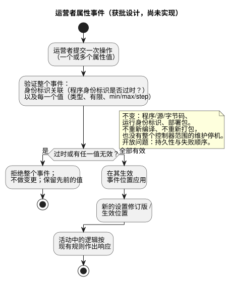
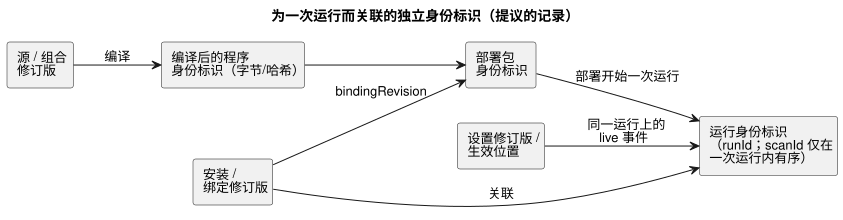

<!-- translation-source: docs/research/GF-COMPOSE-R6-OVERRIDES.md -->
[英文原文](GF-COMPOSE-R6-OVERRIDES.md)

# GF-COMPOSE R6：覆盖与生命周期身份标识

本研究笔记把行为生命周期中可能变化的各种身份标识分开——源、编译后的程序、设置、安装绑定、部署包和运行（run）——并说明哪种变化会影响哪个身份标识。

本文内容：

- **用户问题** —— 为什么更改设置不得改变接线或逻辑。
- **被检查修订版中的证据** —— 当前的编译器、设置、包和交互证据，以及获批的 live 属性事件设计。
- **表格与示例** —— 变更矩阵、三个推演示例，以及拒绝/过时关联（stale join）的情形。
- **需要协调的当前规范冲突** —— 已被获批设计取代的较早规范性文本。
- **建议**、**未决问题与负责方**，以及 **验证**。

## 用户问题

农户更改浇水时间时，不得意外改变接线或程序逻辑。工程师必须能够识别影响某次运行的确切源、设置、安装和部署上下文。

本文定义一个有边界的身份标识与验证设计。它不实现叠加层（overlay）、live 变更或新的部署格式。

## 被检查修订版中的证据

证据检查基于 `ffdbc96461eca67908252507fb851fa4dabd9a2c`，即工作树的 `HEAD`。下文引用的行号均指该修订版。

**R2 依赖。** 同时阅读了更新后的 R2 依赖草案。本文保留 R2 中已固定的“源修订版”与“行为实例”之间的区分。对话记忆是来源（provenance）/编写上下文，而不是自动的执行规则权威或物理绑定权威。本文不选择也不解决 R2 中尚未解决的安装约束边界。

**编译器与控制。**

- `tools/compile-source.mjs` 接受一个规范的 `.ghost.md` 源，并记录源的 UTF-8 SHA-256，而编译器输出携带清单/模块来源信息。
- 当前编译器不提供通用的组合或覆盖身份标识。
- `tools/control.mjs` 验证 config 字面量、运营者元数据、取值范围以及 `apply: stopped`；它对 descriptor 进行降级（lowering）。它不实现设置叠加层协议。

**当前的设置辅助工具 = 源编辑。** `tools/operating-settings.mjs` 中的 `createOperatingSettingsCandidate` 检查期望的源哈希，只编辑已声明的 config 字面量范围，并重新编译出一个候选。因此，当前行为会改变源和编译身份标识。它是一个独立的源编辑工作流，而不是 live 设置路径。

**获批设计：live 属性事件。** 经用户批准的设计修订是：运营者的属性更改是作用于同一程序和同一运行的 live 事件：

- 一次多属性操作就是一个原子事件。
- 验证每一个值。只要有任何一个值无效，就拒绝整个事件且不做任何变更。否则，在其生效事件位置应用该事件。
- 活动中的逻辑可以按现有规则作出响应。
- 程序/源/字节码和运行身份标识不变；设置修订版/生效位置会变化。
- 已接受的设置在 ESP 真正重启后依然保留，但该重启会产生新的运行身份标识。
- 确切的持久性和失败顺序仍未解决。

负责方提案为 [#89
Runtime Settings Overlay](https://github.com/callin2/ghostflow-language/issues/89) 和 [#90 Periodic Schedule](https://github.com/callin2/ghostflow-language/issues/90)，于 2026-09-20 查阅。它们是提案证据，而非实现证据。

下面的流程展示了获批的属性事件行为。这是设计，而不是已实现的运行时路径。

**与较早文档的冲突。** 这一获批的 live 事件契约与较早文档中记载的 `apply: stopped` 行为相冲突：[CONSTRAINTS](../CONSTRAINTS.zh.md) 第 179–204 行；[LANGUAGE-SURFACE](../LANGUAGE-SURFACE.zh.md) 第 66–69 行；[LANGUAGE](../LANGUAGE.zh.md) 第 460–461 行；以及较早的 #89 提案。这些文档仍是较旧的契约，需要对齐；它们并不确立当前的 live 运行时支持。属性更新不会重新打包、重新编译，也不会触发程序/固件更新所需的整个控制器范围的维护停机。

**包与交互身份标识。**

- 可移植包把源、生成的清单、执行兼容性和 `bindingRevision` 绑定在一起，并带有载荷摘要和签名。
- 交互 v0 契约把模式（schema）、源文档/修订版/SHA、模块身份标识和 `runId` 关联起来。
- `scanId` 只在一次运行内有序。
- 过时关联由验证器推导得出，而不是由快照自行声明。

## 表格与示例

### 变更矩阵

每一行是一种变更；每一列是一个身份标识或决策点。

| 变更 | 源/组合修订版 | 编译后的程序字节/哈希 | 设置修订版 | 安装修订版 | 部署包 | 运行身份标识 | 验证/应用时点 |
|---|---|---|---|---|---|---|---|
| 导入参数 | 若改变可执行特化，则产生新的源/组合修订版 | 重新编译；字节/哈希可能变化 | 不是运行时设置 | 仅在兼容时沿用现有安装 | 需要新的包/签名决定；格式不变 | 部署后为新运行 | 编译/导入验证；在选择包/部署时应用 |
| 运营者设置事件 | 源/组合修订版不变 | 程序字节/哈希不变；源编辑辅助工具保持独立 | 新的设置修订版/摘要以及生效事件位置 | 安装修订版不变，除非宿主策略另有规定 | 不自动重新打包；保持真实性；设置与签名的关联未解决 | 同一程序和同一运行；事件被处理时实时生效 | 原子地验证整个事件；无效事件不做变更；持久性顺序未解决 |
| 依赖替换 | 新的组合修订版，固定到确切的依赖修订版 | 通常需要重新编译；必须记录哈希 | 若默认值/设置不同，则需新的设置关联 | 重新验证能力和绑定 | 新包及签名决定 | 新运行 | 部署前进行导入闭包与兼容性验证 |
| 物理绑定 RO3→RO8 | 源/组合修订版不变 | 字节/哈希不变 | 设置修订版不变 | 新的绑定修订版/摘要 | 新的包/应用记录；签名格式不变 | 新运行或显式的部署纪元（epoch） | Device/API 验证逻辑能力并应用绑定；物理证据负责方仍是 Device |

状态：上表中只有源编译、字面量候选检查、包身份标识和交互关联属于当前证据。同一程序的叠加层、依赖替换生命周期以及绑定应用结果是提案或尚未解决的负责方契约。

下图展示了这些相互独立的身份标识之间的关系。注意，live 设置事件附加到现有运行上，而新的部署会开始一次新运行。

### 推演示例

以下是手工推演的身份标识示例，不是执行证据。

1. **浇水 10m → 5m。** 实现这一更改有两种不同的方式：

   - *编辑源中的默认值* 是一次源修订和源 SHA 变更，并可能改变编译后的字节/哈希。它不是运营者设置事件。
   - *一次有效的 live 属性事件* 则保留 Program P 的字节、程序身份标识和当前运行身份标识。它产生新的设置修订版和生效位置。

   例如，在一个由规则控制的浇水时段处于活动状态时，一个把 `duration` 从 `10min` 改为 `5min` 的原子事件会在被处理时应用。现有规则在该生效设置下求值，并可能在新计算出的时间请求 OFF。不会发生源改写、重新编译、新包或新运行。如果同一操作还提供了一个无效属性，则拒绝整批更改，并保留所有先前的生效值。确切的持久化确认顺序以及设置与真实性的关联仍然开放。

2. **可选的 RainSensor 变为存在。** 用固定的 RainSensor 定义替换一个缺失的依赖，会改变组合/依赖修订版，通常也会改变编译后的程序字节/哈希。它需要能力和绑定验证、新的部署包决定以及一次新运行。“缺失”是一个有效的编译分支，还是需要两个不同的源变体，这一点尚未解决，属于组合/API 负责方的职责；本文不对此作推断。

3. **水泵绑定 RO3 → RO8。** 逻辑输出身份标识和程序字节/哈希保持不变。安装绑定修订版/摘要发生变化，包或应用记录必须承认这一变化。新运行必须关联新的绑定修订版。必须由 Device 证据证明实际应用的端点；本语言仓库不能声称 RO8 已被物理驱动。

### 拒绝与过时关联示例

- **无效值。** 以字符串形式提供的 Duration、非有限值，或超出声明的 min/max/step 的值，会在任何变更发生之前使整个属性事件无效。当前辅助工具的证据只覆盖对源候选的检查；live 事件验证是提议的验收要求，而不是已实现的证据。
- **过时的程序身份标识。** 携带旧源/程序身份标识的设置会作为过时（stale）而被拒绝。设置修订版不能附加到不同的源修订版、模块指纹或字节码摘要上。确切的设置传输记录尚未解决。
- **旧运行的快照。** 来自旧运行的快照会被交互关联拒绝，即使它的 `scanId` 等于新运行的 `scanId=0`。模式、源、模块和运行身份标识都必须与期望值一致；`stale` 是验证器的输出。

## 需要协调的当前规范冲突

获批的 live 事件设计取代了当前文档中记载的较早的“停止后 Configure”行为，涉及：[CONSTRAINTS](../CONSTRAINTS.zh.md) 中“Stopped settings apply behavior”一节（被检查修订版中的第 179–204 行，即标题为“운전 설정은 정지한 설정 모드에서만 적용”的示例）；[LANGUAGE-SURFACE](../LANGUAGE-SURFACE.zh.md) 第 66–69 行；以及 [LANGUAGE](../LANGUAGE.zh.md) 第 460–461 行。这些规范性文档并未因此而改变，也不声称当前存在运行时支持。较早的 [#89 提案](https://github.com/callin2/ghostflow-language/issues/89) 同样规定了停止/新运行式的应用方式。应使该契约及规范性文档与获批的修订保持一致；不要把本设计笔记当作 live 机制已经存在的证明。

状态摘要：

- live 运行时设置是经用户批准的设计，而不是已实现的能力。
- 较早的“停止后 Configure”契约以及 #89 的停止/新运行提案必须加以协调。
- 机制/ABI、持久性顺序、验证以及规范性规格的对齐仍然开放。
- #90 参数化调度仍是负责方提案。
- 依赖替换和物理应用既未由这些议题确立，也未由本研究确立。
- 源自记忆的更改必须通过经确认的决定以及源/设置/安装修订版进行关联；过时或已被取代的记忆不得悄悄更新活动设置。

## 建议

使用一个类型化的设置事件记录，为以下各项分别保留身份标识：

- 源/组合修订版；
- 编译后的程序身份标识；
- 设置修订版/生效位置；
- 安装/绑定修订版；
- 部署包身份标识；以及
- 运行身份标识。

应用以下规则：

- 将导入特化视为产生一个新程序。
- 将获批的运营者属性更改视为作用于同一程序/运行的原子 live 事件。
- 将源编辑/重新编译以及整个控制器范围的程序/固件维护停机与属性事件的应用分开。
- 在适用的边界验证关联，并在验证期间推导过时状态。

不要在此选择新的包格式、ABI、运行时、存储引擎或规范权威。保留 R2 中尚未解决的安装约束边界。

## 未决问题与负责方

- [#89](https://github.com/callin2/ghostflow-language/issues/89) API/运行时负责方：定义设置事件记录、摘要/修订版/生效位置、机制/ABI、包真实性关联，以及确切的持久化/确认失败顺序。同一运行内的 live 行为已获批准；不要将其作为用户选择问题重新打开。
- [#90](https://github.com/callin2/ghostflow-language/issues/90) 负责方：定义参数化调度的身份标识，以及调度参数属于源特化还是运行时设置。
- 组合/API 负责方：定义依赖替换和可选依赖语义，包括 RainSensor 缺失与存在时的行为。
- Device/API 负责方：定义绑定应用证据和部署纪元；不要从包摘要推断物理上的成功。
- 系统/安装负责方与语言/API 负责方：解决 R2 中“独立约束制品”与“显式跨项目边界修订”之间的选择。这仍未解决，也不是本文选定的覆盖机制。
- API/系统运行记忆负责方：定义源自记忆的更改的谱系和决定关联，以及保留/导出/删除行为，并确定删除是否留下来源墓碑/摘要。这些仍是 R2 的问题，既不是授予记忆的权威，也不是 R6 的设置实现。
- 契约负责方：扩展交互身份标识，以支持实例/设置/绑定关联，同时不替换现有的 `runId`，也不重新定义 `scanId`。

## 验证

- [x] 已记录被检查的修订版：`ffdbc96461eca67908252507fb851fa4dabd9a2c`。
- [x] 已阅读编译器、控制、运行设置、包和交互的相关章节，以及已完成的 R2 依赖草案。
- [x] 四行矩阵包含了所要求的全部身份标识和应用时点，并说明了当前/提议/未解决的状态。
- [x] 示例区分了源默认值、运行时设置、依赖和绑定。承认了对包签名的影响，但没有选择格式。
- [x] 拒绝示例涵盖了无效值、过时的程序设置和旧运行快照。没有运行或声称运行任何运行时测试套件。

协调方的验收检查为 `git diff --check`、相对链接检查，以及确认没有源文件被更改。本文不包含任何执行或物理结果方面的声明。
