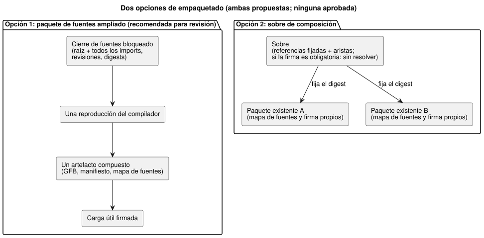
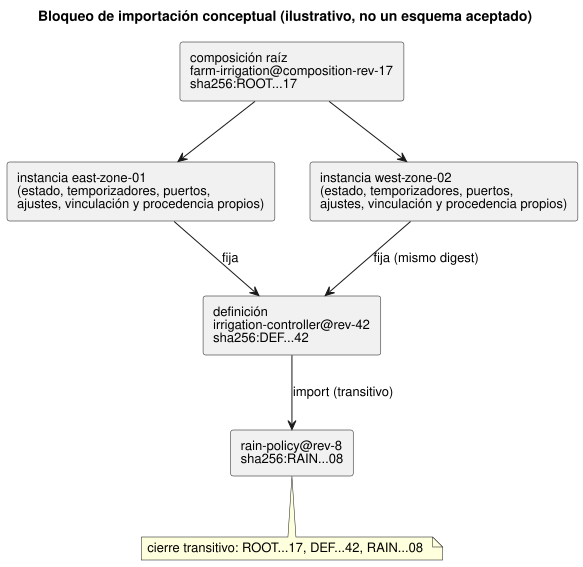

<!-- translation-source: docs/research/GF-COMPOSE-R7-PACKAGES.md -->
[Original en inglés](GF-COMPOSE-R7-PACKAGES.md)

# GF-COMPOSE R7: paquetes y cierre de importaciones

Esta nota de investigación compara dos formas de empaquetar comportamientos
compuestos de modo que un artefacto desplegado pueda rastrearse siempre hasta
sus fuentes, importaciones, compilador y evidencia de confianza exactos.

En este documento:

- **Problema del usuario**: reutilizar entre granjas sin perder la identidad
  exacta.
- **Evidencia en la revisión examinada**: lo que ya garantizan el paquete v1
  actual y su constructor/verificador, y lo que les falta.
- **Tablas y ejemplos**: las dos opciones de empaquetado, un bloqueo de
  importación conceptual y las reglas de resolución/rechazo.
- **Recomendación**: incluido un recorrido por la actualización de una
  definición.
- **Preguntas abiertas y responsables** y **Verificación**.

Términos usados a lo largo del documento:

| Término | Significado |
| --- | --- |
| Cierre de importaciones (import closure) | La fuente raíz más cada fuente exacta importada de forma transitiva. |
| Bloqueo de importación (import lock) | Un registro que fija cada arista de importación a una revisión y un digest inmutables. |
| Definición | Una fuente de comportamiento reutilizable y sin vinculación (binding), en una revisión concreta. |
| Instancia | Un uso de una definición en un sitio, con su propia identidad y su propio estado. |

## Problema del usuario

Un comportamiento reutilizable debe poder instalarse en más de una granja sin
perder las fuentes, los ajustes, la identidad del compilador y la evidencia de
confianza exactos usados para producir un artefacto desplegado.

Un nombre de catálogo o la memoria conversacional no deben seleccionar en
silencio una nueva revisión ejecutable. La memoria sigue siendo procedencia y
contexto de autoría, no autoridad sobre reglas de ejecución ni sobre
vinculaciones (R2, verificado a partir de la memoria de sistema #68).

Esta investigación compara dos opciones de empaquetado para la composición. No
define un registro, un descargador, un servicio de claves, un cambio de formato
de transmisión ni una ABI.

## Evidencia en la revisión examinada

La evidencia se examinó en `ffdbc96461eca67908252507fb851fa4dabd9a2c`, el
`HEAD` del árbol de trabajo.

**Contenido actual del paquete v1.** El paquete incorpora, bajo una carga útil
firmada:

- una fuente canónica `.ghost.md` exacta;
- los bytes GFB1;
- el manifiesto;
- el mapa de fuentes;
- la identidad de ejecución; y
- `bindingRevision`.

La fuente se conserva byte a byte y su SHA-256 queda enlazado por el mapa de
fuentes ([PORTABLE-PACKAGE](../PORTABLE-PACKAGE.es.md),
[SOURCE-MAP](../SOURCE-MAP.es.md)).

**Constructor.** `buildPortablePackage` exige una reproducción nueva de
`compileSource` usando el texto de la fuente y la revisión del compilador.
Rechaza cualquier discrepancia entre el GFB, el manifiesto o el mapa de fuentes
reproducidos y la compilación suministrada
([portable-package.mjs](../../tools/portable-package.mjs)).

**Verificador.** `verifyPortablePackage` comprueba:

- el esquema/versión;
- el digest de la carga útil;
- las firmas de confianza activas;
- la identidad del compilador y del runtime;
- la revisión de vinculación;
- las capacidades;
- los digests de los artefactos; y
- los enlaces cruzados del mapa de fuentes;

y después ejecuta un verificador de bytecode nativo/WASM obligatorio.

El verificador nativo es una frontera del cargador del destino; no establece el
accionamiento físico.

**Lo que falta.** La evidencia actual es de una sola fuente y un solo
artefacto. Ningún campo actual del paquete representa:

- aristas de importación;
- un cierre completo de fuentes;
- la revisión de la definición;
- el ID de instancia; ni
- una definición reutilizable sin vinculación.

**Hallazgos de diseño relacionados (no implementados).**

- R2 propone una identidad de instancia opaca y estado/procedencia aislados.
- R3 deja abiertas la planificación de la composición y la coordinación de
  instancias.
- R6 registra el diseño aprobado por el usuario de eventos de propiedades en
  vivo: cambia una revisión de ajustes/posición efectiva mientras la identidad
  del programa y de la ejecución permanecen estables. Ese evento no reempaqueta
  ni vuelve a desplegar un binario.
- El vínculo entre ajustes y firma sigue sin resolverse; no se implica ningún
  debilitamiento de la autenticidad del paquete.

Siguen siendo hallazgos de diseño, no campos de paquete ni comportamiento de
runtime implementados.

## Tablas y ejemplos

### Exactamente dos opciones de empaquetado

| Opción | Cierre exacto de fuentes | Importaciones inmutables | Reproducción del compilador | Identidad de contrato/mapa | Ciclo de vida de la vinculación | Firmas | Impacto en el verificador nativo |
|---|---|---|---|---|---|---|---|
| Ampliar un paquete de fuentes para la compilación compuesta *(propuesta)* | `.ghost.md` raíz del paquete más cada fuente exacta importada de forma transitiva, ID de revisión y digest | Las aristas de importación fijan la revisión/digest de la definición; los nombres flotantes se rechazan o se resuelven antes de crear el bloqueo | Reproducir el cierre bloqueado completo con la revisión del compilador; comparar el GFB, el manifiesto y el mapa de fuentes compuestos | Una nueva identidad de composición/cierre debe enlazar cada revisión de fuente y el artefacto compuesto; el formato del mapa de fuentes y la extensión de la ABI siguen sin resolverse | La definición reutilizable excluye la vinculación del sitio; el paquete de instalación une por separado la revisión de vinculación y los ID de instancia | Reutilizar la firma Ed25519 de la carga útil y las instantáneas de confianza existentes; firmar el cierre, las aristas, los artefactos y las uniones | Ampliar las comprobaciones de esquema/enlaces cruzados y quizá los límites nativos. La carga actual en el destino puede mantenerse si los bytes GFB1 finales y la ABI siguen siendo compatibles; esto sigue sin resolverse |
| Añadir un sobre de composición que haga referencia a artefactos existentes *(propuesta)* | El sobre enumera las identidades exactas de paquetes/artefactos existentes y sus digests de fuente; el cierre solo es completo si las referencias se resuelven de forma recursiva | Las referencias fijan el digest del paquete/artefacto y la revisión de la definición; los alias del catálogo requieren un resultado fijado | Reproducir cada fuente/artefacto referenciado según sea necesario y luego validar el contrato de composición; sigue sin resolverse si un artefacto compuesto debe reproducirse | Conservar el mapa de fuentes y la identidad actuales de cada paquete, más una nueva identidad de sobre/arista; los mapas entre artefactos y la ABI siguen sin resolverse | Los paquetes existentes conservan su ciclo de vida de vinculación; las referencias reutilizables no deben heredar por accidente una vinculación del sitio | Reutilizar las firmas de cada artefacto y firmar el sobre; el orden de confianza y si la firma del sobre es obligatoria siguen sin resolverse | El verificador nativo puede verificar individualmente los paquetes referenciados, pero la validación a nivel de composición necesita un nuevo contrato del llamador y nuevos límites |

El diagrama contrasta las dos formas: un único cierre bloqueado compilado en un
único artefacto, frente a un sobre que fija paquetes existentes.



Compromiso:

- La primera opción ofrece una única entrada determinista al compilador y un
  único artefacto compuesto.
- La segunda conserva las fronteras entre artefactos, pero dificulta la
  resolución, la identidad de capacidades entre artefactos y la verificación
  agregada.

Ninguna de las dos opciones está aprobada a nivel de arquitectura.

### Bloqueo de importación conceptual (ilustrativo, no un esquema aceptado)

```text
root composition: farm-irrigation@composition-rev-17
root source: sha256:ROOT...17
instance: east-zone-01 -> definition irrigation-controller@rev-42 / sha256:DEF...42
instance: west-zone-02 -> definition irrigation-controller@rev-42 / sha256:DEF...42
imports:
  irrigation-controller@rev-42
    -> rain-policy@rev-8 / sha256:RAIN...08
transitive closure: ROOT...17, DEF...42, RAIN...08
```

El mismo bloqueo en forma de grafo:



Lo que muestra el bloqueo:

- **Compartido:** los dos ID de instancia son distintos aunque fijan el mismo
  digest de definición. La revisión de la definición y la dependencia
  transitiva se comparten.
- **Por instancia:** el estado, los temporizadores, la cualificación de
  puertos lógicos, la unión de ajustes, la vinculación de la instalación y la
  procedencia de runtime se instancian por separado para cada instancia.
- **Estable ante renombrados:** renombrar una entrada del catálogo no cambia
  ninguno de los dos bloqueos.
- **La vinculación pertenece a la instalación:** el `bindingRevision` de un
  paquete desplegable pertenece a una unión de instalación, no a la definición
  reutilizable de forma universal.

### Resolución y rechazo

| Condición | Comportamiento determinista requerido | Cobertura existente | Extensión requerida |
|---|---|---|---|
| Importación faltante | Rechazar antes de la compilación/aceptación del paquete; identificar la arista fijada que falta | No hay resolución de importaciones en el paquete actual | Resolutor del cierre y contrato estable de errores/responsables |
| Importación cíclica | Rechazar los ciclos de importación ejecutables antes del lowering; no inferir el orden a partir de grafos de visualización. Los ciclos de dependencias en el mismo escaneo necesitan una decisión explícita de rechazo/política definida; las aristas de estado del escaneo anterior son distintas | No hay comprobación de ciclos de composición | Detección de ciclos en el resolutor y una política explícita para el mismo escaneo; la semántica del estado del escaneo anterior sigue siendo una decisión de ejecución de R3 |
| Referencia mutable/flotante sin resultado fijado | Rechazar; un nombre, una etiqueta latest o una afirmación de la memoria no es una revisión | El paquete actual exige una fuente exacta incorporada | La creación del bloqueo debe exigir una revisión y un digest inmutables |
| Discrepancia de digest | Rechazar antes del compilador o de la carga en el destino; informar de la discrepancia de arista/artefacto | Comprobaciones existentes de digest de fuente, bytecode, manifiesto, mapa, carga útil y reproducción | Aplicar las mismas comprobaciones de forma recursiva y a la identidad del cierre |
| Versión/capacidad no admitida | Rechazar el paquete o la composición antes de la carga en el destino | Comprobaciones existentes de versión de paquete/runtime/ABI/manifiesto y de capacidades requeridas | Agregar las capacidades importadas y el contrato de composición; conservar las fronteras explícitas de responsabilidad |
| Firma inaceptable | Rechazar si no hay una firma de confianza activa y no revocada | Comprobaciones existentes de Ed25519, instantánea de confianza, rotación y revocación | Definir si la firma del sobre es obligatoria y cómo se compone la confianza |

## Recomendación

Se recomienda **ampliar un paquete de fuentes para la compilación compuesta**,
sujeto a revisión. Ofrece la extensión semántica más pequeña:

- un único cierre de fuentes bloqueado;
- una única reproducción determinista;
- un único artefacto compuesto; y
- la reutilización de los digests de carga útil actuales, la confianza
  Ed25519, la validación de capacidades, los enlaces del mapa de fuentes y la
  verificación del destino nativo/WASM.

Además, hace que las dependencias faltantes o mutables fallen antes del
despliegue en lugar de delegar la corrección a un coordinador.

**Mantener el bloqueo separado del contexto de despliegue/runtime.**

| Registro | Qué fija o une |
| --- | --- |
| Bloqueo inmutable del cierre de importaciones | Revisiones de fuente/definición, aristas de importación y digests exactos. |
| Contexto de despliegue/runtime | ID de instancia, revisión de instalación/vinculación, identidad de programa/compilador/runtime, revisión de ajustes/posición efectiva e identidad de ejecución. |

Un evento de propiedad en vivo cambia la identidad de los ajustes sin cambiar
los bytes del programa, sin reempaquetar, sin volver a desplegar y sin cambiar
la identidad de ejecución. Dos instancias pueden compartir un digest de
definición, pero nunca comparten estado implícito ni heredan en silencio una
vinculación.

**Datos específicos del sitio excluidos de la exportación reutilizable:**

- identidad de la granja/sitio;
- mapeo físico de endpoints/canales;
- perfil del dispositivo y evidencia del firmware;
- revisión de vinculación de la instalación;
- credenciales;
- registros de operadores/agricultores;
- contenido privado de conversaciones o de la memoria;
- estado de runtime, temporizadores e historial de ejecuciones; y
- ajustes de instancia, salvo que se declaren explícitamente como parámetro de
  importación inmutable.

La API es responsable de la orquestación de revisiones/despliegues; Device es
responsable de los perfiles físicos y de la evidencia de vinculación aplicada.

### Recorrido por la actualización de una definición

1. La API crea `irrigation-controller@rev-43` con un nuevo digest de fuente y
   un cierre de dependencias bloqueado.
2. Solo las instancias seleccionadas explícitamente para la actualización
   reciben una nueva arista de procedencia de instancia a definición.
3. Cada instancia afectada se recompila o revalida según la opción elegida, lo
   que produce nuevos digests de módulo, manifiesto, mapa de fuentes y
   artefacto compuesto cuando cambian los bytes.
4. Se comprueba la compatibilidad de sus uniones de ajustes e instalación. La
   instancia/paquete anterior sigue siendo el despliegue previo explicable hasta
   que la API seleccione un paquete nuevo.
5. Esta actualización de programa/firmware usa la parada de mantenimiento de
   todo el controlador para ese ESP. Los eventos de propiedades ordinarios no.
6. El paquete de despliegue firma el nuevo cierre exacto y registra la
   identidad del compilador/runtime y la unión con la vinculación de la
   instalación.

Nada de lo aquí afirmado significa que un dispositivo lo haya activado ni que
una bomba se haya movido.

Siguen sin resolverse: la representación del mapa de fuentes para varios
documentos fuente, la identidad de la ABI compuesta, la denominación agregada
de capacidades y si la verificación nativa acepta un único GFB1 final o valida
un sobre. No elija en silencio un comportamiento de compatibilidad para estas
lagunas.

## Preguntas abiertas y responsables

- Responsables de lenguaje + API: definir el registro de bloqueo/cierre, la
  revisión de la definición, la identidad de las aristas de importación, el
  orden canónico y el contrato de errores de faltantes/ciclos.
- Responsables de compilador/runtime: decidir si la composición emite un único
  módulo GFB1 compatible o requiere una extensión de ABI/runtime; se aplican
  las restricciones de ejecución de R3.
- Responsable del mapa de fuentes/contrato: definir coordenadas de varias
  fuentes y la identidad del mapa compuesto sin romper los enlaces cruzados
  actuales del documento fuente.
- Responsables del paquete/verificador nativo: elegir entre la verificación
  recursiva de artefactos y un único sobre de composición firmado, los límites,
  el orden de confianza y los errores estables.
- Responsable de API/despliegue: definir la selección de instancias para la
  actualización, las uniones de eventos de ajustes en vivo y el vínculo de
  autenticidad sin resolver, el ciclo de vida de la vinculación y el linaje del
  paquete de despliegue. Los eventos de propiedades no implican reempaquetado.
- Responsable de Device: definir la evidencia de una vinculación aplicada. La
  verificación del paquete no es verificación del hardware.
- Responsable de sistema/API: conservar la memoria como procedencia/contexto de
  autoría y definir los enlaces de retención o borrado; la memoria no puede
  fijar la ejecución por sí sola.

## Verificación

- [x] Se registró el commit examinado y se leyeron secciones específicas del
  paquete, el compilador, el mapa de fuentes y las pruebas del paquete
  portable.
- [x] Se comparan exactamente dos opciones de empaquetado en todas las columnas
  solicitadas.
- [x] El ejemplo de bloqueo incluye una revisión de la composición raíz, dos ID
  de instancia, un digest de definición compartido, revisiones/digests exactos
  de las dependencias y una dependencia transitiva.
- [x] Las seis clases de rechazo distinguen la cobertura actual de la extensión
  de composición requerida.
- [x] El recorrido de actualización separa los efectos sobre
  fuente/artefacto/procedencia/despliegue y excluye los datos específicos del
  sitio.
- [x] Las afirmaciones sobre la implementación, las propuestas y los ejemplos
  elaborados a mano se etiquetan de forma distinta. No se ejecutó ni se afirma
  ninguna prueba de runtime.

Las comprobaciones de aceptación del coordinador son `git diff --check`, la
inspección de enlaces relativos y la confirmación de que no cambió ningún
documento no relacionado. No se ejecutó ni se afirma ninguna prueba de runtime.
