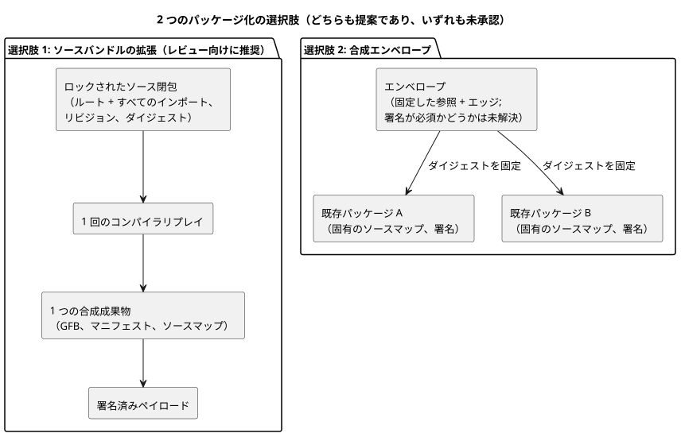
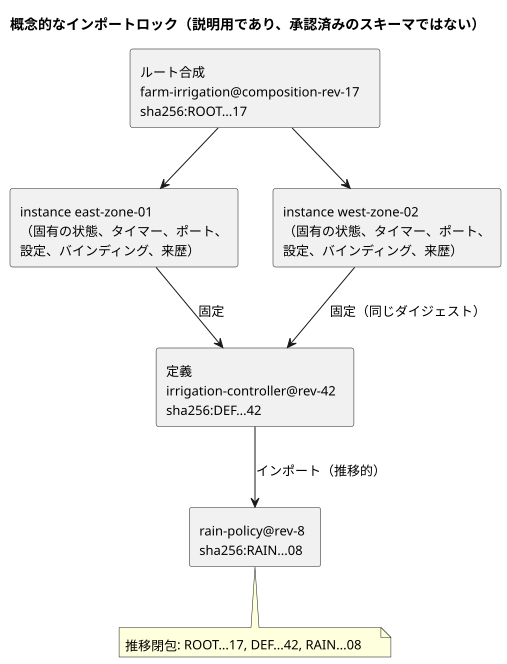

<!-- translation-source: docs/research/GF-COMPOSE-R7-PACKAGES.md -->
[英語の原文](GF-COMPOSE-R7-PACKAGES.md)

# GF-COMPOSE R7：パッケージとインポート閉包

この調査ノートは、合成された振る舞いをパッケージ化する 2 つの方法を比較します。目的は、デプロイされた成果物を、その正確なソース、インポート、コンパイラ、信頼の証拠まで常にたどれるようにすることです。

この文書の内容：

- **ユーザーの課題** — 正確な同一性を失わずに、複数の農場で再利用すること。
- **調査したリビジョンでの証拠** — 現在の v1 パッケージとそのビルダー／ベリファイアがすでに保証していることと、欠けていること。
- **表と例** — 2 つのパッケージ化の選択肢、概念的なインポートロック、解決／拒否の規則。
- **推奨事項** — 定義のアップグレードの手順を含みます。
- **未解決の問題と担当オーナー**、**検証**。

本文で使う用語：

| 用語 | 意味 |
| --- | --- |
| インポート閉包（import closure） | ルートのソースと、推移的にインポートされるすべての正確なソース。 |
| インポートロック（import lock） | 各インポートエッジを不変のリビジョンとダイジェストに固定するレコード。 |
| 定義（definition） | 特定のリビジョンにおける、バインディングを持たない再利用可能な振る舞いのソース。 |
| インスタンス（instance） | ある現場での定義の 1 つの使用。固有の同一性と状態を持ちます。 |

## ユーザーの課題

再利用可能な振る舞いは、デプロイされた成果物を作るのに使われた正確なソース、設定、コンパイラの同一性、信頼の証拠を失わずに、複数の農場に設置できなければなりません。

カタログ名や会話のメモリが、新しい実行可能リビジョンを黙って選択してはなりません。メモリは来歴とオーサリングの文脈のままであり、実行規則やバインディングの権限ではありません（R2、システムメモリ #68 で検証済み）。

この調査は、合成のための 2 つのパッケージ化の選択肢を比較します。レジストリ、ダウンローダー、鍵サービス、ワイヤ形式の変更、ABI は定義しません。

## 調査したリビジョンでの証拠

証拠は、作業ツリーの `HEAD` である `ffdbc96461eca67908252507fb851fa4dabd9a2c` で調査しました。

**現在の v1 パッケージの内容。** パッケージは、署名されたペイロードの下に次のものを埋め込みます。

- 正確な正本の `.ghost.md` ソース 1 つ
- GFB1 のバイト列
- マニフェスト
- ソースマップ
- 実行の同一性
- `bindingRevision`

ソースはバイト単位で保持され、その SHA-256 はソースマップによって結び付けられます（[PORTABLE-PACKAGE](../PORTABLE-PACKAGE.ja.md)、[SOURCE-MAP](../SOURCE-MAP.ja.md)）。

**ビルダー。** `buildPortablePackage` は、ソーステキストとコンパイラのリビジョンを使った新たな `compileSource` のリプレイを要求します。リプレイした GFB、マニフェスト、ソースマップと、与えられたコンパイル結果との間に不一致があれば拒否します（[portable-package.mjs](../../tools/portable-package.mjs)）。

**ベリファイア。** `verifyPortablePackage` は次の項目を検査します。

- スキーマ／バージョン
- ペイロードのダイジェスト
- 有効で信頼された署名
- コンパイラとランタイムの同一性
- バインディングリビジョン
- ケイパビリティ
- 成果物のダイジェスト
- ソースマップの相互リンク

その後、必須のネイティブ／WASM バイトコードベリファイアを実行します。

ネイティブベリファイアはターゲットローダーの境界であり、物理的な作動を確立するものではありません。

**欠けているもの。** 現在の証拠は単一ソース・単一成果物です。現在のパッケージには、次のものを表すフィールドがありません。

- インポートエッジ
- 完全なソース閉包
- 定義のリビジョン
- インスタンス ID
- バインディングを持たない再利用可能な定義

**関連する設計上の知見（未実装）。**

- R2 は、不透明なインスタンスの同一性と、分離された状態／来歴を提案しています。
- R3 は、合成のスケジューリングとインスタンス間の協調を未解決のままにしています。
- R6 は、ユーザーが承認したライブプロパティイベントの設計を記録しています。プログラムと run の同一性は安定したまま、設定リビジョン／有効位置が変わります。そのイベントはバイナリを再パッケージ化も再デプロイもしません。
- 設定と署名の結び付けは未解決です。パッケージの真正性を弱めることは意味しません。

これらは設計上の知見のままであり、実装済みのパッケージフィールドやランタイムの振る舞いではありません。

## 表と例

### ちょうど 2 つのパッケージ化の選択肢

| 選択肢 | 正確なソース閉包 | 不変のインポート | コンパイラのリプレイ | 契約／マップの同一性 | バインディングのライフサイクル | 署名 | ネイティブベリファイアへの影響 |
|---|---|---|---|---|---|---|---|
| 合成コンパイルのためにソースバンドルを拡張する *（提案）* | ルートの `.ghost.md` と、推移的にインポートされるすべての正確なソース、リビジョン ID、ダイジェストをバンドルする | インポートエッジは定義のリビジョン／ダイジェストを固定する。浮動する名前は拒否するか、ロックの作成前に解決する | ロックされた閉包全体をコンパイラのリビジョンでリプレイし、合成された GFB、マニフェスト、ソースマップを比較する | 新しい合成／閉包の同一性が、各ソースリビジョンと合成成果物を結び付けなければならない。ソースマップの形式と ABI の拡張は未解決 | 再利用可能な定義は現場のバインディングを含まない。設置パッケージがバインディングリビジョンとインスタンス ID を別途結合する | Ed25519 のペイロード署名と既存の信頼スナップショットを再利用する。閉包、エッジ、成果物、結合に署名する | スキーマ／相互リンクの検査を拡張し、場合によってはネイティブの制限も拡張する。最終的な GFB1 のバイト列と ABI が互換のままであれば既存のターゲットロードを維持できるが、これは未解決 |
| 既存の成果物を参照する合成エンベロープを追加する *（提案）* | エンベロープは既存のパッケージ／成果物の正確な同一性と、それらのソースのダイジェストを列挙する。参照が再帰的に解決された場合にのみ閉包は完全になる | 参照はパッケージ／成果物のダイジェストと定義のリビジョンを固定する。カタログの別名には固定された結果が必要 | 参照される各ソース／成果物を必要に応じてリプレイし、その後に合成の契約を検証する。合成成果物をリプレイしなければならないかは未解決 | 各パッケージの現在のソースマップと同一性を保持し、新しいエンベロープ／エッジの同一性を加える。成果物をまたぐマップと ABI は未解決 | 既存のパッケージはそれぞれのバインディングのライフサイクルを保持する。再利用可能な参照が現場のバインディングを誤って継承してはならない | 各成果物の署名を再利用し、エンベロープに署名する。信頼の順序と、エンベロープへの署名が必須かどうかは未解決 | ネイティブベリファイアは参照されるパッケージを個別に検証できるが、合成レベルの検証には新しい呼び出し側の契約と制限が必要 |

図は 2 つの形を対比しています。1 つのロックされた閉包を 1 つの成果物にコンパイルするものと、既存のパッケージを固定するエンベロープです。



トレードオフ：

- 1 つ目の選択肢は、決定的なコンパイラ入力を 1 つと、合成成果物を 1 つ与えます。
- 2 つ目は成果物の境界を保持しますが、解決、成果物をまたぐケイパビリティの同一性、集約的な検証が難しくなります。

どちらの選択肢もアーキテクチャとして承認されていません。

### 概念的なインポートロック（説明用であり、承認済みのスキーマではありません）

```text
root composition: farm-irrigation@composition-rev-17
root source: sha256:ROOT...17
instance: east-zone-01 -> definition irrigation-controller@rev-42 / sha256:DEF...42
instance: west-zone-02 -> definition irrigation-controller@rev-42 / sha256:DEF...42
imports:
  irrigation-controller@rev-42
    -> rain-policy@rev-8 / sha256:RAIN...08
transitive closure: ROOT...17, DEF...42, RAIN...08
```

同じロックをグラフで示します。



このロックが示すこと：

- **共有されるもの：** 2 つのインスタンス ID は互いに異なりますが、同じ定義ダイジェストを固定しています。定義のリビジョンと推移的な依存関係は共有されます。
- **インスタンスごとのもの：** 状態、タイマー、論理ポートの修飾、設定の結合、設置のバインディング、ランタイムの来歴は、インスタンスごとに生成されます。
- **名前の変更に対して安定：** カタログ項目の名前を変えても、どちらのロックも変わりません。
- **バインディングは設置に属する：** デプロイ可能なパッケージの `bindingRevision` は設置の結合に属し、普遍的に再利用可能な定義には属しません。

### 解決と拒否

| 条件 | 必要な決定的な振る舞い | 既存のカバー範囲 | 必要な拡張 |
|---|---|---|---|
| インポートの欠落 | コンパイル／パッケージ受け入れの前に拒否し、欠けている固定エッジを特定する | 現在のパッケージにはインポートの解決がない | 閉包リゾルバと、安定したエラー／オーナーの契約 |
| 循環インポート | ロワリングの前に実行可能なインポートの循環を拒否する。表示用のグラフから順序を推論しない。同一スキャンの依存関係の循環には、明示的な拒否／定義済みポリシーの決定が必要。前スキャンの状態エッジは別物 | 合成の循環チェックはない | リゾルバによる循環検出と、明示的な同一スキャンのポリシー。前スキャンの状態のセマンティクスは R3 の実行の決定のまま |
| 固定された結果のない可変／浮動の参照 | 拒否する。名前、latest タグ、メモリの主張はリビジョンではない | 現在のパッケージは正確に埋め込まれたソースを要求する | ロックの作成時に不変のリビジョンとダイジェストを必須にする |
| ダイジェストの不一致 | コンパイラやターゲットのロードの前に拒否し、エッジ／成果物の不一致を報告する | 既存のソース、バイトコード、マニフェスト、マップ、ペイロード、リプレイのダイジェスト検査 | 同じ検査を再帰的に、また閉包の同一性に対して適用する |
| サポートされていないバージョン／ケイパビリティ | ターゲットのロードの前にパッケージまたは合成を拒否する | 既存のパッケージ／ランタイム／ABI／マニフェスト／バージョンと必須ケイパビリティの検査 | インポートされたケイパビリティと合成の契約を集約する。明示的なオーナーの境界を保持する |
| 受け入れられない署名 | 有効で信頼され失効していない署名がなければ拒否する | 既存の Ed25519、信頼スナップショット、ローテーション、失効の検査 | エンベロープの署名が必須かどうかと、信頼をどう合成するかを定義する |

## 推奨事項

レビューを条件として、**合成コンパイルのためにソースバンドルを拡張する**ことを推奨します。これは最小の意味的な拡張で済みます。

- 1 つのロックされたソース閉包
- 1 回の決定的なリプレイ
- 1 つの合成成果物
- 現在のペイロードダイジェスト、Ed25519 の信頼、ケイパビリティの検証、ソースマップのリンク、ネイティブ／WASM のターゲット検証の再利用

また、欠けている依存関係や可変の依存関係を、正しさの判断をコーディネーターに先送りするのではなく、デプロイの前に失敗させます。

**ロックはデプロイ／ランタイムの文脈から分けておきます。**

| レコード | 固定または結合するもの |
| --- | --- |
| 不変のインポート閉包ロック | ソース／定義のリビジョン、インポートエッジ、正確なダイジェスト。 |
| デプロイ／ランタイムの文脈 | インスタンス ID、設置／バインディングのリビジョン、プログラム／コンパイラ／ランタイムの同一性、設定リビジョン／有効位置、run の同一性。 |

ライブプロパティイベントは、プログラムのバイト列を変えず、再パッケージ化、再デプロイ、run の同一性の変更も伴わずに、設定の同一性を変えます。2 つのインスタンスは定義ダイジェストを共有してもかまいませんが、暗黙の状態を共有したり、バインディングを黙って継承したりすることは決してありません。

**再利用可能なエクスポートから除外する現場固有のデータ：**

- 農場／現場の同一性
- 物理エンドポイント／チャネルのマッピング
- デバイスプロファイルとファームウェアの証拠
- 設置のバインディングリビジョン
- 認証情報
- オペレーター／農家の記録
- 非公開の会話やメモリの内容
- ランタイムの状態、タイマー、run の履歴
- インスタンスの設定（不変のインポートパラメータとして明示的に宣言されている場合を除く）

API がリビジョン／デプロイのオーケストレーションを所有し、Device が物理プロファイルと適用されたバインディングの証拠を所有します。

### 定義のアップグレードの手順

1. API が、新しいソースダイジェストとロックされた依存関係の閉包を持つ `irrigation-controller@rev-43` を作成します。
2. アップグレード対象として明示的に選ばれたインスタンスだけが、インスタンスから定義への新しい来歴エッジを受け取ります。
3. 影響を受ける各インスタンスは、選ばれた選択肢のもとで再コンパイルまたは再検証されます。バイト列が変わる場合は、新しいモジュール、マニフェスト、ソースマップ、合成成果物のダイジェストが生成されます。
4. その設定と設置の結合について互換性を検査します。API が新しいパッケージを選ぶまで、古いインスタンス／パッケージは説明可能な以前のデプロイとして残ります。
5. このプログラム／ファームウェアの更新では、その ESP に対してコントローラ全体の保守停止を使います。通常のプロパティイベントでは使いません。
6. デプロイパッケージは新しい正確な閉包に署名し、コンパイラ／ランタイムの同一性と設置のバインディングの結合を記録します。

ここでのどの記述も、デバイスがそれを有効化したことや、ポンプが動いたことを意味しません。

次の事項は未解決のままです。複数のソース文書に対するソースマップの表現、合成された ABI の同一性、集約されたケイパビリティの命名、そしてネイティブ検証が最終的な 1 つの GFB1 を受け付けるのか、エンベロープを検証するのか。これらの欠落について、互換性の振る舞いを黙って選んではなりません。

## 未解決の問題と担当オーナー

- 言語 + API オーナー：ロック／閉包のレコード、定義のリビジョン、インポートエッジの同一性、正準な順序、欠落／循環のエラー契約を定義します。
- コンパイラ／ランタイムのオーナー：合成が互換性のある GFB1 モジュールを 1 つ出力するのか、ABI／ランタイムの拡張を必要とするのかを決定します。R3 の実行上の制約が適用されます。
- ソースマップ／契約のオーナー：現在のソース文書の相互リンクを壊さずに、複数ソースの座標と合成マップの同一性を定義します。
- パッケージ／ネイティブベリファイアのオーナー：成果物の再帰的な検証か、1 つの署名済み合成エンベロープかを選び、制限、信頼の順序、安定したエラーを決めます。
- API／デプロイのオーナー：インスタンスのアップグレードの選択、ライブ設定イベントの結合と未解決の真正性の結び付け、バインディングのライフサイクル、デプロイパッケージの系譜を定義します。プロパティイベントは再パッケージ化を意味しません。
- Device オーナー：適用されたバインディングの証拠を定義します。パッケージの検証はハードウェアの検証ではありません。
- システム／API オーナー：メモリを来歴／オーサリングの文脈として保持し、保持や削除のリンクを定義します。メモリだけで実行を固定することはできません。

## 検証

- [x] 調査したコミットを記録し、パッケージ、コンパイラ、ソースマップ、ポータブルパッケージのテストの該当箇所を読みました。
- [x] ちょうど 2 つのパッケージ化の選択肢を、要求されたすべての列で比較しています。
- [x] ロックの例には、ルート合成のリビジョン、2 つのインスタンス ID、共有された定義ダイジェスト、正確な依存関係のリビジョン／ダイジェスト、推移的な依存関係が含まれています。
- [x] 6 つの拒否クラスのすべてで、既存のカバー範囲と、必要な合成の拡張を区別しています。
- [x] アップグレードの手順は、ソース／成果物／来歴／デプロイへの影響を分離し、現場固有のデータを除外しています。
- [x] 実装、提案、手作業の例についての主張を区別して表示しています。ランタイムのテストは実行しておらず、実行したとも主張していません。

コーディネーターの受け入れ検査は、`git diff --check`、相対リンクの確認、無関係な文書が変更されていないことの確認です。ランタイムのテストは実行しておらず、実行したとも主張していません。
