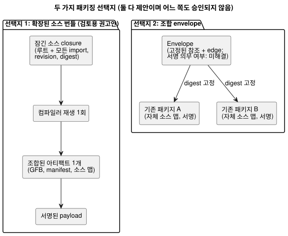
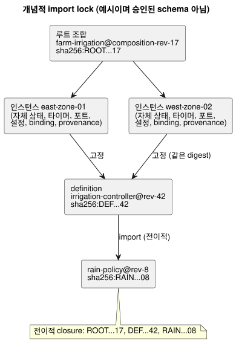

<!-- translation-source: docs/research/GF-COMPOSE-R7-PACKAGES.md -->
[영문 원문](GF-COMPOSE-R7-PACKAGES.md)

# GF-COMPOSE R7: 패키지와 import closure

이 연구 노트는 배포된 아티팩트를 언제나 정확한 소스, import, 컴파일러, 신뢰 증거까지
거슬러 추적할 수 있도록, 조합된 동작(behavior)을 패키징하는 두 가지 방법을 비교합니다.

이 문서의 구성:

- **사용자 문제** — 정확한 identity를 잃지 않고 여러 농장에서 재사용하기.
- **조사한 revision의 증거** — 현재 v1 패키지와 그 builder/verifier가 이미 보장하는 것과
  부족한 것.
- **표와 예** — 두 가지 패키징 선택지, 개념적 import lock, 해석/거부 규칙.
- **권고** — definition 업그레이드 절차 포함.
- **미해결 질문과 소유자**와 **검증**.

문서 전체에서 쓰는 용어:

| 용어 | 의미 |
| --- | --- |
| Import closure | 루트 소스와, 전이적으로 import되는 모든 정확한 소스. |
| Import lock | 각 import edge를 변경 불가능한 revision과 digest에 고정하는 기록. |
| Definition | 특정 revision의, 재사용 가능하고 바인딩이 없는 동작 소스. |
| 인스턴스 | 한 현장에서 definition을 한 번 사용하는 것. 자체 identity와 상태를 가집니다. |

## 사용자 문제

재사용 가능한 동작은 배포된 아티팩트를 만드는 데 쓰인 정확한 소스, 설정, 컴파일러
identity, 신뢰 증거를 잃지 않고 둘 이상의 농장에 설치될 수 있어야 합니다.

카탈로그 이름이나 대화 memory가 새로운 실행 revision을 조용히 선택해서는 안 됩니다.
memory는 provenance(출처)이자 작성 문맥으로 남으며, 실행 규칙이나 바인딩의 권한이
아닙니다(R2, system-memory #68에서 확인됨).

이 연구는 조합을 위한 두 가지 패키징 선택지를 비교합니다. 레지스트리, 다운로더, 키 서비스,
wire 형식 변경, ABI를 정의하지 않습니다.

## 조사한 revision의 증거

증거는 작업 트리 `HEAD`인 `ffdbc96461eca67908252507fb851fa4dabd9a2c`에서 조사했습니다.

**현재 v1 패키지 내용.** 패키지는 서명된 payload 안에 다음을 담습니다.

- 정확한 정본 `.ghost.md` 소스 하나
- GFB1 바이트
- manifest
- 소스 맵
- 실행 identity
- `bindingRevision`

소스는 바이트 단위로 보존되며, 그 SHA-256은 소스 맵이 연결합니다
([PORTABLE-PACKAGE](../PORTABLE-PACKAGE.ko.md), [SOURCE-MAP](../SOURCE-MAP.ko.md)).

**Builder.** `buildPortablePackage`는 소스 텍스트와 컴파일러 revision으로 새로
`compileSource` 재생을 수행해야 합니다. 재생된 GFB, manifest, 소스 맵이 제공된 컴파일
결과와 다르면 거부합니다([portable-package.mjs](../../tools/portable-package.mjs)).

**Verifier.** `verifyPortablePackage`는 다음을 검사합니다.

- schema/버전
- payload digest
- 활성 상태의 신뢰된 서명
- 컴파일러와 런타임 identity
- 바인딩 revision
- capability
- 아티팩트 digest
- 소스 맵 상호 연결

그런 다음 필수 native/WASM 바이트코드 verifier를 실행합니다.

native verifier는 대상 로더의 경계이며, 물리적 구동을 확립하지 않습니다.

**부족한 것.** 현재 증거는 단일 소스, 단일 아티팩트입니다. 현재 패키지 필드 중 다음을
표현하는 것은 없습니다.

- import edge
- 완전한 소스 closure
- definition revision
- 인스턴스 ID
- 재사용 가능하고 바인딩이 없는 definition

**관련 설계 결과(미구현).**

- R2는 불투명한 인스턴스 identity와 격리된 상태/provenance를 제안합니다.
- R3는 조합 스케줄링과 인스턴스 조정을 열어 둡니다.
- R6는 사용자가 승인한 live 속성 이벤트 설계를 기록합니다. 프로그램과 실행 identity는
  안정적으로 유지되면서 설정 revision/유효 위치가 바뀝니다. 그 이벤트는 바이너리를
  재패키징하거나 재배포하지 않습니다.
- 설정과 서명의 연결은 미해결입니다. 패키지 진정성을 약화한다는 뜻은 아닙니다.

이것들은 설계 결과로 남으며, 구현된 패키지 필드나 런타임 동작이 아닙니다.

## 표와 예

### 정확히 두 가지 패키징 선택지

| 선택지 | 정확한 소스 closure | 변경 불가능한 import | 컴파일러 재생 | 계약/맵 identity | 바인딩 생애주기 | 서명 | native verifier 영향 |
|---|---|---|---|---|---|---|---|
| 조합 컴파일을 위해 소스 번들 확장 *(제안)* | 번들 루트 `.ghost.md`와 전이적으로 import되는 모든 정확한 소스, revision ID, digest | import edge가 definition revision/digest를 고정. 유동 이름은 거부하거나 lock 생성 전에 해석 | 잠긴 closure 전체를 컴파일러 revision으로 재생하고 조합된 GFB, manifest, 소스 맵을 비교 | 새 조합/closure identity가 각 소스 revision과 조합 아티팩트를 연결해야 함. 소스 맵 형식과 ABI 확장은 미해결 | 재사용 가능한 definition은 현장 바인딩을 제외. 설치 패키지가 바인딩 revision과 인스턴스 ID를 별도로 결합 | Ed25519 payload 서명과 기존 신뢰 snapshot 재사용. closure, edge, 아티팩트, 결합에 서명 | schema/상호 연결 검사와 경우에 따라 native 한계를 확장. 최종 GFB1 바이트와 ABI가 호환되면 기존 대상 로딩을 유지할 수 있으나, 이는 미해결 |
| 기존 아티팩트를 참조하는 조합 envelope 추가 *(제안)* | envelope가 기존 패키지/아티팩트의 정확한 identity와 소스 digest를 나열. 참조를 재귀적으로 해석해야만 closure가 완전함 | 참조가 패키지/아티팩트 digest와 definition revision을 고정. 카탈로그 별칭은 고정된 결과가 필요 | 필요에 따라 참조된 각 소스/아티팩트를 재생한 뒤 조합 계약을 검증. 조합 아티팩트를 재생해야 하는지는 미해결 | 각 패키지의 현재 소스 맵과 identity를 보존하고 새 envelope/edge identity를 추가. 아티팩트 간 맵과 ABI는 미해결 | 기존 패키지는 각자의 바인딩 생애주기를 유지. 재사용 가능한 참조가 현장 바인딩을 실수로 상속해서는 안 됨 | 각 아티팩트의 서명을 재사용하고 envelope에 서명. 신뢰 순서와 envelope 서명의 필수 여부는 미해결 | native verifier는 참조된 패키지를 개별적으로 검증할 수 있으나, 조합 수준 검증에는 새로운 호출자 계약과 한계가 필요 |

다이어그램은 두 형태를 대비합니다. 하나의 잠긴 closure를 하나의 아티팩트로 컴파일하는
방식과, 기존 패키지를 고정하는 envelope 방식입니다.



장단점:

- 첫 번째 선택지는 하나의 결정적인 컴파일러 입력과 하나의 조합 아티팩트를 제공합니다.
- 두 번째 선택지는 아티팩트 경계를 보존하지만, 해석, 아티팩트 간 capability identity,
  집합 검증을 더 어렵게 만듭니다.

어느 선택지도 아키텍처 승인을 받지 않았습니다.

### 개념적 import lock (예시이며 승인된 schema 아님)

```text
root composition: farm-irrigation@composition-rev-17
root source: sha256:ROOT...17
instance: east-zone-01 -> definition irrigation-controller@rev-42 / sha256:DEF...42
instance: west-zone-02 -> definition irrigation-controller@rev-42 / sha256:DEF...42
imports:
  irrigation-controller@rev-42
    -> rain-policy@rev-8 / sha256:RAIN...08
transitive closure: ROOT...17, DEF...42, RAIN...08
```

같은 lock을 그래프로 나타내면 다음과 같습니다.



lock이 보여 주는 것:

- **공유되는 것:** 두 인스턴스 ID는 서로 다르지만 같은 definition digest를 고정합니다.
  definition revision과 전이적 의존성은 공유됩니다.
- **인스턴스별인 것:** 상태, 타이머, 논리 포트 한정, 설정 결합, 설치 바인딩, 런타임
  provenance는 인스턴스마다 따로 만들어집니다.
- **이름 변경에도 안정적:** 카탈로그 항목의 이름을 바꿔도 어느 lock도 바뀌지 않습니다.
- **바인딩은 설치에 속함:** 배포 가능한 패키지의 `bindingRevision`은 보편적으로 재사용
  가능한 definition이 아니라 설치 결합에 속합니다.

### 해석과 거부

| 조건 | 필요한 결정적 동작 | 기존 커버리지 | 필요한 확장 |
|---|---|---|---|
| 누락된 import | 컴파일/패키지 수락 전에 거부하고 누락된 고정 edge를 식별 | 현재 패키지에는 import 해석이 없음 | closure 해석기와 안정적인 오류/소유자 계약 |
| 순환 import | lowering 전에 실행 가능한 import 순환을 거부. 표시용 그래프에서 순서를 추론하지 않음. 같은 스캔 안의 의존성 순환은 명시적인 거부/정의된 정책 결정이 필요하며, 이전 스캔 상태 edge는 이와 구분됨 | 조합 순환 검사 없음 | 해석기의 순환 감지와 명시적인 같은 스캔 정책. 이전 스캔 상태 의미는 R3 실행 결정으로 남음 |
| 고정된 결과가 없는 가변/유동 참조 | 거부. 이름, latest 태그, memory 주장은 revision이 아님 | 현재 패키지는 정확히 내장된 소스를 요구 | lock 생성 시 변경 불가능한 revision과 digest를 요구해야 함 |
| digest 불일치 | 컴파일러 또는 대상 로드 전에 거부하고 edge/아티팩트 불일치를 보고 | 기존 소스, 바이트코드, manifest, 맵, payload, 재생 digest 검사 | 같은 검사를 재귀적으로, 그리고 closure identity에 적용 |
| 지원되지 않는 버전/capability | 대상 로드 전에 패키지 또는 조합을 거부 | 기존 패키지/런타임/ABI/manifest/버전 및 필수 capability 검사 | import된 capability와 조합 계약을 집계. 명시적 소유자 경계 보존 |
| 받아들일 수 없는 서명 | 활성 상태이고 신뢰되며 폐기되지 않은 서명이 없으면 거부 | 기존 Ed25519, 신뢰 snapshot, 교체(rotation), 폐기(revocation) 검사 | envelope 서명이 필수인지, 신뢰를 어떻게 조합하는지 정의 |

## 권고

검토를 조건으로 **조합 컴파일을 위해 소스 번들 확장**을 권고합니다. 이 방식은 가장 작은
의미적 확장을 제공합니다.

- 하나의 잠긴 소스 closure
- 하나의 결정적 재생
- 하나의 조합 아티팩트
- 현재의 payload digest, Ed25519 신뢰, capability 검증, 소스 맵 연결, native/WASM 대상
  검증의 재사용

또한 누락되었거나 가변적인 의존성이 정확성 판단을 코디네이터로 미루지 않고 배포 전에
실패하게 만듭니다.

**lock을 배포/런타임 문맥과 분리합니다.**

| 기록 | 고정하거나 결합하는 것 |
| --- | --- |
| 변경 불가능한 import closure lock | 소스/definition revision, import edge, 정확한 digest. |
| 배포/런타임 문맥 | 인스턴스 ID, 설치/바인딩 revision, 프로그램/컴파일러/런타임 identity, 설정 revision/유효 위치, 실행 identity. |

live 속성 이벤트는 프로그램 바이트, 재패키징, 재배포, 실행 identity를 바꾸지 않고 설정
identity를 바꿉니다. 두 인스턴스는 definition digest를 공유할 수 있지만, 암묵적인 상태를
공유하거나 바인딩을 조용히 상속하는 일은 절대 없습니다.

**재사용 가능한 내보내기에서 제외되는 현장별 데이터:**

- 농장/현장 identity
- 물리 endpoint/채널 매핑
- 장치 프로필과 펌웨어 증거
- 설치 바인딩 revision
- 자격 증명
- 운영자/농부 기록
- 비공개 대화나 memory 내용
- 런타임 상태, 타이머, 실행 이력
- 인스턴스 설정(변경 불가능한 import 파라미터로 명시적으로 선언된 경우는 제외)

revision/배포 오케스트레이션은 API가 소유하고, 물리 프로필과 적용된 바인딩의 증거는
Device가 소유합니다.

### Definition 업그레이드 절차

1. API가 새 소스 digest와 잠긴 의존성 closure를 가진 `irrigation-controller@rev-43`을
   만듭니다.
2. 업그레이드 대상으로 명시적으로 선택된 인스턴스만 새로운 인스턴스-definition
   provenance edge를 받습니다.
3. 영향받는 각 인스턴스는 선택한 방식에 따라 재컴파일되거나 재검증되며, 바이트가 바뀌면
   새로운 모듈, manifest, 소스 맵, 조합 아티팩트 digest가 만들어집니다.
4. 그 인스턴스의 설정과 설치 결합의 호환성을 검사합니다. API가 새 패키지를 선택할 때까지
   이전 인스턴스/패키지는 설명 가능한 이전 배포로 남습니다.
5. 이 프로그램/펌웨어 갱신은 해당 ESP에 대해 컨트롤러 전체 유지보수 정지를 사용합니다.
   일반적인 속성 이벤트는 그렇지 않습니다.
6. 배포 패키지는 새로운 정확한 closure에 서명하고, 컴파일러/런타임 identity와 설치 바인딩
   결합을 기록합니다.

여기의 어떤 주장도 장치가 이를 활성화했다거나 펌프가 움직였다는 뜻이 아닙니다.

다음은 미해결로 남습니다. 여러 소스 문서에 대한 소스 맵 표현, 조합된 ABI identity, 집계된
capability 이름 규칙, 그리고 native 검증이 하나의 최종 GFB1을 받아들일지 envelope를
검증할지 여부입니다. 이 공백에 대해 호환성 동작을 조용히 선택하지 마십시오.

## 미해결 질문과 소유자

- 언어 + API 소유자: lock/closure 기록, definition revision, import edge identity, 정규
  순서, 누락/순환 오류 계약을 정의합니다.
- 컴파일러/런타임 소유자: 조합이 호환되는 GFB1 모듈 하나를 내보낼지, ABI/런타임 확장이
  필요한지 결정합니다. R3 실행 제약이 적용됩니다.
- 소스 맵/계약 소유자: 현재 소스 문서 상호 연결을 깨지 않고 다중 소스 좌표와 조합 맵
  identity를 정의합니다.
- 패키지/native verifier 소유자: 재귀적 아티팩트 검증과 서명된 조합 envelope 하나 중에서
  선택하고, 한계, 신뢰 순서, 안정적인 오류를 정합니다.
- API/배포 소유자: 인스턴스 업그레이드 선택, live 설정 이벤트 결합과 미해결 진정성 연결,
  바인딩 생애주기, 배포 패키지 lineage를 정의합니다. 속성 이벤트는 재패키징을 함축하지
  않습니다.
- Device 소유자: 적용된 바인딩의 증거를 정의합니다. 패키지 검증은 하드웨어 검증이
  아닙니다.
- 시스템/API 소유자: memory를 provenance/작성 문맥으로 유지하고 보존 또는 삭제 연결을
  정의합니다. memory만으로는 실행을 고정할 수 없습니다.

## 검증

- [x] 조사한 commit을 기록하고, 패키지, 컴파일러, 소스 맵, portable-package 테스트의 해당
  절을 읽었습니다.
- [x] 정확히 두 가지 패키징 선택지를 요청된 모든 열에 걸쳐 비교했습니다.
- [x] lock 예에는 루트 조합 revision, 두 인스턴스 ID, 공유 definition digest, 정확한 의존성
  revision/digest, 전이적 의존성이 포함되어 있습니다.
- [x] 여섯 가지 거부 종류 모두 현재 커버리지와 필요한 조합 확장을 구분합니다.
- [x] 업그레이드 절차는 소스/아티팩트/provenance/배포 효과를 분리하고 현장별 데이터를
  제외합니다.
- [x] 구현, 제안, 수작업 예에 관한 주장을 구분해 표시했습니다. 런타임 테스트를 실행하거나
  주장하지 않았습니다.

코디네이터의 인수 검사는 `git diff --check`, 상대 링크 점검, 관련 없는 문서가 바뀌지
않았다는 확인입니다. 런타임 테스트는 실행하거나 주장하지 않았습니다.
