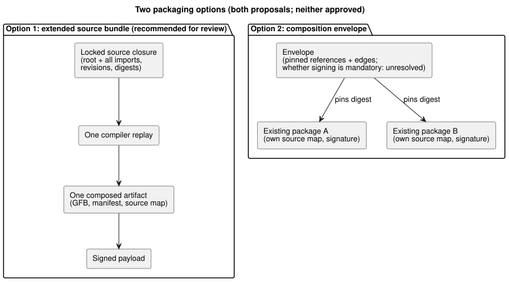
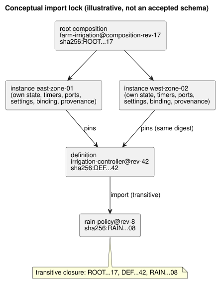

# GF-COMPOSE R7: packages and import closure

This research note compares two ways to package composed behaviors so that a
deployed artifact can always be traced back to its exact sources, imports,
compiler, and trust evidence.

In this document:

- **User problem** — reuse across farms without losing exact identity.
- **Evidence at examined revision** — what the current v1 package and its
  builder/verifier already guarantee, and what they lack.
- **Tables and examples** — the two packaging options, a conceptual import
  lock, and resolution/rejection rules.
- **Recommendation** — including a definition-upgrade walkthrough.
- **Unresolved questions and owners** and **Verification**.

Terms used throughout:

| Term | Meaning |
| --- | --- |
| Import closure | The root source plus every transitively imported exact source. |
| Import lock | A record that pins each import edge to an immutable revision and digest. |
| Definition | A reusable, binding-free behavior source at a specific revision. |
| Instance | One use of a definition at a site, with its own identity and state. |

## User problem

A reusable behavior must be installable at more than one farm without losing
the exact sources, settings, compiler identity, and trust evidence used to
produce a deployed artifact.

A catalog name or conversation memory must not silently select a new
executable revision. Memory remains provenance and authoring context, not
execution-rule or binding authority (R2, verified from system-memory #68).

This research compares two packaging options for composition. It does not
define a registry, downloader, key service, wire-format change, or ABI.

## Evidence at examined revision

Evidence was examined at `ffdbc96461eca67908252507fb851fa4dabd9a2c`, the
working-tree `HEAD`.

**Current v1 package contents.** The package embeds, under a signed payload:

- one exact canonical `.ghost.md` source;
- GFB1 bytes;
- manifest;
- source map;
- execution identity; and
- `bindingRevision`.

The source is byte-preserved and its SHA-256 is linked by the source map
([PORTABLE-PACKAGE](../PORTABLE-PACKAGE.md), [SOURCE-MAP](../SOURCE-MAP.md)).

**Builder.** `buildPortablePackage` requires a fresh `compileSource` replay
using the source text and compiler revision. It rejects any mismatch between
replayed GFB, manifest, or source map and the supplied compilation
([portable-package.mjs](../../tools/portable-package.mjs)).

**Verifier.** `verifyPortablePackage` checks:

- schema/version;
- payload digest;
- active trusted signatures;
- compiler and runtime identity;
- binding revision;
- capabilities;
- artifact digests; and
- source-map cross-links;

then runs a mandatory native/WASM bytecode verifier.

The native verifier is a target loader boundary; it does not establish physical
actuation.

**What is missing.** Current evidence is single-source and single-artifact. No
current package field represents:

- import edges;
- a complete source closure;
- definition revision;
- instance ID; or
- a reusable binding-free definition.

**Related design findings (not implemented).**

- R2 proposes opaque instance identity and isolated state/provenance.
- R3 leaves composition scheduling and instance coordination open.
- R6 records the user-approved live property-event design: a settings
  revision/effective position changes while program and run identity remain
  stable. That event does not repackage or redeploy a binary.
- Settings-to-signature linkage is unresolved; no weakening of package
  authenticity is implied.

These remain design findings, not implemented package fields or runtime
behavior.

## Tables and examples

### Exactly two packaging options

| Option | Exact source closure | Immutable imports | Compiler replay | Contract/map identity | Binding lifecycle | Signatures | Native verifier impact |
|---|---|---|---|---|---|---|---|
| Extend a source bundle for composed compilation *(proposal)* | Bundle root `.ghost.md` plus every transitively imported exact source, revision ID, and digest | Import edges pin definition revision/digest; floating names are rejected or resolved before lock creation | Replay the complete locked closure with compiler revision; compare composed GFB, manifest, and source map | New composition/closure identity must link each source revision and composed artifact; source-map format and ABI extension remain unresolved | Reusable definition excludes site binding; installation package separately joins binding revision and instance IDs | Reuse Ed25519 payload signing and existing trust snapshots; sign closure, edges, artifacts, and joins | Extend schema/cross-link checks and possibly native limits. Existing target loading can remain if final GFB1 bytes and ABI stay compatible; this is unresolved |
| Add a composition envelope referencing existing artifacts *(proposal)* | Envelope lists exact existing package/artifact identities and their source digests; closure is complete only if references are recursively resolved | References pin package/artifact digest and definition revision; catalog aliases require a pinned result | Replay each referenced source/artifact as required, then validate composition contract; whether a composed artifact must be replayed is unresolved | Preserve each package's current source map and identity, plus a new envelope/edge identity; cross-artifact maps and ABI are unresolved | Existing packages retain their binding lifecycle; reusable references must not inherit a site binding accidentally | Reuse signatures on each artifact and sign the envelope; trust ordering and whether envelope signing is required are unresolved | Native verifier can verify referenced packages individually, but composition-level validation needs a new caller contract and limits |

The diagram contrasts the two shapes: one locked closure compiled into one
artifact, versus an envelope that pins existing packages.



Trade-off:

- The first option gives one deterministic compiler input and one composed
  artifact.
- The second preserves artifact boundaries but makes resolution,
  cross-artifact capability identity, and aggregate verification harder.

Neither option is architecture-approved.

### Conceptual import lock (illustrative, not an accepted schema)

```text
root composition: farm-irrigation@composition-rev-17
root source: sha256:ROOT...17
instance: east-zone-01 -> definition irrigation-controller@rev-42 / sha256:DEF...42
instance: west-zone-02 -> definition irrigation-controller@rev-42 / sha256:DEF...42
imports:
  irrigation-controller@rev-42
    -> rain-policy@rev-8 / sha256:RAIN...08
transitive closure: ROOT...17, DEF...42, RAIN...08
```

The same lock as a graph:



What the lock shows:

- **Shared:** the two instance IDs are distinct while pinning the same
  definition digest. The definition revision and transitive dependency are
  shared.
- **Per instance:** state, timers, logical-port qualification, settings join,
  installation binding, and runtime provenance are instantiated per instance.
- **Stable under renaming:** renaming a catalog entry does not change either
  lock.
- **Binding belongs to installation:** a deployable package's
  `bindingRevision` belongs to an installation join, not to the universally
  reusable definition.

### Resolution and rejection

| Condition | Required deterministic behavior | Existing coverage | Required extension |
|---|---|---|---|
| Missing import | Reject before compilation/package acceptance; identify the missing pinned edge | No import resolution in current package | Closure resolver and stable error/owner contract |
| Cyclic import | Reject executable import cycles before lowering; do not infer order from display graphs. Same-scan dependency cycles need an explicit reject/defined-policy decision; prior-scan state edges are distinct | No composition cycle check | Resolver cycle detection and an explicit same-scan policy; prior-scan state semantics remain an R3 execution decision |
| Mutable/floating reference without pinned result | Reject; a name, latest tag, or memory claim is not a revision | Current package requires exact embedded source | Lock creation must require immutable revision and digest |
| Digest mismatch | Reject before compiler or target load; report edge/artifact mismatch | Existing source, bytecode, manifest, map, payload, and replay digest checks | Apply the same checks recursively and to closure identity |
| Unsupported version/capability | Reject package or composition before target load | Existing package/runtime/ABI/manifest/version and required-capability checks | Aggregate imported capabilities and composition contract; preserve explicit owner boundaries |
| Unacceptable signature | Reject absent an active trusted non-revoked signature | Existing Ed25519, trust snapshot, rotation, and revocation checks | Define whether envelope signature is mandatory and how trust is composed |

## Recommendation

Recommend **extend a source bundle for composed compilation**, subject to
review. It offers the smallest semantic extension:

- one locked source closure;
- one deterministic replay;
- one composed artifact; and
- reuse of current payload digests, Ed25519 trust, capability validation,
  source-map links, and native/WASM target verification.

It also makes missing or mutable dependencies fail before deployment instead
of deferring correctness to a coordinator.

**Keep the lock separate from deployment/runtime context.**

| Record | What it pins or joins |
| --- | --- |
| Immutable import-closure lock | Source/definition revisions, import edges, and exact digests. |
| Deployment/runtime context | Instance ID, installation/binding revision, program/compiler/runtime identity, settings revision/effective position, and run identity. |

A live property event changes settings identity without changing program
bytes, repackaging, redeployment, or run identity. Two instances may share a
definition digest but never share implicit state or silently inherit a
binding.

**Site-specific data excluded from reusable export:**

- farm/site identity;
- physical endpoint/channel mapping;
- device profile and firmware evidence;
- installation binding revision;
- credentials;
- operator/farmer records;
- private conversation or memory content;
- runtime state, timers, and run history; and
- instance settings, unless explicitly declared as an immutable import
  parameter.

The API owns revision/deployment orchestration; Device owns physical profiles
and applied-binding evidence.

### Definition upgrade walkthrough

1. API creates `irrigation-controller@rev-43` with a new source digest and
   locked dependency closure.
2. Only instances explicitly selected for upgrade receive a new
   instance-to-definition provenance edge.
3. Each affected instance is recompiled or revalidated under the chosen
   option, producing new module, manifest, source-map, and composed-artifact
   digests when bytes change.
4. Its settings and installation joins are checked for compatibility. The old
   instance/package remains the explainable prior deployment until API selects
   a new package.
5. This program/firmware update uses controller-wide maintenance stop for that
   ESP. Ordinary property events do not.
6. The deployment package signs the new exact closure and records
   compiler/runtime identity and installation binding join.

No claim here means a device activated it or a pump moved.

The following remain unresolved: the source-map representation for multiple
source documents, composed ABI identity, aggregate capability naming, and
whether native verification accepts one final GFB1 or validates an envelope.
Do not silently choose compatibility behavior for these gaps.

## Unresolved questions and owners

- Language + API owners: define the lock/closure record, definition revision,
  import edge identity, canonical ordering, and missing/cycle error contract.
- Compiler/runtime owners: decide whether composition emits one compatible GFB1
  module or requires an ABI/runtime extension; R3 execution constraints apply.
- Source-map/contract owner: define multi-source coordinates and composed map
  identity without breaking current source-document cross-links.
- Package/native verifier owners: choose recursive artifact verification versus
  one signed composition envelope, limits, trust ordering, and stable errors.
- API/deployment owner: define instance upgrade selection, live settings-event
  joins and unresolved authenticity linkage, binding lifecycle, and
  deployment-package lineage. Property events do not imply repackaging.
- Device owner: define evidence for an applied binding. Package verification is
  not hardware verification.
- System/API owner: preserve memory as provenance/authoring context and define
  retention or deletion links; memory cannot pin execution by itself.

## Verification

- [x] Examined commit recorded and targeted package, compiler, source-map, and
  portable-package test sections were read.
- [x] Exactly two packaging options are compared across all requested columns.
- [x] Lock example includes a root composition revision, two instance IDs,
  shared definition digest, exact dependency revisions/digests, and a
  transitive dependency.
- [x] All six rejection classes distinguish current coverage from required
  composition extension.
- [x] Upgrade walkthrough separates source/artifact/provenance/deployment
  effects and excludes site-specific data.
- [x] Claims about implementation, proposals, and hand-worked examples are
  labeled distinctly. No runtime tests were run or claimed.

Coordinator acceptance checks are `git diff --check`, relative-link inspection,
and confirmation that no unrelated document changed. No runtime tests were run
or claimed.
