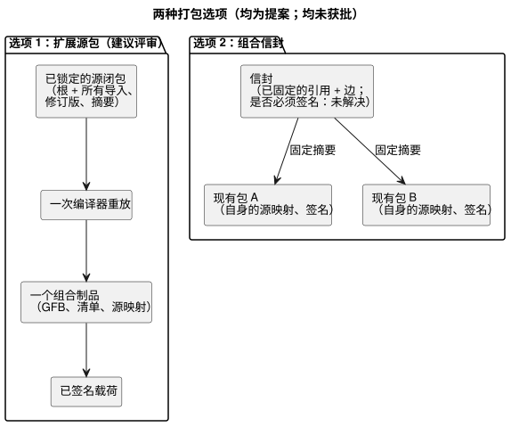
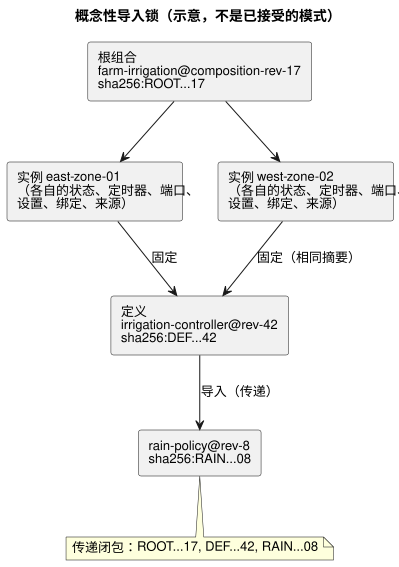

<!-- translation-source: docs/research/GF-COMPOSE-R7-PACKAGES.md -->
[英文原文](GF-COMPOSE-R7-PACKAGES.md)

# GF-COMPOSE R7：包与导入闭包

本研究笔记比较两种打包组合行为的方式，目标是让已部署的制品始终可以追溯到其确切的源、导入、编译器和信任证据。

本文内容：

- **用户问题** —— 在多个农场之间复用，同时不丢失确切的身份标识。
- **被检查修订版中的证据** —— 当前 v1 包及其构建器/验证器已经保证了什么，又缺少什么。
- **表格与示例** —— 两种打包选项、一个概念性的导入锁，以及解析/拒绝规则。
- **建议** —— 包括一个定义升级的推演。
- **未决问题与负责方** 以及 **验证**。

全文使用的术语：

| 术语 | 含义 |
| --- | --- |
| 导入闭包 | 根源加上所有被传递导入的确切源。 |
| 导入锁 | 一条记录，把每条导入边固定到一个不可变的修订版和摘要。 |
| 定义 | 位于特定修订版、可复用且不含绑定的行为源。 |
| 实例 | 某个定义在某个现场的一次使用，拥有自己的身份标识和状态。 |

## 用户问题

可复用的行为必须能够安装到不止一个农场，同时不丢失生成已部署制品时所用的确切源、设置、编译器身份标识和信任证据。

目录名称或对话记忆不得悄悄选择新的可执行修订版。记忆仍然是来源（provenance）和编写上下文，而不是执行规则或绑定的权威（R2，已依据系统记忆 #68 核实）。

本研究比较组合的两种打包选项。它不定义注册表、下载器、密钥服务、传输格式变更或 ABI。

## 被检查修订版中的证据

证据检查基于 `ffdbc96461eca67908252507fb851fa4dabd9a2c`，即工作树的 `HEAD`。

**当前 v1 包的内容。** 该包在一个已签名的载荷中嵌入：

- 一个确切的规范 `.ghost.md` 源；
- GFB1 字节；
- 清单；
- 源映射；
- 执行身份标识；以及
- `bindingRevision`。

源按字节原样保存，其 SHA-256 由源映射关联（[PORTABLE-PACKAGE](../PORTABLE-PACKAGE.zh.md)、[SOURCE-MAP](../SOURCE-MAP.zh.md)）。

**构建器。** `buildPortablePackage` 要求使用源文本和编译器修订版进行一次全新的 `compileSource` 重放。只要重放得到的 GFB、清单或源映射与所提供的编译结果有任何不一致，它就拒绝（[portable-package.mjs](../../tools/portable-package.mjs)）。

**验证器。** `verifyPortablePackage` 检查：

- 模式/版本；
- 载荷摘要；
- 有效的受信任签名；
- 编译器和运行时身份标识；
- 绑定修订版；
- 能力；
- 制品摘要；以及
- 源映射交叉链接；

然后运行强制的 native/WASM 字节码验证器。

native 验证器是目标加载器的边界；它并不确立物理驱动。

**缺少什么。** 当前证据是单源、单制品的。当前没有任何包字段表示：

- 导入边；
- 完整的源闭包；
- 定义修订版；
- 实例 ID；或
- 可复用且不含绑定的定义。

**相关设计结论（未实现）。**

- R2 提出不透明的实例身份标识以及隔离的状态/来源。
- R3 将组合调度和实例协调留作开放问题。
- R6 记录了经用户批准的 live 属性事件设计：设置修订版/生效位置会变化，而程序和运行身份标识保持稳定。该事件不会重新打包或重新部署二进制文件。
- 设置与签名的关联尚未解决；这并不意味着削弱包的真实性。

这些仍然是设计结论，而不是已实现的包字段或运行时行为。

## 表格与示例

### 恰好两种打包选项

| 选项 | 确切的源闭包 | 不可变导入 | 编译器重放 | 契约/映射身份标识 | 绑定生命周期 | 签名 | 对 native 验证器的影响 |
|---|---|---|---|---|---|---|---|
| 为组合编译扩展源包（source bundle）*（提案）* | 打包根 `.ghost.md` 以及所有被传递导入的确切源、修订版 ID 和摘要 | 导入边固定定义修订版/摘要；浮动名称会被拒绝，或在创建锁之前解析 | 使用编译器修订版重放完整的已锁定闭包；比较组合后的 GFB、清单和源映射 | 新的组合/闭包身份标识必须关联每个源修订版和组合制品；源映射格式和 ABI 扩展仍未解决 | 可复用定义不包含现场绑定；安装包另行关联绑定修订版和实例 ID | 复用 Ed25519 载荷签名和现有的信任快照；对闭包、边、制品和关联进行签名 | 扩展模式/交叉链接检查，并可能扩展 native 限制。如果最终的 GFB1 字节和 ABI 保持兼容，现有的目标加载可以保留；这一点尚未解决 |
| 添加引用现有制品的组合信封（envelope）*（提案）* | 信封列出现有包/制品的确切身份标识及其源摘要；只有在递归解析所有引用后，闭包才完整 | 引用固定包/制品摘要和定义修订版；目录别名需要一个已固定的结果 | 按需重放每个被引用的源/制品，然后验证组合契约；组合制品是否必须重放尚未解决 | 保留每个包当前的源映射和身份标识，并加上新的信封/边身份标识；跨制品映射和 ABI 尚未解决 | 现有包保留其绑定生命周期；可复用引用不得意外继承现场绑定 | 复用每个制品上的签名并对信封签名；信任顺序以及是否必须对信封签名尚未解决 | native 验证器可以逐个验证被引用的包，但组合层面的验证需要新的调用方契约和限制 |

下图对比了两种形态：一种是把已锁定的闭包编译成一个制品，另一种是固定现有包的信封。



权衡：

- 第一种选项提供一个确定性的编译器输入和一个组合制品。
- 第二种选项保留了制品边界，但使解析、跨制品的能力身份标识以及聚合验证变得更难。

两种选项都未获得架构批准。

### 概念性导入锁（示意，不是已接受的模式）

```text
根组合：farm-irrigation@composition-rev-17
根源：sha256:ROOT...17
实例：east-zone-01 -> 定义 irrigation-controller@rev-42 / sha256:DEF...42
实例：west-zone-02 -> 定义 irrigation-controller@rev-42 / sha256:DEF...42
导入：
  irrigation-controller@rev-42
    -> rain-policy@rev-8 / sha256:RAIN...08
传递闭包：ROOT...17, DEF...42, RAIN...08
```

用图表示同一个锁：



该锁说明了：

- **共享**： 两个实例 ID 互不相同，但固定的是同一个定义摘要。定义修订版和传递依赖是共享的。
- **按实例**： 状态、定时器、逻辑端口限定、设置关联、安装绑定和运行时来源都按实例分别实例化。
- **重命名时保持稳定**： 重命名目录条目不会改变任何一个锁。
- **绑定属于安装**： 可部署包的 `bindingRevision` 属于安装关联，而不属于普遍可复用的定义。

### 解析与拒绝

| 条件 | 要求的确定性行为 | 现有覆盖 | 需要的扩展 |
|---|---|---|---|
| 缺失导入 | 在编译/包接受之前拒绝；指出缺失的已固定边 | 当前包中没有导入解析 | 闭包解析器以及稳定的错误/负责方契约 |
| 循环导入 | 在降级之前拒绝可执行的导入环；不要从显示用的图推断顺序。同扫描依赖环需要一个显式的拒绝/已定义策略决定；前一扫描的状态边是另一回事 | 没有组合环检查 | 解析器的环检测以及显式的同扫描策略；前一扫描状态的语义仍是 R3 的执行决定 |
| 没有固定结果的可变/浮动引用 | 拒绝；名称、latest 标签或记忆中的说法都不是修订版 | 当前包要求嵌入确切的源 | 创建锁时必须要求不可变的修订版和摘要 |
| 摘要不匹配 | 在编译器或目标加载之前拒绝；报告边/制品的不匹配 | 现有的源、字节码、清单、映射、载荷和重放摘要检查 | 对闭包身份标识递归地应用相同的检查 |
| 不受支持的版本/能力 | 在目标加载之前拒绝包或组合 | 现有的包/运行时/ABI/清单/版本以及所需能力检查 | 聚合导入的能力和组合契约；保持显式的负责方边界 |
| 不可接受的签名 | 若没有有效、受信任且未被吊销的签名，则拒绝 | 现有的 Ed25519、信任快照、轮换和吊销检查 | 定义信封签名是否为强制，以及信任如何组合 |

## 建议

建议采用 **为组合编译扩展源包**，但需经评审。它提供最小的语义扩展：

- 一个已锁定的源闭包；
- 一次确定性的重放；
- 一个组合制品；以及
- 复用当前的载荷摘要、Ed25519 信任、能力验证、源映射链接以及 native/WASM 目标验证。

它还使缺失或可变的依赖在部署之前就失败，而不是把正确性推迟给协调方。

**将锁与部署/运行时上下文分开。**

| 记录 | 固定或关联的内容 |
| --- | --- |
| 不可变的导入闭包锁 | 源/定义修订版、导入边以及确切的摘要。 |
| 部署/运行时上下文 | 实例 ID、安装/绑定修订版、程序/编译器/运行时身份标识、设置修订版/生效位置以及运行身份标识。 |

live 属性事件会改变设置身份标识，但不会改变程序字节，也不会导致重新打包、重新部署或运行身份标识变化。两个实例可以共享一个定义摘要，但绝不共享隐式状态，也绝不悄悄继承绑定。

**从可复用导出中排除的现场特定数据**：

- 农场/现场身份标识；
- 物理端点/通道映射；
- 设备配置文件和固件证据；
- 安装绑定修订版；
- 凭据；
- 运营者/农户记录；
- 私人对话或记忆内容；
- 运行时状态、定时器和运行历史；以及
- 实例设置，除非被显式声明为不可变的导入参数。

API 负责修订版/部署的编排；Device 负责物理配置文件和已应用绑定的证据。

### 定义升级推演

1. API 创建 `irrigation-controller@rev-43`，带有新的源摘要和已锁定的依赖闭包。
2. 只有被显式选中升级的实例才会获得新的“实例到定义”来源边。
3. 每个受影响的实例都按所选选项重新编译或重新验证；当字节发生变化时，会产生新的模块、清单、源映射和组合制品摘要。
4. 检查其设置关联和安装关联的兼容性。在 API 选择新包之前，旧的实例/包仍是可解释的先前部署。
5. 这次程序/固件更新会对该 ESP 使用整个控制器范围的维护停机。普通属性事件则不会。
6. 部署包对新的确切闭包签名，并记录编译器/运行时身份标识以及安装绑定关联。

此处的任何陈述都不表示设备已经激活了它或水泵已经运转。

以下事项仍未解决：多源文档的源映射表示、组合 ABI 身份标识、聚合能力命名，以及 native 验证是接受一个最终的 GFB1 还是验证一个信封。不要为这些空白悄悄选择兼容性行为。

## 未决问题与负责方

- 语言 + API 负责方：定义锁/闭包记录、定义修订版、导入边身份标识、规范排序以及缺失/环错误契约。
- 编译器/运行时负责方：决定组合是产出一个兼容的 GFB1 模块，还是需要 ABI/运行时扩展；R3 的执行约束适用。
- 源映射/契约负责方：定义多源坐标和组合映射身份标识，且不破坏当前的源文档交叉链接。
- 包/native 验证器负责方：在递归制品验证与一个已签名的组合信封之间作出选择，并定义限制、信任顺序和稳定的错误。
- API/部署负责方：定义实例升级选择、live 设置事件关联及尚未解决的真实性关联、绑定生命周期，以及部署包谱系。属性事件并不意味着重新打包。
- Device 负责方：定义已应用绑定的证据。包验证不是硬件验证。
- 系统/API 负责方：将记忆保持为来源/编写上下文，并定义保留或删除的关联；记忆本身不能固定执行内容。

## 验证

- [x] 已记录被检查的提交，并阅读了包、编译器、源映射和可移植包测试的相关章节。
- [x] 恰好比较了两种打包选项，涵盖所要求的全部列。
- [x] 锁示例包含根组合修订版、两个实例 ID、共享的定义摘要、确切的依赖修订版/摘要以及一个传递依赖。
- [x] 全部六类拒绝都区分了现有覆盖与所需的组合扩展。
- [x] 升级推演区分了源/制品/来源/部署方面的影响，并排除了现场特定数据。
- [x] 关于实现的陈述、提案和手工推演示例分别作了标注。没有运行或声称运行任何运行时测试。

协调方的验收检查为 `git diff --check`、相对链接检查，以及确认没有无关文档被更改。没有运行或声称运行任何运行时测试。
