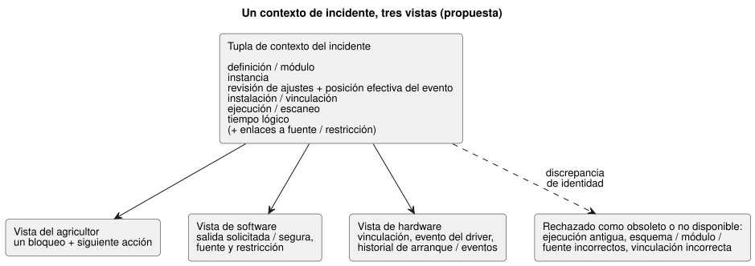

<!-- translation-source: docs/research/GF-COMPOSE-R8-INCIDENT-EVIDENCE.md -->
[Original en inglés](GF-COMPOSE-R8-INCIDENT-EVIDENCE.md)

# GF-COMPOSE R8: composición de la evidencia de incidentes

Padre: [#99](https://github.com/callin2/ghostflow-language/issues/99)  
Issue: [#107](https://github.com/callin2/ghostflow-language/issues/107)  
Estado: investigación/diseño acotado. No se afirma ninguna implementación ni prueba con dispositivos físicos.

Esta nota define cómo las vistas del agricultor, de software y de hardware
pueden apuntar al **mismo incidente**. Cubre la evidencia encontrada en la
revisión examinada, las uniones de identidad requeridas, cómo se mantienen
separadas las etapas de salida, tres recorridos elaborados a mano, la
recomendación y las decisiones abiertas de los responsables.

## Problema del usuario

Un agricultor pregunta: «¿Por qué no se realizó el riego?». La respuesta debe
identificar la misma ocurrencia que inspeccionan un ingeniero y un instalador.

La respuesta debe mantener separadas cuatro cosas:

1. la **salida solicitada**;
2. la **salida segura** seleccionada por el runtime (entorno de ejecución) del lenguaje;
3. el **resultado de aplicación del host o del renderizador**;
4. la **observación física**.

Dos reglas se aplican en todo momento:

- Un valor ausente no es `false`.
- Una ejecución (run) o vinculación (binding) antigua no debe unirse al incidente actual.

El objetivo específico de la composición es un traspaso de evidencia pequeño y
exacto. **No** crea:

- una segunda fuente ejecutable;
- un nuevo almacén de eventos;
- un registro completo de escaneos en bruto;
- hechos reconstruidos de una caída.

Las uniones propuestas incluyen la explicación de evento de entrada → regla →
intención, y la revisión de ajustes/posición efectiva que rige cada evaluación.
Son uniones de diseño, no afirmaciones sobre la telemetría actual.

## Evidencia en la revisión examinada

La revisión del lenguaje examinada es `ffdbc96461eca67908252507fb851fa4dabd9a2c`.

**Contrato de interacción.** Exige uniones exactas de esquema, módulo, fuente y
`runId`. `scanId` solo está ordenado dentro de una ejecución. Las observaciones
completadas usan explícitamente `ready`, `unavailable` o `error`. `stale` lo
deriva el consumidor que valida y nunca lo afirma un productor. Véanse
[`contracts/interaction-v0/README.md`](../../contracts/interaction-v0/README.es.md)
y [`tools/interaction-runtime-snapshot.mjs`](../../tools/interaction-runtime-snapshot.mjs).

**Contrato de seguridad de la fuente.** Registra la procedencia del compilador,
la salida solicitada/segura, las observaciones de restricciones y los resúmenes
(digests) de la fuente/documento. Explícitamente no infiere el funcionamiento
eléctrico ni mecánico. Véase
[`docs/SOURCE-SAFETY-TRACE.md`](../SOURCE-SAFETY-TRACE.es.md).

**Host con tramas.** El host con tramas (framed host) captura una trama de
entrada completa, despacha una sola vez y publica el último resultado aceptado.
Retiene (latch) un fallo tras un error de acondicionamiento o de despacho. Tras
ese fallo se requiere una nueva instancia del host. Véase
[`docs/FRAMED-CONTROL-HOST.md`](../FRAMED-CONTROL-HOST.es.md).

**Investigación previa (R1–R3) y la enmienda sobre el reinicio.**

- R1 recomienda un único bloqueo legible para el agricultor más una vista de
  ingeniería de las mismas identidades de fuente/módulo/instancia/ejecución e
  instalación.
- R2 establece que el `.ghost.md` canónico sigue siendo la autoridad ejecutable.
  La memoria #68 es contexto de procedencia/autoría, no autoridad directa sobre
  reglas de ejecución ni vinculaciones.
- R3 establece que un reinicio crea un nuevo `runId`, y que la propagación
  exacta de fallos en la composición sigue sin resolverse.
- Por separado, la enmienda de diseño acordada con el usuario es que el
  reinicio es un evento normal cuya respuesta la define la lógica GhostFlow
  escrita por el autor. No define una política global de reanudación/manual.
  Las obligaciones eléctricas previas al runtime de arranque, desconexión y
  fallo siguen siendo responsabilidad de Device/Driver. Esta regla de
  evento-respuesta es diseño, no evidencia del runtime actual.

**Issue de Device [#28](https://github.com/callin2/farm-device/issues/28).**
Propone un registro (journal) en flash local al dispositivo, acotado y
orientado a anexado, con un objetivo de unos siete días, separado del
historial reciente en RAM. La propuesta menciona:

- recuperación tras reinicio/corte de energía;
- identidad monotónica de eventos (`deviceId`, `eventSequence`, `bootId`, con
  `runId`/`scanId` opcionales);
- calidad del tiempo;
- identidad del programa/ajustes/runtime;
- paginación;
- avisos explícitos de recuperación/pérdida de datos.

También propone clases de eventos para cambios de salida solicitada/segura/aplicada,
comandos, fallos, disparos de seguridad, cambios de programa/ajustes y reinicios.

Se trata de evidencia de issue/diseño, no de evidencia de un runtime del
lenguaje o de Device implementado. El esquema de eventos versionado exacto, los
campos de retroalimentación física y la unión final de arranque/evento con la
ejecución siguen sin decidirse. Se etiquetan como uniones requeridas o
evidencia desconocida, no como material fuente no disponible. La agregación
(coalescing) de ocurrencias de entrada/observaciones de valor no es una promesa
de retención persistente de incidentes.

## Tablas y ejemplos

### Unión de incidente requerida

Cada fila es un límite de evidencia: quién lo produce, qué identidad debe
unirse y cómo se trata una identidad ausente o discordante.

| Límite de evidencia | Productor | Unión obligatoria | Disponibilidad / tratamiento de discrepancias |
|---|---|---|---|
| Revisión de la definición | Almacenamiento de API/fuente más el compilador del lenguaje | `documentId`, `revisionId`, SHA de la fuente; huella del módulo y SHA del bytecode | Requerida para explicar la fuente. Una identidad ausente o distinta es obsoleta/error, nunca una unión por etiqueta en el mejor de los casos. |
| Instancia de comportamiento | Composición/despliegue de la API | `instanceId` opaco propuesto, unido a la revisión de la definición | La v0 actual no tiene campo de instancia. Si falta, el alcance de la composición queda sin resolver; no se fusionan instancias de la misma definición. |
| Programa y ajustes | Fuente canónica para los valores predeterminados ejecutables; API/runtime para los eventos de ajustes | Revisión del programa más revisión/resumen de ajustes, posición efectiva del evento y alcance | Los eventos de propiedades en vivo preservan la identidad del programa y de la ejecución. Cada evaluación/intención se une a su revisión de ajustes efectiva. Los ajustes ausentes deben ser desconocidos; no se sustituyen silenciosamente por los valores predeterminados de la fuente. |
| Instalación y vinculación | Contexto de instalación de la API y perfil de Device | Revisión de instalación/vinculación, puerto lógico, identidad del endpoint físico/perfil | Requerida para afirmar qué equipo era el objetivo. Una vinculación incorrecta o antigua rechaza la unión; el endpoint físico no es la identidad del puerto lógico. |
| Ejecución / escaneo | Host con tramas/runtime | `runId`, `scanId` completado, tiempo lógico; identidad de esquema/módulo/fuente | `scanId` por sí solo no es válido. Un reinicio real crea una nueva ejecución y no debe unirse al antiguo escaneo 0. Un evento de propiedades en vivo no crea una nueva ejecución. Sin finalización no hay afirmación de escaneo completado. |
| Secuencia de arranque/eventos del dispositivo | Propuesta de historiador persistente de Device en #28; productor/esquema final sin resolver | Identidad monotónica de eventos del dispositivo propuesta, identidad de arranque, secuencia de eventos y enlace a la misma ejecución/vinculación | La propuesta admite la recuperación tras reinicio y avisos explícitos de pérdida de datos, pero los campos exactos y la retroalimentación física siguen sin resolverse. Se informa el último evento registrado y la brecha; nunca se sintetiza un escaneo final. No se infiere la retención duradera de cada observación de entrada del runtime. |
| Tiempo lógico | Finalización del host/runtime; reloj de Device solo si se registra por separado | `logicalTimeMs` exacto más cualquier marca de tiempo/identidad de reloj del dispositivo | El tiempo lógico del host no prueba el tiempo de reloj de pared ni la ocurrencia física. Una discrepancia de relojes es una incertidumbre que se muestra, no algo que se repara por inferencia. |
| Referencia a fuente/restricción | Mapa de fuente del compilador y traza de seguridad; responsable de restricciones para las restricciones de instalación | Nodo de fuente/ancla de intención, índice/tipo de restricción, primera violación/resultado final, contexto exacto del incidente | Las lecturas de dependencias estáticas no prueban la causa ejecutada. El artefacto/límite de restricciones de instalación sin resolver sigue siendo una decisión del responsable. |

**El contexto del incidente.** El contexto exacto de los participantes es la
tupla de:

- definición/módulo;
- instancia;
- revisión de ajustes/posición efectiva del evento dentro de la misma ejecución;
- instalación/vinculación;
- ejecución/escaneo;
- tiempo lógico.

Toda vista de participante debe usar esa tupla. Un consumidor debe rechazar
como obsoleta o no disponible una ejecución antigua, un esquema/módulo/fuente
incorrecto o una vinculación incorrecta. No debe presentar silenciosamente un
registro relacionado en su lugar.

El diagrama siguiente muestra una tupla que alimenta las tres vistas y cómo
las identidades discordantes se rechazan en lugar de unirse.

**La cadena causal.** La evidencia causal propuesta es: evento de entrada u
observación → regla evaluada → intención → salida solicitada/segura → resultado
del renderizador u observación física, unida a los ajustes efectivos en el
momento de la evaluación.

### Separación de etapas y titularidad/brechas

Cada etapa tiene su propio responsable y su propia brecha. Una etapa posterior
nunca prueba que una anterior se haya realizado físicamente.

| Etapa / evidencia | Responsable | Soporte actual | Brecha de composición |
|---|---|---|---|
| Salida solicitada | Traza del núcleo Rust; mapa de fuente del lenguaje | Mapa `requested` y procedencia existentes | Unirla a la instancia y al escaneo completado exacto. |
| Salida segura | Resolución de seguridad de Rust | Mapa `safe` existente y traza de seguridad acotada | Mantenerla distinta de la solicitud y exponer la referencia a la restricción. |
| Aplicación del host/renderizador | Integración de API/host y Device | No la define interaction-v0; un fallo del host no es una falla física | #74/#88 deben definir el evento de resultado de aplicación y la semántica de ausencia. La fuente/intención del driver se ocupa de la medición de precisión, el protocolo y la mecánica de ISR/escaneo en bruto; expone eventos/mediciones tipados y significativos sin ocultar la política agrícola. El tiempo de captura, el tiempo de recepción/evaluación y la calidad se mantienen distintos; el acuse de un comando no es prueba física. |
| Observación física | Responsable de Device/instalación | #28 propone un historial de eventos persistente y hace referencia a evidencia HIL de relés físicos, pero no fija el esquema final de retroalimentación | #28 debe definir la retroalimentación disponible, la identidad de arranque/historial y la retención; un evento aplicado registrado sigue sin probar el funcionamiento físico. |
| Contexto de memoria/autoría | API/sistema #68 | Solo contexto de procedencia | Nunca debe convertirse en una unión de ejecución o de vinculación sin una decisión/ruta de fuente aprobada. |
| Ocurrencias de entrada y observaciones de valor | No implementado aquí; diseño acordado. La captura puede basarse en interrupciones o en escaneo. | Identidad de la ocurrencia o valor observado, con tiempos distintos de captura y de recepción/evaluación, y calidad | Definir el registro de ingreso y el mapeo de evento a tick. Se preservan por defecto dentro de la capacidad admitida; el reemplazo por el último valor pendiente solo cuando se habilita explícitamente por entrada. El desbordamiento/pérdida debe informarse. El orden y el mapeo siguen abiertos; esto no es un historial duradero ilimitado. |

El diagrama siguiente muestra la cadena causal propuesta con cada etapa
separada, incluidos los dos límites de prueba mencionados en la tabla.

### Recorridos emparejados (elaborados a mano, no evidencia de ejecución)

Cada recorrido da la respuesta al agricultor y la siguiente acción, la
evidencia de software, la evidencia de hardware y la incertidumbre restante.

#### 1. Riego bloqueado por nivel bajo de agua

- **Respuesta al agricultor y siguiente acción:** «El riego fue bloqueado por
  la señal de nivel bajo de agua; revise el tanque o el sensor de la
  instalación». La respuesta no debe decir que el tanque está vacío.
- **Evidencia de software:** la misma ejecución/escaneo completado, la entrada
  `low_water=true`, la bomba solicitada `ON`, la bomba segura `OFF`, la
  restricción violada y la referencia a la fuente/ancla.
- **Evidencia de hardware:** solo el registro disponible del sensor o de la
  instalación.
- **Incertidumbre restante:** la señal no prueba el nivel físico del tanque ni
  que el sensor sea correcto.

#### 2. La aplicación del renderizador falló o falta la retroalimentación

- **Respuesta al agricultor y siguiente acción:** cuando se registra una falla,
  «El sistema solicitó el riego, pero la aplicación en el dispositivo falló».
  En caso contrario, «El resultado del comando es desconocido porque falta la
  retroalimentación física». La siguiente acción es inspeccionar la ruta de
  instalación/driver o contactar al instalador.
- **Evidencia de software:** la misma ejecución/escaneo, la salida solicitada,
  la salida segura y el resultado del host/renderizador si existe.
- **Evidencia de hardware:** la vinculación, el evento del driver o la
  retroalimentación física, solo si Device los registró.
- **Incertidumbre restante:** `requested=ON` o `safe=ON` no prueba que la bomba
  haya funcionado.

#### 3. Caída/reinicio con una brecha en el registro

- **Respuesta al agricultor y siguiente acción:** «El último evento de riego
  registrado fue [evento]; el sistema se reinició antes de registrar el
  siguiente resultado». La siguiente acción es inspeccionar el dispositivo y
  reintentar solo conforme al procedimiento operativo existente.
- **Evidencia de software:** la última ejecución/escaneo completado, el tiempo
  lógico, el último resultado solicitado/seguro y el límite de fallo del
  host/nueva ejecución.
- **Evidencia de hardware:** el último registro de arranque/evento y un
  intervalo faltante explícito, cuando el historial de Device lo proporciona.
- **Incertidumbre restante:** el escaneo final faltante y el estado físico
  deben permanecer desconocidos. No se reconstruye la causa de la caída ni la
  salida.

## Recomendación

**Adoptar un único contexto de incidente**, reutilizado sin cambios en las
vistas del agricultor, de software y de hardware.

**Hacer que la adición mínima de composición sea una regla de unión de
identidades y de proyección, no un nuevo almacén.** La unión es:
definición/módulo + instancia + revisión de ajustes/posición efectiva del
evento + instalación/vinculación + ejecución/escaneo + tiempo lógico, con
enlaces a fuente/restricción.

**Mantener cuatro etapas con nombres separados:** salida solicitada, salida
segura, resultado de aplicación y observación física.

**Derivar el estado obsoleto a partir de la validación** y rechazar las
identidades discordantes de ejecución, módulo, fuente, esquema o vinculación.

Lo que debe mostrar cada caso:

- **Invariante de nivel bajo de agua:** solicitada `ON`, segura `OFF`,
  `low_water=true` y la referencia a la restricción.
- **Falla de aplicación o retroalimentación ausente:** el estado de aplicación
  registrado o un desconocido explícito.
- **Reinicio:** tratar el reinicio como un evento normal y unir la respuesta
  escrita en GhostFlow a su nueva ejecución; no imponer una política global de
  reanudación/manual. Device/Driver es responsable por separado de las
  obligaciones eléctricas previas al runtime de arranque, desconexión y fallo.
  Mostrar el último evento registrado y la brecha en el registro.

No exigir la retención completa de escaneos ni inventar hechos que #28 no
registró.

## Preguntas sin resolver y responsables

- **Responsables de eventos y explicación de #74/#88:** definir el resultado de
  aplicación canónico, la ausencia de retroalimentación física, el contexto del
  incidente y los campos de redacción para el agricultor. No fusionar
  comando/aplicación/observación en un solo estado.
- **Responsable de Device #28:** finalizar el contrato de identidad y retención
  del historial persistente: ID de arranque/sesión, secuencia de eventos,
  enlace de vinculación, retroalimentación física y representación de las
  brechas en el registro. #28 plantea estas cuestiones, pero deja abiertos el
  esquema de eventos versionado exacto y las uniones finales entre proyectos.
- **Responsable de API/despliegue/runtime:** definir `instanceId`, las uniones
  de revisión/resumen/posición efectiva de ajustes y el ciclo de vida de la
  revisión de instalación/vinculación a través de eventos en vivo, reinicios y
  redespliegues. La mecánica exacta de entrega, orden y durabilidad sigue
  siendo una brecha de diseño.
- **Responsable del contrato de lenguaje/runtime:** definir la futura
  representación del incidente calificada por instancia, preservando la
  semántica de `runId` y `scanId` de la v0.
- **Responsable de instalación/sistema junto con los responsables de
  lenguaje/API:** elegir el límite de restricciones de instalación sin resolver
  de R2. La memoria #68 puede aportar procedencia a una decisión confirmada,
  pero no puede autorizar directamente la ejecución ni la vinculación.

## Verificación

- [x] La tabla de uniones cubre la revisión de la definición, la instancia, el
  programa/ajustes, la instalación/vinculación, la ejecución/escaneo, la
  secuencia del dispositivo, el tiempo lógico y la referencia a
  fuente/restricción, con productor, carácter obligatorio y tratamiento de
  discrepancias.
- [x] Tres recorridos ofrecen la respuesta al agricultor/siguiente acción, la
  evidencia de software, la evidencia de hardware y la incertidumbre restante.
  Los comandos no son resultados físicos y los valores ausentes no son false.
- [x] Las etapas solicitada, segura, de aplicación y física permanecen
  separadas. Los casos de ejecución/vinculación antigua y de brecha en el
  registro son explícitos.
- [x] Las afirmaciones basadas en el código/contratos examinados se separan de
  las propuestas, de las decisiones de responsables sin resolver y de los
  ejemplos elaborados a mano. No se ejecutó ni se afirma ninguna prueba de
  runtime ni física; la conformidad nativa/WASM es solo aceptación propuesta.
- [x] Revisión examinada registrada como
  `ffdbc96461eca67908252507fb851fa4dabd9a2c`. R1–R3 y los registros de los
  issues #89/#90 se revisaron como evidencia de diseño. Device #28 es evidencia
  de propuesta, no de implementación; su esquema de eventos exacto sigue sin
  resolverse.

No se realizó ninguna verificación de runtime ni física. La conformidad
nativa/WASM, la higiene del diff y las comprobaciones de enlaces relativos
siguen siendo responsabilidades de aceptación del responsable de
implementación/diseño; no se afirman como completadas aquí.
