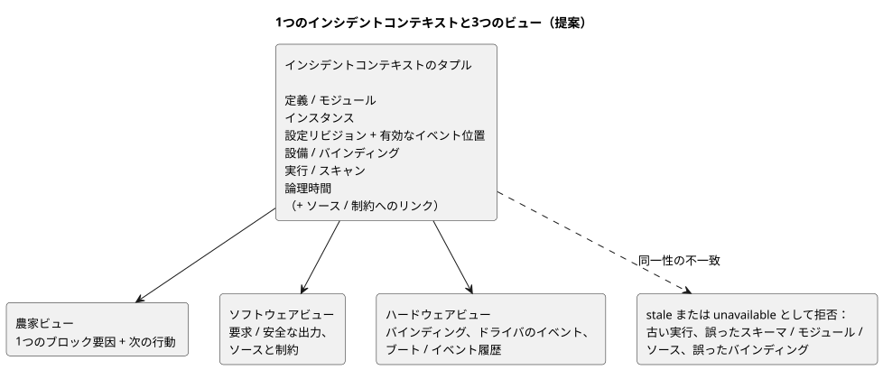
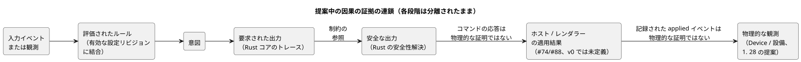

<!-- translation-source: docs/research/GF-COMPOSE-R8-INCIDENT-EVIDENCE.md -->
[英語の原文](GF-COMPOSE-R8-INCIDENT-EVIDENCE.md)

# GF-COMPOSE R8：インシデント証拠の合成

親：[#99](https://github.com/callin2/ghostflow-language/issues/99)  
Issue：[#107](https://github.com/callin2/ghostflow-language/issues/107)  
ステータス：範囲を限定した調査・設計です。実装や物理デバイスでのテストを行ったとは主張しません。

このノートでは、農家・ソフトウェア・ハードウェアの各ビューが**同じインシデント（incident）**を指し示すための方法を定義します。対象は、調査したリビジョンで見つかった証拠、必要な同一性の結合（join）、出力の各段階を分離したまま保つ方法、手作業で検討した3つのウォークスルー、推奨事項、そして未解決のオーナー判断です。

## ユーザーの課題

農家が「なぜ灌水が行われなかったのか？」と尋ねます。その回答は、エンジニアや設置担当者が調べるのと同じ発生事象を特定しなければなりません。

回答では、次の4つを区別しておく必要があります。

1. **要求された出力**（requested output）
2. 言語ランタイムが選択した**安全な出力**（safe output）
3. **ホストまたはレンダラーによる適用結果**
4. **物理的な観測**

全体を通じて2つのルールが適用されます。

- 値の欠落は `false` ではありません。
- 古い実行（run）やバインディングを現在のインシデントに結合してはなりません。

合成（composition）に固有の目標は、小さく正確な証拠の受け渡しです。これは次のものを作り**ません**。

- 2つ目の実行可能ソース
- 新しいイベントストア
- スキャンの完全な生ログ
- 再構成されたクラッシュの事実

提案されている結合には、入力イベント→ルール→意図の説明と、各評価を支配する設定リビジョン／有効位置が含まれます。これらは設計上の結合であり、現在のテレメトリが備えているという主張ではありません。

## 調査したリビジョンでの証拠

調査した言語リビジョンは `ffdbc96461eca67908252507fb851fa4dabd9a2c` です。

**インタラクション契約。** スキーマ、モジュール、ソース、`runId` の厳密な結合を必須とします。`scanId` は1つの実行内でのみ順序付けられます。完了した観測は `ready`、`unavailable`、`error` のいずれかを明示的に使います。`stale` は検証を行う消費側が導出するものであり、生成側が表明することは決してありません。[`contracts/interaction-v0/README.md`](../../contracts/interaction-v0/README.ja.md) と [`tools/interaction-runtime-snapshot.mjs`](../../tools/interaction-runtime-snapshot.mjs) を参照してください。

**ソース安全性契約。** コンパイラの来歴（provenance）、要求／安全な出力、制約の観測、ソース／ドキュメントのダイジェストを記録します。電気的・機械的な動作を推論しないことを明示しています。[`docs/SOURCE-SAFETY-TRACE.md`](../SOURCE-SAFETY-TRACE.ja.md) を参照してください。

**フレーム化ホスト。** フレーム化ホストは完全な入力フレームを取り込み、1回だけディスパッチし、最後に受け入れた結果を公開します。条件付け（conditioning）またはディスパッチに失敗すると、故障をラッチします。その故障の後は新しいホストインスタンスが必要です。[`docs/FRAMED-CONTROL-HOST.md`](../FRAMED-CONTROL-HOST.ja.md) を参照してください。

**先行調査（R1〜R3）と再起動に関する修正。**

- R1 は、農家が読める1つのブロック要因と、同じソース／モジュール／インスタンス／実行および設備の同一性を示すエンジニア向けビューを推奨しています。
- R2 は、正本の `.ghost.md` が引き続き実行上の権威であることを確立しています。Memory #68 は来歴／作成時の文脈であり、実行ルールやバインディングの直接の権威ではありません。
- R3 は、再起動によって新しい `runId` が作られること、そして合成時の故障の厳密な波及（fan-out）が未解決であることを確立しています。
- これとは別に、ユーザーが合意した設計修正として、再起動は通常のイベントであり、その応答は GhostFlow のロジックで記述します。グローバルな再開／手動ポリシーは定義しません。ランタイム開始前の電気的な起動、切断、故障に関する義務は引き続き Device／Driver の責任です。このイベント応答ルールは設計であり、現在のランタイムの証拠ではありません。

**Device issue [#28](https://github.com/callin2/farm-device/issues/28)。** RAM 上の最近の履歴とは別に、デバイスローカルで容量が限定された追記指向のフラッシュジャーナル（約7日分を目標）を提案しています。この提案では次の項目を挙げています。

- 再起動／停電からの復旧
- 単調なイベント同一性（`deviceId`、`eventSequence`、`bootId`、任意で `runId`／`scanId`）
- 時刻の品質
- プログラム／設定／ランタイムの同一性
- ページネーション
- 明示的な復旧／データ損失の通知

また、出力の要求／安全／適用の変化、コマンド、故障、安全トリップ、プログラム／設定の変更、再起動についてのイベント分類も提案しています。

これは issue／設計上の証拠であり、実装済みの言語や Device ランタイムの証拠ではありません。バージョン付きのイベントスキーマの厳密な形、物理フィードバックのフィールド、ブート／イベントから実行への最終的な結合は未決定です。これらは「利用できないソース資料」ではなく、「必要な結合」または「不明な証拠」としてラベル付けされています。入力の発生（occurrence）／値の観測の統合（coalescing）は、インシデントを永続的に保持する約束ではありません。

## 表と例

### 必要なインシデント結合

各行は1つの証拠の境界です。誰が生成するか、どの同一性を結合しなければならないか、同一性の欠落や不一致をどう扱うかを示します。

| 証拠の境界 | 生成者 | 必須の結合 | 利用可否／不一致の扱い |
|---|---|---|---|
| 定義リビジョン | API／ソースストレージと言語コンパイラ | `documentId`、`revisionId`、ソース SHA、モジュールのフィンガープリントとバイトコード SHA | ソースの説明に必須です。同一性の欠落や相違は stale／error であり、ラベルによるベストエフォートの結合は決して行いません。 |
| 振る舞いのインスタンス | API の合成／デプロイ | 定義リビジョンに結合される、提案中の不透明な `instanceId` | 現在の v0 にはインスタンスのフィールドがありません。存在しない場合、合成のスコープは未解決です。同じ定義のインスタンス同士をマージしてはなりません。 |
| プログラムと設定 | 実行時の既定値は正本ソース、設定イベントは API／ランタイム | プログラムリビジョンと、設定リビジョン／ダイジェスト、有効なイベント位置、スコープ | ライブプロパティイベントはプログラムと実行の同一性を保ちます。各評価／意図を、その時点で有効な設定リビジョンに結合します。設定が欠落している場合は不明としなければならず、ソースの既定値を黙って代用してはなりません。 |
| 設備とバインディング | API の設備コンテキストと Device プロファイル | 設備／バインディングのリビジョン、論理ポート、物理エンドポイント／プロファイルの同一性 | どの機器が対象だったかを主張するために必須です。誤った、または古いバインディングは結合を拒否します。物理エンドポイントは論理ポートの同一性ではありません。 |
| 実行／スキャン | フレーム化ホスト／ランタイム | `runId`、完了した `scanId`、論理時間、スキーマ／モジュール／ソースの同一性 | `scanId` 単独では無効です。実際の再起動は新しい実行を作るため、古いスキャン 0 に結合してはなりません。ライブプロパティイベントは新しい実行を作りません。完了が欠落している場合、完了したスキャンとは主張できません。 |
| デバイスのブート／イベント順序 | #28 で提案されている Device の永続ヒストリアン。最終的な生成者／スキーマは未解決 | 提案中の単調なデバイスイベント同一性、ブート同一性、イベント順序、および同じ実行／バインディングへのリンク | この提案は再起動からの復旧と明示的なデータ損失通知を支えますが、厳密なフィールドと物理フィードバックは未解決です。最後に記録されたイベントとギャップを報告し、最終スキャンを合成しては決してなりません。ランタイムのすべての入力観測が永続的に保持されると推論してはなりません。 |
| 論理時間 | ホスト／ランタイムの完了。Device の時計は別途記録された場合のみ | 厳密な `logicalTimeMs` と、デバイスのタイムスタンプ／時計の同一性（あれば） | ホストの論理時間は、壁時計の時刻や物理的な発生の証明ではありません。時計の不一致は表示すべき不確実性であり、推論で補修してはなりません。 |
| ソース／制約の参照 | コンパイラのソースマップと安全性トレース。設備の制約については制約のオーナー | ソースノード／意図アンカー、制約のインデックス／種類、最初の違反／最終結果、厳密なインシデントコンテキスト | 静的な依存関係の読み取りは、実行された原因の証明ではありません。未解決の設備制約の成果物／境界はオーナーの判断事項として残ります。 |

**インシデントコンテキスト。** 参加者が共有する厳密なコンテキストは、次の組（タプル）です。

- 定義／モジュール
- インスタンス
- 同じ実行内での設定リビジョン／有効なイベント位置
- 設備／バインディング
- 実行／スキャン
- 論理時間

参加者のすべてのビューは、このタプルを使わなければなりません。消費側は、古い実行、誤ったスキーマ／モジュール／ソース、誤ったバインディングを stale または unavailable として拒否しなければなりません。代わりに関連するレコードを黙って提示してはなりません。

次の図は、1つのタプルが3つのビューすべてに供給され、同一性が一致しないものは結合されずに拒否される様子を示しています。

**因果の連鎖。** 提案されている因果の証拠は、入力イベントまたは観測 → 評価されたルール → 意図 → 要求／安全な出力 → レンダラーの結果または物理的な観測、という流れであり、評価時に有効だった設定に結合されます。

### 段階の分離とオーナーシップ／ギャップ

各段階には、それぞれのオーナーとギャップがあります。後の段階が、前の段階が物理的に実現されたことを証明することは決してありません。

| 段階／証拠 | オーナー | 現在のサポート | 合成上のギャップ |
|---|---|---|---|
| 要求された出力 | Rust コアのトレース、言語のソースマップ | 既存の `requested` マップと来歴 | インスタンスおよび厳密な完了スキャンに結合する。 |
| 安全な出力 | Rust の安全性解決 | 既存の `safe` マップと範囲を限定した安全性トレース | 要求とは区別して保ち、制約の参照を公開する。 |
| ホスト／レンダラーによる適用 | API／ホストと Device の統合 | interaction-v0 では定義されていない。ホストの故障は物理的な故障ではない | #74／#88 が適用結果イベントと欠落のセマンティクスを定義しなければならない。Driver のソース／意図は、高精度の測定、プロトコル、生の ISR／スキャンの仕組みを扱い、農場のポリシーを隠すことなく、意味のある型付きイベント／測定値を公開する。取得時刻、受信／評価時刻、品質は区別したまま保つ。コマンドの応答（acknowledgement）は物理的な証明ではない。 |
| 物理的な観測 | Device／設備のオーナー | #28 は永続的なイベント履歴を提案し、HIL による物理リレーの証拠に言及しているが、最終的なフィードバックスキーマは確定していない | #28 が、利用可能なフィードバック、ブート／履歴の同一性、保持を定義しなければならない。記録された applied イベントであっても、物理的な動作を証明するものではない。 |
| メモリ／作成時の文脈 | API／システム #68 | 来歴の文脈のみ | 承認された判断／ソース経路がない限り、実行やバインディングの結合になっては決してならない。 |
| 入力の発生と値の観測 | ここでは未実装。合意済みの設計。取得は割り込みベースでもスキャンベースでもよい | 発生の同一性、または取得時刻と受信／評価時刻と品質を区別した観測値 | 取り込み（ingress）レコードと、イベントから tick への対応付けを定義する。既定ではサポートする容量の範囲内で保持し、最新の保留値による置き換えは入力ごとに明示的にオプトインした場合のみとする。オーバーフロー／損失は報告しなければならない。順序と対応付けは未解決であり、無制限の永続履歴ではない。 |

次の図は、提案されている因果の連鎖を示します。各段階は分離されたままであり、表で挙げた2つの証明の境界も含まれています。

### 対になったウォークスルー（手作業による検討であり、実行の証拠ではありません）

各ウォークスルーでは、農家への回答と次の行動、ソフトウェアの証拠、ハードウェアの証拠、残る不確実性を示します。

#### 1. 低水位による灌水のブロック

- **農家への回答と次の行動：**「低水位信号によって灌水がブロックされました。タンクまたは設備のセンサを確認してください。」回答では、タンクが空であると言ってはなりません。
- **ソフトウェアの証拠：**同じ完了した実行／スキャン、入力 `low_water=true`、要求されたポンプ `ON`、安全なポンプ `OFF`、違反した制約、およびソース／アンカーの参照。
- **ハードウェアの証拠：**利用可能なセンサまたは設備の記録のみ。
- **残る不確実性：**この信号は、タンクの物理的な水位やセンサの正しさを証明しません。

#### 2. レンダラーの適用失敗、またはフィードバックの欠落

- **農家への回答と次の行動：**失敗が記録されている場合は「システムは灌水を要求しましたが、デバイスでの適用に失敗しました。」そうでない場合は「物理的なフィードバックがないため、コマンドの結果は不明です。」次の行動は、設備／ドライバの経路を点検するか、設置担当者に連絡することです。
- **ソフトウェアの証拠：**同じ実行／スキャン、要求された出力、安全な出力、および（あれば）ホスト／レンダラーの結果。
- **ハードウェアの証拠：**バインディング、ドライバのイベント、または物理フィードバック。ただし Device が記録した場合に限ります。
- **残る不確実性：**`requested=ON` や `safe=ON` は、ポンプが動作したことを証明しません。

#### 3. ジャーナルのギャップを伴うクラッシュ／再起動

- **農家への回答と次の行動：**「最後に記録された灌水イベントは［イベント］です。次の結果が記録される前にシステムが再起動しました。」次の行動は、デバイスを点検し、既存の運用手順に従う場合に限り再試行することです。
- **ソフトウェアの証拠：**最後に完了した実行／スキャン、論理時間、最後の要求／安全な結果、およびホストの故障／新しい実行の境界。
- **ハードウェアの証拠：**Device の履歴が提供する場合、最後のブート／イベントの記録と、明示された欠落区間。
- **残る不確実性：**欠落した最終スキャンと物理的な状態は不明のままにしなければなりません。クラッシュの原因や出力を再構成することはありません。

## 推奨事項

**1つのインシデントコンテキストを採用し**、農家・ソフトウェア・ハードウェアのビューで変更せずに再利用します。

**合成に必要な最小限の追加は、新しいストアではなく、同一性の結合と射影のルールとします。** 結合は次のとおりです：定義／モジュール + インスタンス + 設定リビジョン／有効なイベント位置 + 設備／バインディング + 実行／スキャン + 論理時間、およびソース／制約へのリンク。

**名前を分けた4つの段階を保ちます：**要求された出力、安全な出力、適用結果、物理的な観測。

**stale は検証から導出し**、実行・モジュール・ソース・スキーマ・バインディングの同一性が一致しないものを拒否します。

各ケースで示すべき内容：

- **低水位の不変条件：**要求 `ON`、安全 `OFF`、`low_water=true`、制約の参照。
- **適用の失敗またはフィードバックの欠落：**記録された適用状態、または明示的な不明。
- **再起動：**再起動を通常のイベントとして扱い、GhostFlow で記述された応答をその新しい実行に結合します。グローバルな再開／手動ポリシーを課してはなりません。ランタイム開始前の電気的な起動、切断、故障に関する義務は、別途 Device／Driver が担います。最後に記録されたイベントとジャーナルのギャップを示します。

スキャンの完全な保持を要求したり、#28 が記録しなかった事実を作り出したりしてはなりません。

## 未解決の質問とオーナー

- **#74／#88 のイベントおよび説明のオーナー：**正規の適用結果、物理フィードバックの欠落、インシデントコンテキスト、農家向けの文言のフィールドを定義します。コマンド／適用／観測を1つのステータスにまとめてはなりません。
- **Device #28 のオーナー：**永続履歴の同一性と保持の契約を確定します。対象は、ブート／セッション ID、イベント順序、バインディングへのリンク、物理フィードバック、ジャーナルのギャップの表現です。#28 はこれらの懸念を提案していますが、バージョン付きイベントスキーマの厳密な形と、プロジェクト間の最終的な結合は未決定のままです。
- **API／デプロイ／ランタイムのオーナー：**`instanceId`、設定リビジョン／ダイジェスト／有効位置の結合、そしてライブイベント・再起動・再デプロイをまたぐ設備／バインディングリビジョンのライフサイクルを定義します。配信、順序、永続性の厳密な仕組みは設計上のギャップとして残ります。
- **言語／ランタイム契約のオーナー：**v0 の `runId` と `scanId` のセマンティクスを保ちつつ、将来のインスタンス修飾付きインシデント表現を定義します。
- **設備／システムのオーナー（言語／API のオーナーと共同）：**R2 から持ち越された未解決の設備制約の境界を選択します。Memory #68 は確定した判断に来歴を提供できますが、実行やバインディングを直接認可することはできません。

## 検証

- [x] 結合の表は、定義リビジョン、インスタンス、プログラム／設定、設備／バインディング、実行／スキャン、デバイスの順序、論理時間、ソース／制約の参照を、生成者、必須の状態、不一致の扱いとともに網羅しています。
- [x] 3つのウォークスルーは、農家への回答／次の行動、ソフトウェアの証拠、ハードウェアの証拠、残る不確実性を示しています。コマンドは物理的な結果ではなく、欠落した値は false ではありません。
- [x] 要求、安全、適用、物理の各段階は分離されたままです。古い実行／バインディングとジャーナルのギャップのケースは明示されています。
- [x] 調査したコード／契約からの主張は、提案、未解決のオーナー判断、手作業による例とは区別されています。ランタイムテストや物理テストは実行しておらず、主張もしていません。native／WASM の適合性は提案中の受け入れ基準にすぎません。
- [x] 調査したリビジョンを `ffdbc96461eca67908252507fb851fa4dabd9a2c` として記録しました。R1〜R3 と #89／#90 の issue 記録は設計上の証拠として確認しました。Device #28 は提案の証拠であり、実装の証拠ではありません。その厳密なイベントスキーマは未解決のままです。

ランタイムや物理的な検証は行っていません。native／WASM の適合性、差分の衛生状態、相対リンクのチェックは、実装／設計オーナーの受け入れ責任として残っており、ここで完了したとは主張しません。
