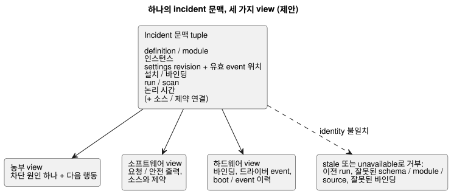
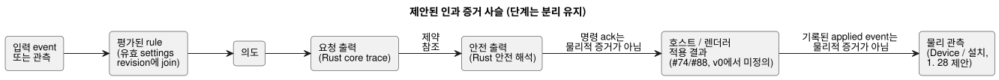

<!-- translation-source: docs/research/GF-COMPOSE-R8-INCIDENT-EVIDENCE.md -->
[영문 원문](GF-COMPOSE-R8-INCIDENT-EVIDENCE.md)

# GF-COMPOSE R8: incident(사고) 증거 조합

상위 항목: [#99](https://github.com/callin2/ghostflow-language/issues/99)  
이슈: [#107](https://github.com/callin2/ghostflow-language/issues/107)  
상태: 범위가 한정된 연구/설계입니다. 구현이나 물리 장치 테스트를 했다고 주장하지 않습니다.

이 노트는 농부, 소프트웨어, 하드웨어 view가 **같은 incident**를 가리키는 방법을
정의합니다. 조사한 revision에서 찾은 증거, 필요한 identity join, 출력 단계를 서로
분리해 두는 방법, 수작업으로 따라간 walkthrough 세 개, 권고, 그리고 아직 열려 있는
소유자 결정을 다룹니다.

## 사용자 문제

농부가 “왜 관수가 이뤄지지 않았나요?”라고 묻습니다. 답변은 엔지니어와 설치자가
조사하는 것과 같은 발생(occurrence)을 식별해야 합니다.

답변은 다음 네 가지를 구분해야 합니다.

1. **요청 출력**(requested output)
2. 언어 런타임이 선택한 **안전 출력**(safe output)
3. **호스트 또는 렌더러의 적용 결과**
4. **물리 관측**

다음 두 규칙은 전체에 적용됩니다.

- 값이 없다는 것은 `false`가 아닙니다.
- 이전 run이나 바인딩을 현재 incident에 join해서는 안 됩니다.

조합(composition)에 특유한 목표는 작고 정확한 증거 인계입니다. 이 목표는 다음을
만들지 **않습니다**.

- 두 번째 실행 소스
- 새로운 event 저장소
- 전체 raw scan 로깅
- 재구성한 crash 사실

제안하는 join에는 input event → rule → intent로 이어지는 설명과, 각 평가를 지배하는
settings revision/유효 위치(effective position)가 포함됩니다. 이는 설계상의 join이며
현재 telemetry가 그렇다는 주장이 아닙니다.

## 조사한 revision의 증거

조사한 언어 revision은 `ffdbc96461eca67908252507fb851fa4dabd9a2c`입니다.

**Interaction 계약.** 정확한 schema, module, source, `runId` join을 요구합니다.
`scanId`는 하나의 run 안에서만 순서를 가집니다. 완료된 관측은 `ready`, `unavailable`,
`error`를 명시적으로 사용합니다. `stale`은 검증하는 consumer가 도출하며, producer가
주장하는 일은 결코 없습니다.
[`contracts/interaction-v0/README.md`](../../contracts/interaction-v0/README.md)와
[`tools/interaction-runtime-snapshot.mjs`](../../tools/interaction-runtime-snapshot.mjs)를
참고하세요.

**Source-safety 계약.** 컴파일러 provenance(출처), 요청/안전 출력, 제약 관측,
source/document digest를 기록합니다. 전기적·기계적 동작을 추론하지 않는다고 명시합니다.
[`docs/SOURCE-SAFETY-TRACE.md`](../SOURCE-SAFETY-TRACE.md)를 참고하세요.

**Framed host.** Framed host는 완전한 입력 프레임을 포착하고, 한 번 dispatch하며,
마지막으로 수락된 결과를 게시합니다. conditioning이나 dispatch가 실패하면 fault를
래치합니다. 그 fault 이후에는 새 호스트 인스턴스가 필요합니다.
[`docs/FRAMED-CONTROL-HOST.md`](../FRAMED-CONTROL-HOST.md)를 참고하세요.

**이전 연구(R1–R3)와 재시작 수정 사항.**

- R1은 농부가 읽을 수 있는 차단 원인(blocker) 하나와, 같은
  source/module/instance/run 및 설치 identity를 보여 주는 엔지니어 view를 권고합니다.
- R2는 정본 `.ghost.md`가 실행 권한으로 남는다는 점을 확립합니다. 운영 기억 #68은
  provenance/작성 문맥이며, 직접적인 실행 규칙이나 바인딩 권한이 아닙니다.
- R3는 재시작이 새 `runId`를 만든다는 점과, 조합된 fault fan-out의 정확한 방식이
  아직 미해결이라는 점을 확립합니다.
- 이와 별도로, 사용자와 합의한 설계 수정 사항은 재시작이 일반 event이며 그에 대한
  반응은 GhostFlow 논리가 작성한다는 것입니다. 전역 resume/manual 정책은 정의하지
  않습니다. 런타임 이전의 전기적 startup, disconnect, failure 의무는 Device/Driver의
  책임으로 남습니다. 이 event 반응 규칙은 설계이며 현재 런타임 증거가 아닙니다.

**Device 이슈 [#28](https://github.com/callin2/farm-device/issues/28).** RAM의 최근
이력과 별도로, 약 7일 분량을 목표로 하는 장치 로컬·유한·추가 지향(append-oriented)
flash journal(저널)을 제안합니다. 제안에는 다음이 명시되어 있습니다.

- reboot/전원 상실 복구
- 단조 event identity(`deviceId`, `eventSequence`, `bootId`, 선택적
  `runId`/`scanId`)
- 시간 품질
- program/settings/runtime identity
- 페이지 나누기(pagination)
- 명시적인 복구/데이터 손실 알림

또한 출력 request/safe/applied 변경, 명령, fault, 안전 trip, program/settings 변경,
reboot에 대한 event 종류도 제안합니다.

이것은 이슈/설계 증거이며, 구현된 언어나 Device 런타임의 증거가 아닙니다. 정확한
버전 붙은 event schema, 물리 피드백 field, 최종 boot/event-to-run join은 아직 정해지지
않았습니다. 이들은 이용할 수 없는 소스 자료가 아니라, 필요한 join 또는 알 수 없는
증거로 표시합니다. 입력 발생/값 관측의 병합(coalescing)은 incident를 영속적으로
보존하겠다는 약속이 아닙니다.

## 표와 예

### 필수 incident join

각 행은 하나의 증거 경계입니다. 누가 생성하는지, 어떤 identity를 join해야 하는지,
identity가 없거나 일치하지 않을 때 어떻게 처리하는지를 보여 줍니다.

| 증거 경계 | 생성자(producer) | 필수 join | 가용성 / 불일치 처리 |
|---|---|---|---|
| Definition revision | API/소스 저장소와 언어 컴파일러 | `documentId`, `revisionId`, source SHA, module fingerprint와 bytecode SHA | 소스 설명에 필수입니다. identity가 없거나 다르면 stale/error이며, 최선 노력식 라벨 join을 하지 않습니다. |
| 동작 인스턴스 | API 조합/배포 | definition revision에 join되는, 제안된 불투명 `instanceId` | 현재 v0에는 instance field가 없습니다. 없으면 조합 범위는 미해결입니다. 같은 정의의 인스턴스를 합치지 않습니다. |
| 프로그램과 설정 | 실행 기본값은 정본 소스, 설정 event는 API/런타임 | 프로그램 revision과 settings revision/digest, 유효 event 위치, 범위 | live property event는 프로그램과 run identity를 보존합니다. 각 평가/의도를 그 시점의 유효 settings revision에 join합니다. 설정이 없으면 알 수 없음이며, 소스 기본값을 조용히 대입하지 않습니다. |
| 설치와 바인딩 | API 설치 문맥과 Device 프로필 | 설치/바인딩 revision, 논리 포트, 물리 endpoint/프로필 identity | 어떤 설비를 대상으로 했는지 주장하려면 필수입니다. 잘못되었거나 오래된 바인딩은 join을 거부합니다. 물리 endpoint는 논리 포트 identity가 아닙니다. |
| Run / scan | Framed host/런타임 | `runId`, 완료된 `scanId`, 논리 시간, schema/module/source identity | `scanId`만으로는 유효하지 않습니다. 실제 재시작은 새 run을 만들며 이전 scan 0에 join해서는 안 됩니다. live property event는 새 run을 만들지 않습니다. 완료 기록이 없으면 완료된 scan이라고 주장할 수 없습니다. |
| Device boot/event 순번 | #28의 Device 영속 historian 제안. 최종 생성자/schema는 미해결 | 제안된 단조 장치 event identity, boot identity, event 순번, 같은 run/바인딩으로의 연결 | 제안은 reboot 복구와 명시적 데이터 손실 알림을 지원하지만, 정확한 field와 물리 피드백은 미해결입니다. 마지막으로 기록된 event와 공백을 보고합니다. 최종 scan을 합성해서는 안 됩니다. 모든 런타임 입력 관측이 영속 보존된다고 추론하지 않습니다. |
| 논리 시간 | 호스트/런타임 완료. Device 시계는 별도로 기록된 경우에만 | 정확한 `logicalTimeMs`와 장치 timestamp/시계 identity | 호스트 논리 시간은 벽시계 시각이나 물리적 발생의 증거가 아닙니다. 시계 불일치는 보여 줘야 할 불확실성이며, 추론으로 고치지 않습니다. |
| 소스/제약 참조 | 컴파일러 source map과 안전 trace. 설치 제약은 제약 소유자 | source node/의도 앵커, 제약 index/kind, 첫 위반/최종 결과, 정확한 incident 문맥 | 정적 의존성 읽기는 실제 실행된 원인의 증거가 아닙니다. 미해결인 설치 제약 artifact/경계는 소유자 결정으로 남습니다. |

**Incident 문맥.** 정확한 참여자 문맥은 다음 항목으로 이루어진 tuple입니다.

- definition/module
- 인스턴스
- 같은 run 안의 settings revision/유효 event 위치
- 설치/바인딩
- run/scan
- 논리 시간

모든 참여자 view는 이 tuple을 사용해야 합니다. consumer는 이전 run, 잘못된
schema/module/source, 잘못된 바인딩을 stale 또는 unavailable로 거부해야 합니다. 관련
기록을 대신 조용히 보여 줘서는 안 됩니다.

아래 그림은 하나의 tuple이 세 view 모두에 공급되고, identity가 일치하지 않으면 join하지
않고 거부하는 모습을 보여 줍니다.

**인과 사슬.** 제안하는 인과 증거는 입력 event 또는 관측 → 평가된 rule → 의도 →
요청/안전 출력 → 렌더러 결과 또는 물리 관측이며, 평가 시점의 유효 설정에 join됩니다.

### 단계 분리와 소유권/공백

각 단계에는 자기 소유자와 자기 공백이 있습니다. 뒤 단계가 앞 단계의 물리적 실현을
증명하는 일은 결코 없습니다.

| 단계 / 증거 | 소유자 | 현재 지원 | 조합상의 공백 |
|---|---|---|---|
| 요청 출력 | Rust core trace, 언어 source map | 기존 `requested` map과 provenance | 인스턴스와 정확한 완료 scan에 join해야 합니다. |
| 안전 출력 | Rust 안전 해석(safety resolution) | 기존 `safe` map과 유한한 안전 trace | 요청과 구분해 두고 제약 참조를 노출해야 합니다. |
| 호스트/렌더러 적용 | API/호스트와 Device 통합 | interaction-v0가 정의하지 않습니다. 호스트 fault는 물리 고장이 아닙니다 | #74/#88이 적용 결과 event와 부재 의미를 정의해야 합니다. Driver 소스/의도는 정밀 측정, 프로토콜, raw ISR/scan 메커니즘을 처리하며, 농장 정책을 숨기지 않고 의미 있는 typed event/측정을 노출합니다. 포착 시각, 수신/평가 시각, 품질은 서로 구분됩니다. 명령 acknowledgement는 물리적 증거가 아닙니다. |
| 물리 관측 | Device/설치 소유자 | #28은 영속 event 이력을 제안하고 HIL 물리 릴레이 증거를 참조하지만, 최종 피드백 schema는 정하지 않습니다 | #28이 이용 가능한 피드백, boot/이력 identity, 보존 기간을 정의해야 합니다. 기록된 applied event도 여전히 물리 동작을 증명하지 않습니다. |
| 운영 기억/작성 문맥 | API/system #68 | provenance 문맥으로만 사용 | 승인된 결정/소스 경로 없이 실행 또는 바인딩 join이 되어서는 안 됩니다. |
| 입력 발생과 값 관측 | 여기서는 구현되지 않음. 합의된 설계. 포착은 인터럽트 기반이나 scan 기반일 수 있음 | 구분된 포착 시각과 수신/평가 시각, 품질을 가진 발생 identity 또는 관측값 | ingress 기록과 event-to-tick 대응을 정의해야 합니다. 지원 용량 안에서는 기본적으로 보존하며, 입력별로 명시적으로 opt-in한 경우에만 최신 대기값으로 교체합니다. overflow/손실은 반드시 보고해야 합니다. 순서와 대응은 아직 열려 있으며, 무제한 영속 이력이 아닙니다. |

아래 그림은 제안하는 인과 사슬을 각 단계를 분리한 채로 보여 주며, 표에서 언급한 두
증거 경계도 함께 나타냅니다.

### 짝지은 walkthrough (수작업이며 실행 증거가 아님)

각 walkthrough는 농부 답변과 다음 행동, 소프트웨어 증거, 하드웨어 증거, 남은 불확실성을
제시합니다.

#### 1. 저수위로 관수 차단

- **농부 답변과 다음 행동:** “저수위 신호 때문에 관수가 차단되었습니다. 탱크나 설치된
  센서를 확인하세요.” 답변에서 탱크가 비었다고 말해서는 안 됩니다.
- **소프트웨어 증거:** 같은 완료 run/scan, 입력 `low_water=true`, 요청된 펌프 `ON`,
  안전 펌프 `OFF`, 위반된 제약, 소스/앵커 참조.
- **하드웨어 증거:** 이용 가능한 센서 또는 설치 기록뿐입니다.
- **남은 불확실성:** 이 신호는 실제 탱크 수위나 센서의 정확성을 증명하지 않습니다.

#### 2. 렌더러 적용 실패 또는 피드백 부재

- **농부 답변과 다음 행동:** 실패가 기록되어 있으면 “시스템이 관수를 요청했지만 장치
  적용에 실패했습니다.” 그렇지 않으면 “물리 피드백이 없어 명령 결과를 알 수 없습니다.”
  다음 행동은 설치/드라이버 경로를 점검하거나 설치자에게 연락하는 것입니다.
- **소프트웨어 증거:** 같은 run/scan, 요청 출력, 안전 출력, 그리고 있다면
  호스트/렌더러 결과.
- **하드웨어 증거:** Device가 기록한 경우에만 바인딩, 드라이버 event, 물리 피드백.
- **남은 불확실성:** `requested=ON`이나 `safe=ON`은 펌프가 실제로 돌았다는 증거가
  아닙니다.

#### 3. journal 공백을 동반한 crash/reboot

- **농부 답변과 다음 행동:** “마지막으로 기록된 관수 event는 [event]입니다. 다음 결과가
  기록되기 전에 시스템이 재부팅되었습니다.” 다음 행동은 장치를 점검하고, 기존 운영
  절차에 따라서만 재시도하는 것입니다.
- **소프트웨어 증거:** 마지막 완료 run/scan, 논리 시간, 마지막 요청/안전 결과, 호스트
  fault/새 run 경계.
- **하드웨어 증거:** Device 이력이 제공하는 경우, 마지막 boot/event 기록과 명시적인
  누락 구간.
- **남은 불확실성:** 누락된 최종 scan과 물리 상태는 알 수 없음으로 남아야 합니다. crash
  원인이나 출력을 재구성하지 않습니다.

## 권고

**하나의 incident 문맥을 채택하고**, 농부·소프트웨어·하드웨어 view에서 변경 없이
재사용합니다.

**최소한의 조합 추가는 새 저장소가 아니라 identity join과 projection 규칙으로
합니다.** join은 definition/module + 인스턴스 + settings revision/유효 event 위치 +
설치/바인딩 + run/scan + 논리 시간이며, 소스/제약 연결을 함께 가집니다.

**이름이 구분된 네 단계를 유지합니다:** 요청 출력, 안전 출력, 적용 결과, 물리 관측.

**stale은 검증에서 도출하고**, run, module, source, schema, 바인딩 identity가 일치하지
않으면 거부합니다.

각 사례에서 보여 줘야 할 것:

- **저수위 불변 조건:** 요청 `ON`, 안전 `OFF`, `low_water=true`, 제약 참조.
- **적용 실패 또는 피드백 부재:** 기록된 적용 상태 또는 명시적인 알 수 없음.
- **Reboot:** 재시작을 일반 event로 취급하고, GhostFlow로 작성한 반응을 새 run에
  join합니다. 전역 resume/manual 정책을 강요하지 않습니다. 런타임 이전의 전기적
  startup, disconnect, failure 의무는 Device/Driver가 별도로 소유합니다. 마지막으로
  기록된 event와 journal 공백을 보여 줍니다.

전체 scan 보존을 요구하거나, #28이 기록하지 않은 사실을 만들어 내서는 안 됩니다.

## 미해결 질문과 소유자

- **#74/#88 event 및 설명 소유자:** 정본 적용 결과, 물리 피드백 부재, incident 문맥,
  농부 문구 field를 정의합니다. 명령/적용/관측을 하나의 상태로 합치지 않습니다.
- **Device #28 소유자:** 영속 이력의 identity와 보존 계약을 확정합니다. boot/session ID,
  event 순번, 바인딩 연결, 물리 피드백, journal 공백 표현이 포함됩니다. #28은 이 관심사를
  제안하지만, 정확한 버전 붙은 event schema와 최종 프로젝트 간 join은 열어 둡니다.
- **API/배포/런타임 소유자:** live event, 재시작, 재배포에 걸친 `instanceId`, settings
  revision/digest/유효 위치 join, 설치/바인딩 revision 수명 주기를 정의합니다. 정확한
  전달, 순서, 영속성 메커니즘은 설계 공백으로 남습니다.
- **언어/런타임 계약 소유자:** v0의 `runId`와 `scanId` 의미를 보존하면서, 향후의
  인스턴스 한정 incident 표현을 정의합니다.
- **설치/시스템 소유자(언어/API 소유자와 함께):** R2에서 미해결로 남은 설치 제약 경계를
  선택합니다. 운영 기억 #68은 확인된 결정에 provenance를 제공할 수는 있지만, 실행이나
  바인딩을 직접 승인할 수는 없습니다.

## 검증

- [x] join 표가 definition revision, 인스턴스, 프로그램/설정, 설치/바인딩, run/scan,
  장치 순번, 논리 시간, 소스/제약 참조를 다루며, 생성자, 필수 여부, 불일치 처리를
  포함합니다.
- [x] 세 walkthrough가 농부 답변/다음 행동, 소프트웨어 증거, 하드웨어 증거, 남은
  불확실성을 제공합니다. 명령은 물리적 결과가 아니며, 없는 값은 false가 아닙니다.
- [x] 요청, 안전, 적용, 물리 단계가 분리되어 있습니다. 이전 run/바인딩과 journal 공백
  사례가 명시되어 있습니다.
- [x] 조사한 코드/계약에서 나온 주장을 제안, 미해결 소유자 결정, 수작업 예와
  구분했습니다. 런타임 테스트나 물리 테스트는 실행하거나 주장하지 않았습니다.
  native/WASM 적합성은 제안된 acceptance일 뿐입니다.
- [x] 조사한 revision을 `ffdbc96461eca67908252507fb851fa4dabd9a2c`로 기록했습니다.
  R1–R3과 #89/#90 이슈 기록은 설계 증거로 검토했습니다. Device #28은 구현 증거가 아니라
  제안 증거이며, 정확한 event schema는 미해결로 남습니다.

런타임 검증이나 물리 검증은 수행하지 않았습니다. native/WASM 적합성, diff 위생, 상대
링크 검사는 구현/설계 소유자의 acceptance 책임으로 남으며, 여기서 완료했다고 주장하지
않습니다.
