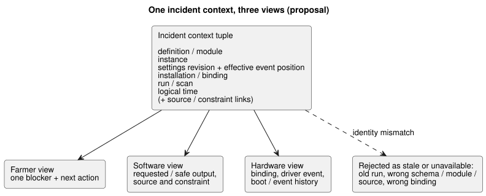
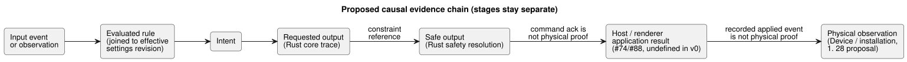

# GF-COMPOSE R8: incident evidence composition

Parent: [#99](https://github.com/callin2/ghostflow-language/issues/99)  
Issue: [#107](https://github.com/callin2/ghostflow-language/issues/107)  
Status: bounded research/design. No implementation or physical-device test is claimed.

This note defines how farmer, software, and hardware views can point at the
**same incident**. It covers the evidence found at the examined revision, the
required identity joins, how output stages stay separate, three hand-worked
walkthroughs, the recommendation, and the open owner decisions.

## User problem

A farmer asks: “Why did watering not happen?” The answer must identify the
same occurrence that an engineer and an installer inspect.

The answer must keep four things apart:

1. the **requested output**;
2. the **safe output** selected by the language runtime;
3. the **host or renderer application result**;
4. the **physical observation**.

Two rules apply throughout:

- A missing value is not `false`.
- An old run or binding must not be joined to the current incident.

The composition-specific goal is a small, exact evidence handoff. It does
**not** create:

- a second executable source;
- a new event store;
- full raw scan logging;
- reconstructed crash facts.

Proposed joins include the input-event-to-rule-to-intent explanation and the
settings revision/effective position governing each evaluation. These are
design joins, not current telemetry claims.

## Evidence at examined revision

The language revision examined is `ffdbc96461eca67908252507fb851fa4dabd9a2c`.

**Interaction contract.** It requires exact schema, module, source, and
`runId` joins. `scanId` is only ordered within a run. Completed observations
explicitly use `ready`, `unavailable`, or `error`. `stale` is derived by the
validating consumer and is never asserted by a producer. See
[`contracts/interaction-v0/README.md`](../../contracts/interaction-v0/README.md)
and [`tools/interaction-runtime-snapshot.mjs`](../../tools/interaction-runtime-snapshot.mjs).

**Source-safety contract.** It records compiler provenance, requested/safe
output, constraint observations, and source/document digests. It explicitly
does not infer electrical or mechanical operation. See
[`docs/SOURCE-SAFETY-TRACE.md`](../SOURCE-SAFETY-TRACE.md).

**Framed host.** The framed host captures a complete input frame, dispatches
once, and publishes the last accepted outcome. It latches a fault after a
conditioning or dispatch failure. After that fault, a new host instance is
required. See [`docs/FRAMED-CONTROL-HOST.md`](../FRAMED-CONTROL-HOST.md).

**Earlier research (R1–R3) and the restart amendment.**

- R1 recommends one farmer-readable blocker plus an engineer view of the same
  source/module/instance/run and installation identities.
- R2 establishes that canonical `.ghost.md` remains executable authority.
  Memory #68 is provenance/authoring context, not direct execution-rule or
  binding authority.
- R3 establishes that restart creates a new `runId`, and that exact composed
  fault fan-out remains unresolved.
- Separately, the user-agreed design amendment is that restart is a normal
  event whose response is authored by GhostFlow logic. It does not define a
  global resume/manual policy. Pre-runtime electrical startup, disconnect, and
  failure obligations remain Device/Driver responsibilities. This
  event-response rule is design, not current runtime evidence.

**Device issue [#28](https://github.com/callin2/farm-device/issues/28).** It
proposes a device-local, bounded, append-oriented flash journal targeting about
seven days, separate from RAM recent history. The proposal names:

- reboot/power-loss recovery;
- monotonic event identity (`deviceId`, `eventSequence`, `bootId`, with
  optional `runId`/`scanId`);
- time quality;
- program/settings/runtime identity;
- pagination;
- explicit recovery/data-loss notices.

It also proposes event classes for output request/safe/applied changes,
commands, faults, safety trips, program/settings changes, and reboot.

This is issue/design evidence, not implemented language or Device runtime
evidence. The exact versioned event schema, physical-feedback fields, and final
boot/event-to-run join remain undecided. They are labeled as required joins or
unknown evidence, not as unavailable source material. Input
occurrence/value-observation coalescing is not a persistent incident-retention
promise.

## Tables and examples

### Required incident join

Each row is one evidence boundary: who produces it, which identity must join,
and how missing or mismatched identity is handled.

| Evidence boundary | Producer | Mandatory join | Availability / mismatch handling |
|---|---|---|---|
| Definition revision | API/source storage plus language compiler | `documentId`, `revisionId`, source SHA; module fingerprint and bytecode SHA | Required for source explanation. Missing or differing identity is stale/error, never a best-effort label join. |
| Behavior instance | API composition/deployment | Proposed opaque `instanceId` joined to the definition revision | Current v0 has no instance field. If absent, composition scope is unresolved; do not merge same-definition instances. |
| Program and settings | Canonical source for executable defaults; API/runtime for settings events | Program revision plus settings revision/digest, effective event position, and scope | Live property events preserve program and run identity. Join each evaluation/intent to its effective settings revision. Missing settings must be unknown, not source defaults silently substituted. |
| Installation and binding | API installation context and Device profile | Installation/binding revision, logical port, physical endpoint/profile identity | Required to claim which equipment was targeted. Wrong or old binding rejects the join; physical endpoint is not logical port identity. |
| Run / scan | Framed host/runtime | `runId`, completed `scanId`, logical time; schema/module/source identity | `scanId` alone is invalid. A real restart creates a new run and must not join old scan 0. A live property event does not create a new run. Missing completion means no completed scan claim. |
| Device boot/event sequence | Device persistent historian proposal in #28; final producer/schema unresolved | Proposed monotonic device event identity, boot identity, event sequence, and link to the same run/binding | The proposal supports reboot recovery and explicit data-loss notices, but exact fields and physical feedback remain unresolved. Report last recorded event and gap; never synthesize a final scan. Do not infer durable retention of every runtime input observation. |
| Logical time | Host/runtime completion; Device clock only if separately recorded | Exact `logicalTimeMs` plus any device timestamp/clock identity | Host logical time is not proof of wall-clock or physical occurrence. Clock mismatch is an uncertainty to show, not repair by inference. |
| Source/constraint reference | Compiler source map and safety trace; constraint owner for installation constraints | Source node/intent anchor, constraint index/kind, first violation/final result, exact incident context | Static dependency reads are not executed-cause proof. Unresolved installation-constraint artifact/boundary remains an owner decision. |

**The incident context.** The exact participant context is the tuple of:

- definition/module;
- instance;
- settings revision/effective event position within the same run;
- installation/binding;
- run/scan;
- logical time.

Every participant view must use that tuple. A consumer must reject an old run,
wrong schema/module/source, or wrong binding as stale or unavailable. It must
not silently present a related record instead.

The diagram below shows one tuple feeding all three views, and mismatched
identities being rejected rather than joined.

**The causal chain.** Proposed causal evidence is: input event or observation
→ evaluated rule → intent → requested/safe output → renderer result or physical
observation, joined to the effective settings at evaluation.

### Stage separation and ownership/gaps

Each stage has its own owner and its own gap. A later stage never proves an
earlier one was physically realized.

| Stage / evidence | Owner | Current support | Composition gap |
|---|---|---|---|
| Requested output | Rust core trace; language source map | Existing `requested` map and provenance | Join it to instance and exact completed scan. |
| Safe output | Rust safety resolution | Existing `safe` map and bounded safety trace | Keep distinct from request and expose constraint reference. |
| Host/renderer application | API/host and Device integration | Not defined by interaction-v0; host fault is not physical failure | #74/#88 must define application-result event and absence semantics. Driver source/intent handles precision measurement, protocol, and raw ISR/scan mechanics; it exposes meaningful typed events/measurements without hiding farm policy. Capture time, receipt/evaluation time, and quality stay distinct; command acknowledgement is not physical proof. |
| Physical observation | Device/installation owner | #28 proposes persistent event history and references HIL physical-relay evidence, but does not settle the final feedback schema | #28 must define available feedback, boot/history identity, and retention; a recorded applied event still does not prove physical operation. |
| Memory/authoring context | API/system #68 | Provenance context only | Must never become an execution or binding join without an approved decision/source path. |
| Input occurrences and value observations | Not implemented here; agreed design. Capture may be interrupt- or scan-based. | Occurrence identity or observed value with distinct capture and receipt/evaluation times and quality | Define the ingress record and event-to-tick mapping. Preserve by default within supported capacity; latest-pending-value replacement only when explicitly opted in per input. Overflow/loss must be reported. Ordering and mapping remain open; this is not unlimited durable history. |

The diagram below shows the proposed causal chain with each stage kept
separate, including the two proof boundaries named in the table.

### Paired walkthroughs (hand-worked, not execution evidence)

Each walkthrough gives the farmer answer and next action, the software
evidence, the hardware evidence, and the remaining uncertainty.

#### 1. Low-water blocked watering

- **Farmer answer and next action:** “Watering was blocked by the low-water
  signal; check the tank or installation sensor.” The answer must not say that
  the tank is empty.
- **Software evidence:** the same completed run/scan, input `low_water=true`,
  requested pump `ON`, safe pump `OFF`, the violated constraint, and the
  source/anchor reference.
- **Hardware evidence:** only the available sensor or installation record.
- **Remaining uncertainty:** the signal does not prove the physical tank level
  or sensor correctness.

#### 2. renderer application failed or feedback is absent

- **Farmer answer and next action:** when a failure is recorded, “The system
  requested watering, but the device application failed.” Otherwise, “The
  command result is unknown because physical feedback is absent.” The next
  action is to inspect the installation/driver path or contact the installer.
- **Software evidence:** the same run/scan, requested output, safe output, and
  the host/renderer result if present.
- **Hardware evidence:** the binding, driver event, or physical feedback, only
  if Device recorded it.
- **Remaining uncertainty:** `requested=ON` or `safe=ON` does not prove that
  the pump ran.

#### 3. Crash/reboot with a journal gap

- **Farmer answer and next action:** “The last recorded watering event was
  [event]; the system rebooted before the next result was recorded.” The next
  action is to inspect the device and retry only under the existing operational
  procedure.
- **Software evidence:** the last completed run/scan, logical time, last
  requested/safe outcome, and the host fault/new-run boundary.
- **Hardware evidence:** the last boot/event record and an explicit missing
  interval, when Device history provides it.
- **Remaining uncertainty:** the missing final scan and physical state must
  remain unknown. No crash cause or output is reconstructed.

## Recommendation

**Adopt one incident context**, reused unchanged across farmer, software, and
hardware views.

**Make the minimum composition addition an identity join and projection rule,
not a new store.** The join is: definition/module + instance + settings
revision/effective event position + installation/binding + run/scan + logical
time, with source/constraint links.

**Keep four separately named stages:** requested output, safe output,
application result, and physical observation.

**Derive stale from validation** and reject mismatched run, module, source,
schema, or binding identities.

What each case should show:

- **Low-water invariant:** requested `ON`, safe `OFF`, `low_water=true`, and
  the constraint reference.
- **Application failure or absent feedback:** the recorded application state or
  an explicit unknown.
- **Reboot:** treat restart as a normal event and join the GhostFlow-authored
  response to its new run; do not impose a global resume/manual policy.
  Device/Driver separately owns pre-runtime electrical startup, disconnect, and
  failure obligations. Show the last recorded event and the journal gap.

Do not require full scan retention or invent facts that #28 did not record.

## Unresolved questions and owners

- **#74/#88 event and explanation owners:** define the canonical application
  result, physical-feedback absence, incident context, and farmer wording
  fields. Do not collapse command/application/observation into one status.
- **Device #28 owner:** finalize the persistent-history identity and retention
  contract: boot/session ID, event sequence, binding link, physical feedback,
  and journal-gap representation. #28 proposes these concerns but leaves the
  exact versioned event schema and final cross-project joins open.
- **API/deployment/runtime owner:** define `instanceId`, settings
  revision/digest/effective-position joins, and installation/binding revision
  lifecycle across live events, restarts, and redeployments. Exact delivery,
  ordering, and durability mechanics remain design gaps.
- **Language/runtime contract owner:** define the future instance-qualified
  incident representation while preserving v0 `runId` and `scanId` semantics.
- **Installation/system owner with language/API owners:** choose the unresolved
  installation-constraint boundary from R2. Memory #68 may provide provenance
  to a confirmed decision, but cannot authorize execution or binding directly.

## Verification

- [x] The join table covers definition revision, instance, program/settings,
  installation/binding, run/scan, device sequence, logical time, and
  source/constraint reference, with producer, mandatory status, and mismatch
  handling.
- [x] Three walkthroughs provide farmer answer/next action, software evidence,
  hardware evidence, and remaining uncertainty. Commands are not physical
  outcomes, and missing values are not false.
- [x] Requested, safe, application, and physical stages remain separate. Old
  run/binding and journal-gap cases are explicit.
- [x] Claims from the examined code/contracts are separated from proposals,
  unresolved owner decisions, and hand-worked examples. No runtime or physical
  test was run or claimed; native/WASM conformance is proposed acceptance only.
- [x] Examined revision recorded as
  `ffdbc96461eca67908252507fb851fa4dabd9a2c`. R1–R3 and the #89/#90 issue
  records were reviewed as design evidence. Device #28 is proposal evidence,
  not implementation evidence; its exact event schema remains unresolved.

No runtime or physical verification was performed. Native/WASM conformance,
diff hygiene, and relative-link checks remain acceptance responsibilities for
the implementation/design owner; they are not claimed as completed here.
