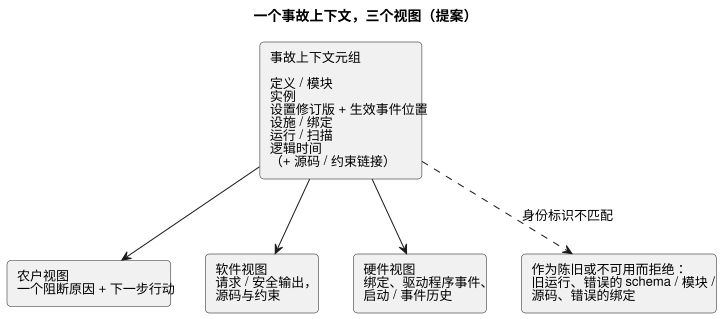
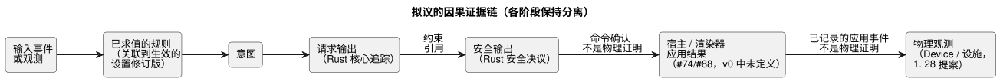

<!-- translation-source: docs/research/GF-COMPOSE-R8-INCIDENT-EVIDENCE.md -->
[英文原文](GF-COMPOSE-R8-INCIDENT-EVIDENCE.md)

# GF-COMPOSE R8：事故证据的组合

父 issue：[#99](https://github.com/callin2/ghostflow-language/issues/99)  
Issue：[#107](https://github.com/callin2/ghostflow-language/issues/107)  
状态：有界的研究/设计。不声称任何实现或物理设备测试。

本说明定义农户视图、软件视图和硬件视图如何指向**同一个事故（incident）**。内容包括：在所考察修订版中找到的证据、必需的身份标识关联（join）、如何让各输出阶段保持分离、三个手工推演示例、建议，以及尚待负责人决定的问题。

## 用户问题

农户问：“为什么没有浇水？”答案必须指出工程师和安装人员所检查的同一个触发实例。

答案必须区分以下四项：

1. **请求的输出**；
2. 语言运行时选出的**安全输出**；
3. **宿主或渲染器的应用结果**；
4. **物理观测**。

以下两条规则始终适用：

- 缺失的值不是 `false`。
- 旧的运行或绑定不得关联到当前事故。

组合层面的目标是一次小而精确的证据交接。它**不会**创建：

- 第二个可执行源；
- 新的事件存储；
- 完整的原始扫描日志；
- 重构出来的崩溃事实。

拟议的关联包括“输入事件 → 规则 → 意图”的解释，以及决定每次求值的设置修订版/生效位置。这些是设计上的关联，并非对当前遥测能力的声明。

## 所考察修订版中的证据

所考察的语言修订版是 `ffdbc96461eca67908252507fb851fa4dabd9a2c`。

**交互契约。** 它要求 schema、模块、源码和 `runId` 精确关联。`scanId` 只在一次运行内部有序。已完成的观测显式使用 `ready`、`unavailable` 或 `error`。`stale` 由进行验证的消费方推导得出，生产方绝不断言它。参见
[`contracts/interaction-v0/README.md`](../../contracts/interaction-v0/README.md)
和 [`tools/interaction-runtime-snapshot.mjs`](../../tools/interaction-runtime-snapshot.mjs)。

**源码安全契约。** 它记录编译器来源、请求/安全输出、约束观测以及源码/文档摘要。它明确不推断电气或机械动作。参见
[`docs/SOURCE-SAFETY-TRACE.md`](../SOURCE-SAFETY-TRACE.zh.md)。

**分帧宿主。** 分帧宿主捕获完整的输入帧，分派一次，并发布最后一次被接受的结果。在调理（conditioning）或分派失败后，它会锁存一个故障。出现该故障后，必须创建新的宿主实例。参见 [`docs/FRAMED-CONTROL-HOST.md`](../FRAMED-CONTROL-HOST.zh.md)。

**早期研究（R1–R3）与重启修订。**

- R1 建议提供一个农户可读的阻断原因，外加一个面向工程师的视图，展示同一份源码/模块/实例/运行以及设施身份标识。
- R2 确立规范的 `.ghost.md` 仍是可执行的权威来源。Memory #68 是来源/编写上下文，而不是直接的执行规则或绑定权威。
- R3 确立重启会创建新的 `runId`，并且组合后精确的故障扇出仍未解决。
- 另外，经用户同意的设计修订是：重启是一个普通事件，其响应由 GhostFlow 逻辑编写。它不定义全局的恢复/手动策略。运行时之前的电气启动、断开和故障义务仍由 Device/Driver 负责。这条事件响应规则属于设计，而非当前运行时证据。

**Device issue [#28](https://github.com/callin2/farm-device/issues/28)。** 它提议一个设备本地的、有界的、以追加为主的闪存日志（journal），目标保留约七天，与 RAM 中的近期历史分开。该提案列出：

- 重启/断电恢复；
- 单调的事件身份标识（`deviceId`、`eventSequence`、`bootId`，以及可选的 `runId`/`scanId`）；
- 时间质量；
- 程序/设置/运行时身份标识；
- 分页；
- 显式的恢复/数据丢失通知。

它还提议了以下事件类别：输出请求/安全/已应用的变化、命令、故障、安全跳闸、程序/设置变更以及重启。

这是 issue/设计层面的证据，而不是已实现的语言或 Device 运行时证据。精确的带版本事件 schema、物理反馈字段以及最终的启动/事件到运行的关联仍未确定。它们被标注为必需的关联或未知证据，而不是不可用的源材料。输入触发实例/值观测的合并（coalescing）并不是对事故持久保留的承诺。

## 表格与示例

### 必需的事故关联

每一行是一个证据边界：由谁产生、必须关联哪个身份标识，以及如何处理缺失或不匹配的身份标识。

| 证据边界 | 产生方 | 必需的关联 | 可用性 / 不匹配处理 |
|---|---|---|---|
| 定义修订版 | API/源码存储加语言编译器 | `documentId`、`revisionId`、源码 SHA；模块指纹和字节码 SHA | 源码解释所必需。身份标识缺失或不一致即为陈旧/错误，绝不做尽力而为的标签关联。 |
| 行为实例 | API 组合/部署 | 拟议的不透明 `instanceId`，关联到定义修订版 | 当前 v0 没有实例字段。若缺失，组合范围即未解决；不得合并同一定义的多个实例。 |
| 程序与设置 | 可执行默认值来自规范源；设置事件来自 API/运行时 | 程序修订版加设置修订版/摘要、生效事件位置和作用域 | 实时属性事件保留程序和运行身份标识。将每次求值/意图关联到其生效的设置修订版。缺失的设置必须为未知，不得静默替换为源码默认值。 |
| 设施与绑定 | API 设施上下文和 Device 配置档 | 设施/绑定修订版、逻辑端口、物理端点/配置档身份标识 | 声称目标是哪台设备时所必需。错误或旧的绑定会使关联被拒绝；物理端点不是逻辑端口身份标识。 |
| 运行 / 扫描 | 分帧宿主/运行时 | `runId`、已完成的 `scanId`、逻辑时间；schema/模块/源码身份标识 | 单独的 `scanId` 无效。真实重启会创建新的运行，且不得关联到旧的 scan 0。实时属性事件不会创建新的运行。缺少完成记录即不能声称扫描已完成。 |
| 设备启动/事件序列 | #28 中的 Device 持久历史记录器提案；最终产生方/schema 未定 | 拟议的单调设备事件身份标识、启动身份标识、事件序列，以及到同一运行/绑定的链接 | 该提案支持重启恢复和显式的数据丢失通知，但精确字段和物理反馈仍未解决。报告最后记录的事件和间隙；绝不合成最后一次扫描。不得推断每个运行时输入观测都被持久保留。 |
| 逻辑时间 | 宿主/运行时完成记录；仅在单独记录时才使用 Device 时钟 | 精确的 `logicalTimeMs`，以及任何设备时间戳/时钟身份标识 | 宿主逻辑时间不能证明墙钟时间或物理发生。时钟不匹配是需要展示的不确定性，而不是靠推断修复。 |
| 源码/约束引用 | 编译器源码映射和安全追踪；设施约束由约束负责人提供 | 源码节点/意图锚点、约束索引/种类、首次违反/最终结果、精确的事故上下文 | 静态依赖读取不能证明执行原因。未解决的设施约束产物/边界仍由负责人决定。 |

**事故上下文。** 精确的参与方上下文是以下各项组成的元组：

- 定义/模块；
- 实例；
- 同一运行内的设置修订版/生效事件位置；
- 设施/绑定；
- 运行/扫描；
- 逻辑时间。

每个参与方视图都必须使用该元组。消费方必须把旧的运行、错误的 schema/模块/源码或错误的绑定作为陈旧或不可用而拒绝。它不得静默地改为展示一条相关记录。

下图展示一个元组为三个视图提供输入，而身份标识不匹配的记录被拒绝、不予关联。

**因果链。** 拟议的因果证据为：输入事件或观测 → 已求值的规则 → 意图 → 请求/安全输出 → 渲染器结果或物理观测，并关联到求值时生效的设置。

### 阶段分离与所有权/缺口

每个阶段都有自己的负责人和自己的缺口。后一阶段绝不能证明前一阶段已在物理上实现。

| 阶段 / 证据 | 负责人 | 当前支持 | 组合缺口 |
|---|---|---|---|
| 请求输出 | Rust 核心追踪；语言源码映射 | 已有的 `requested` 映射和来源 | 将其关联到实例和精确的已完成扫描。 |
| 安全输出 | Rust 安全决议 | 已有的 `safe` 映射和有界安全追踪 | 与请求保持区分，并公开约束引用。 |
| 宿主/渲染器应用 | API/宿主与 Device 集成 | interaction-v0 未定义；宿主故障不是物理故障 | #74/#88 必须定义应用结果事件及缺失语义。驱动程序源码/意图负责精密测量、协议和原始 ISR/扫描机制；它公开有意义的类型化事件/测量值，而不隐藏农场策略。捕获时间、接收/求值时间和质量保持区分；命令确认不是物理证明。 |
| 物理观测 | Device/设施负责人 | #28 提议持久事件历史并引用 HIL 物理继电器证据，但未确定最终的反馈 schema | #28 必须定义可用的反馈、启动/历史身份标识和保留策略；即使记录了应用事件，也仍不能证明物理动作。 |
| Memory/编写上下文 | API/系统 #68 | 仅为来源上下文 | 在没有经批准的决策/源码路径之前，绝不能成为执行或绑定关联。 |
| 输入触发实例与值观测 | 此处未实现；属于已同意的设计。捕获可以基于中断或扫描。 | 触发实例身份标识或观测值，带有区分的捕获时间、接收/求值时间和质量 | 定义入口记录以及事件到 tick 的映射。默认在支持的容量内全部保留；仅当按输入显式选择时才允许用最新待处理值替换。溢出/丢失必须报告。顺序和映射仍未确定；这不是无限的持久历史。 |

下图展示拟议的因果链，每个阶段保持分离，并标出了上表中提到的两个证明边界。

### 成对推演（手工推演，非执行证据）

每个推演给出农户答案和下一步行动、软件证据、硬件证据以及剩余的不确定性。

#### 1. 低水位阻止了浇水

- **农户答案和下一步行动**：“浇水被低水位信号阻止；请检查水箱或设施传感器。”答案不得说水箱是空的。
- **软件证据**：同一个已完成的运行/扫描、输入 `low_water=true`、请求的泵 `ON`、安全的泵 `OFF`、被违反的约束以及源码/锚点引用。
- **硬件证据**：仅限可用的传感器或设施记录。
- **剩余不确定性**：该信号不能证明水箱的物理水位或传感器是否正确。

#### 2. 渲染器应用失败或反馈缺失

- **农户答案和下一步行动**：若记录了失败，则为“系统请求了浇水，但设备应用失败。”否则为“由于缺少物理反馈，命令结果未知。”下一步行动是检查设施/驱动程序路径，或联系安装人员。
- **软件证据**：同一个运行/扫描、请求输出、安全输出，以及宿主/渲染器结果（若存在）。
- **硬件证据**：绑定、驱动程序事件或物理反馈，仅当 Device 记录了它们时。
- **剩余不确定性**：`requested=ON` 或 `safe=ON` 不能证明泵已运转。

#### 3. 崩溃/重启并出现日志间隙

- **农户答案和下一步行动**：“最后记录的浇水事件是 [事件]；系统在记录下一个结果之前重启了。”下一步行动是检查设备，并且只按现有操作规程重试。
- **软件证据**：最后一个已完成的运行/扫描、逻辑时间、最后的请求/安全结果，以及宿主故障/新运行边界。
- **硬件证据**：最后的启动/事件记录，以及显式的缺失区间（当 Device 历史提供时）。
- **剩余不确定性**：缺失的最后一次扫描和物理状态必须保持未知。不重构任何崩溃原因或输出。

## 建议

**采用一个事故上下文**，在农户、软件和硬件视图之间原样复用。

**组合所需的最小增补是一条身份标识关联和投影规则，而不是新的存储。** 该关联为：定义/模块 + 实例 + 设置修订版/生效事件位置 + 设施/绑定 + 运行/扫描 + 逻辑时间，并带有源码/约束链接。

**保留四个分别命名的阶段**：请求输出、安全输出、应用结果和物理观测。

**通过验证推导陈旧状态**，并拒绝运行、模块、源码、schema 或绑定身份标识不匹配的记录。

每种情况应展示的内容：

- **低水位不变式**：请求 `ON`、安全 `OFF`、`low_water=true` 以及约束引用。
- **应用失败或反馈缺失**：已记录的应用状态，或显式的未知。
- **重启**：把重启视为普通事件，并将 GhostFlow 编写的响应关联到其新的运行；不施加全局的恢复/手动策略。运行时之前的电气启动、断开和故障义务另由 Device/Driver 负责。展示最后记录的事件和日志间隙。

不要求完整保留扫描，也不编造 #28 未记录的事实。

## 未解决的问题与负责人

- **#74/#88 事件与解释负责人**：定义规范的应用结果、物理反馈缺失、事故上下文和农户措辞字段。不得把命令/应用/观测合并成一个状态。
- **Device #28 负责人**：最终确定持久历史的身份标识与保留契约：启动/会话 ID、事件序列、绑定链接、物理反馈以及日志间隙的表示。#28 提出了这些关注点，但精确的带版本事件 schema 和最终的跨项目关联仍未确定。
- **API/部署/运行时负责人**：定义 `instanceId`、设置修订版/摘要/生效位置的关联，以及设施/绑定修订版在实时事件、重启和重新部署之间的生命周期。精确的投递、顺序和持久性机制仍是设计缺口。
- **语言/运行时契约负责人**：定义未来按实例限定的事故表示，同时保留 v0 的 `runId` 和 `scanId` 语义。
- **设施/系统负责人与语言/API 负责人**：选择 R2 中尚未解决的设施约束边界。Memory #68 可以为已确认的决策提供来源，但不能直接授权执行或绑定。

## 验证

- [x] 关联表涵盖定义修订版、实例、程序/设置、设施/绑定、运行/扫描、设备序列、逻辑时间以及源码/约束引用，并列出产生方、必需状态和不匹配处理。
- [x] 三个推演给出农户答案/下一步行动、软件证据、硬件证据和剩余不确定性。命令不是物理结果，缺失的值不是 false。
- [x] 请求、安全、应用和物理阶段保持分离。旧运行/绑定和日志间隙的情况都已明确。
- [x] 来自所考察代码/契约的声明，与提案、未解决的负责人决策以及手工推演示例相互区分。未运行也未声称任何运行时或物理测试；native/WASM 一致性仅作为拟议的验收项。
- [x] 所考察的修订版记录为
  `ffdbc96461eca67908252507fb851fa4dabd9a2c`。R1–R3 以及 #89/#90 issue 记录作为设计证据进行了审阅。Device #28 是提案证据，而非实现证据；其精确的事件 schema 仍未确定。

未进行任何运行时或物理验证。native/WASM 一致性、diff 整洁性和相对链接检查仍是实现/设计负责人的验收责任；此处不声称已完成。
