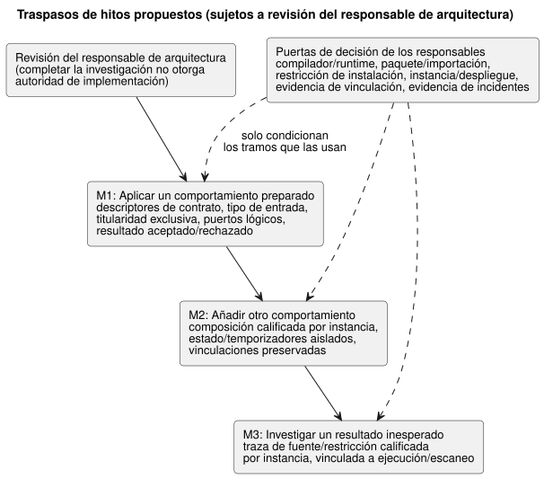

<!-- translation-source: docs/research/GF-COMPOSE-R9-ACCEPTANCE.md -->
[Original en inglés](GF-COMPOSE-R9-ACCEPTANCE.md)

# GF-COMPOSE R9: aceptación y traspaso para la implementación

Padre: [#99](https://github.com/callin2/ghostflow-language/issues/99)
Issue: [#108](https://github.com/callin2/ghostflow-language/issues/108)
Estado: investigación/diseño acotado. No se afirma ninguna ejecución de
composición, puesta en servicio de dispositivos ni estudio con participantes.
Completar la investigación no autoriza la implementación. Las recomendaciones y
los traspasos de hitos requieren la revisión del responsable de arquitectura
antes de que comience el trabajo dependiente.

Esta nota convierte los hallazgos de R1–R8 en criterios de aceptación propuestos
y tres traspasos de implementación propuestos. Contiene: una matriz de
aceptación de escenarios, tres traspasos de hitos (M1–M3), una recomendación y
las decisiones de los responsables que condicionan cada tramo dependiente. Todo
lo que aparece aquí es una especificación por revisar, no un resultado medido
ni ejecutado.

## Problema del usuario

El primer tramo de composición debe reducir las decisiones que un agricultor
necesita para:

- aplicar un comportamiento preparado;
- entender un resultado bloqueado o fallido;
- conectar esa explicación con la evidencia de ingeniería.

Hay dos recorridos:

- **Recorrido del agricultor:** aplicar, añadir e investigar.
- **Recorrido del ingeniero:** el mismo incidente, visto a través de la fuente,
  la instancia, la vinculación (binding), la ejecución (run) exactas y la
  evidencia disponible del dispositivo.

Son especificaciones de aceptación, no resultados medidos.

## Evidencia en la revisión examinada

La revisión del lenguaje examinada es `ffdbc96461eca67908252507fb851fa4dabd9a2c`.
R1–R8 se leyeron como el conjunto de dependencias.

La evidencia actual incluye:

- una única entrada `.ghost.md` canónica para el compilador;
- el registro explícito de pruebas del host en
  [`tools/verify-language.mjs`](../../tools/verify-language.mjs);
- el contrato de cinta de escaneo (scan tape) nativa/WASM en
  [`SCAN-TAPE-PARITY.md`](../SCAN-TAPE-PARITY.es.md);
- reglas independientes de evidencia del host, del hardware y física en
  [`integration-v1`](../../contracts/integration-v1/README.es.md).

Las comprobaciones existentes son solo evidencia del host/de conformidad.
Ningún resultado de prueba ni de estudio con usuarios de los que siguen se
presenta como ejecutado.

Lo que aporta cada nota de investigación anterior:

| Nota | Aportación utilizada aquí |
|---|---|
| R1 | Aporta las medidas de esfuerzo y de explicación. |
| R2 | Separa las identidades de fuente canónica, revisión de la definición, instancia, puerto lógico, vinculación física, ajustes y ejecución/escaneo. |
| R3 | Prefiere la composición estática para la revisión, pero deja abierta la decisión de reducción (lowering)/ABI. Exige instantáneas independientes del orden, preservando la semántica establecida de estado anterior/siguiente. La regla semántica es fija; el mecanismo con el que una reducción de la composición la preserva sigue abierto. |
| R4 | Mantiene las vinculaciones existentes y distingue las DI físicas de las entradas de software explícitas. |
| R5 | Limita el primer perfil a comprobaciones de tipo, dependencia, parámetro y propietario exclusivo. |
| R6 | Separa los parámetros de importación, los ajustes del operador, los cambios de dependencias y los cambios de vinculación. |
| R7 | Recomienda un cierre de fuentes fijado, mientras su elección de verificación de paquetes sigue abierta. |
| R8 | Exige un único contexto de incidente y mantiene separadas las etapas solicitada, segura, de aplicación y física. |

## Tablas y ejemplos

### Matriz de aceptación

Cómo leer la matriz:

- Los resultados y medidas esperados son **especificaciones propuestas**, no
  resultados ejecutados ni un alcance de implementación aprobado.
- La columna **Prerrequisito** identifica las entradas de investigación. Las
  puertas de decisión de la sección «Preguntas sin resolver y responsables» se
  aplican a los tramos de implementación dependientes.
- «Elaborado a mano» significa razonamiento a partir de los contratos
  revisados, no evidencia de ejecución.

| Escenario | Supuestos de entrada | Resultado/rechazo esperado | Cadena de evidencia | Medida de esfuerzo / explicabilidad / trazabilidad | Capa de verificación | Responsable | Prerrequisito |
|---|---|---|---|---|---|---|---|
| Riego cableado + ventilación de cuatro ventiladores | Las entradas de riego son DI cableadas; existen siete RO compatibles | Aceptar la propuesta de capacidad; preservar la vinculación del riego; añadir cuatro vinculaciones distintas de ventiladores | roles lógicos → revisiones de perfil/vinculación → propuesta | pasos de configuración; la vinculación sin cambios es explicable; roles/endpoints trazables | fixture del host, luego API/Device/físico por separado | lenguaje/API; Device confirma el mapeo aplicado | R2, R4, R5 |
| Composición con arranque manual por software | El arranque manual es una entrada de software explícita; el nivel bajo de agua es una DI cableada | Aceptar con un recuento de DI de 1; no contar la entrada de software como DI física | tipo de entrada → identidad de capacidad/perfil | menos decisiones de configuración erróneas; tipo de entrada visible; revisión de vinculación enlazada | host + contrato de integración | lenguaje/API; Device es responsable del adaptador | R4, R5 |
| Instancias de riego duplicadas | Misma definición fijada; IDs de instancia distintos | Aceptar solo con estado, temporizadores, ajustes, vinculaciones y procedencia aislados | revisión de la definición → instancia → ejecución/escaneo | sin ambigüedad de configuración duplicada; cada resultado nombra la instancia; sin trazas fusionadas | conformidad de composición del host | compilador/runtime + API | R2, R3 |
| Reordenación de declaraciones | Mismos IDs de instancia y misma cinta de entradas/tiempo | Mismas salidas, vinculaciones e identidades de traza | IDs de instancia + trama ordenada → resultados | sin corrección por reordenación; explicación estable; reproducción (replay) determinista | extensión de paridad nativa/WASM | compilador/runtime | R3, R4 |
| Escritores directos de salida en competencia | Dos definiciones apuntan a un canal de salida | La compilación rechaza y ningún artefacto es desplegable. Las solicitudes explícitas de estación arbitradas por el gestor existente de escritor único siguen siendo válidas. | canal de salida → definiciones → diagnóstico | rechazar antes del despliegue; identificar ambas definiciones | propuesta de conformidad del compilador | compilador/runtime | Unicidad de salidas y contrato de estaciones existentes |
| Titularidad exclusiva de la bomba | Dos propietarios lógicos apuntan a un endpoint exclusivo | Rechazar antes de la activación; nombrar ambas reclamaciones de instancia/puerto y el motivo | reclamaciones → revisión de endpoint/vinculación → diagnóstico | corrección temprana; el agricultor ve un único bloqueo; el conflicto es auditable | validación de contrato del host | lenguaje/compilador + API/Device | R4, R5 |
| Requisito inválido o desconocido | Tipo incorrecto, dependencia faltante o idoneidad desconocida | Rechazar la discordancia concreta; en otro caso informar desconocido, nunca compatible/aprobado | evidencia de manifiesto/dependencia/perfil → resultado | menos correcciones tardías; el hecho no admitido es explícito; se nombra el origen de la incertidumbre | host + contrato de integración | compilador/API; perfil/Device para la idoneidad | R2, R4, R5 |
| Explicación de nivel bajo de agua | `low_water=true`; bomba solicitada ON | Salida segura OFF; el agricultor ve la señal y la siguiente acción, no «tanque vacío» | entrada → fuente/restricción → salida solicitada/segura → ejecución | corrección de la paráfrasis; el ingeniero llega a la entrada/restricción; unión exacta con la ejecución | traza del host; usabilidad más adelante | lenguaje/runtime + #88/#74 | R1, R3, R8 |
| Falla de aplicación/retroalimentación | Comando emitido; falla de aplicación o sin retroalimentación | Mostrar la aplicación fallida o un desconocido explícito; no afirmar éxito físico | solicitada/segura → host/driver → observación disponible | navegación de diagnóstico; distinción de etapas; evidencia faltante visible | registro del host; Device/físico por separado | #74/#88 + Device | R8 |
| Caída, reinicio o brecha en el registro | El runtime se reinicia o el historial tiene un intervalo faltante | Nuevo `runId`; preservar la última evidencia y la brecha; sin escaneo/resultado fabricado | módulo/instancia/vinculación → ejecución/escaneo → evidencia de arranque/evento | menos pasos de reconstrucción; límite de reinicio claro; brecha trazable | semántica del host + historial de Device | runtime/API + Device #28 | R2, R3, R8 |
| Identidad de las sobrescrituras | Cambio de parámetro de importación, ajuste del operador, dependencia o vinculación | Aplicar la matriz de R6; rechazar uniones obsoletas; preservar revisiones distintas | identidades de fuente/artefacto/ajustes/vinculación/paquete/ejecución | esfuerzo de corrección; el motivo del cambio de identidad es explicable; linaje completo | puertas de host/paquete/integración | API/despliegue + compilador/Device | R6 |
| Evento de propiedades en vivo durante una operación activa | Una acción válida cambia varias propiedades declaradas como ajustables en runtime | Validar como un solo evento; aplicar todos los valores al procesarse, de modo que la lógica existente pueda cambiar la salida durante la operación activa sin esperar otro ciclo. La revisión/hash de la fuente, los bytes/hash del programa y la identidad de la ejecución no cambian. Avanzan la revisión de ajustes y la posición efectiva del evento. | evento → conjunto completo de propiedades validado → revisión de ajustes/posición efectiva → misma fuente/programa/ejecución → lógica/salida resultante | probar el efecto en la operación activa y explicar qué revisión de ajustes rigió la ocurrencia | conformidad nativa/WASM propuesta; no ejecutada | contrato de runtime/API | Enmienda acordada con el usuario; mecanismo y ABI de R6/#89 |
| Evento multipropiedad inválido | Una acción contiene varios valores válidos y un valor de tipo/rango/paso inválido | Rechazar el evento completo. Ninguna propiedad cambia; la revisión de ajustes/posición efectiva anterior y el comportamiento activo permanecen sin cambios. | evento rechazado + motivo de validación; los ajustes anteriores siguen unidos al mismo programa/ejecución | probar el rechazo de todo o nada e identificar el miembro inválido | conformidad nativa/WASM propuesta; no ejecutada | contrato de runtime/API | Enmienda acordada con el usuario; registro de validación de R6/#89 |
| Identidad de propiedades en vivo y unión de evidencia | Aceptar un evento válido mientras una ejecución está activa | La evidencia de ejecución afectada posterior se une a la nueva revisión de ajustes/posición efectiva del evento y al mismo programa/ejecución. No reinterpretar registros obsoletos ni insinuar un cambio de fuente/bytecode. | hashes de fuente/programa + `runId` sin cambios; la revisión de ajustes/posición efectiva avanza y se une a los resultados posteriores | la reproducción/explicación identifica exactamente qué ajustes se aplicaron en cada posición de evento | conformidad nativa/WASM/de adaptador propuesta; no ejecutada | contrato de runtime/API | R6; mecanismo de unión de ajustes abierto |
| Reinicio real tras ajustes aceptados | Propiedades aceptadas persistidas; ocurre un reinicio físico del ESP; se entrega el evento de reinicio de GhostFlow | Las propiedades persisten. El reinicio inicia un nuevo `runId`. La respuesta al reinicio la determina la lógica GhostFlow escrita por el autor; no imponer un comportamiento global de reanudación/manual. Las obligaciones eléctricas previas al runtime de arranque/fallo se mantienen en Device/Driver. | revisión de ajustes anterior → ajustes persistidos tras el reinicio; ejecución antigua → nueva ejecución; evento de reinicio → transición/salida escrita por el autor | mostrar la persistencia, el límite de la ejecución y la respuesta real escrita al reinicio sin afirmar actuación física | conformidad del host propuesta; Device por separado; no ejecutada | runtime/API; límite de arranque de Device/Driver | Enmienda acordada con el usuario; el orden de persistencia/recuperación sigue abierto |
| Entrega de ocurrencias y valores de entrada | Llegan múltiples ocurrencias y observaciones de valores cambiantes entre evaluaciones | Preservar cada ocurrencia y observación por defecto dentro de la capacidad admitida. El reemplazo por el último valor pendiente solo se permite con habilitación explícita por entrada. Rechazar/informar el desbordamiento o la pérdida; nunca informar un éxito silencioso. No se implica un historial duradero ilimitado. | identidad de la entrada + tiempo de captura + tiempo de recepción/evaluación + calidad + resultado de entrega/pérdida | mostrar la preservación de ocurrencias, la agregación habilitada y el desbordamiento/pérdida visibles | conformidad nativa/WASM propuesta; orden/mapeo/límites siguen abiertos; no ejecutada | contrato de runtime/Driver | Enmienda acordada con el usuario sobre la entrega de entradas |
| Actualización de una definición importada | La importación fijada exacta cambia de revisión | Seleccionar explícitamente las instancias afectadas; revalidar el cierre y las uniones; sin actualización flotante | arista de importación → cierre/artefacto → instancia/despliegue | alcance de la actualización visible; procedencia conservada; el despliegue anterior sigue siendo explicable | validación de paquete/reproducción | responsables de lenguaje/API/paquetes | R2, R6, R7 |
| Paridad nativa/WASM | Mismo artefacto fijado, ajustes, estado inicial, cinta de entradas y tiempo lógico | Resultados aceptados e identidades de traza admitidas iguales; las tramas inválidas coinciden semánticamente | artefacto/módulo → trama → resultado completo | una sola ruta de reproducción; evidencia de explicación idéntica; hashes e identidades registrados | puerta explícita de cinta de escaneo del host | lenguaje/runtime | R3 y el contrato de paridad existente |

El caso DI 2 / RO 7 es un resultado de capacidad bajo el supuesto de entradas
cableadas. No prueba la puesta en servicio física ni que un agricultor pueda
aplicar el comportamiento. El caso negativo de nivel bajo de agua pertenece al
mismo primer hito.

Las filas de propiedades en vivo y de reinicio definen cómo se comportan las
identidades a lo largo del tiempo. El diagrama siguiente las resume: un evento
válido de propiedades en vivo solo hace avanzar la revisión de ajustes dentro de
la misma ejecución, uno inválido no cambia nada y un reinicio real inicia una
nueva ejecución con los ajustes aceptados persistidos.

### Tres traspasos de hitos propuestos

El orden y el alcance mínimo siguientes son propuestas sujetas a la revisión
del responsable de arquitectura. Cada tramo dependiente requiere las decisiones
pertinentes enumeradas más abajo.

1. **M1 — Aplicar un comportamiento preparado.**
   - *Cambio mínimo en el lenguaje:* exponer los descriptores de contrato
     acotados necesarios para requisitos tipados, tipo de entrada explícito,
     titularidad exclusiva, identidad estable de puertos lógicos y un resultado
     aceptado o rechazado trazable.
   - *Traspaso al consumidor:* la API presenta una propuesta y una revisión de
     instalación/vinculación confirmada; Device aporta la evidencia de
     perfil/aplicación; el frontend presenta el bloqueo para el agricultor y la
     explicación negativa de nivel bajo de agua.
   - La aceptación física se mantiene aparte.

2. **M2 — Añadir otro comportamiento preservando el comportamiento/las
   vinculaciones existentes.**
   - *Cambio mínimo en el lenguaje:* composición calificada por instancia con
     estado/temporizadores aislados, instantáneas de entrada deterministas,
     orden de identidades estable y el rechazo, en el primer perfil, de salidas
     exclusivas compartidas.
   - *Traspaso al consumidor:* la API registra las uniones de instancia y
     vinculación; Device confirma los mapeos sin cambios y los nuevos; la
     reproducción del host comprueba los casos de recursos cableados/de
     software.
   - *Límites de alcance:* el tramo de composición propuesto rechaza los
     escritores directos en competencia. No implementa una superposición de
     ajustes de runtime como parte de M2. Este límite de alcance no rechaza el
     comportamiento de eventos de propiedades en vivo aprobado por separado, y
     no exige que esos eventos detengan el controlador ni inicien una nueva
     ejecución.
   - *Si un tramo usa eventos de propiedades en vivo,* conservar todo lo
     especificado en la matriz de aceptación: hashes de fuente/programa e
     identidad de la ejecución sin cambios, uniones de ajustes/posición
     efectiva, consecuencia en la operación activa, rechazo atómico y
     comportamiento de persistencia ante el reinicio.

3. **M3 — Investigar un resultado inesperado desde la explicación al agricultor
   hasta la evidencia de ingeniería.**
   - *Cambio mínimo en el lenguaje:* unir la traza de fuente/restricción
     calificada por instancia al contexto de ejecución/escaneo existente,
     conservando la distinción entre salida solicitada y segura.
   - *Traspaso al consumidor:* #88/#74 definen la redacción y los eventos de
     resultado de aplicación; la API une las revisiones de ajustes y de
     vinculación; Device #28 define la evidencia de arranque/historial y de
     brechas.
   - Una observación física faltante sigue siendo desconocida.

## Recomendación

**Proponer los tres traspasos anteriores para la revisión del responsable de
arquitectura.**

La dirección de investigación preferida es la composición estática con:

- un paquete de fuentes fijado;
- IDs de instancia explícitos;
- puertos estables definidos por el autor;
- vinculaciones preservadas;
- rechazo por propietario exclusivo.

Las alternativas de ejecución y de paquetes siguen sin decidirse hasta que sus
responsables resuelvan las puertas indicadas abajo. Los resultados propuestos
llevan la cadena de identidad de R8.

Límites de alcance:

- La aceptación del host, de la API, de Device, física y de usabilidad se
  mantienen separadas.
- La capacidad, la reproducción coincidente y un registro de integración válido
  solo establecen su alcance declarado.
- Aceptar este documento de investigación no aprueba ni una arquitectura ni una
  implementación.

## Preguntas sin resolver y responsables

Estos son bloqueos de implementación para los tramos especificados, no
dependencias universales de que se completen issues externos enteros. M1–M3 se
refieren a los traspasos propuestos arriba. Los hallazgos de R1–R8 citados son
la evidencia de estas decisiones abiertas.

| Decisión y entrada de investigación | Decisión requerida del responsable antes del trabajo dependiente | Tramo dependiente |
|---|---|---|
| Contrato de compilador/runtime y de diagnósticos (R2, R3, R5) | Los responsables del compilador/runtime definen la identidad de descriptores/diagnósticos para M1; eligen entre reducción estática y VM coordinadas, entrada/tiempo, compatibilidad GFB1/ABI, propagación de fallos y el mecanismo que preserva la semántica establecida de estado anterior/siguiente en la ejecución compuesta. Las reglas de instantánea anterior/siguiente dentro de un bloque `control` y de rechazo de ciclos son fijas. Solo la codificación de referencias de importación/entre instancias y su validación siguen abiertas, si se eligen tales referencias. | Los cambios de descriptores de M1 requieren la decisión sobre descriptores. La ejecución/reproducción de M2 requiere las decisiones de ejecución compuesta; estas también se aplican a M1 si instancia código compuesto |
| Contrato de paquetes/importación (R2, R6, R7) | Los responsables de lenguaje/API/paquetes eligen entre paquete de fuentes y envoltorio, el esquema de cierre/bloqueo, el orden, la identidad del mapa de múltiples fuentes y las reglas de verificación de reproducción y firma | Cualquier extensión de paquete de importación reutilizable de M1; composición/actualización importada de M2. El uso existente de paquetes de una sola fuente no requiere un nuevo formato de paquete |
| Autoridad de las restricciones de instalación (R2, R4, R5) | Sistema #62 con los responsables de lenguaje/API seleccionan la representación canónica de restricciones, el límite de aplicación y la evidencia de compatibilidad | Cualquier tramo de M1/M2 que afirme compatibilidad/aplicación de restricciones de instalación; explicación de M3 de tal restricción. Sin una decisión, la idoneidad queda desconocida; no hay afirmación de despliegue exitoso |
| Identidad de instancia y de despliegue (R2, R6, R8) | Los responsables de API/despliegue y del contrato del lenguaje definen el ciclo de vida de la instancia, las uniones de vinculación/ajustes, la continuidad en las actualizaciones y el rechazo de uniones obsoletas. Un evento de propiedades en vivo preserva los hashes de fuente/programa y la identidad de la ejecución mientras hace avanzar la revisión de ajustes/posición efectiva del evento; los resultados posteriores se unen a los ajustes efectivos. El reinicio persiste los ajustes aceptados y crea una nueva ejecución. | Uniones de vinculación/resultado de M1; creación y actualización de instancias de M2; contexto exacto del incidente de M3. El trabajo de mecanismo/ABI/alineación de la especificación de #89 solo condiciona los tramos que usan ajustes en vivo; los tramos no relacionados no dependen de él. |
| Evidencia de vinculación (R4, R8) | Los responsables de API/Device/perfil definen los registros de propuesta/confirmación, el orden estable de endpoints y la identidad de la vinculación aplicada observada; el responsable físico define la evidencia de puesta en servicio | Aplicación de la instalación de M1; asignación/preservación de M2; afirmaciones de equipo objetivo de M3. Las comprobaciones de capacidad del host siguen teniendo un alcance separado |
| Contrato de evidencia de incidentes (R1, R3, R8) | Los responsables de lenguaje/runtime y de #74/#88 definen las uniones de traza calificadas por instancia, la explicación para el agricultor, los campos de resultado de aplicación y la semántica de ausencia; el responsable de Device #28 define las uniones de arranque/evento con ejecución/vinculación, la retroalimentación disponible y la representación de brechas | Proyección de nivel bajo de agua/bloqueo de M1; tramo correspondiente de M3 lógico, de aplicación o de reinicio/historial. Los campos del registro de Device solo se necesitan para el tramo de historial del dispositivo |

Alcance de los issues relacionados:

- **#95** es una dependencia solo si se elige un arbitraje más allá del gestor
  de estaciones existente. El primer perfil rechaza los escritores directos en
  competencia, preservando el arbitraje explícito de solicitudes de estación a
  través del gestor existente de escritor único.
- **#89/#90** son responsables del mecanismo/ABI/verificación de las
  propiedades en vivo y de conciliar el texto anterior de Configure con
  detención. La decisión del usuario sobre las propiedades en vivo está
  resuelta. #89 solo condiciona los tramos que usan ajustes en vivo, no el
  trabajo de implementación no relacionado de R1–R8.
- La especialización en tiempo de importación sigue siendo distinta.
- La memoria y la retención permanecen con sus responsables existentes de
  API/sistema y de Device; este traspaso no añade trabajo de almacenamiento ni
  de retención.
- La evidencia faltante sigue siendo explícita.

## Verificación

- [x] Criterio de aceptación 1: todos los escenarios resumidos conservan
  supuestos, resultado esperado, evidencia, medida, capa, responsable y
  prerrequisito. La matriz sigue siendo de especificaciones propuestas; no se
  afirma ningún resultado de ejecución ni de participantes.
- [x] Criterio de aceptación 2: tres traspasos propuestos describen recorridos
  de usuario completos y el alcance mínimo. Cada tramo dependiente tiene
  decisiones de responsables nombradas; las dependencias de #89, #95 y del
  historial de Device solo se aplican cuando se usan sus capacidades.
- [x] Criterio de aceptación 3: las decisiones de autoridad, identidad,
  escaneo, vinculación, paquetes y contrato de evidencia siguen siendo bloqueos
  explícitos. La aceptación del host, de la API, de Device, física y de
  usabilidad se mantienen separadas. Las futuras pruebas ejecutables requieren
  un registro explícito en `tools/verify-language.mjs`; las comprobaciones
  existentes no deben debilitarse. Completar la investigación no otorga
  autoridad de implementación.
- [x] Se registra la revisión examinada; se inspeccionaron las secciones
  pertinentes de `VERIFICATION.md`, paridad, integración y registro explícito
  de pruebas.
- [ ] Verificación del coordinador pendiente: releer R1–R8 corregidos y esta
  matriz, verificar los enlaces relativos y aceptar la publicación corregida de
  la investigación. `git diff --check` local pasó; no se ejecutaron pruebas de
  runtime ni comprobaciones físicas.
