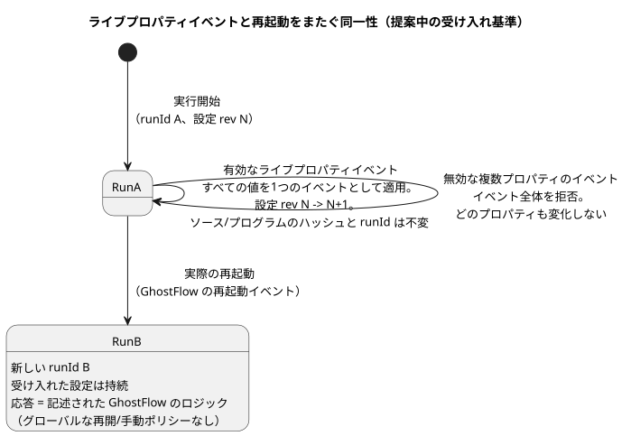
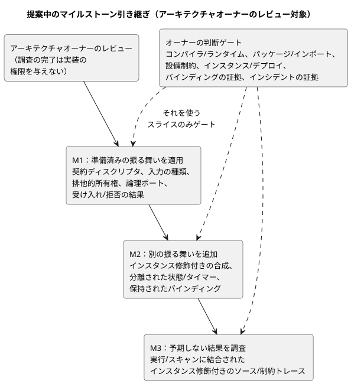

<!-- translation-source: docs/research/GF-COMPOSE-R9-ACCEPTANCE.md -->
[英語の原文](GF-COMPOSE-R9-ACCEPTANCE.md)

# GF-COMPOSE R9：受け入れ基準と実装への引き継ぎ

親：[#99](https://github.com/callin2/ghostflow-language/issues/99)
Issue：[#108](https://github.com/callin2/ghostflow-language/issues/108)
ステータス：範囲を限定した調査・設計です。合成の実行、デバイスのコミッショニング、参加者による調査を行ったとは主張しません。
調査の完了は実装を認可するものではありません。推奨事項とマイルストーンの引き継ぎは、依存する作業を始める前にアーキテクチャオーナーのレビューを必要とします。

このノートは、R1〜R8 の調査結果を、提案中の受け入れ基準と3つの提案中の実装引き継ぎにまとめたものです。内容は、シナリオの受け入れマトリクス、3つのマイルストーン引き継ぎ（M1〜M3）、推奨事項、そして依存する各スライスのゲートとなるオーナー判断です。ここに書かれていることはすべてレビュー対象の仕様であり、測定や実行の結果ではありません。

## ユーザーの課題

最初の合成（composition）スライスは、農家が次のことをするために必要な判断を減らさなければなりません。

- 準備済みの振る舞いを適用する
- ブロックされた結果や失敗した結果を理解する
- その説明をエンジニア向けの証拠につなげる

ジャーニーは2つあります。

- **農家のジャーニー：**適用、追加、調査。
- **エンジニアのジャーニー：**同じインシデントを、厳密なソース、インスタンス、バインディング、実行（run）、および利用可能なデバイスの証拠を通じて見る。

これらは受け入れ仕様であり、測定された結果ではありません。

## 調査したリビジョンでの証拠

調査した言語リビジョンは `ffdbc96461eca67908252507fb851fa4dabd9a2c` です。R1〜R8 を依存関係のセットとして読みました。

現在の証拠には次のものが含まれます。

- 1つの正本 `.ghost.md` をコンパイラの入力とすること
- [`tools/verify-language.mjs`](../../tools/verify-language.mjs) における明示的なホストテストの登録
- [`SCAN-TAPE-PARITY.md`](../SCAN-TAPE-PARITY.ja.md) における native／WASM のスキャンテープ契約
- [`integration-v1`](../../contracts/integration-v1/README.ja.md) における、ホスト・ハードウェア・物理の証拠を独立させるルール

既存のチェックはホスト／適合性の証拠にすぎません。以下のテストやユーザー調査の結果は、いずれも実行済みとして提示するものではありません。

先行する各調査ノートの寄与：

| ノート | ここで使った寄与 |
|---|---|
| R1 | 作業量と説明の尺度を提供します。 |
| R2 | 正本ソース、定義リビジョン、インスタンス、論理ポート、物理バインディング、設定、実行／スキャンの各同一性を分離します。 |
| R3 | レビューのために静的な合成を優先しますが、lowering／ABI の判断は未決定のままにしています。確立された前状態／次状態のセマンティクスを保ちつつ、順序に依存しないスナップショットを要求します。セマンティクスのルールは確定しており、合成の lowering がそれを保つ仕組みは未決定です。 |
| R4 | 既存のバインディングを保持し、物理 DI と明示的なソフトウェア入力を区別します。 |
| R5 | 最初のプロファイルを、型、依存関係、パラメータ、排他的オーナーのチェックに限定します。 |
| R6 | インポートパラメータ、オペレーター設定、依存関係の変更、バインディングの変更を分離します。 |
| R7 | 固定（pin）されたソースクロージャを推奨しますが、パッケージの検証方式は未決定です。 |
| R8 | 1つのインシデントコンテキストを要求し、要求・安全・適用・物理の各段階を分離したまま保ちます。 |

## 表と例

### 受け入れマトリクス

マトリクスの読み方：

- 期待される結果と尺度は**提案中の仕様**であり、実行結果や承認済みの実装スコープではありません。
- **前提**列は調査上の入力を示します。「未解決の質問とオーナー」節の判断ゲートは、依存する実装スライスに適用されます。
- 「手作業による検討」とは、レビューした契約にもとづく推論のことであり、実行の証拠ではありません。

| シナリオ | 入力の仮定 | 期待される結果／拒否 | 証拠の連鎖 | 作業量／説明可能性／追跡可能性の尺度 | 検証レイヤー | 責任オーナー | 前提 |
|---|---|---|---|---|---|---|---|
| 配線済みの灌水 + 4台のファンによる換気 | 灌水の入力は配線済みの DI。互換性のある RO が7個ある | 容量の提案を受け入れる。灌水のバインディングを保持する。4つの別個のファンバインディングを追加する | 論理ロール → プロファイル／バインディングのリビジョン → 提案 | セットアップの手順数。変更されないバインディングが説明可能。ロール／エンドポイントが追跡可能 | ホストのフィクスチャ、その後 API／Device／物理を別々に | 言語／API。適用されたマッピングは Device が確認する | R2、R4、R5 |
| ソフトウェアによる手動起動の合成 | 手動起動は明示的なソフトウェア入力。低水位は配線済みの DI | DI 数 1 で受け入れる。ソフトウェア入力を物理 DI として数えない | 入力の種類 → ケイパビリティ／プロファイルの同一性 | 誤った構成判断が減る。入力の種類が見える。バインディングのリビジョンがリンクされる | ホスト + 統合契約 | 言語／API。アダプタは Device が担う | R4、R5 |
| 灌水インスタンスの重複 | 同じ固定された定義。インスタンス ID は別個 | 状態、タイマー、設定、バインディング、来歴が分離されている場合に限り受け入れる | 定義リビジョン → インスタンス → 実行／スキャン | セットアップの重複による曖昧さがない。各結果がインスタンスを名指しする。トレースがマージされない | ホストでの合成の適合性 | コンパイラ／ランタイム + API | R2、R3 |
| 宣言の並べ替え | 同じインスタンス ID と同じ入力／時間テープ | 同じ出力、バインディング、トレースの同一性 | インスタンス ID + 順序付きフレーム → 結果 | 並べ替えによる修正が不要。説明が安定している。リプレイが決定的 | native／WASM パリティの拡張 | コンパイラ／ランタイム | R3、R4 |
| 競合する直接の出力書き込み元 | 2つの定義が1つの出力チャネルを対象とする | コンパイルで拒否し、デプロイ可能な成果物は生成されない。既存の単一書き込み元マネージャで調停される明示的なステーション要求は引き続き有効 | 出力チャネル → 定義 → 診断 | デプロイ前に拒否する。両方の定義を特定する | コンパイラの適合性（提案） | コンパイラ／ランタイム | 既存の出力一意性とステーション契約 |
| ポンプの排他的所有権 | 2つの論理オーナーが1つの排他的エンドポイントを対象とする | 有効化の前に拒否する。両方のインスタンス／ポートの主張と理由を名指しする | 主張 → エンドポイント／バインディングのリビジョン → 診断 | 早期に修正できる。農家には1つのブロック要因が見える。競合が監査可能 | ホストでの契約検証 | 言語／コンパイラ + API／Device | R4、R5 |
| 無効または不明な要件 | 型の誤り、依存関係の欠落、または適合性が不明 | 具体的な不一致は拒否する。それ以外は不明と報告し、互換／合格とは決して報告しない | マニフェスト／依存関係／プロファイルの証拠 → 結果 | 遅い段階での修正が減る。サポートされない事実が明示される。不確実性の出所が名指しされる | ホスト + 統合契約 | コンパイラ／API。適合性はプロファイル／Device | R2、R4、R5 |
| 低水位の説明 | `low_water=true`。ポンプに ON が要求される | 安全な出力は OFF。農家には「タンクが空」ではなく、信号と次の行動が示される | 入力 → ソース／制約 → 要求／安全な出力 → 実行 | 言い換えの正しさ。エンジニアが入力／制約にたどり着ける。実行への厳密な結合 | ホストのトレース。ユーザビリティは後で | 言語／ランタイム + #88／#74 | R1、R3、R8 |
| 適用／フィードバックの失敗 | コマンドが発行された。適用の失敗、またはフィードバックがない | 適用の失敗、または明示的な不明を示す。物理的な成功を主張しない | 要求／安全 → ホスト／ドライバ → 利用可能な観測 | 診断のナビゲーション。段階の区別。欠落した証拠が見える | ホストの記録。Device／物理は別 | #74／#88 + Device | R8 |
| クラッシュ、再起動、またはジャーナルのギャップ | ランタイムが再起動する、または履歴に欠落区間がある | 新しい `runId`。最後の証拠とギャップを保持する。スキャン／結果を捏造しない | モジュール／インスタンス／バインディング → 実行／スキャン → ブート／イベントの証拠 | 再構成の手順が減る。再起動の境界が明確。ギャップが追跡可能 | ホストのセマンティクス + Device の履歴 | ランタイム／API + Device #28 | R2、R3、R8 |
| 上書きの同一性 | インポートパラメータ、オペレーター設定、依存関係、またはバインディングを変更する | R6 のマトリクスを適用する。stale な結合を拒否する。別個のリビジョンを保持する | ソース／成果物／設定／バインディング／パッケージ／実行の同一性 | 修正の作業量。同一性が変わった理由を説明できる。系譜が完全 | ホスト／パッケージ／統合のゲート | API／デプロイ + コンパイラ／Device | R6 |
| 稼働中のライブプロパティイベント | 1つの有効な操作が、宣言された実行時調整可能なプロパティを複数変更する | 1つのイベントとして検証する。処理時にすべての値を適用するため、既存のロジックは次のサイクルを待たずに稼働中の出力を変えることがある。ソースのリビジョン／ハッシュ、プログラムのバイト列／ハッシュ、実行の同一性は変わらない。設定リビジョンと有効なイベント位置を進める。 | イベント → 検証済みの完全なプロパティ集合 → 設定リビジョン／有効位置 → 同じソース／プログラム／実行 → 結果として生じるロジック／出力 | 稼働中の効果を証明し、その発生をどの設定リビジョンが支配したかを説明する | native／WASM の適合性（提案）。未実行 | ランタイム／API 契約 | ユーザーが合意した修正。R6／#89 の仕組みと ABI |
| 無効な複数プロパティのイベント | 1つの操作に複数の有効な値と、型／範囲／ステップが無効な値が1つ含まれる | イベント全体を拒否する。どのプロパティも変化しない。以前の設定リビジョン／有効位置と稼働中の振る舞いは変わらない。 | 拒否されたイベント + 検証の理由。古い設定は同じプログラム／実行に結合されたまま | 全か無かの拒否を証明し、無効なメンバーを特定する | native／WASM の適合性（提案）。未実行 | ランタイム／API 契約 | ユーザーが合意した修正。R6／#89 の検証記録 |
| ライブプロパティの同一性と証拠の結合 | 実行が稼働中に有効なイベントを受け入れる | 以降の影響を受ける実行の証拠は、新しい設定リビジョン／有効なイベント位置と、同じプログラム／実行に結合する。stale なレコードを再解釈したり、ソース／バイトコードの変更をほのめかしたりしない。 | ソース／プログラムのハッシュ + `runId` は不変。設定リビジョン／有効位置が進み、以降の結果に結合する | リプレイ／説明で、各イベント位置にどの設定が適用されたかを厳密に特定する | native／WASM／アダプタの適合性（提案）。未実行 | ランタイム／API 契約 | R6。設定を結合する仕組みは未決定 |
| 設定受け入れ後の実際の再起動 | 受け入れたプロパティが永続化されている。ESP の物理的な再起動が起こる。GhostFlow の再起動イベントが配信される | プロパティは持続する。再起動により新しい `runId` が始まる。再起動への応答は記述された GhostFlow のロジックで決まり、グローバルな再開／手動の振る舞いを課さない。ランタイム開始前の電気的な起動／故障に関する義務は Device／Driver に残す。 | 以前の設定リビジョン → 再起動後に永続化された設定。古い実行 → 新しい実行。再起動イベント → 記述された遷移／出力 | 物理的な動作を主張せずに、永続化、実行の境界、実際に記述された再起動応答を示す | ホストの適合性（提案）。Device は別。未実行 | ランタイム／API。Device／Driver の起動境界 | ユーザーが合意した修正。永続化／復旧の順序は未決定 |
| 入力の発生と値の配信 | 評価と評価の間に、複数の発生と変化する値の観測が届く | 既定では、サポートする容量の範囲内で各発生と各観測を保持する。最新の保留値による置き換えは、入力ごとに明示的にオプトインした場合のみ許可する。オーバーフローや損失は拒否／報告し、黙って成功と報告しては決してならない。無制限の永続履歴を意味するものではない。 | 入力の同一性 + 取得時刻 + 受信／評価時刻 + 品質 + 配信／損失の結果 | 発生の保持、オプトインによる統合（coalescing）、オーバーフロー／損失の可視化を示す | native／WASM の適合性（提案）。順序／対応付け／上限は未決定。未実行 | ランタイム／Driver 契約 | ユーザーが合意した入力配信に関する修正 |
| インポートした定義のアップグレード | 厳密に固定されたインポートのリビジョンが変わる | 影響を受けるインスタンスを明示的に選択する。クロージャと結合を再検証する。浮動的な更新はしない | インポートのエッジ → クロージャ／成果物 → インスタンス／デプロイ | アップグレードのスコープが見える。来歴が保持される。古いデプロイも引き続き説明可能 | パッケージ／リプレイの検証 | 言語／API／パッケージのオーナー | R2、R6、R7 |
| native／WASM パリティ | 同じ固定された成果物、設定、初期状態、入力テープ、論理時間 | 受け入れられた結果とサポートされるトレースの同一性が等しい。無効なフレームについてもセマンティクス上一致する | 成果物／モジュール → フレーム → 完全な結果 | リプレイ経路が1つ。説明の証拠が同一。ハッシュと同一性が記録される | 明示的なスキャンテープのホストゲート | 言語／ランタイム | R3 と既存のパリティ契約 |

DI 2 / RO 7 のケースは、配線済み入力という仮定のもとでの1つの容量結果です。物理的なコミッショニングや、農家がその振る舞いを適用できることを証明するものではありません。低水位の否定ケースは、同じ最初のマイルストーンに属します。

ライブプロパティと再起動の行は、同一性が時間とともにどう振る舞うかを定義します。次の図はそれを要約したものです。有効なライブプロパティイベントは同じ実行内で設定リビジョンだけを進め、無効なイベントは何も変えず、実際の再起動は受け入れた設定を永続化したまま新しい実行を始めます。

### 3つの提案中のマイルストーン引き継ぎ

以下の順序と最小スコープは提案であり、アーキテクチャオーナーのレビューの対象です。依存する各スライスには、後述の関連する判断が必要です。

1. **M1 — 準備済みの振る舞いを適用する。**
   - *最小限の言語変更：*型付きの要件、明示的な入力の種類、排他的所有権、安定した論理ポートの同一性、追跡可能な受け入れ／拒否の結果に必要な、範囲を限定した契約ディスクリプタを公開します。
   - *消費側への引き継ぎ：*API は提案と確定した設備／バインディングのリビジョンを提示します。Device はプロファイル／適用の証拠を提供します。フロントエンドは農家向けのブロック要因と、低水位の否定ケースの説明を提示します。
   - 物理的な受け入れは別に扱います。

2. **M2 — 既存の振る舞い／バインディングを保ったまま別の振る舞いを追加する。**
   - *最小限の言語変更：*状態／タイマーを分離したインスタンス修飾付きの合成、決定的な入力スナップショット、安定した同一性の順序、そして共有される排他的出力を最初のプロファイルで拒否すること。
   - *消費側への引き継ぎ：*API はインスタンスとバインディングの結合を記録します。Device は変更されないマッピングと新しいマッピングを確認します。ホストのリプレイで、配線／ソフトウェアのリソースのケースを確認します。
   - *スコープの制限：*提案中の合成スライスは、競合する直接の書き込み元を拒否します。M2 の一部として実行時設定のオーバーレイは実装しません。このスコープの制限は、別途承認されたライブプロパティイベントの振る舞いを拒否するものではなく、それらのイベントのためにコントローラを停止したり新しい実行を始めたりすることも要求しません。
   - *スライスがライブプロパティイベントを使う場合、*受け入れマトリクスで規定したすべてを維持します：ソース／プログラムのハッシュと実行の同一性が変わらないこと、設定／有効位置の結合、稼働中の帰結、アトミックな拒否、再起動時の永続化の振る舞い。

3. **M3 — 予期しない結果を、農家向けの説明からエンジニア向けの証拠まで調査する。**
   - *最小限の言語変更：*要求と安全な出力の区別を保ったまま、インスタンス修飾付きのソース／制約トレースを既存の実行／スキャンのコンテキストに結合します。
   - *消費側への引き継ぎ：*#88／#74 は文言／適用結果のイベントを定義します。API は設定とバインディングのリビジョンを結合します。Device #28 はブート／履歴とギャップの証拠を定義します。
   - 欠落した物理的な観測は不明のままにします。

## 推奨事項

**上記の3つの引き継ぎを、アーキテクチャオーナーのレビューに提案します。**

調査として望ましい方向性は、次の要素を備えた静的な合成です。

- 固定されたソースバンドル
- 明示的なインスタンス ID
- 安定した、記述されたポート
- 保持されたバインディング
- 排他的オーナーの拒否

実行方式とパッケージ方式の代替案は、それぞれのオーナーが以下のゲートを解決するまで未決定です。提案中の結果は、R8 の同一性の連鎖を引き継ぎます。

スコープの制限：

- ホスト、API、Device、物理、ユーザビリティの受け入れは別々のままです。
- 容量、一致するリプレイ、有効な統合記録は、それぞれ明記されたスコープだけを確立します。
- この調査ドキュメントを受け入れても、アーキテクチャも実装も承認されません。

## 未解決の質問とオーナー

これらは指定されたスライスにとっての実装上のブロッカーであり、外部 issue 全体の完了に普遍的に依存するものではありません。M1〜M3 は上記の提案中の引き継ぎを指します。引用した R1〜R8 の調査結果が、これらの未決定事項の証拠です。

| 判断と調査上の入力 | 依存する作業の前に必要なオーナー判断 | 依存するスライス |
|---|---|---|
| コンパイラ／ランタイムと診断の契約（R2、R3、R5） | コンパイラ／ランタイムのオーナーが、M1 のディスクリプタ／診断の同一性を定義する。静的な lowering か協調する VM か、入力／時間、GFB1／ABI の互換性、故障の波及（fan-out）、合成された実行で確立された前状態／次状態のセマンティクスを保つ仕組みを選択する。control 内の前状態／次状態のスナップショットと循環の拒否のルールは確定している。そのような参照が選ばれた場合に限り、インポート／インスタンス間参照のエンコーディングとその検証が未決定として残る。 | M1 のディスクリプタ変更にはディスクリプタの判断が必要。M2 の実行／リプレイには合成された実行に関する判断が必要。M1 が合成されたコードをインスタンス化する場合は M1 にも適用される |
| パッケージ／インポートの契約（R2、R6、R7） | 言語／API／パッケージのオーナーが、ソースバンドルかエンベロープか、クロージャ／ロックのスキーマ、順序、複数ソースのマップの同一性、リプレイと署名検証のルールを選択する | M1 の再利用可能インポートのパッケージ拡張すべて。M2 のインポートされた合成／アップグレード。既存の単一ソースのパッケージ利用には新しいパッケージ形式は不要 |
| 設備制約の権威（R2、R4、R5） | システム #62 が言語／API のオーナーと共同で、正規の制約表現、強制の境界、互換性の証拠を選択する | 設備制約の互換性／強制を主張する M1／M2 のスライスすべて。そのような制約についての M3 の説明。判断がない場合、適合性は不明のままとし、デプロイの成功は主張しない |
| インスタンスとデプロイの同一性（R2、R6、R8） | API／デプロイと言語契約のオーナーが、インスタンスのライフサイクル、バインディング／設定の結合、アップグレードの連続性、stale な結合の拒否を定義する。ライブプロパティイベントは、ソース／プログラムのハッシュと実行の同一性を保ちつつ、設定リビジョン／有効なイベント位置を進める。以降の結果は有効な設定に結合する。再起動は受け入れた設定を永続化し、新しい実行を作る。 | M1 のバインディング／結果の結合。M2 のインスタンス作成とアップグレード。M3 の厳密なインシデントコンテキスト。#89 の仕組み／ABI／仕様整合の作業は、ライブ設定を使うスライスだけのゲートであり、無関係なスライスはそれに依存しない。 |
| バインディングの証拠（R4、R8） | API／Device／プロファイルのオーナーが、提案／確定の記録、安定したエンドポイントの順序、観測された適用済みバインディングの同一性を定義する。物理のオーナーがコミッショニングの証拠を定義する | M1 の設備への適用。M2 の割り当て／保持。M3 の対象機器に関する主張。ホストでの容量チェックは別のスコープのまま |
| インシデント証拠の契約（R1、R3、R8） | 言語／ランタイムと #74／#88 のオーナーが、インスタンス修飾付きのトレース結合、農家向けの説明、適用結果のフィールド、欠落のセマンティクスを定義する。Device #28 のオーナーが、ブート／イベントから実行／バインディングへの結合、利用可能なフィードバック、ギャップの表現を定義する | M1 の低水位／ブロック要因の射影。M3 の対応する論理、適用、または再起動／履歴のスライス。Device のジャーナルのフィールドはデバイス履歴のスライスでのみ必要 |

関連する issue のスコープ：

- **#95** は、既存のステーションマネージャを超える調停が選ばれた場合にのみ依存関係になります。最初のプロファイルは、既存の単一書き込み元マネージャによる明示的なステーション要求の調停を保ちつつ、競合する直接の書き込み元を拒否します。
- **#89／#90** は、ライブプロパティの仕組み／ABI／検証と、停止を前提とした古い Configure の記述との整合を担います。ライブプロパティに関するユーザーの判断は確定しています。#89 はライブ設定を使うスライスだけのゲートであり、無関係な R1〜R8 の実装作業のゲートではありません。
- インポート時の特殊化は別のものとして扱います。
- メモリと保持は、既存の API／システムおよび Device のオーナーのもとに残ります。この引き継ぎは、ストレージや保持の作業を追加しません。
- 欠落した証拠は明示されたままにします。

## 検証

- [x] 受け入れ基準 1：すべての要約シナリオが、仮定、期待される結果、証拠、尺度、レイヤー、オーナー、前提を保持しています。マトリクスは提案中の仕様のままであり、実行結果や参加者による結果は主張していません。
- [x] 受け入れ基準 2：3つの提案中の引き継ぎは、完全なユーザージャーニーと最小スコープを記述しています。依存する各スライスには名前付きのオーナー判断があります。#89、#95、Device の履歴への依存は、それぞれのケイパビリティを使う場合にのみ適用されます。
- [x] 受け入れ基準 3：権威、同一性、スキャン、バインディング、パッケージ、証拠の契約に関する判断は、明示的なブロッカーのままです。ホスト、API、Device、物理、ユーザビリティの受け入れは別々のままです。将来の実行可能テストは `tools/verify-language.mjs` への明示的な登録が必要であり、既存のチェックを弱めてはなりません。調査の完了は実装の権限を与えません。
- [x] 調査したリビジョンを記録しました。対象とした `VERIFICATION.md`、パリティ、統合、明示的なテスト登録の各節を確認しました。
- [ ] コーディネーターによる検証は保留中です：修正済みの R1〜R8 とこのマトリクスを読み直し、相対リンクを検証し、修正済みの調査の公開を受け入れること。ローカルの `git diff --check` は合格しました。ランタイムテストや物理的なチェックは実行していません。
