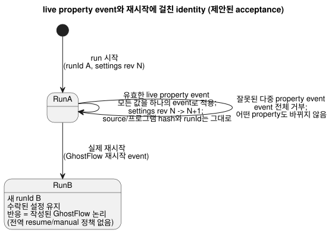
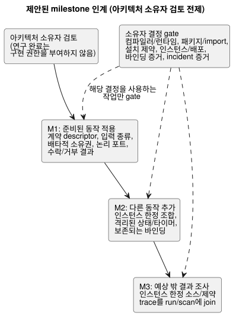

<!-- translation-source: docs/research/GF-COMPOSE-R9-ACCEPTANCE.md -->
[영문 원문](GF-COMPOSE-R9-ACCEPTANCE.md)

# GF-COMPOSE R9: acceptance와 구현 인계

상위 항목: [#99](https://github.com/callin2/ghostflow-language/issues/99)
이슈: [#108](https://github.com/callin2/ghostflow-language/issues/108)
상태: 범위가 한정된 연구/설계입니다. 조합 실행, 장치 commissioning(시운전), 참여자
연구를 했다고 주장하지 않습니다.
연구 완료가 구현을 승인하지는 않습니다. 권고와 milestone 인계는 의존 작업을 시작하기
전에 아키텍처 소유자의 검토가 필요합니다.

이 노트는 R1–R8의 결과를 제안된 acceptance 기준과 세 가지 제안된 구현 인계로
정리합니다. 시나리오별 acceptance matrix, milestone 인계 세 가지(M1–M3), 권고, 그리고
각 의존 작업을 가로막는 소유자 결정을 담고 있습니다. 여기 있는 모든 내용은 검토할
명세이며, 측정하거나 실행한 결과가 아닙니다.

## 사용자 문제

첫 조합 작업은 농부가 다음 일을 하는 데 필요한 결정을 줄여야 합니다.

- 준비된 동작 적용하기
- 차단되거나 실패한 결과 이해하기
- 그 설명을 엔지니어 증거에 연결하기

여정(journey)은 두 가지입니다.

- **농부 여정:** 적용, 추가, 조사.
- **엔지니어 여정:** 같은 incident를 정확한 source, 인스턴스, 바인딩, run, 이용 가능한
  장치 증거를 통해 봅니다.

이는 acceptance 명세이며 측정 결과가 아닙니다.

## 조사한 revision의 증거

조사한 언어 revision은 `ffdbc96461eca67908252507fb851fa4dabd9a2c`입니다.
R1–R8을 의존성 집합으로 읽었습니다.

현재 증거에는 다음이 포함됩니다.

- 하나의 정본 `.ghost.md` 컴파일러 입력
- [`tools/verify-language.mjs`](../../tools/verify-language.mjs)의 명시적 호스트 테스트
  등록
- [`SCAN-TAPE-PARITY.md`](../SCAN-TAPE-PARITY.md)의 native/WASM 스캔 테이프 계약
- [`integration-v1`](../../contracts/integration-v1/README.md)의 독립적인 호스트,
  하드웨어, 물리 증거 규칙

기존 검사는 호스트/적합성(conformance) 증거일 뿐입니다. 아래의 테스트나 사용자 연구
결과 가운데 실행했다고 제시하는 것은 없습니다.

앞선 각 연구 노트가 기여하는 내용:

| 노트 | 여기서 사용한 기여 |
|---|---|
| R1 | 노력 및 설명 측정 기준을 제공합니다. |
| R2 | 정본 소스, definition revision, 인스턴스, 논리 포트, 물리 바인딩, 설정, run/scan identity를 분리합니다. |
| R3 | 검토 용이성을 위해 정적 조합을 선호하지만 lowering/ABI 결정은 열어 둡니다. 확립된 이전/다음 상태 의미를 보존하면서 순서에 독립적인 snapshot을 요구합니다. 의미 규칙은 확정되었고, 조합 lowering이 그것을 보존하는 메커니즘은 아직 열려 있습니다. |
| R4 | 기존 바인딩을 유지하고, 물리 DI와 명시적 소프트웨어 입력을 구분합니다. |
| R5 | 첫 프로필을 타입, 의존성, 파라미터, 배타적 소유자 검사로 한정합니다. |
| R6 | import 파라미터, 운영자 설정, 의존성 변경, 바인딩 변경을 분리합니다. |
| R7 | 고정된(pinned) source closure를 권고하지만, 패키지 검증 방식의 선택은 열어 둡니다. |
| R8 | 하나의 incident 문맥을 요구하고, 요청·안전·적용·물리 단계를 분리해 둡니다. |

## 표와 예

### Acceptance matrix

matrix 읽는 법:

- 예상 결과와 측정은 **제안된 명세**이며, 실행 결과나 승인된 구현 범위가 아닙니다.
- **선행 조건** 열은 연구 입력을 나타냅니다. “미해결 질문과 소유자” 절의 결정
  gate는 의존 구현 작업에 적용됩니다.
- “수작업”은 검토한 계약에 근거한 추론이라는 뜻이며 실행 증거가 아닙니다.

| 시나리오 | 입력 가정 | 예상 결과/거부 | 증거 연결 | 노력 / 설명 가능성 / 추적 가능성 측정 | 검증 계층 | 책임 소유자 | 선행 조건 |
|---|---|---|---|---|---|---|---|
| 유선 관수 + 팬 4개 환기 | 관수 입력은 유선 DI이고, 호환 RO가 7개 있음 | 용량 제안을 수락. 관수 바인딩을 보존. 서로 다른 팬 바인딩 4개를 추가 | 논리 역할 → 프로필/바인딩 revision → 제안 | 설정 단계 수, 변경되지 않은 바인딩을 설명 가능, 역할/endpoint 추적 가능 | 호스트 fixture, 이후 API/Device/물리를 각각 별도로 | 언어/API. 적용된 매핑은 Device가 확인 | R2, R4, R5 |
| 소프트웨어 수동 시작 조합 | 수동 시작은 명시적 소프트웨어 입력이고, 저수위는 유선 DI | DI 수 1로 수락. 소프트웨어 입력을 물리 DI로 세지 않음 | 입력 종류 → capability/프로필 identity | 잘못된 구성 결정 감소, 입력 종류가 보임, 바인딩 revision 연결 | 호스트 + 통합 계약 | 언어/API. 어댑터는 Device가 소유 | R4, R5 |
| 관수 인스턴스 중복 | 같은 고정 정의, 서로 다른 인스턴스 ID | 상태, 타이머, 설정, 바인딩, provenance가 격리된 경우에만 수락 | definition revision → 인스턴스 → run/scan | 중복 설정의 모호함 없음, 각 결과에 인스턴스 명시, trace 병합 없음 | 호스트 조합 적합성 | 컴파일러/런타임 + API | R2, R3 |
| 선언 순서 변경 | 같은 인스턴스 ID와 같은 입력/시간 테이프 | 같은 출력, 바인딩, trace identity | 인스턴스 ID + 순서 있는 프레임 → 결과 | 순서 변경에 따른 수정 없음, 설명이 안정적, 재생(replay)이 결정적 | native/WASM parity 확장 | 컴파일러/런타임 | R3, R4 |
| 경쟁하는 직접 출력 작성자 | 두 정의가 하나의 출력 채널을 대상으로 함 | 컴파일이 거부하며 배포 가능한 artifact가 없음. 기존 단일 작성자 manager가 중재하는 명시적 station 요청은 계속 유효 | 출력 채널 → 정의 → 진단 | 배포 전 거부, 두 정의를 모두 식별 | 컴파일러 적합성 제안 | 컴파일러/런타임 | 기존 출력 고유성 및 station 계약 |
| 펌프 배타적 소유권 | 두 논리 소유자가 하나의 배타적 endpoint를 대상으로 함 | 활성화 전에 거부. 두 인스턴스/포트 주장과 이유를 명시 | 주장 → endpoint/바인딩 revision → 진단 | 조기 수정, 농부에게 차단 원인 하나 표시, 충돌 감사 가능 | 호스트 계약 검증 | 언어/컴파일러 + API/Device | R4, R5 |
| 잘못되었거나 알 수 없는 요구 사항 | 잘못된 타입, 의존성 누락, 또는 적합성(suitability)을 알 수 없음 | 구체적 불일치는 거부. 그 외에는 알 수 없음으로 보고하며, compatible/pass로 보고하지 않음 | manifest/의존성/프로필 증거 → 결과 | 뒤늦은 수정 감소, 지원되지 않는 사실을 명시, 불확실성의 출처를 명명 | 호스트 + 통합 계약 | 컴파일러/API. 적합성은 프로필/Device | R2, R4, R5 |
| 저수위 설명 | `low_water=true`, 펌프 ON 요청 | 안전 출력 OFF. 농부에게는 “탱크가 비었음”이 아니라 신호와 다음 행동을 보여 줌 | 입력 → 소스/제약 → 요청/안전 출력 → run | 바꿔 말한 설명의 정확성, 엔지니어가 입력/제약에 도달, 정확한 run join | 호스트 trace, 사용성은 이후 | 언어/런타임 + #88/#74 | R1, R3, R8 |
| 적용/피드백 실패 | 명령 발행 후 적용 실패 또는 피드백 없음 | 적용 실패 또는 명시적 알 수 없음을 표시. 물리적 성공을 주장하지 않음 | 요청/안전 → 호스트/드라이버 → 이용 가능한 관측 | 진단 탐색, 단계 구분, 누락된 증거가 보임 | 호스트 기록. Device/물리는 별도 | #74/#88 + Device | R8 |
| crash, 재시작, journal 공백 | 런타임이 재시작하거나 이력에 누락 구간이 있음 | 새 `runId`. 마지막 증거와 공백을 보존. scan/결과를 지어내지 않음 | module/인스턴스/바인딩 → run/scan → boot/event 증거 | 재구성 단계 감소, 재시작 경계 명확, 공백 추적 가능 | 호스트 의미 + Device 이력 | 런타임/API + Device #28 | R2, R3, R8 |
| override identity | import 파라미터, 운영자 설정, 의존성, 바인딩 변경 | R6 matrix 적용. stale join 거부. 서로 다른 revision을 보존 | source/artifact/설정/바인딩/패키지/run identity | 수정 노력, identity가 바뀐 이유를 설명 가능, 계보(lineage) 완전 | 호스트/패키지/통합 gate | API/배포 + 컴파일러/Device | R6 |
| 운전 중 live property event | 하나의 유효한 동작이 선언된 런타임 조정 가능 property 여러 개를 변경 | 하나의 event로 검증. 처리 시 모든 값을 적용하므로, 기존 논리가 다른 주기를 기다리지 않고 운전 중에 출력을 바꿀 수 있음. source revision/hash, 프로그램 바이트/hash, run identity는 그대로. settings revision과 유효 event 위치는 전진 | event → 검증된 전체 property 집합 → settings revision/유효 위치 → 같은 source/프로그램/run → 결과 논리/출력 | 운전 중 효과를 입증하고, 해당 발생에 어느 settings revision이 적용되었는지 설명 | 제안된 native/WASM 적합성. 미실행 | 런타임/API 계약 | 사용자 합의 수정 사항. R6/#89 메커니즘과 ABI |
| 잘못된 다중 property event | 하나의 동작에 유효한 값 여러 개와 잘못된 타입/범위/step 값 하나가 포함됨 | event 전체를 거부. 어떤 property도 바뀌지 않음. 이전 settings revision/유효 위치와 활성 동작은 그대로 | 거부된 event + 검증 사유. 이전 설정은 같은 프로그램/run에 join된 채로 유지 | 전부 아니면 전무 방식의 거부를 입증하고 잘못된 항목을 식별 | 제안된 native/WASM 적합성. 미실행 | 런타임/API 계약 | 사용자 합의 수정 사항. R6/#89 검증 기록 |
| live property identity와 증거 join | run이 활성인 동안 유효한 event를 수락 | 이후 영향을 받는 실행 증거는 새 settings revision/유효 event 위치 및 같은 프로그램/run에 join. stale 기록을 재해석하거나 source/바이트코드 변경을 암시하지 않음 | source/프로그램 hash + `runId`는 그대로. settings revision/유효 위치가 전진하고 이후 결과에 join | 재생/설명이 각 event 위치에서 어떤 설정이 적용되었는지 정확히 식별 | 제안된 native/WASM/어댑터 적합성. 미실행 | 런타임/API 계약 | R6. 설정 join 메커니즘은 미정 |
| 설정 수락 후 실제 재시작 | 수락된 property가 저장되고, 실제 ESP 재시작이 일어나며, GhostFlow 재시작 event가 전달됨 | property는 유지됨. 재시작은 새 `runId`를 시작. 재시작 반응은 작성된 GhostFlow 논리가 결정하며, 전역 resume/manual 동작을 강요하지 않음. 런타임 이전의 전기적 startup/failure 의무는 Device/Driver에 남김 | 이전 settings revision → 재시작 후 저장된 설정. 이전 run → 새 run. 재시작 event → 작성된 전이/출력 | 물리적 작동을 주장하지 않고 영속성, run 경계, 실제로 작성된 재시작 반응을 보여 줌 | 제안된 호스트 적합성. Device는 별도. 미실행 | 런타임/API. Device/Driver startup 경계 | 사용자 합의 수정 사항. 영속화/복구 순서는 미정 |
| 입력 발생과 값 전달 | 평가 사이에 여러 발생과 변하는 값 관측이 도착 | 지원 용량 안에서 각 발생과 관측을 기본적으로 보존. 최신 대기값 교체는 입력별로 명시적으로 opt-in한 경우에만 허용. overflow/손실은 거부하거나 보고하며, 조용히 성공으로 보고하지 않음. 무제한 영속 이력을 뜻하지 않음 | 입력 identity + 포착 시각 + 수신/평가 시각 + 품질 + 전달/손실 결과 | 발생 보존, opt-in 병합, 눈에 보이는 overflow/손실을 보여 줌 | 제안된 native/WASM 적합성. 순서/대응/한계는 미정. 미실행 | 런타임/Driver 계약 | 사용자 합의 입력 전달 수정 사항 |
| 가져온 정의의 업그레이드 | 정확히 고정된 import의 revision이 바뀜 | 영향받는 인스턴스를 명시적으로 선택. closure와 join을 재검증. 떠다니는(floating) 갱신 없음 | import 간선 → closure/artifact → 인스턴스/배포 | 업그레이드 범위가 보임, provenance 유지, 이전 배포도 설명 가능 | 패키지/재생 검증 | 언어/API/패키지 소유자 | R2, R6, R7 |
| native/WASM parity | 같은 고정 artifact, 설정, 초기 상태, 입력 테이프, 논리 시간 | 수락된 결과와 지원되는 trace identity가 같음. 잘못된 프레임은 의미상 일치 | artifact/module → 프레임 → 완전한 결과 | 하나의 재생 경로, 동일한 설명 증거, hash와 identity 기록 | 명시적 스캔 테이프 호스트 gate | 언어/런타임 | R3 및 기존 parity 계약 |

DI 2 / RO 7 사례는 유선 입력 가정 아래의 용량 결과 하나일 뿐입니다. 물리적
commissioning이나 농부가 동작을 적용할 수 있다는 것을 증명하지 않습니다. 저수위
부정(negative) 사례는 같은 첫 milestone에 속합니다.

live property 행과 재시작 행은 identity가 시간에 따라 어떻게 동작하는지 정의합니다.
아래 그림은 이를 요약합니다. 유효한 live property event는 같은 run 안에서 settings
revision만 전진시키고, 잘못된 event는 아무것도 바꾸지 않으며, 실제 재시작은 수락된
설정을 유지한 채 새 run을 시작합니다.

### 제안된 milestone 인계 세 가지

다음 순서와 최소 범위는 아키텍처 소유자 검토를 전제로 한 제안입니다. 각 의존 작업에는
아래에 나열한 관련 결정이 필요합니다.

1. **M1 — 준비된 동작 적용.**
   - *최소 언어 변경:* 타입이 지정된 요구 사항, 명시적 입력 종류, 배타적 소유권,
     안정적인 논리 포트 identity, 추적 가능한 수락/거부 결과에 필요한 한정된 계약
     descriptor를 노출합니다.
   - *Consumer 인계:* API는 제안과 확인된 설치/바인딩 revision을 제시합니다. Device는
     프로필/적용 증거를 공급합니다. 프론트엔드는 농부용 차단 원인과 저수위 부정 설명을
     제시합니다.
   - 물리 acceptance는 별도로 남습니다.

2. **M2 — 기존 동작/바인딩을 보존하면서 다른 동작 추가.**
   - *최소 언어 변경:* 격리된 상태/타이머, 결정적 입력 snapshot, 안정적인 identity
     순서, 공유 배타 출력에 대한 첫 프로필의 거부를 갖춘 인스턴스 한정 조합.
   - *Consumer 인계:* API는 인스턴스 및 바인딩 join을 기록합니다. Device는 변경되지
     않은 매핑과 새 매핑을 확인합니다. 호스트 재생은 유선/소프트웨어 자원 사례를
     검사합니다.
   - *범위 제한:* 제안된 조합 작업은 경쟁하는 직접 작성자를 거부합니다. M2의 일부로
     런타임 설정 overlay를 구현하지 않습니다. 이 범위 제한은 별도로 승인된 live
     property event 동작을 거부하지 않으며, 그 event가 controller를 멈추거나 새 run을
     시작하도록 요구하지도 않습니다.
   - *작업이 live property event를 사용한다면,* acceptance matrix에 명시된 모든 것을
     유지합니다. 변경되지 않는 source/프로그램 hash와 run identity, 설정/유효 위치 join,
     운전 중 효과, 원자적 거부, 재시작 시 영속 동작이 그것입니다.

3. **M3 — 농부 설명에서 엔지니어 증거까지 예상 밖의 결과 조사.**
   - *최소 언어 변경:* 요청 출력과 안전 출력의 구분을 유지하면서, 인스턴스 한정
     소스/제약 trace를 기존 run/scan 문맥에 join합니다.
   - *Consumer 인계:* #88/#74는 문구와 적용 결과 event를 정의합니다. API는 설정 및
     바인딩 revision을 join합니다. Device #28은 boot/이력 및 공백 증거를 정의합니다.
   - 누락된 물리 관측은 알 수 없음으로 남습니다.

## 권고

**위의 세 인계를 아키텍처 소유자 검토에 제안합니다.**

선호하는 연구 방향은 다음을 갖춘 정적 조합입니다.

- 고정된 소스 번들
- 명시적 인스턴스 ID
- 안정적으로 작성된 포트
- 보존되는 바인딩
- 배타적 소유자 거부

실행 및 패키지 대안은 소유자가 아래 gate를 해결할 때까지 결정되지 않은 상태로
남습니다. 제안된 결과는 R8의 identity 사슬을 따릅니다.

범위 제한:

- 호스트, API, Device, 물리, 사용성 acceptance는 각각 별도로 남습니다.
- 용량, 일치하는 재생, 유효한 통합 기록은 각자 명시된 범위만 확립합니다.
- 이 연구 문서를 수락하는 것은 아키텍처도 구현도 승인하지 않습니다.

## 미해결 질문과 소유자

이것들은 명시된 작업에 대한 구현 차단 요인이며, 외부 이슈 전체의 완료에 대한 보편적인
의존성이 아닙니다. M1–M3는 위의 제안된 인계를 가리킵니다. 인용된 R1–R8의 결과가 이
열린 결정의 증거입니다.

| 결정과 연구 입력 | 의존 작업 전에 필요한 소유자 결정 | 의존 작업 |
|---|---|---|
| 컴파일러/런타임 및 진단 계약 (R2, R3, R5) | 컴파일러/런타임 소유자가 M1용 descriptor/진단 identity를 정의합니다. 정적 lowering 대 협조 VM, 입력/시간, GFB1/ABI 호환성, fault fan-out, 그리고 조합 실행에서 확립된 이전/다음 상태 의미를 보존하는 메커니즘을 선택합니다. control 내부의 이전/다음 snapshot과 순환 거부 규칙은 확정되어 있습니다. 그러한 참조를 선택하는 경우, import/인스턴스 간 참조의 인코딩과 그 검증만 열려 있습니다. | M1 descriptor 변경에는 descriptor 결정이 필요합니다. M2 실행/재생에는 조합 실행 결정이 필요하며, M1이 조합 코드를 인스턴스화하는 경우 M1에도 적용됩니다 |
| 패키지/import 계약 (R2, R6, R7) | 언어/API/패키지 소유자가 소스 번들 대 envelope, closure/lock schema, 순서, 다중 소스 map identity, 재생 및 서명 검증 규칙을 선택합니다 | 모든 M1 재사용 import 패키지 확장. M2 가져온 조합/업그레이드. 기존 단일 소스 패키지 사용에는 새 패키지 형식이 필요하지 않습니다 |
| 설치 제약 권한 (R2, R4, R5) | System #62가 언어/API 소유자와 함께 정본 제약 표현, 강제 경계, 호환성 증거를 선택합니다 | 설치 제약 호환성/강제를 주장하는 모든 M1/M2 작업. 그런 제약에 대한 M3 설명. 결정이 없으면 적합성은 알 수 없음으로 남고, 성공적인 배포를 주장하지 않습니다 |
| 인스턴스 및 배포 identity (R2, R6, R8) | API/배포 및 언어 계약 소유자가 인스턴스 수명 주기, 바인딩/설정 join, 업그레이드 연속성, stale join 거부를 정의합니다. live property event는 source/프로그램 hash와 run identity를 보존하면서 settings revision/유효 event 위치를 전진시키고, 이후 결과는 유효 설정에 join됩니다. 재시작은 수락된 설정을 유지하고 새 run을 만듭니다. | M1 바인딩/결과 join. M2 인스턴스 생성과 업그레이드. M3 정확한 incident 문맥. #89의 메커니즘/ABI/명세 정합 작업은 live 설정을 사용하는 작업만 gate하며, 관련 없는 작업은 이에 의존하지 않습니다. |
| 바인딩 증거 (R4, R8) | API/Device/프로필 소유자가 제안/확인 기록, 안정적인 endpoint 순서, 관측된 적용 바인딩 identity를 정의합니다. 물리 소유자는 commissioning 증거를 정의합니다 | M1 설치 적용. M2 할당/보존. M3 설비 대상 주장. 호스트 용량 검사는 별도 범위로 남습니다 |
| incident 증거 계약 (R1, R3, R8) | 언어/런타임 및 #74/#88 소유자가 인스턴스 한정 trace join, 농부 설명, 적용 결과 field, 부재 의미를 정의합니다. Device #28 소유자는 boot/event-to-run/바인딩 join, 이용 가능한 피드백, 공백 표현을 정의합니다 | M1 저수위/차단 원인 projection. M3의 해당 논리, 적용, 재시작/이력 작업. Device journal field는 장치 이력 작업에만 필요합니다 |

관련 이슈 범위:

- **#95**는 기존 station manager를 넘어서는 중재를 선택하는 경우에만 의존성입니다. 첫
  프로필은 경쟁하는 직접 작성자를 거부하면서, 기존 단일 작성자 manager를 통한 명시적
  station 요청 중재는 보존합니다.
- **#89/#90**은 live property 메커니즘/ABI/검증과, 이전의 stopped-Configure 문구 조정을
  소유합니다. live property에 대한 사용자 결정은 확정되었습니다. #89는 live 설정을
  사용하는 작업만 gate하며, 관련 없는 R1–R8 구현 작업은 gate하지 않습니다.
- import 시점 특수화(specialization)는 별개로 남습니다.
- 운영 기억과 보존은 기존 API/system 및 Device 소유자에게 남습니다. 이 인계는 저장소나
  보존 작업을 추가하지 않습니다.
- 누락된 증거는 명시적으로 남습니다.

## 검증

- [x] Acceptance 기준 1: 모든 요약 시나리오가 가정, 예상 결과, 증거, 측정, 계층, 소유자,
  선행 조건을 유지합니다. matrix는 제안된 명세로 남으며, 실행 결과나 참여자 결과를
  주장하지 않습니다.
- [x] Acceptance 기준 2: 제안된 인계 세 가지가 완전한 사용자 여정과 최소 범위를
  설명합니다. 각 의존 작업에는 이름이 붙은 소유자 결정이 있습니다. #89, #95, Device
  이력 의존성은 해당 capability를 사용할 때만 적용됩니다.
- [x] Acceptance 기준 3: 권한, identity, scan, 바인딩, 패키지, 증거 계약 결정이 명시적
  차단 요인으로 남습니다. 호스트, API, Device, 물리, 사용성 acceptance는 각각 별도로
  남습니다. 향후 실행 가능한 테스트는 `tools/verify-language.mjs`에 명시적으로
  등록해야 하며, 기존 검사를 약화해서는 안 됩니다. 연구 완료는 구현 권한을 부여하지
  않습니다.
- [x] 조사한 revision을 기록했습니다. 대상 `VERIFICATION.md`, parity, 통합, 명시적
  테스트 등록 절을 살펴보았습니다.
- [ ] 코디네이터 검증 대기: 수정된 R1–R8과 이 matrix를 다시 읽고, 상대 링크를
  검증하고, 수정된 연구 게시를 수락해야 합니다. 로컬 `git diff --check`는
  통과했습니다. 런타임 테스트나 물리 검사는 실행하지 않았습니다.
