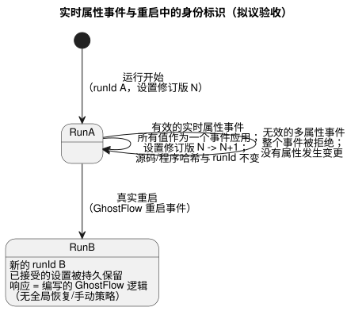
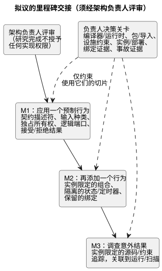

<!-- translation-source: docs/research/GF-COMPOSE-R9-ACCEPTANCE.md -->
[英文原文](GF-COMPOSE-R9-ACCEPTANCE.md)

# GF-COMPOSE R9：验收与实现交接

父 issue：[#99](https://github.com/callin2/ghostflow-language/issues/99)
Issue：[#108](https://github.com/callin2/ghostflow-language/issues/108)
状态：有界的研究/设计。不声称任何组合执行、设备调试投运或参与者研究。
研究完成并不授权实现。各项建议和里程碑交接都需要先经架构负责人评审，依赖它们的工作才能开始。

本说明把 R1–R8 的结论转化为拟议的验收标准和三个拟议的实现交接。内容包括：场景验收矩阵、三个里程碑交接（M1–M3）、建议，以及对每个依赖切片起把关作用的负责人决策。这里的一切都是待评审的规格，而不是测得或执行得到的结果。

## 用户问题

第一个组合切片必须减少农户在以下事项上需要做出的决策：

- 应用一个预制行为；
- 理解被阻止或失败的结果；
- 把该解释与工程师的证据联系起来。

有两条使用路径：

- **农户路径**：应用、添加和调查。
- **工程师路径**：同一个事故，通过精确的源码、实例、绑定、运行以及可用的设备证据来查看。

这些是验收规格，而不是测得的结果。

## 所考察修订版中的证据

所考察的语言修订版是 `ffdbc96461eca67908252507fb851fa4dabd9a2c`。R1–R8 作为依赖集合进行了阅读。

当前证据包括：

- 一个规范的 `.ghost.md` 编译器输入；
- 在
  [`tools/verify-language.mjs`](../../tools/verify-language.mjs) 中显式注册的宿主测试；
- [`SCAN-TAPE-PARITY.md`](../SCAN-TAPE-PARITY.zh.md) 中的 native/WASM 扫描带（scan tape）契约；
- [`integration-v1`](../../contracts/integration-v1/README.md) 中相互独立的宿主、硬件和物理证据规则。

现有检查仅是宿主/一致性证据。下文中的任何测试或用户研究结果都不作为已执行的结果呈现。

各篇早期研究说明的贡献：

| 说明 | 此处采用的贡献 |
|---|---|
| R1 | 提供工作量和可解释性度量。 |
| R2 | 区分规范源、定义修订版、实例、逻辑端口、物理绑定、设置以及运行/扫描身份标识。 |
| R3 | 为便于评审而倾向于静态组合，但将降级（lowering）/ABI 决策留待解决。要求快照与顺序无关，同时保留既定的旧状态/下一状态语义。语义规则是固定的；组合降级以何种机制保留该语义仍未确定。 |
| R4 | 保留现有绑定，并区分物理 DI 与显式的软件输入。 |
| R5 | 将第一个配置档限定为类型、依赖、参数和独占所有者检查。 |
| R6 | 区分导入参数、操作员设置、依赖变更和绑定变更。 |
| R7 | 建议使用固定（pinned）的源码闭包，而其包验证方案仍未确定。 |
| R8 | 要求一个事故上下文，并让请求、安全、应用和物理阶段保持分离。 |

## 表格与示例

### 验收矩阵

如何阅读该矩阵：

- 预期结果和度量是**拟议的规格**，不是已执行的结果，也不是已批准的实现范围。
- **前提**列标明研究输入。“未解决的问题与负责人”一节中的决策关卡适用于依赖它们的实现切片。
- “手工推演”指根据已审阅的契约进行的推理，而不是执行证据。

| 场景 | 输入假设 | 预期结果/拒绝 | 证据链 | 工作量 / 可解释性 / 可追溯性度量 | 验证层 | 负责方 | 前提 |
|---|---|---|---|---|---|---|---|
| 有线灌溉 + 四风机通风 | 灌溉输入为有线 DI；存在七个兼容的 RO | 接受容量提案；保留灌溉绑定；新增四个不同的风机绑定 | 逻辑角色 → 配置档/绑定修订版 → 提案 | 配置步骤；未变更的绑定可解释；角色/端点可追溯 | 先宿主测试夹具，再分别进行 API/Device/物理验证 | 语言/API；Device 确认已应用的映射 | R2、R4、R5 |
| 软件手动启动组合 | 手动启动为显式软件输入；低水位为有线 DI | 以 DI 数量 1 接受；不把软件输入计为物理 DI | 输入种类 → 能力（capability）/配置档身份标识 | 更少的错误配置决策；输入种类可见；绑定修订版已链接 | 宿主 + 集成契约 | 语言/API；Device 负责适配器 | R4、R5 |
| 重复的灌溉实例 | 同一个固定定义；不同的实例 ID | 仅当状态、定时器、设置、绑定和来源相互隔离时才接受 | 定义修订版 → 实例 → 运行/扫描 | 无重复配置歧义；每个结果都标明实例；追踪不合并 | 宿主组合一致性 | 编译器/运行时 + API | R2、R3 |
| 声明重新排序 | 相同的实例 ID 和相同的输入/时间带 | 相同的输出、绑定和追踪身份标识 | 实例 ID + 有序帧 → 结果 | 无需纠正顺序；解释稳定；重放是确定性的 | native/WASM 一致性扩展 | 编译器/运行时 | R3、R4 |
| 相互竞争的直接输出写入者 | 两个定义指向同一个输出通道 | 编译拒绝，没有可部署的产物。由现有单写入者管理器仲裁的显式站点（station）请求仍然有效。 | 输出通道 → 定义 → 诊断 | 部署前拒绝；指出两个定义 | 编译器一致性提案 | 编译器/运行时 | 现有输出唯一性和站点契约 |
| 独占的泵所有权 | 两个逻辑所有者指向同一个独占端点 | 激活前拒绝；指出两个实例/端口声明及原因 | 声明 → 端点/绑定修订版 → 诊断 | 及早纠正；农户看到一个阻断原因；冲突可审计 | 宿主契约验证 | 语言/编译器 + API/Device | R4、R5 |
| 无效或未知的需求 | 类型错误、缺少依赖或适用性未知 | 拒绝具体的不匹配；否则报告未知，绝不报告兼容/通过 | 清单（manifest）/依赖/配置档证据 → 结果 | 更少的后期纠正；不支持的事实被明确指出；指明不确定性的来源 | 宿主 + 集成契约 | 编译器/API；适用性由配置档/Device 负责 | R2、R4、R5 |
| 低水位解释 | `low_water=true`；请求泵 ON | 安全输出为 OFF；农户看到信号和下一步行动，而不是“水箱空了” | 输入 → 源码/约束 → 请求/安全输出 → 运行 | 转述正确性；工程师能追溯到输入/约束；精确的运行关联 | 宿主追踪；之后再做可用性验证 | 语言/运行时 + #88/#74 | R1、R3、R8 |
| 应用/反馈失败 | 已发出命令；应用失败或无反馈 | 显示应用失败或显式的未知；不声称物理成功 | 请求/安全 → 宿主/驱动程序 → 可用的观测 | 诊断导航；阶段区分；缺失的证据可见 | 宿主记录；Device/物理分开验证 | #74/#88 + Device | R8 |
| 崩溃、重启或日志间隙 | 运行时重启，或历史中存在缺失区间 | 新的 `runId`；保留最后的证据和间隙；不编造扫描/结果 | 模块/实例/绑定 → 运行/扫描 → 启动/事件证据 | 更少的重构步骤；重启边界清晰；间隙可追溯 | 宿主语义 + Device 历史 | 运行时/API + Device #28 | R2、R3、R8 |
| 覆盖（override）身份标识 | 更改导入参数、操作员设置、依赖或绑定 | 应用 R6 矩阵；拒绝陈旧的关联；保留各自不同的修订版 | 源码/产物/设置/绑定/包/运行身份标识 | 纠正工作量；身份标识变化的原因可解释；谱系完整 | 宿主/包/集成关卡 | API/部署 + 编译器/Device | R6 |
| 运行期间的实时属性事件 | 一次有效操作更改多个已声明可在运行时调整的属性 | 作为一个事件进行验证；处理时应用所有值，因此现有逻辑可以在运行期间改变输出，而无需等待下一个周期。源码修订版/哈希、程序字节/哈希以及运行身份标识保持不变。推进设置修订版和生效事件位置。 | 事件 → 经验证的完整属性集合 → 设置修订版/生效位置 → 同一源码/程序/运行 → 产生的逻辑/输出 | 证明对运行中操作的影响，并解释该次发生由哪个设置修订版决定 | 拟议的 native/WASM 一致性；未运行 | 运行时/API 契约 | 经用户同意的修订；R6/#89 机制与 ABI |
| 无效的多属性事件 | 一次操作包含若干有效值和一个类型/范围/步长无效的值 | 拒绝整个事件。没有属性发生变更；之前的设置修订版/生效位置和当前行为保持不变。 | 被拒绝的事件 + 验证原因；旧设置仍关联到同一程序/运行 | 证明全有或全无的拒绝，并指出无效的成员 | 拟议的 native/WASM 一致性；未运行 | 运行时/API 契约 | 经用户同意的修订；R6/#89 验证记录 |
| 实时属性身份标识与证据关联 | 在运行进行中接受一个有效事件 | 之后受影响的执行证据关联到新的设置修订版/生效事件位置以及同一程序/运行。不重新解释陈旧记录，也不暗示源码/字节码发生变化。 | 源码/程序哈希 + `runId` 不变；设置修订版/生效位置推进，并关联到之后的结果 | 重放/解释能精确识别在每个事件位置生效的是哪些设置 | 拟议的 native/WASM/适配器一致性；未运行 | 运行时/API 契约 | R6；设置关联机制未定 |
| 接受设置后的真实重启 | 已接受的属性已持久化；发生 ESP 物理重启；GhostFlow 重启事件已投递 | 属性被持久保留。重启开始新的 `runId`。重启响应由编写的 GhostFlow 逻辑决定；不施加全局的恢复/手动行为。运行时之前的电气启动/故障义务仍由 Device/Driver 负责。 | 之前的设置修订版 → 重启后持久化的设置；旧运行 → 新运行；重启事件 → 编写的转换/输出 | 展示持久化、运行边界和实际编写的重启响应，而不声称物理动作 | 拟议的宿主一致性；Device 分开验证；未运行 | 运行时/API；Device/Driver 启动边界 | 经用户同意的修订；持久化/恢复的顺序仍未确定 |
| 输入触发实例与值的投递 | 两次求值之间到达多个触发实例和不断变化的值观测 | 默认在支持的容量内保留每个触发实例和观测。仅当按输入显式选择时才允许用最新待处理值替换。拒绝/报告溢出或丢失；绝不报告静默成功。不意味着无界的持久历史。 | 输入身份标识 + 捕获时间 + 接收/求值时间 + 质量 + 投递/丢失结果 | 展示触发实例的保留、按需选择的合并以及可见的溢出/丢失 | 拟议的 native/WASM 一致性；顺序/映射/边界仍未确定；未运行 | 运行时/Driver 契约 | 经用户同意的输入投递修订 |
| 导入定义升级 | 精确固定的导入更改了修订版 | 显式选择受影响的实例；重新验证闭包和关联；不进行浮动更新 | 导入边 → 闭包/产物 → 实例/部署 | 升级范围可见；来源被保留；旧部署仍可解释 | 包/重放验证 | 语言/API/包负责人 | R2、R6、R7 |
| native/WASM 一致性 | 相同的固定产物、设置、初始状态、输入带和逻辑时间 | 被接受的结果和支持的追踪身份标识相等；无效帧在语义上一致 | 产物/模块 → 帧 → 完整结果 | 一条重放路径；相同的解释证据；记录哈希和身份标识 | 显式的扫描带宿主关卡 | 语言/运行时 | R3 和现有一致性契约 |

DI 2 / RO 7 的情形是在有线输入假设下的一个容量结果。它不能证明物理调试投运，也不能证明农户能够应用该行为。低水位的负面情形属于同一个第一里程碑。

实时属性和重启这几行定义了身份标识随时间的变化方式。下图对此做了总结：有效的实时属性事件只在同一运行内推进设置修订版，无效事件不改变任何东西，而真实重启会开始新的运行，已接受的设置被持久保留。

### 三个拟议的里程碑交接

以下顺序和最小范围均为提案，须经架构负责人评审。每个依赖切片都需要下文列出的相关决策。

1. **M1 — 应用一个预制行为。**
   - *最小语言变更：*公开所需的有界契约描述符，用于类型化需求、显式输入种类、独占所有权、稳定的逻辑端口身份标识，以及可追溯的接受或拒绝结果。
   - *消费方交接：*API 提供提案以及已确认的设施/绑定修订版；Device 提供配置档/已应用证据；前端展示农户的阻断原因和低水位的负面解释。
   - 物理验收保持分开进行。

2. **M2 — 在保留现有行为/绑定的同时再添加一个行为。**
   - *最小语言变更：*实例限定的组合，具有隔离的状态/定时器、确定性的输入快照、稳定的身份标识顺序，以及第一个配置档对共享独占输出的拒绝。
   - *消费方交接：*API 记录实例和绑定关联；Device 确认未变更和新增的映射；宿主重放检查有线/软件资源情形。
   - *范围限制：*拟议的组合切片拒绝相互竞争的直接写入者。它不在 M2 中实现运行时设置叠加层。这一范围限制并不拒绝另行批准的实时属性事件行为，也不要求这些事件停止控制器或开始新的运行。
   - *如果某个切片使用实时属性事件，*则保留验收矩阵中规定的全部内容：不变的源码/程序哈希和运行身份标识、设置/生效位置关联、对运行中操作的影响、原子性拒绝以及重启持久化行为。

3. **M3 — 从农户解释追溯到工程师证据，调查意外结果。**
   - *最小语言变更：*将实例限定的源码/约束追踪关联到现有的运行/扫描上下文，同时保留请求输出与安全输出的区分。
   - *消费方交接：*#88/#74 定义措辞/应用结果事件；API 关联设置和绑定修订版；Device #28 定义启动/历史和间隙证据。
   - 缺失的物理观测保持未知。

## 建议

**将上述三个交接提交架构负责人评审。**

优先的研究方向是静态组合，具有：

- 固定的源码包；
- 显式的实例 ID；
- 稳定的编写端口；
- 保留的绑定；
- 独占所有者拒绝。

在各自负责人解决下列关卡之前，执行和包方面的备选方案仍未确定。拟议的结果沿用 R8 的身份标识链。

范围限制：

- 宿主、API、Device、物理和可用性验收保持相互分离。
- 容量、匹配的重放和有效的集成记录只确立各自所声明的范围。
- 接受本研究文档既不批准某个架构，也不批准实现。

## 未解决的问题与负责人

这些是所指定切片的实现阻碍，而不是对外部 issue 整体完成的普遍依赖。M1–M3 指上文的拟议交接。所引用的 R1–R8 结论是这些未决决策的证据。

| 决策与研究输入 | 依赖工作开始前所需的负责人决策 | 依赖切片 |
|---|---|---|
| 编译器/运行时与诊断契约（R2、R3、R5） | 编译器/运行时负责人为 M1 定义描述符/诊断身份标识；选择静态降级还是协调的多个 VM、输入/时间、GFB1/ABI 兼容性、故障扇出，以及在组合执行中保留既定旧状态/下一状态语义的机制。控制内部的旧/下一快照和环路拒绝规则是固定的。如果选择了导入/跨实例引用，则只有其编码及验证仍未确定。 | M1 的描述符变更需要描述符决策。M2 的执行/重放需要组合执行方面的决策；若 M1 实例化了组合代码，这些决策同样适用于 M1 |
| 包/导入契约（R2、R6、R7） | 语言/API/包负责人选择源码包还是信封（envelope）、闭包/锁定 schema、顺序、多源映射身份标识、重放和签名验证规则 | 任何 M1 可复用导入包扩展；M2 导入组合/升级。现有的单源包用法不需要新的包格式 |
| 设施约束权威（R2、R4、R5） | System #62 与语言/API 负责人选择规范的约束表示、执行边界和兼容性证据 | 任何声称设施约束兼容/执行的 M1/M2 切片；M3 对此类约束的解释。若无决策，适用性保持未知；不得声称部署成功 |
| 实例与部署身份标识（R2、R6、R8） | API/部署与语言契约负责人定义实例生命周期、绑定/设置关联、升级连续性以及陈旧关联的拒绝。实时属性事件保留源码/程序哈希和运行身份标识，同时推进设置修订版/生效事件位置；之后的结果关联到生效的设置。重启会持久保留已接受的设置并创建新的运行。 | M1 绑定/结果关联；M2 实例创建与升级；M3 精确的事故上下文。#89 机制/ABI/规格对齐工作只约束使用实时设置的切片；无关切片不依赖于它。 |
| 绑定证据（R4、R8） | API/Device/配置档负责人定义提案/确认记录、稳定的端点顺序以及观测到的已应用绑定身份标识；物理负责人定义调试投运证据 | M1 设施应用；M2 分配/保留；M3 设备目标声明。宿主容量检查保持单独界定范围 |
| 事故证据契约（R1、R3、R8） | 语言/运行时与 #74/#88 负责人定义实例限定的追踪关联、农户解释、应用结果字段和缺失语义；Device #28 负责人定义启动/事件到运行/绑定的关联、可用的反馈以及间隙表示 | M1 低水位/阻断原因投影；M3 相应的逻辑、应用或重启/历史切片。只有设备历史切片才需要 Device 日志字段 |

相关 issue 的范围：

- 只有在选择了超出现有站点管理器的仲裁时，**#95** 才是依赖项。第一个配置档拒绝相互竞争的直接写入者，同时通过现有的单写入者管理器保留显式站点请求的仲裁。
- **#89/#90** 负责实时属性的机制/ABI/验证，以及对较早的“停止后 Configure”文本的协调。关于实时属性的用户决策已经确定。#89 只约束使用实时设置的切片，而不约束无关的 R1–R8 实现工作。
- 导入时特化保持独立。
- Memory 和保留策略仍由其现有的 API/系统和 Device 负责人负责；本交接不增加任何存储或保留工作。
- 缺失的证据保持显式。

## 验证

- [x] 验收标准 1：所有汇总场景都保留了假设、预期结果、证据、度量、验证层、负责方和前提。该矩阵仍是拟议的规格；不声称任何执行或参与者结果。
- [x] 验收标准 2：三个拟议交接描述了完整的用户路径和最小范围。每个依赖切片都有指名的负责人决策；#89、#95 和 Device 历史依赖仅在使用其能力时适用。
- [x] 验收标准 3：权威、身份标识、扫描、绑定、包和证据契约方面的决策仍是显式的阻碍。宿主、API、Device、物理和可用性验收保持相互分离。未来的可执行测试需要在 `tools/verify-language.mjs` 中显式注册；不得削弱现有检查。研究完成不授予任何实现权限。
- [x] 已记录所考察的修订版；检查了 `VERIFICATION.md`、一致性、集成以及显式测试注册的相关章节。
- [ ] 协调者验证待完成：重新阅读修正后的 R1–R8 和本矩阵，验证相对链接，并接受修正后的研究发布。本地 `git diff --check` 已通过；未运行任何运行时测试或物理检查。
