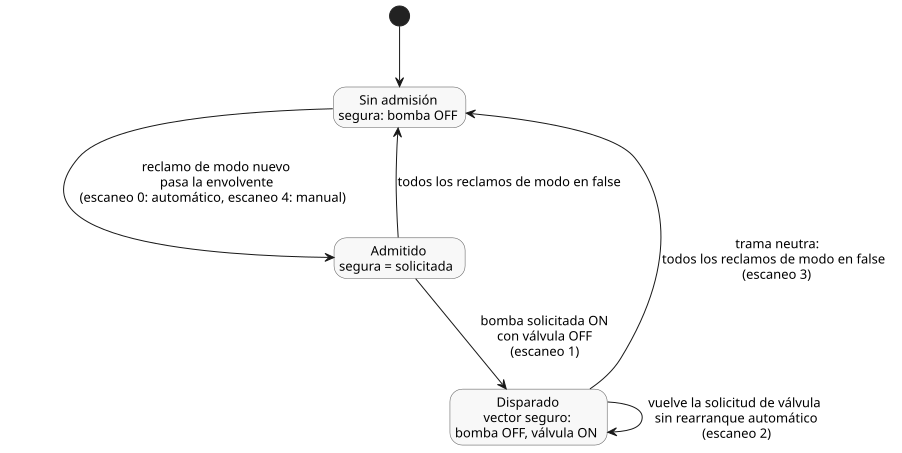

<!-- translation-source: examples/bound-resource-execution.ghost.md -->
[Original en inglés](bound-resource-execution.ghost.md)
> Traducción de lectura. Para compilar, use el archivo original `.ghost.md` enlazado.

# Ejecución de una política Bool compartida vinculada

Este control completo, solo de software, encamina las solicitudes automáticas, manuales y de respaldo (fallback) a través de una única envolvente lógica compartida de la bomba (el conjunto de reglas obligatorias que toda solicitud de la bomba debe superar). Las entradas son solicitudes, no retroalimentación física. La respuesta definida por el autor ante una infracción es bomba OFF y válvula ON. Es una elección explícita para este ejemplo, no una secuencia de seguridad de un dispositivo.

Esta es la nueva revisión de fuente explícita bound-input-quality-v1. Cada entrada canónica lleva la calidad del productor (`ok` o `fault`). Para sus expresiones de solicitud, el ejemplo conserva la última observación de cada entrada, y `false` inicializa esa memoria local a la fuente. El límite obligatorio de admisión automático/manual es más estricto: exige una observación Bool buena (Good) de cada modo en cada escaneo. Si un modo no está disponible, todo el escaneo se rechaza de forma atómica y se permite un reintento corregido de ese escaneo. Un modo no disponible no significa OFF, ni un disparo, ni una orden de rearranque. Los bytes de la fuente original se conservan por separado.

<!-- ghostflow:anchor id=GF-INT-BOUND-OBSERVATIONS kind=intent status=confirmed origin=engineer -->
Conservar las últimas observaciones de solicitud de este ejemplo de software, preservando a la vez su guarda de recursos definida por el autor.

```ghost
control BoundPump {
  resource station: Station;
  resource pump1: BoolActuator;
  resource valve1: BoolActuator;
  input automatic, manual, automatic_request, manual_request, fallback_request, valve_request: Bool;
  // ghostflow:link id=GF-INT-BOUND-OBSERVATIONS relation=implements
  state remembered_automatic: Bool = false;
  let automatic_value = case automatic { ok(value) => value; fault(_) => remembered_automatic; };
  remembered_automatic' = automatic_value;
  // ghostflow:link id=GF-INT-BOUND-OBSERVATIONS relation=implements
  state remembered_manual: Bool = false;
  let manual_value = case manual { ok(value) => value; fault(_) => remembered_manual; };
  remembered_manual' = manual_value;
  // ghostflow:link id=GF-INT-BOUND-OBSERVATIONS relation=implements
  state remembered_automatic_request: Bool = false;
  let automatic_request_value = case automatic_request { ok(value) => value; fault(_) => remembered_automatic_request; };
  remembered_automatic_request' = automatic_request_value;
  // ghostflow:link id=GF-INT-BOUND-OBSERVATIONS relation=implements
  state remembered_manual_request: Bool = false;
  let manual_request_value = case manual_request { ok(value) => value; fault(_) => remembered_manual_request; };
  remembered_manual_request' = manual_request_value;
  // ghostflow:link id=GF-INT-BOUND-OBSERVATIONS relation=implements
  state remembered_fallback_request: Bool = false;
  let fallback_request_value = case fallback_request { ok(value) => value; fault(_) => remembered_fallback_request; };
  remembered_fallback_request' = fallback_request_value;
  // ghostflow:link id=GF-INT-BOUND-OBSERVATIONS relation=implements
  state remembered_valve_request: Bool = false;
  let valve_request_value = case valve_request { ok(value) => value; fault(_) => remembered_valve_request; };
  remembered_valve_request' = valve_request_value;
  output pump, valve: Bool;
  pump <- (automatic_value && (automatic_request_value || fallback_request_value)) || (manual_value && manual_request_value);
  valve <- valve_request_value;
  constraints SharedRules for station {
    exclusive at admission { automatic, manual };
    require at safe_output pump1.on => any_on({ valve1 });
    safe { pump1 = false; valve1 = true; }
  }
}
```

Compile el destino WASM y, después, ejecute el bloque JavaScript completo que sigue desde la raíz del repositorio. El bloque suministra explícitamente todas las identidades: documento fuente, artefacto, revisión, recursos, modos y salidas. El host de referencia valida el artefacto y es dueño del único escritor lógico; no realiza ninguna E/S física. La misma guarda obligatoria también se ejecuta en el núcleo portable de Rust y en el ejecutor nativo.

```js
import fs from 'node:fs';
import { compileSourceSync } from './tools/compile-source.mjs';
import { compileBoundResourceControl } from './tools/bound-resource-control.mjs';
import { BoundResourceControlRuntime } from './runtimes/node/bound-resource-control.mjs';

const filename = 'examples/bound-resource-execution.ghost.md';
const checked = compileSourceSync(fs.readFileSync(filename, 'utf8'), { filename });
const bound = compileBoundResourceControl(checked, {
  format: 'GhostFlow/resource-constraints-binding-v1',
  revision: 'virtual-installation-input-v1',
  sourceDocumentSha256: checked.sourceDocument.sha256,
  artifactSha256: checked.manifest.bytecodeSha256,
  resources: [
    { name: 'station', resourceId: 'virtual/bound-loop' },
    { name: 'pump1', resourceId: 'virtual/bound-pump', output: 'pump' },
    { name: 'valve1', resourceId: 'virtual/bound-valve', output: 'valve' },
  ],
  modes: [
    { group: 'SharedRules', name: 'automatic', input: 'automatic' },
    { group: 'SharedRules', name: 'manual', input: 'manual' },
  ],
});
const wasm = fs.readFileSync('target/wasm32-unknown-unknown/release/ghostflow_wasm.wasm');
const runtime = await BoundResourceControlRuntime.instantiate(wasm, bound);
const requests = [
  [true, false, true, false, false, true],
  [true, false, true, false, false, false],
  [true, false, true, false, false, true],
  [false, false, false, false, false, true],
  [false, true, false, true, false, true],
];
try {
  for (const [scanId, values] of requests.entries()) {
    // Each row explicitly supplies Good software observations, including false.
    const inputs = bound.manifest.sensors.flatMap((port, index) => [
      { name: port.valueInput, value: values[index] },
      { name: port.okInput, value: true },
      { name: port.faultInput, value: 0 },
    ]);
    const { trace } = runtime.scan({ scanId, logicalTimeMs: scanId, inputs });
    console.log(JSON.stringify(trace));
  }
} finally { runtime.dispose(); }
```

Cada fila de `requests` enumera las entradas en el orden de declaración: `automatic`, `manual`, `automatic_request`, `manual_request`, `fallback_request`, `valve_request`. Los cinco escaneos producen estas salidas seguras:

| Escaneo | Qué cambia | `pump`, `valve` solicitados | `pump`, `valve` seguros |
| --- | --- | --- | --- |
| 0 | El modo automático reclama la bomba; se solicita la válvula | ON, ON | ON, ON |
| 1 | La solicitud de la válvula cae mientras la bomba sigue solicitada | ON, OFF | OFF, ON (vector seguro definido por el autor) |
| 2 | Vuelve la solicitud de la válvula | ON, ON | OFF, ON (sigue disparado; sin rearranque automático) |
| 3 | Trama neutra: ambos reclamos de modo son false | OFF, ON | OFF, ON (disparo liberado) |
| 4 | Un reclamo manual nuevo solicita la bomba | ON, ON | ON, ON (superó la misma envolvente) |

El segundo escaneo infringe el requisito de funcionamiento `pump1.on => any_on({ valve1 })`, por lo que la guarda aplica el vector seguro no-OFF definido por el autor. Restablecer solo la solicitud de la válvula no rearranca la bomba. Una trama neutra, en la que ningún modo reclama el recurso, libera el disparo. El reclamo manual nuevo posterior debe superar la misma envolvente antes de que la bomba vuelva a funcionar.

El diagrama siguiente resume cómo evolucionan la admisión y el disparo a lo largo de estos escaneos.



La vinculación es inmutable durante esta activación y se exige en cada evaluación. El host nativo debe compartir un único `ResourceBindingRegistry` entre todos los escritores de su instalación. El host de referencia de Node también rechaza escritores duplicados entre instancias WASM. Los registros independientes son autoridades de instalación separadas; no son una forma de arbitrar un único recurso compartido.

Este perfil ejecutable admite exactamente un control de solicitudes Bool GFB1 v1/v3, con todas las salidas protegidas explícitamente. Los perfiles no admitidos fallan de forma cerrada (fail closed): los perfiles contextuales, de contabilización de uso y continuos, y la composición por importación de políticas compartidas. El contrato especializado de arrendamiento/limpieza de Station sigue siendo independiente. Este ejemplo no demuestra ninguna aplicación de hardware, parada confirmada, secuencia física, integración PID ni arbitraje cooperativo entre varios controles.

## Módulos públicos para navegador y Worker

Los navegadores y los Workers importan `compileSource`, `compileBoundResourceControl`,
`verifyBoundResourceCompilation` y `observeBoundResourceTrace` desde
`tools/browser-toolchain.mjs`. Importan `BoundResourceControlRuntime` desde
`runtimes/wasm/bound-resource-control.mjs`. Suministre el documento canónico exacto,
la vinculación de la instalación y los bytes WASM obtenidos. La API del runtime tiene
tres llamadas:

- `instantiate(wasmBytes, bound)` crea el escritor verificado.
- `scan(frame)` devuelve el resultado enmarcado de Rust.
- `dispose()` libera el reclamo del escritor.

Si falla la construcción del runtime, también se libera el reclamo pendiente. Los
grafos de módulos del compilador y del runtime no usan módulos integrados de Node
ni `Buffer`. La ruta de Node usada arriba reexporta este mismo runtime para el
ejemplo actual.

Para presentar un esquema de interacción, pase `interactionSourceIdentity` a
`compileSource`. La vinculación preserva esa identidad de documento/revisión y
regenera la identidad de módulo del esquema para los bytes GFB17 ejecutables. La
verificación del esquema reconstruye ambas identidades; los descriptores
verificados siguen sin ser ejecutables. En el manifiesto vinculado, las entradas y
salidas lógicas conservan exactamente sus nombres y tipos:

- Las entradas canónicas se enumeran en `manifest.sensors`. Sus rieles generados de
  valor/OK/fallo forman juntos la trama completa de la VM.
- `manifest.inputs` contiene solo puertos de entrada históricos simples.
- La activación inmutable de modos usa el riel de valor generado, y la guarda de
  Rust valida el riel OK Bool correspondiente.

Las versiones y los formatos de transmisión de GFRB, GFRS y GFB17 no cambian.

El perfil finito puede incluir estado Bool definido por el autor. Tal como exige el
contrato de interacción, vincule cada estado observado con su ancla de intención
literate confirmada. El descriptor verificado lleva la procedencia de la fuente,
pero ninguna vinculación de almacenamiento ejecutable; la vinculación las obtiene
del programa reducido (lowered) real. Las instantáneas de escaneo WASM completadas
exponen el valor del estado observado mediante el mismo productor público de
interacción, incluso con esquemas no vacíos.

El registro de escritores de JavaScript cubre una instancia de módulo en un realm,
incluida la creación asíncrona pendiente. Los Workers separados, las ventanas o las
instancias de módulo cargadas de forma independiente tienen cada uno su propio
registro. Antes de iniciar cualquiera de esos escritores, el host de una instalación
debe reservar identificadores de recurso estables en una única autoridad
compartida. Debe liberarlos ante un fallo, al desecharlos o al terminar el Worker.
La guarda local al realm no proporciona arbitraje entre Workers ni ninguna garantía
física.
