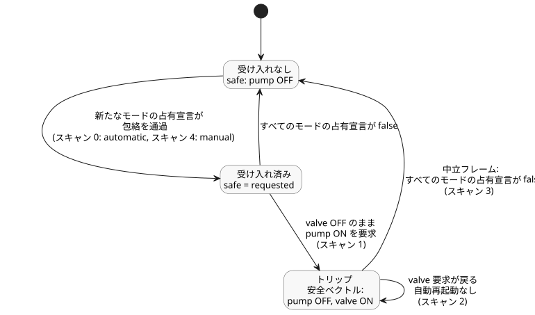

<!-- translation-source: examples/bound-resource-execution.ghost.md -->
[英語の原文](bound-resource-execution.ghost.md)
> 閲覧用の翻訳です。コンパイルには、リンク先の原本 `.ghost.md` ファイルを使用してください。

# バインドされた共有 Bool ポリシーの実行

この完全なソフトウェアのみの `control` は、自動・手動・フォールバックの要求を、1 つの共有された論理ポンプ包絡（すべてのポンプ要求が通過しなければならない必須ルールの集合）に通します。入力は要求であり、物理的なフィードバックではありません。違反に対して作者が定めた応答は、ポンプ OFF ・バルブ ON です。これはこの例のための明示的な選択であり、デバイスの安全シーケンスではありません。

これは入力品質を明示する新しいソースリビジョン bound-input-quality-v1 です。各正準入力は生成元の品質（`ok` または `fault`）を持ちます。要求式については、この例は各入力の最後の観測値を維持し、`false` がそのソース内ローカルなメモリを初期化します。必須の自動/手動の受け入れ（admission）境界はより厳格で、毎スキャン、各モードについて品質が Good の Bool 観測を要求します。いずれかのモードが利用できない場合、そのスキャン全体がアトミックに拒否され、修正したうえでそのスキャンを再試行することが許可されます。モードが利用できないことは、OFF ・トリップ・再起動コマンドのいずれも意味しません。元のソースのバイト列は別途保持されています。

<!-- ghostflow:anchor id=GF-INT-BOUND-OBSERVATIONS kind=intent status=confirmed origin=engineer -->
このソフトウェア例の最後の要求観測値を保持しつつ、作者が定めたリソースガードを維持します。

```ghost
control BoundPump {
  resource station: Station;
  resource pump1: BoolActuator;
  resource valve1: BoolActuator;
  input automatic, manual, automatic_request, manual_request, fallback_request, valve_request: Bool;
  // ghostflow:link id=GF-INT-BOUND-OBSERVATIONS relation=implements
  state remembered_automatic: Bool = false;
  let automatic_value = case automatic { ok(value) => value; fault(_) => remembered_automatic; };
  remembered_automatic' = automatic_value;
  // ghostflow:link id=GF-INT-BOUND-OBSERVATIONS relation=implements
  state remembered_manual: Bool = false;
  let manual_value = case manual { ok(value) => value; fault(_) => remembered_manual; };
  remembered_manual' = manual_value;
  // ghostflow:link id=GF-INT-BOUND-OBSERVATIONS relation=implements
  state remembered_automatic_request: Bool = false;
  let automatic_request_value = case automatic_request { ok(value) => value; fault(_) => remembered_automatic_request; };
  remembered_automatic_request' = automatic_request_value;
  // ghostflow:link id=GF-INT-BOUND-OBSERVATIONS relation=implements
  state remembered_manual_request: Bool = false;
  let manual_request_value = case manual_request { ok(value) => value; fault(_) => remembered_manual_request; };
  remembered_manual_request' = manual_request_value;
  // ghostflow:link id=GF-INT-BOUND-OBSERVATIONS relation=implements
  state remembered_fallback_request: Bool = false;
  let fallback_request_value = case fallback_request { ok(value) => value; fault(_) => remembered_fallback_request; };
  remembered_fallback_request' = fallback_request_value;
  // ghostflow:link id=GF-INT-BOUND-OBSERVATIONS relation=implements
  state remembered_valve_request: Bool = false;
  let valve_request_value = case valve_request { ok(value) => value; fault(_) => remembered_valve_request; };
  remembered_valve_request' = valve_request_value;
  output pump, valve: Bool;
  pump <- (automatic_value && (automatic_request_value || fallback_request_value)) || (manual_value && manual_request_value);
  valve <- valve_request_value;
  constraints SharedRules for station {
    exclusive at admission { automatic, manual };
    require at safe_output pump1.on => any_on({ valve1 });
    safe { pump1 = false; valve1 = true; }
  }
}
```

WASM ターゲットをビルドしてから、リポジトリのルートで下の JavaScript フェンス全体を実行します。このコードは、ソース文書・アーティファクト・リビジョン・リソース・モード・出力という、すべての同一性を明示的に与えます。リファレンスホストはアーティファクトを検証し、唯一の論理ライターを所有します。物理 I/O は一切行いません。同じ必須ガードは、ポータブルな Rust コアとネイティブランナーでも実行されます。

```js
import fs from 'node:fs';
import { compileSourceSync } from './tools/compile-source.mjs';
import { compileBoundResourceControl } from './tools/bound-resource-control.mjs';
import { BoundResourceControlRuntime } from './runtimes/node/bound-resource-control.mjs';

const filename = 'examples/bound-resource-execution.ghost.md';
const checked = compileSourceSync(fs.readFileSync(filename, 'utf8'), { filename });
const bound = compileBoundResourceControl(checked, {
  format: 'GhostFlow/resource-constraints-binding-v1',
  revision: 'virtual-installation-input-v1',
  sourceDocumentSha256: checked.sourceDocument.sha256,
  artifactSha256: checked.manifest.bytecodeSha256,
  resources: [
    { name: 'station', resourceId: 'virtual/bound-loop' },
    { name: 'pump1', resourceId: 'virtual/bound-pump', output: 'pump' },
    { name: 'valve1', resourceId: 'virtual/bound-valve', output: 'valve' },
  ],
  modes: [
    { group: 'SharedRules', name: 'automatic', input: 'automatic' },
    { group: 'SharedRules', name: 'manual', input: 'manual' },
  ],
});
const wasm = fs.readFileSync('target/wasm32-unknown-unknown/release/ghostflow_wasm.wasm');
const runtime = await BoundResourceControlRuntime.instantiate(wasm, bound);
const requests = [
  [true, false, true, false, false, true],
  [true, false, true, false, false, false],
  [true, false, true, false, false, true],
  [false, false, false, false, false, true],
  [false, true, false, true, false, true],
];
try {
  for (const [scanId, values] of requests.entries()) {
    // Each row explicitly supplies Good software observations, including false.
    const inputs = bound.manifest.sensors.flatMap((port, index) => [
      { name: port.valueInput, value: values[index] },
      { name: port.okInput, value: true },
      { name: port.faultInput, value: 0 },
    ]);
    const { trace } = runtime.scan({ scanId, logicalTimeMs: scanId, inputs });
    console.log(JSON.stringify(trace));
  }
} finally { runtime.dispose(); }
```

`requests` の各行は、宣言順に入力を並べたものです：`automatic`、`manual`、`automatic_request`、`manual_request`、`fallback_request`、`valve_request`。5 回のスキャンは次の安全出力を生成します。

| スキャン | 変化する内容 | 要求 `pump`, `valve` | 安全 `pump`, `valve` |
| --- | --- | --- | --- |
| 0 | 自動モードがポンプの占有を宣言し、バルブが要求される | ON, ON | ON, ON |
| 1 | ポンプがまだ要求されている間にバルブ要求が落ちる | ON, OFF | OFF, ON（作者が定めた安全ベクトル） |
| 2 | バルブ要求が戻る | ON, ON | OFF, ON（トリップ継続中。自動再起動なし） |
| 3 | 中立フレーム：両方のモードの占有宣言が false | OFF, ON | OFF, ON（トリップ解除） |
| 4 | 新たな手動の占有宣言がポンプを要求する | ON, ON | ON, ON（同じ包絡を通過） |

2 回目のスキャンは運転中の要件 `pump1.on => any_on({ valve1 })` に違反するため、ガードは作者が定めた非 OFF の安全ベクトルを適用します。バルブ要求を戻すだけではポンプは再起動しません。どのモードもリソースの占有を宣言しない中立フレームによって、トリップが解除されます。その後の新たな手動の占有宣言は、ポンプが再び運転する前に同じ包絡を通過しなければなりません。

下の図は、これらのスキャンを通じて受け入れとトリップがどのように推移するかをまとめたものです。



バインディングはこのアクティベーションの間は不変であり、すべての評価で必須です。ネイティブホストは、そのインストール内のすべてのライターで 1 つの `ResourceBindingRegistry` を共有しなければなりません。リファレンス Node ホストも、WASM インスタンスをまたいだ重複ライターを拒否します。独立したレジストリはそれぞれ別個のインストール権限であり、1 つの共有リソースを調停する手段ではありません。

この実行可能プロファイルがサポートするのは、すべての出力が明示的に保護された、Bool GFB1 v1/v3 の要求 `control` ちょうど 1 つだけです。サポートされないプロファイルはフェイルクローズドで失敗します：コンテキスト・アカウンティング・連続のプロファイル、および共有ポリシーのインポート合成です。専用の Station リース/クリーンアップ契約は別のままです。この例は、ハードウェアへの適用、確認済みの停止、物理シーケンス、PID 統合、協調的な複数 `control` 間の調停のいずれも示しません。

## ブラウザと Worker の公開モジュール

ブラウザと Worker は、`compileSource`、`compileBoundResourceControl`、`verifyBoundResourceCompilation`、`observeBoundResourceTrace` を `tools/browser-toolchain.mjs` からインポートします。`BoundResourceControlRuntime` は `runtimes/wasm/bound-resource-control.mjs` からインポートします。正確な正準文書、インストールのバインディング、取得した WASM バイト列を与えてください。ランタイム API には次の 3 つの呼び出しがあります。

- `instantiate(wasmBytes, bound)` は検査済みのライターを作成します。
- `scan(frame)` はフレーム化された Rust の結果を返します。
- `dispose()` はライターの占有（claim）を解放します。

ランタイムの構築に失敗した場合も、保留中の占有は解放されます。コンパイラとランタイムのモジュールグラフは、Node の組み込みモジュールも `Buffer` も使用しません。上で使った Node のパスは、この例のために同じランタイムを再エクスポートしています。

インタラクションスキーマを提示するには、`compileSource` に `interactionSourceIdentity` を渡します。バインディングはその文書/リビジョンの同一性を保持し、実行可能な GFB17 バイト列に合わせてスキーマのモジュール同一性を再生成します。スキーマの検証では両方の同一性を再構築します。検査済みのディスクリプタは実行不可能なままです。バインドされたマニフェストでは、論理入力と論理出力は正確な名前と型を保ちます。

- 正準入力は `manifest.sensors` に列挙されます。生成された value/OK/fault レールが合わさって、完全な VM フレームを構成します。
- `manifest.inputs` には、従来からの単純な入力ポートだけが含まれます。
- 不変のモードアクティベーションは生成された value レールを使用し、Rust ガードは対応する Bool の OK レールを検証します。

GFRB、GFRS、GFB17 のワイヤーバージョンとレイアウトは変更されていません。

有限プロファイルには、作者が定めた Bool の状態を含めることができます。インタラクション契約が要求するとおり、観測される各状態を、確認済みの文芸的な意図アンカーにリンクしてください。検査済みのディスクリプタはソースの来歴を持ちますが、実行可能なストレージバインディングは持ちません。バインディングはそれを実際に低レベル化（lowering）されたプログラムから取得します。完了した WASM スキャンのスナップショットは、空でないスキーマも含め、同じ公開インタラクションプロデューサを通じて観測された状態値を公開します。

JavaScript のライターレジストリは、1 つのレルム内の 1 つのモジュールインスタンスを対象とし、保留中の非同期作成も含みます。別々の Worker、ウィンドウ、または独立して読み込まれたモジュールインスタンスは、それぞれ独自のレジストリを持ちます。それらのライターのいずれかを開始する前に、インストールホストは安定したリソース ID を 1 つの共有権限の中で予約しなければなりません。失敗・破棄・ Worker の終了時には、それらを解放しなければなりません。レルムローカルなガードは、Worker 間の調停も物理的な保証も提供しません。
