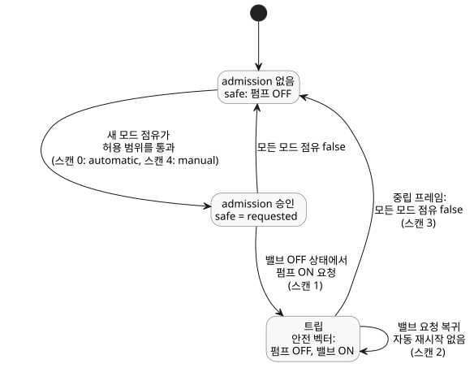

<!-- translation-source: examples/bound-resource-execution.ghost.md -->
[영문 원문](bound-resource-execution.ghost.md)

# 바인딩된 공유 Bool 정책 실행

이 완전한 소프트웨어 전용 제어는 자동·수동·대체(fallback) 경로의 요청을 하나의 공유 논리 펌프 허용 범위(envelope)로 통과시킵니다. 허용 범위란 모든 펌프 요청이 통과해야 하는 필수 규칙의 집합입니다. 입력은 요청이며 물리 피드백이 아닙니다. 위반 시 작성된 응답은 펌프 OFF, 밸브 ON입니다. 이것은 이 예제에서 명시적으로 선택한 값이며 장치 안전 시퀀스가 아닙니다.

이 문서는 명시적인 새 소스 revision인 bound-input-quality-v1입니다. 각 정본 입력은 생산자(producer)가 제공한 품질(`ok` 또는 `fault`)을 함께 전달합니다. 요청 식에서는 이 예제가 각 입력의 마지막 관측값을 유지하며, `false`는 이 소스 내부 기억의 초기값입니다. 자동·수동 모드의 필수 admission(수용) 경계는 이보다 엄격하여, 매 스캔마다 각 모드의 Good Bool 관측값을 요구합니다. 모드를 사용할 수 없으면 해당 스캔 전체를 원자적으로 거부하며, 그 스캔을 수정해 재시도하는 것은 허용됩니다. 모드를 사용할 수 없다는 것은 OFF, 트립, 재시작 명령 중 어느 것도 뜻하지 않습니다. 원본 소스 바이트는 별도로 보존합니다.

<!-- ghostflow:anchor id=GF-INT-BOUND-OBSERVATIONS kind=intent status=confirmed origin=engineer -->
이 소프트웨어 예제의 마지막 요청 관측값을 유지하면서, 작성된 자원 가드를 보존합니다.

```ghost
control BoundPump {
  resource station: Station;
  resource pump1: BoolActuator;
  resource valve1: BoolActuator;
  input automatic, manual, automatic_request, manual_request, fallback_request, valve_request: Bool;
  // ghostflow:link id=GF-INT-BOUND-OBSERVATIONS relation=implements
  state remembered_automatic: Bool = false;
  let automatic_value = case automatic { ok(value) => value; fault(_) => remembered_automatic; };
  remembered_automatic' = automatic_value;
  // ghostflow:link id=GF-INT-BOUND-OBSERVATIONS relation=implements
  state remembered_manual: Bool = false;
  let manual_value = case manual { ok(value) => value; fault(_) => remembered_manual; };
  remembered_manual' = manual_value;
  // ghostflow:link id=GF-INT-BOUND-OBSERVATIONS relation=implements
  state remembered_automatic_request: Bool = false;
  let automatic_request_value = case automatic_request { ok(value) => value; fault(_) => remembered_automatic_request; };
  remembered_automatic_request' = automatic_request_value;
  // ghostflow:link id=GF-INT-BOUND-OBSERVATIONS relation=implements
  state remembered_manual_request: Bool = false;
  let manual_request_value = case manual_request { ok(value) => value; fault(_) => remembered_manual_request; };
  remembered_manual_request' = manual_request_value;
  // ghostflow:link id=GF-INT-BOUND-OBSERVATIONS relation=implements
  state remembered_fallback_request: Bool = false;
  let fallback_request_value = case fallback_request { ok(value) => value; fault(_) => remembered_fallback_request; };
  remembered_fallback_request' = fallback_request_value;
  // ghostflow:link id=GF-INT-BOUND-OBSERVATIONS relation=implements
  state remembered_valve_request: Bool = false;
  let valve_request_value = case valve_request { ok(value) => value; fault(_) => remembered_valve_request; };
  remembered_valve_request' = valve_request_value;
  output pump, valve: Bool;
  pump <- (automatic_value && (automatic_request_value || fallback_request_value)) || (manual_value && manual_request_value);
  valve <- valve_request_value;
  constraints SharedRules for station {
    exclusive at admission { automatic, manual };
    require at safe_output pump1.on => any_on({ valve1 });
    safe { pump1 = false; valve1 = true; }
  }
}
```

WASM 타깃을 빌드한 다음, 저장소 루트에서 아래의 완전한 JavaScript 코드 블록을 실행합니다. 이 코드는 소스 문서, 산출물, revision, 자원, 모드, 출력의 식별자를 모두 명시적으로 제공합니다. 참조 호스트는 산출물을 검증하고 유일한 논리 writer를 소유하며, 물리 I/O는 수행하지 않습니다. 같은 필수 가드는 이식 가능한 Rust 코어와 네이티브 실행기에서도 실행됩니다.

```js
import fs from 'node:fs';
import { compileSourceSync } from './tools/compile-source.mjs';
import { compileBoundResourceControl } from './tools/bound-resource-control.mjs';
import { BoundResourceControlRuntime } from './runtimes/node/bound-resource-control.mjs';

const filename = 'examples/bound-resource-execution.ghost.md';
const checked = compileSourceSync(fs.readFileSync(filename, 'utf8'), { filename });
const bound = compileBoundResourceControl(checked, {
  format: 'GhostFlow/resource-constraints-binding-v1',
  revision: 'virtual-installation-input-v1',
  sourceDocumentSha256: checked.sourceDocument.sha256,
  artifactSha256: checked.manifest.bytecodeSha256,
  resources: [
    { name: 'station', resourceId: 'virtual/bound-loop' },
    { name: 'pump1', resourceId: 'virtual/bound-pump', output: 'pump' },
    { name: 'valve1', resourceId: 'virtual/bound-valve', output: 'valve' },
  ],
  modes: [
    { group: 'SharedRules', name: 'automatic', input: 'automatic' },
    { group: 'SharedRules', name: 'manual', input: 'manual' },
  ],
});
const wasm = fs.readFileSync('target/wasm32-unknown-unknown/release/ghostflow_wasm.wasm');
const runtime = await BoundResourceControlRuntime.instantiate(wasm, bound);
const requests = [
  [true, false, true, false, false, true],
  [true, false, true, false, false, false],
  [true, false, true, false, false, true],
  [false, false, false, false, false, true],
  [false, true, false, true, false, true],
];
try {
  for (const [scanId, values] of requests.entries()) {
    // Each row explicitly supplies Good software observations, including false.
    const inputs = bound.manifest.sensors.flatMap((port, index) => [
      { name: port.valueInput, value: values[index] },
      { name: port.okInput, value: true },
      { name: port.faultInput, value: 0 },
    ]);
    const { trace } = runtime.scan({ scanId, logicalTimeMs: scanId, inputs });
    console.log(JSON.stringify(trace));
  }
} finally { runtime.dispose(); }
```

`requests`의 각 행은 입력을 선언 순서대로 나열합니다. `automatic`, `manual`, `automatic_request`, `manual_request`, `fallback_request`, `valve_request` 순입니다. 다섯 번의 스캔은 다음 안전 출력을 만듭니다.

| 스캔 | 바뀌는 내용 | 요청 `pump`, `valve` | 안전 `pump`, `valve` |
| --- | --- | --- | --- |
| 0 | 자동 모드가 펌프를 점유하고 밸브가 요청됨 | ON, ON | ON, ON |
| 1 | 펌프 요청은 유지된 채 밸브 요청이 꺼짐 | ON, OFF | OFF, ON (작성된 안전 벡터) |
| 2 | 밸브 요청이 돌아옴 | ON, ON | OFF, ON (여전히 트립 상태, 자동 재시작 없음) |
| 3 | 중립 프레임: 두 모드 점유가 모두 false | OFF, ON | OFF, ON (트립 해제) |
| 4 | 새 수동 점유가 펌프를 요청함 | ON, ON | ON, ON (같은 허용 범위를 통과) |

두 번째 스캔은 실행 중 필수 조건 `pump1.on => any_on({ valve1 })`을 위반하므로, 가드가 작성된 안전 벡터를 적용합니다. 이 벡터는 모든 출력을 OFF로 만드는 것이 아닙니다. 밸브 요청만 복원해서는 펌프가 재시작하지 않습니다. 어떤 모드도 자원을 점유하지 않는 중립 프레임이 트립을 해제합니다. 그 뒤의 새 수동 점유도 펌프가 다시 운전하기 전에 같은 허용 범위를 통과해야 합니다.

아래 다이어그램은 이 스캔들에 걸쳐 admission과 트립이 어떻게 바뀌는지 요약합니다.



바인딩은 이번 활성화 동안 불변이며, 매 평가마다 필요합니다. 네이티브 호스트는 설치(installation)의 모든 writer가 하나의 `ResourceBindingRegistry`를 공유하게 해야 합니다. 참조 Node 호스트도 서로 다른 WASM 인스턴스 사이의 중복 writer를 거부합니다. 독립된 레지스트리는 각각 별개의 설치 권한이며, 하나의 공유 자원을 중재하는 수단이 아닙니다.

이 실행 프로필은 모든 출력이 명시적으로 보호된 Bool GFB1 v1/v3 요청 제어 정확히 하나만 지원합니다. 지원하지 않는 프로필은 안전하게 거부(fail closed)됩니다. 문맥(contextual)·회계(accounting)·연속(continuous) 프로필과 공유 정책 import 조합이 여기에 해당합니다. 특수한 Station 임대(lease)·정리(cleanup) 계약은 별개로 유지됩니다. 이 예제는 하드웨어 적용, 확인된 정지, 물리 시퀀스, PID 연동, 협력하는 다중 제어 중재 중 어느 것도 보여 주지 않습니다.

## 브라우저와 Worker 공개 모듈

브라우저와 Worker는 `tools/browser-toolchain.mjs`에서 `compileSource`,
`compileBoundResourceControl`, `verifyBoundResourceCompilation`,
`observeBoundResourceTrace`를 가져옵니다. `BoundResourceControlRuntime`은
`runtimes/wasm/bound-resource-control.mjs`에서 가져옵니다. 정확한 정본 문서,
설치 바인딩, 가져온(fetch) WASM 바이트를 전달합니다. 런타임 API는 세 가지
호출로 이루어집니다.

- `instantiate(wasmBytes, bound)`는 검증된 writer를 만듭니다.
- `scan(frame)`은 프레임 형식의 Rust 결과를 반환합니다.
- `dispose()`는 writer의 점유를 해제합니다.

런타임 생성에 실패하면 대기 중인 점유도 해제됩니다. 컴파일러와 런타임 모듈
그래프는 Node 내장 모듈이나 `Buffer`를 사용하지 않습니다. 위에서 사용한 Node
경로는 현재 예제를 위해 이와 동일한 런타임을 다시 내보냅니다(re-export).

상호작용 스키마를 표시하려면 `compileSource`에 `interactionSourceIdentity`를
전달합니다. 바인딩은 그 문서·revision 식별자를 유지하고, 실행 가능한 GFB17
바이트에 맞게 스키마의 모듈 식별자를 다시 생성합니다. 스키마 검증은 두 식별자를
모두 재구성하며, 검증된 descriptor는 실행 불가능한 상태로 남습니다. 바인딩된
manifest에서 논리 입력과 출력은 정확한 이름과 타입을 유지합니다.

- 정본 입력은 `manifest.sensors`에 나열됩니다. 여기서 생성된 value/OK/fault
  레일이 모여 완전한 VM 프레임을 이룹니다.
- `manifest.inputs`에는 과거 방식의 일반 입력 포트만 들어 있습니다.
- 불변 모드 활성화는 생성된 value 레일을 사용하며, Rust 가드는 이에 대응하는
  Bool OK 레일을 검증합니다.

GFRB, GFRS, GFB17의 wire 버전과 레이아웃은 바뀌지 않습니다.

유한 프로필에는 작성한 Bool 상태를 포함할 수 있습니다. 상호작용 계약이 요구하는
대로, 관찰하는 각 상태를 확인된 literate 의도 앵커에 연결합니다. 검증된
descriptor는 소스 provenance(출처)를 담지만 실행 저장소 바인딩은 담지 않습니다.
바인딩 단계는 실제로 낮춘(lowered) 프로그램에서 이를 얻습니다. 완료된 WASM 스캔
스냅샷은 같은 공개 상호작용 생성기를 통해 관찰된 상태 값을 노출하며, 비어 있지
않은 스키마에서도 마찬가지입니다.

JavaScript writer 레지스트리는 하나의 realm에 있는 하나의 모듈 인스턴스만
다루며, 대기 중인 비동기 생성도 포함합니다. 서로 다른 Worker, 창, 또는 독립적으로
로드된 모듈 인스턴스는 각자 자신의 레지스트리를 가집니다. 설치 호스트는 그런
writer를 시작하기 전에 하나의 공유 권한에서 안정적인 자원 ID를 예약해야 합니다.
또한 실패, 폐기(dispose), Worker 종료 시 이를 해제해야 합니다. realm 내부 가드는
Worker 사이의 중재도, 물리적 보장도 제공하지 않습니다.
