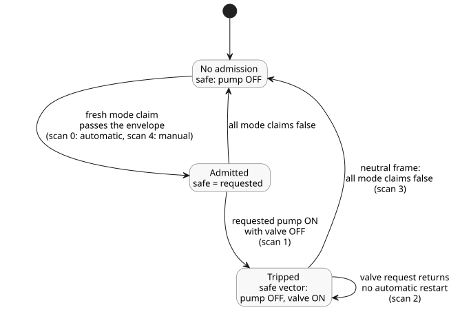

# Executing a bound shared Bool policy

This complete, software-only control routes automatic, manual and fallback requests through one shared logical pump envelope (the set of mandatory rules that every pump request must pass). The inputs are requests, not physical feedback. The authored response to a violation is pump OFF and valve ON. This is an explicit choice for this example, not a device safety sequence.

This is the explicit new source revision bound-input-quality-v1. Each canonical input carries producer quality (`ok` or `fault`). For its request expressions, the example keeps the last observation of each input, and `false` initializes that source-local memory. The mandatory automatic/manual admission boundary is stricter: it requires a Good Bool observation of each mode in every scan. If a mode is unavailable, the whole scan is rejected atomically and a corrected retry of that scan is permitted. An unavailable mode does not mean OFF, a trip, or a restart command. The original source bytes are retained separately.

<!-- ghostflow:anchor id=GF-INT-BOUND-OBSERVATIONS kind=intent status=confirmed origin=engineer -->
Retain this software example's last request observations while preserving its authored resource guard.

```ghost
control BoundPump {
  resource station: Station;
  resource pump1: BoolActuator;
  resource valve1: BoolActuator;
  input automatic, manual, automatic_request, manual_request, fallback_request, valve_request: Bool;
  // ghostflow:link id=GF-INT-BOUND-OBSERVATIONS relation=implements
  state remembered_automatic: Bool = false;
  let automatic_value = case automatic { ok(value) => value; fault(_) => remembered_automatic; };
  remembered_automatic' = automatic_value;
  // ghostflow:link id=GF-INT-BOUND-OBSERVATIONS relation=implements
  state remembered_manual: Bool = false;
  let manual_value = case manual { ok(value) => value; fault(_) => remembered_manual; };
  remembered_manual' = manual_value;
  // ghostflow:link id=GF-INT-BOUND-OBSERVATIONS relation=implements
  state remembered_automatic_request: Bool = false;
  let automatic_request_value = case automatic_request { ok(value) => value; fault(_) => remembered_automatic_request; };
  remembered_automatic_request' = automatic_request_value;
  // ghostflow:link id=GF-INT-BOUND-OBSERVATIONS relation=implements
  state remembered_manual_request: Bool = false;
  let manual_request_value = case manual_request { ok(value) => value; fault(_) => remembered_manual_request; };
  remembered_manual_request' = manual_request_value;
  // ghostflow:link id=GF-INT-BOUND-OBSERVATIONS relation=implements
  state remembered_fallback_request: Bool = false;
  let fallback_request_value = case fallback_request { ok(value) => value; fault(_) => remembered_fallback_request; };
  remembered_fallback_request' = fallback_request_value;
  // ghostflow:link id=GF-INT-BOUND-OBSERVATIONS relation=implements
  state remembered_valve_request: Bool = false;
  let valve_request_value = case valve_request { ok(value) => value; fault(_) => remembered_valve_request; };
  remembered_valve_request' = valve_request_value;
  output pump, valve: Bool;
  pump <- (automatic_value && (automatic_request_value || fallback_request_value)) || (manual_value && manual_request_value);
  valve <- valve_request_value;
  constraints SharedRules for station {
    exclusive at admission { automatic, manual };
    require at safe_output pump1.on => any_on({ valve1 });
    safe { pump1 = false; valve1 = true; }
  }
}
```

Build the WASM target, then run the complete JavaScript fence below from the repository root. It supplies every identity explicitly: source document, artifact, revision, resources, modes and outputs. The reference host validates the artifact and owns the sole logical writer; it performs no physical I/O. The same mandatory guard also executes in the portable Rust core and the native runner.

```js
import fs from 'node:fs';
import { compileSourceSync } from './tools/compile-source.mjs';
import { compileBoundResourceControl } from './tools/bound-resource-control.mjs';
import { BoundResourceControlRuntime } from './runtimes/node/bound-resource-control.mjs';

const filename = 'examples/bound-resource-execution.ghost.md';
const checked = compileSourceSync(fs.readFileSync(filename, 'utf8'), { filename });
const bound = compileBoundResourceControl(checked, {
  format: 'GhostFlow/resource-constraints-binding-v1',
  revision: 'virtual-installation-input-v1',
  sourceDocumentSha256: checked.sourceDocument.sha256,
  artifactSha256: checked.manifest.bytecodeSha256,
  resources: [
    { name: 'station', resourceId: 'virtual/bound-loop' },
    { name: 'pump1', resourceId: 'virtual/bound-pump', output: 'pump' },
    { name: 'valve1', resourceId: 'virtual/bound-valve', output: 'valve' },
  ],
  modes: [
    { group: 'SharedRules', name: 'automatic', input: 'automatic' },
    { group: 'SharedRules', name: 'manual', input: 'manual' },
  ],
});
const wasm = fs.readFileSync('target/wasm32-unknown-unknown/release/ghostflow_wasm.wasm');
const runtime = await BoundResourceControlRuntime.instantiate(wasm, bound);
const requests = [
  [true, false, true, false, false, true],
  [true, false, true, false, false, false],
  [true, false, true, false, false, true],
  [false, false, false, false, false, true],
  [false, true, false, true, false, true],
];
try {
  for (const [scanId, values] of requests.entries()) {
    // Each row explicitly supplies Good software observations, including false.
    const inputs = bound.manifest.sensors.flatMap((port, index) => [
      { name: port.valueInput, value: values[index] },
      { name: port.okInput, value: true },
      { name: port.faultInput, value: 0 },
    ]);
    const { trace } = runtime.scan({ scanId, logicalTimeMs: scanId, inputs });
    console.log(JSON.stringify(trace));
  }
} finally { runtime.dispose(); }
```

Each row of `requests` lists the inputs in declaration order: `automatic`, `manual`, `automatic_request`, `manual_request`, `fallback_request`, `valve_request`. The five scans produce these safe outputs:

| Scan | What changes | Requested `pump`, `valve` | Safe `pump`, `valve` |
| --- | --- | --- | --- |
| 0 | Automatic mode claims the pump; the valve is requested | ON, ON | ON, ON |
| 1 | The valve request drops while the pump is still requested | ON, OFF | OFF, ON (authored safe vector) |
| 2 | The valve request returns | ON, ON | OFF, ON (still tripped; no automatic restart) |
| 3 | Neutral frame: both mode claims are false | OFF, ON | OFF, ON (trip released) |
| 4 | A fresh manual claim requests the pump | ON, ON | ON, ON (passed the same envelope) |

The second scan violates the running requirement `pump1.on => any_on({ valve1 })`, so the guard applies the authored non-OFF safe vector. Restoring the valve request alone does not restart the pump. A neutral frame, in which no mode claims the resource, releases the trip. The later fresh manual claim must pass the same envelope before the pump runs again.

The diagram below summarizes how admission and the trip evolve across these scans.



The binding is immutable for this activation and is required on every evaluation. The native host must share one `ResourceBindingRegistry` among every writer in its installation. The reference Node host also rejects duplicate writers across WASM instances. Independent registries are separate installation authorities; they are not a way to arbitrate one shared resource.

This executable profile supports exactly one Bool GFB1 v1/v3 request control, with every output explicitly protected. Unsupported profiles fail closed: contextual, accounting and continuous profiles, and shared-policy import composition. The specialized Station lease/cleanup contract remains separate. This example does not demonstrate any hardware application, confirmed stop, physical sequence, PID integration, or cooperative multi-control arbitration.

## Browser and Worker public modules

Browsers and Workers import `compileSource`, `compileBoundResourceControl`,
`verifyBoundResourceCompilation`, and `observeBoundResourceTrace` from
`tools/browser-toolchain.mjs`. They import `BoundResourceControlRuntime` from
`runtimes/wasm/bound-resource-control.mjs`. Supply the exact canonical document,
the installation binding, and the fetched WASM bytes. The runtime API has three
calls:

- `instantiate(wasmBytes, bound)` creates the checked writer.
- `scan(frame)` returns the framed Rust outcome.
- `dispose()` releases the writer's claim.

If runtime construction fails, the pending claim is also released. The compiler
and runtime module graphs use no Node builtins and no `Buffer`. The Node path
used above re-exports this same runtime for the current example.

To present an interaction schema, pass `interactionSourceIdentity` to
`compileSource`. Binding preserves that document/revision identity and
regenerates the schema's module identity for the executable GFB17 bytes. Schema
verification reconstructs both identities; checked descriptors remain
nonexecutable. In the bound manifest, logical inputs and outputs keep their exact
names and types:

- Canonical inputs are listed in `manifest.sensors`. Their generated value/OK/fault
  rails together form the complete VM frame.
- `manifest.inputs` contains only plain historical input ports.
- The immutable mode activation uses the generated value rail, and the Rust guard
  validates the matching Bool OK rail.

The GFRB, GFRS and GFB17 wire versions and layouts are unchanged.

The finite profile may include authored Bool state. As the interaction contract
requires, link each observed state to its confirmed literate intent anchor. The
checked descriptor carries source provenance but no executable storage
bindings; binding obtains those from the actual lowered program. Completed
WASM scan snapshots expose the observed state value through the same public
interaction producer, including nonempty schemas.

The JavaScript writer registry covers one module instance in one realm,
including pending asynchronous creation. Separate Workers, windows, or
independently loaded module instances each have their own registry. Before
starting any of those writers, an installation host must reserve stable resource
IDs in one shared authority. It must release them on failure, disposal, or Worker
termination. The realm-local guard provides no cross-Worker arbitration and no
physical guarantee.
