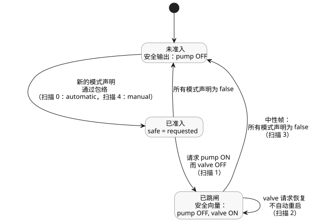

<!-- translation-source: examples/bound-resource-execution.ghost.md -->
[英文原文](bound-resource-execution.ghost.md)
> 本文为阅读用译本。编译时请使用上方链接的原始 `.ghost.md` 文件。

# 执行已绑定的共享 Bool 策略

这个完整的纯软件 `control` 块，把自动、手动和回退（fallback）请求都引导到同一个共享的逻辑泵包络中（即每个泵请求都必须通过的一组强制规则）。输入是请求，而不是物理反馈。违反规则时，作者编写的响应是泵 OFF、阀门 ON。这是本示例的显式选择，而不是设备的安全时序。

这是显式的新源修订版 bound-input-quality-v1。每个规范输入都带有生产方质量（`ok` 或 `fault`）。对于其请求表达式，示例保留每个输入的上一次观测，并以 `false` 初始化这一源局部记忆。强制性的自动/手动准入边界则更为严格：它要求每次扫描中每种模式都有一个 Good 的 Bool 观测。如果某个模式不可用，整个扫描会被原子地拒绝，并允许对该扫描进行修正后的重试。模式不可用并不意味着 OFF、跳闸或重启命令。原始源字节另行保留。

<!-- ghostflow:anchor id=GF-INT-BOUND-OBSERVATIONS kind=intent status=confirmed origin=engineer -->
保留本软件示例上一次的请求观测，同时维持作者编写的资源保护。

```ghost
control BoundPump {
  resource station: Station;
  resource pump1: BoolActuator;
  resource valve1: BoolActuator;
  input automatic, manual, automatic_request, manual_request, fallback_request, valve_request: Bool;
  // ghostflow:link id=GF-INT-BOUND-OBSERVATIONS relation=implements
  state remembered_automatic: Bool = false;
  let automatic_value = case automatic { ok(value) => value; fault(_) => remembered_automatic; };
  remembered_automatic' = automatic_value;
  // ghostflow:link id=GF-INT-BOUND-OBSERVATIONS relation=implements
  state remembered_manual: Bool = false;
  let manual_value = case manual { ok(value) => value; fault(_) => remembered_manual; };
  remembered_manual' = manual_value;
  // ghostflow:link id=GF-INT-BOUND-OBSERVATIONS relation=implements
  state remembered_automatic_request: Bool = false;
  let automatic_request_value = case automatic_request { ok(value) => value; fault(_) => remembered_automatic_request; };
  remembered_automatic_request' = automatic_request_value;
  // ghostflow:link id=GF-INT-BOUND-OBSERVATIONS relation=implements
  state remembered_manual_request: Bool = false;
  let manual_request_value = case manual_request { ok(value) => value; fault(_) => remembered_manual_request; };
  remembered_manual_request' = manual_request_value;
  // ghostflow:link id=GF-INT-BOUND-OBSERVATIONS relation=implements
  state remembered_fallback_request: Bool = false;
  let fallback_request_value = case fallback_request { ok(value) => value; fault(_) => remembered_fallback_request; };
  remembered_fallback_request' = fallback_request_value;
  // ghostflow:link id=GF-INT-BOUND-OBSERVATIONS relation=implements
  state remembered_valve_request: Bool = false;
  let valve_request_value = case valve_request { ok(value) => value; fault(_) => remembered_valve_request; };
  remembered_valve_request' = valve_request_value;
  output pump, valve: Bool;
  pump <- (automatic_value && (automatic_request_value || fallback_request_value)) || (manual_value && manual_request_value);
  valve <- valve_request_value;
  constraints SharedRules for station {
    exclusive at admission { automatic, manual };
    require at safe_output pump1.on => any_on({ valve1 });
    safe { pump1 = false; valve1 = true; }
  }
}
```

先构建 WASM 目标，然后在仓库根目录运行下面完整的 JavaScript 代码围栏。它显式提供所有身份标识：源文档、构件、修订版、资源、模式和输出。参考宿主会验证构件并持有唯一的逻辑写入者；它不执行任何物理 I/O。同一强制保护也在可移植的 Rust 核心和原生运行器中执行。

```js
import fs from 'node:fs';
import { compileSourceSync } from './tools/compile-source.mjs';
import { compileBoundResourceControl } from './tools/bound-resource-control.mjs';
import { BoundResourceControlRuntime } from './runtimes/node/bound-resource-control.mjs';

const filename = 'examples/bound-resource-execution.ghost.md';
const checked = compileSourceSync(fs.readFileSync(filename, 'utf8'), { filename });
const bound = compileBoundResourceControl(checked, {
  format: 'GhostFlow/resource-constraints-binding-v1',
  revision: 'virtual-installation-input-v1',
  sourceDocumentSha256: checked.sourceDocument.sha256,
  artifactSha256: checked.manifest.bytecodeSha256,
  resources: [
    { name: 'station', resourceId: 'virtual/bound-loop' },
    { name: 'pump1', resourceId: 'virtual/bound-pump', output: 'pump' },
    { name: 'valve1', resourceId: 'virtual/bound-valve', output: 'valve' },
  ],
  modes: [
    { group: 'SharedRules', name: 'automatic', input: 'automatic' },
    { group: 'SharedRules', name: 'manual', input: 'manual' },
  ],
});
const wasm = fs.readFileSync('target/wasm32-unknown-unknown/release/ghostflow_wasm.wasm');
const runtime = await BoundResourceControlRuntime.instantiate(wasm, bound);
const requests = [
  [true, false, true, false, false, true],
  [true, false, true, false, false, false],
  [true, false, true, false, false, true],
  [false, false, false, false, false, true],
  [false, true, false, true, false, true],
];
try {
  for (const [scanId, values] of requests.entries()) {
    // Each row explicitly supplies Good software observations, including false.
    const inputs = bound.manifest.sensors.flatMap((port, index) => [
      { name: port.valueInput, value: values[index] },
      { name: port.okInput, value: true },
      { name: port.faultInput, value: 0 },
    ]);
    const { trace } = runtime.scan({ scanId, logicalTimeMs: scanId, inputs });
    console.log(JSON.stringify(trace));
  }
} finally { runtime.dispose(); }
```

`requests` 的每一行按声明顺序列出输入：`automatic`、`manual`、`automatic_request`、`manual_request`、`fallback_request`、`valve_request`。五次扫描产生如下安全输出：

| 扫描 | 变化内容 | 请求的 `pump`、`valve` | 安全的 `pump`、`valve` |
| --- | --- | --- | --- |
| 0 | 自动模式声明使用泵；请求阀门 | ON, ON | ON, ON |
| 1 | 泵仍被请求时，阀门请求撤销 | ON, OFF | OFF, ON（作者编写的安全向量） |
| 2 | 阀门请求恢复 | ON, ON | OFF, ON（仍处于跳闸状态；不自动重启） |
| 3 | 中性帧：两个模式声明均为 false | OFF, ON | OFF, ON（跳闸解除） |
| 4 | 新的手动声明请求泵 | ON, ON | ON, ON（通过了同一包络） |

第二次扫描违反了运行要求 `pump1.on => any_on({ valve1 })`，因此保护应用作者编写的非 OFF 安全向量。仅恢复阀门请求不会重启泵。中性帧（即没有任何模式声明该资源的帧）会解除跳闸。之后新的手动声明必须通过同一包络，泵才能再次运行。

下图总结了准入和跳闸状态在这些扫描中的演变。



该绑定在本次激活期间不可变，并且每次求值都需要它。原生宿主必须在其设施内的所有写入者之间共享同一个 `ResourceBindingRegistry`。参考 Node 宿主还会拒绝跨 WASM 实例的重复写入者。相互独立的注册表是彼此独立的设施权威；它们不是对同一共享资源进行仲裁的手段。

这个可执行 profile 恰好支持一个 Bool GFB1 v1/v3 请求 `control` 块，且每个输出都受到显式保护。不支持的 profile 会以故障关闭（fail closed）方式失败：上下文、用量核算和连续 profile，以及共享策略的导入组合。专用的 Station 租约/清理契约仍是独立的。本示例不演示任何硬件应用、已确认的停止、物理时序、PID 集成或多个 `control` 之间的协作仲裁。

## 浏览器与 Worker 公共模块

浏览器和 Worker 从 `tools/browser-toolchain.mjs` 导入 `compileSource`、`compileBoundResourceControl`、`verifyBoundResourceCompilation` 和 `observeBoundResourceTrace`。它们从 `runtimes/wasm/bound-resource-control.mjs` 导入 `BoundResourceControlRuntime`。需要提供确切的规范文档、设施绑定以及获取到的 WASM 字节。运行时 API 有三个调用：

- `instantiate(wasmBytes, bound)` 创建经过检查的写入者。
- `scan(frame)` 返回带帧的 Rust 结果。
- `dispose()` 释放写入者的声明。

如果运行时构造失败，待处理的声明也会被释放。编译器和运行时的模块图不使用任何 Node 内置模块，也不使用 `Buffer`。上面使用的 Node 路径为当前示例重新导出了同一个运行时。

要呈现交互 schema，请向 `compileSource` 传入 `interactionSourceIdentity`。绑定会保留该文档/修订版身份标识，并为可执行的 GFB17 字节重新生成 schema 的模块身份标识。schema 验证会重建这两个身份标识；经过检查的描述符仍不可执行。在已绑定的清单（manifest）中，逻辑输入和输出保留其确切的名称和类型：

- 规范输入列在 `manifest.sensors` 中。它们生成的 value/OK/fault 轨道共同构成完整的 VM 帧。
- `manifest.inputs` 只包含普通的历史输入端口。
- 不可变的模式激活使用生成的 value 轨道，Rust 保护会验证对应的 Bool OK 轨道。

GFRB、GFRS 和 GFB17 的线格式版本和布局保持不变。

有限 profile 可以包含作者编写的 Bool 状态。按照交互契约的要求，须将每个被观测的状态链接到其已确认的文学式意图锚点。经过检查的描述符携带源来源信息，但不携带可执行的存储绑定；绑定会从实际降级后的程序中获取这些信息。已完成的 WASM 扫描快照通过同一个公共交互生产者暴露被观测的状态值，包括非空 schema 的情形。

JavaScript 写入者注册表覆盖一个 realm 中的一个模块实例，包括待处理的异步创建。相互独立的 Worker、窗口或独立加载的模块实例各自拥有自己的注册表。在启动其中任何写入者之前，设施宿主必须在一个共享权威中预留稳定的资源 ID。在失败、释放或 Worker 终止时，它必须释放这些 ID。realm 局部的保护不提供跨 Worker 的仲裁，也不提供任何物理保证。
