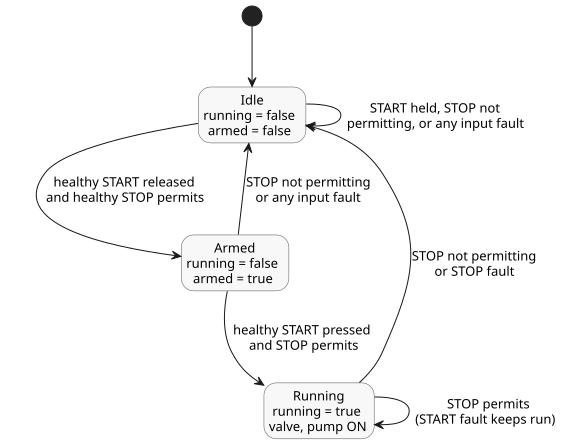

<!-- translation-source: examples/curriculum/pc-02-start-stop.ghost.md -->
[Korean original](pc-02-start-stop.ghost.md)
> Reading translation. Compile the linked original `.ghost.md` file.

# PC-02 — START/STOP latching and fresh-start permission

<!-- ghostflow:anchor id=GF-INT-PC02-START-STOP-REARM-V1 kind=intent status=confirmed origin=imported -->
> Learning scenario: Press START to begin operation, and stop immediately when
> STOP is asserted. When STOP clears, operation may restart only after START
> is released and pressed again, even if START was held during the stop.

The linked Korean original is the only executable source for PC-02. Lesson
[E03](../../docs/ProgrammingInGhostflow.en.md#ch03) already covers the basic
latch and the rule that `pump` requires `valve`. This example builds on it and
makes three things explicit: the stop path, a fresh-start event, and restart
inhibition.

`stop_ok` is a logical input that is `true` when the stop path permits
operation; it is supplied as `false` while STOP is active. The NO/NC polarity of
the real STOP contact and the electrical safety circuit belong to the device
adapter's input semantics. This virtual example receives only a normalized Bool
payload together with its acquisition quality.

This is an explicit new source revision. It keeps the existing healthy
START/STOP scenario unchanged and adds these rules for acquisition faults:

- A START fault prevents a new start. An active run continues while STOP is
  healthy and permits operation.
- A STOP fault clears `running` and requests OFF.
- A fault on either input clears `armed`.
- To restart, the control must observe a healthy, released START while STOP is
  healthy and permits operation, followed by another press. An acquisition
  fault never counts as a healthy release for rearming.

The previous revision is kept in
`tests/fixtures/history/issue531/pc-02-start-stop.ghost.en.md.pre-input.txt`.

```ghost
// issue531-approved-fault-restart-v1: rearm requires healthy START release.
control StartStopPump {
  input start, stop_ok: Bool;
  output valve, pump: Bool;

  // ghostflow:link id=GF-INT-PC02-START-STOP-REARM-V1 relation=implements
  state armed: Bool = false;
  // ghostflow:link id=GF-INT-PC02-START-STOP-REARM-V1 relation=implements
  state running: Bool = false;

  let start_good = case start { ok(_) => true; fault(_) => false; };
  let stop_good = case stop_ok { ok(_) => true; fault(_) => false; };
  let start_requested = start |> recover(false);
  let stop_permitted = stop_ok |> recover(false);
  let start_event = start_good && armed && start_requested;

  running' = stop_permitted && (start_event || running);
  armed' = start_good && stop_good && stop_permitted && !start_requested;

  valve <- running';
  pump <- running';

  require pump => valve;
}
```

`running` is the operating state from the previous tick; `running'` is its next
state, computed in this tick. `armed` remembers whether START was released at
the last observation. As a result:

- On a new runtime's first input, `start_event` is false even if START is
  already pressed.
- After STOP clears, operation stays inhibited until START is released.

The state diagram below shows the three combinations of `running` and `armed`
that the control can reach, and what moves it between them.



This example does not verify physical relay contacts, motor rotation, or a
wired safety circuit. Its dedicated checker uses the actual GhostFlow compiler
and the existing WASM `ControlRuntime` to compare the `stateBefore`,
`stateAfter`, `requested`, and `safe` frames.
