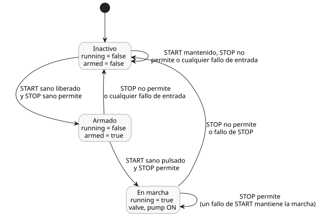

<!-- translation-source: examples/curriculum/pc-02-start-stop.ghost.en.md -->
[Original en inglés](pc-02-start-stop.ghost.en.md)
> Traducción de lectura. Para compilar, use el archivo original en coreano [`pc-02-start-stop.ghost.md`](pc-02-start-stop.ghost.md).

# PC-02 — Autorretención START/STOP y permiso de arranque nuevo

<!-- ghostflow:anchor id=GF-INT-PC02-START-STOP-REARM-V1 kind=intent status=confirmed origin=imported -->
> Escenario de aprendizaje: pulse START para iniciar la operación, y deténgase de
> inmediato cuando se active STOP. Cuando STOP se despeja, la operación solo puede
> rearrancar después de liberar START y volver a pulsarlo, incluso si START se
> mantuvo pulsado durante la parada.

El original en coreano enlazado es la única fuente ejecutable de PC-02. La lección
[E03](../../docs/ProgrammingInGhostflow.es.md#ch03) ya cubre el latch (retención)
básico y la regla de que `pump` requiere `valve`. Este ejemplo se basa en ella y
hace explícitas tres cosas: la ruta de parada, un evento de arranque nuevo y la
inhibición del rearranque.

`stop_ok` es una entrada lógica que vale `true` cuando la ruta de parada permite la
operación; se suministra como `false` mientras STOP está activo. La polaridad NA/NC
del contacto STOP real y el circuito eléctrico de seguridad pertenecen a la
semántica de entrada del adaptador del dispositivo. Este ejemplo virtual solo
recibe una carga útil Bool normalizada junto con su calidad de adquisición.

Esta es una nueva revisión de fuente explícita. Mantiene sin cambios el escenario
START/STOP con entradas sanas y agrega estas reglas para los fallos de adquisición:

- Un fallo de START impide un arranque nuevo. Una marcha activa continúa mientras
  STOP esté sano y permita la operación.
- Un fallo de STOP borra `running` y solicita OFF.
- Un fallo en cualquiera de las dos entradas borra `armed`.
- Para rearrancar, el control debe observar un START sano y liberado mientras STOP
  está sano y permite la operación, seguido de otra pulsación. Un fallo de
  adquisición nunca cuenta como una liberación sana para el rearme.

La revisión anterior se conserva en
`tests/fixtures/history/issue531/pc-02-start-stop.ghost.en.md.pre-input.txt`.

```ghost
// issue531-approved-fault-restart-v1: rearm requires healthy START release.
control StartStopPump {
  input start, stop_ok: Bool;
  output valve, pump: Bool;

  // ghostflow:link id=GF-INT-PC02-START-STOP-REARM-V1 relation=implements
  state armed: Bool = false;
  // ghostflow:link id=GF-INT-PC02-START-STOP-REARM-V1 relation=implements
  state running: Bool = false;

  let start_good = case start { ok(_) => true; fault(_) => false; };
  let stop_good = case stop_ok { ok(_) => true; fault(_) => false; };
  let start_requested = start |> recover(false);
  let stop_permitted = stop_ok |> recover(false);
  let start_event = start_good && armed && start_requested;

  running' = stop_permitted && (start_event || running);
  armed' = start_good && stop_good && stop_permitted && !start_requested;

  valve <- running';
  pump <- running';

  require pump => valve;
}
```

`running` es el estado de operación del tick anterior; `running'` es su estado
siguiente, calculado en este tick. `armed` recuerda si START estaba liberado en la
última observación. Como resultado:

- En la primera entrada de un runtime nuevo, `start_event` es false aunque START ya
  esté pulsado.
- Después de que STOP se despeja, la operación permanece inhibida hasta que se
  libera START.

El diagrama de estados siguiente muestra las tres combinaciones de `running` y
`armed` que puede alcanzar el control, y qué lo hace pasar de una a otra.



Este ejemplo no verifica los contactos físicos del relé, la rotación del motor ni
un circuito de seguridad cableado. Su verificador dedicado usa el compilador real
de GhostFlow y el `ControlRuntime` WASM existente para comparar las tramas
`stateBefore`, `stateAfter`, `requested` y `safe`.
