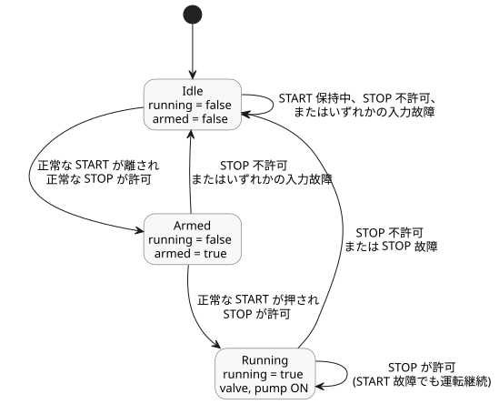

<!-- translation-source: examples/curriculum/pc-02-start-stop.ghost.en.md -->
[英語の原文](pc-02-start-stop.ghost.en.md)
> 閲覧用の翻訳です。コンパイルには、リンク先の韓国語の原本 [`pc-02-start-stop.ghost.md`](pc-02-start-stop.ghost.md) を使用してください。

# PC-02 — START/STOP の自己保持と新たな起動の許可

<!-- ghostflow:anchor id=GF-INT-PC02-START-STOP-REARM-V1 kind=intent status=confirmed origin=imported -->
> 学習シナリオ：START を押すと運転を開始し、STOP が入るとただちに停止する。STOP が解除されたとき、停止中に START を押し続けていたとしても、START をいったん離してから押し直した後でなければ運転を再開できない。

リンク先の韓国語の原本が、PC-02 の唯一の実行可能なソースです。レッスン [E03](../../docs/ProgrammingInGhostflow.ja.md#ch03) では、基本的な自己保持と、`pump` には `valve` が必要というルールをすでに扱いました。この例はそれを土台に、停止経路、新たな起動（fresh start）イベント、再起動の抑止という 3 点を明示します。

`stop_ok` は、停止経路が運転を許可しているときに `true` となる論理入力です。STOP が作動している間は `false` が供給されます。実際の STOP 接点の a接点/b接点の極性や電気的な安全回路は、デバイスアダプタの入力セマンティクスに属します。この仮想例が受け取るのは、正規化された Bool のペイロードとその取得品質だけです。

これは明示的な新しいソースリビジョンです。既存の正常な START/STOP シナリオは変更せず、取得故障について次のルールを追加します。

- START の故障は新たな起動を妨げます。STOP が正常で運転を許可している間は、運転中の状態は継続します。
- STOP の故障は `running` をクリアし、OFF を要求します。
- どちらかの入力が故障すると `armed` がクリアされます。
- 再起動するには、STOP が正常で運転を許可している間に、正常な状態で離された START を観測し、その後もう一度押される必要があります。取得故障が、再アームのための正常な解放とみなされることは決してありません。

以前のリビジョンは `tests/fixtures/history/issue531/pc-02-start-stop.ghost.en.md.pre-input.txt` に保存されています。

```ghost
// issue531-approved-fault-restart-v1: rearm requires healthy START release.
control StartStopPump {
  input start, stop_ok: Bool;
  output valve, pump: Bool;

  // ghostflow:link id=GF-INT-PC02-START-STOP-REARM-V1 relation=implements
  state armed: Bool = false;
  // ghostflow:link id=GF-INT-PC02-START-STOP-REARM-V1 relation=implements
  state running: Bool = false;

  let start_good = case start { ok(_) => true; fault(_) => false; };
  let stop_good = case stop_ok { ok(_) => true; fault(_) => false; };
  let start_requested = start |> recover(false);
  let stop_permitted = stop_ok |> recover(false);
  let start_event = start_good && armed && start_requested;

  running' = stop_permitted && (start_event || running);
  armed' = start_good && stop_good && stop_permitted && !start_requested;

  valve <- running';
  pump <- running';

  require pump => valve;
}
```

`running` は前の tick の運転状態で、`running'` はこの tick で計算される次状態です。`armed` は、最後の観測で START が離されていたかどうかを記憶します。その結果：

- 新しいランタイムの最初の入力では、START がすでに押されていても `start_event` は false です。
- STOP が解除された後も、START が離されるまで運転は抑止されたままです。

下の状態図は、`control` が到達しうる `running` と `armed` の 3 つの組み合わせと、それらの間を移動させる条件を示しています。



この例は、物理的なリレー接点、モーターの回転、配線された安全回路を検証しません。専用のチェッカーは実際の GhostFlow コンパイラと既存の WASM `ControlRuntime` を使い、`stateBefore`、`stateAfter`、`requested`、`safe` の各フレームを比較します。
