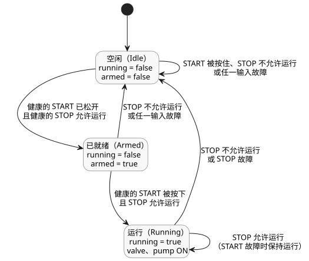

<!-- translation-source: examples/curriculum/pc-02-start-stop.ghost.en.md -->
[英文原文](pc-02-start-stop.ghost.en.md)
> 本文为阅读用译本。编译时请使用原始文件 `pc-02-start-stop.ghost.md`（韩文原文）。

# PC-02 — START/STOP 自锁与新的启动许可

<!-- ghostflow:anchor id=GF-INT-PC02-START-STOP-REARM-V1 kind=intent status=confirmed origin=imported -->
> 学习场景：按下 START 开始运行，STOP 生效时立即停止。STOP 解除后，即使在停止期间一直按住 START，也只有在松开 START 并再次按下之后才能重新运行。

链接的韩文原文是 PC-02 唯一的可执行源。课程 [E03](../../docs/ProgrammingInGhostflow.zh.md#ch03) 已经讲解了基本的自锁以及 `pump` 需要 `valve` 的规则。本示例以此为基础，显式地表达了三件事：停止路径、新的启动事件以及重启抑制。

`stop_ok` 是一个逻辑输入，当停止路径允许运行时为 `true`；STOP 生效期间它以 `false` 提供。真实 STOP 触点的常开/常闭极性以及电气安全回路属于设备适配器的输入语义。这个虚拟示例只接收归一化的 Bool 载荷及其采集质量。

这是一个显式的新源修订版。它保持现有的健康 START/STOP 场景不变，并为采集故障增加以下规则：

- START 故障会阻止新的启动。只要 STOP 健康且允许运行，正在进行的运行就会继续。
- STOP 故障会清除 `running` 并请求 OFF。
- 任一输入故障都会清除 `armed`。
- 要重新启动，`control` 必须在 STOP 健康且允许运行的情况下观测到一个健康的、已松开的 START，然后再次按下。采集故障绝不会被视为用于重新就绪的健康松开。

前一个修订版保存在
`tests/fixtures/history/issue531/pc-02-start-stop.ghost.en.md.pre-input.txt`。

```ghost
// issue531-approved-fault-restart-v1: rearm requires healthy START release.
control StartStopPump {
  input start, stop_ok: Bool;
  output valve, pump: Bool;

  // ghostflow:link id=GF-INT-PC02-START-STOP-REARM-V1 relation=implements
  state armed: Bool = false;
  // ghostflow:link id=GF-INT-PC02-START-STOP-REARM-V1 relation=implements
  state running: Bool = false;

  let start_good = case start { ok(_) => true; fault(_) => false; };
  let stop_good = case stop_ok { ok(_) => true; fault(_) => false; };
  let start_requested = start |> recover(false);
  let stop_permitted = stop_ok |> recover(false);
  let start_event = start_good && armed && start_requested;

  running' = stop_permitted && (start_event || running);
  armed' = start_good && stop_good && stop_permitted && !start_requested;

  valve <- running';
  pump <- running';

  require pump => valve;
}
```

`running` 是上一个 tick 的运行状态；`running'` 是在本 tick 中计算出的下一状态。`armed` 记录上一次观测时 START 是否已松开。因此：

- 在新运行时的第一个输入时，即使 START 已被按下，`start_event` 也为 false。
- STOP 解除后，在 START 被松开之前，运行一直受到抑制。

下面的状态图展示了 `control` 能够到达的三种 `running` 与 `armed` 组合，以及在它们之间切换的条件。



本示例不验证物理继电器触点、电机转动或接线的安全回路。其专用检查器使用实际的 GhostFlow 编译器和现有的 WASM `ControlRuntime` 来比较 `stateBefore`、`stateAfter`、`requested` 和 `safe` 帧。
