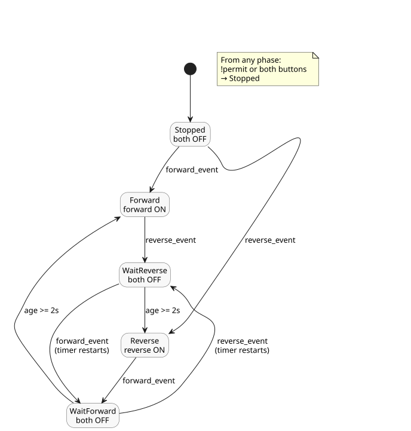

<!-- translation-source: examples/curriculum/pc-04-direction-interlock.ghost.md -->
[Korean original](pc-04-direction-interlock.ghost.md)
> Reading translation. Compile the linked original `.ghost.md` file.

# PC-04 — Forward/reverse direction-change interlock

<!-- ghostflow:anchor id=GF-INT-PC04-DIRECTION-INTERLOCK-V1 kind=intent status=confirmed origin=imported -->
> Learning scenario: A learning scenario based on the forward/reverse stage of
> the user's PLC-replacement curriculum. This document is not a direct user quote.

The linked Korean original is the only canonical, literate, executable source
for PC-04. It keeps and references the existing lesson
[E06 DirectionInterlock](../../docs/ProgrammingInGhostflow.md#e06--두-방향을-동시에-요청하면),
which shows a small safety constraint that blocks simultaneous output requests.
This lesson builds on E06 and makes three things explicit: a fresh-start event,
a stopped state, and a wait before changing direction.

The inputs and outputs are:

- `forward_start` and `reverse_start` are momentary inputs: `true` while the
  button is pressed.
- `stop_ok` and `overload_ok` are normalized inputs: `true` when the stop path
  and the overload protection, respectively, permit operation.
- `forward_contactor` and `reverse_contactor` are logical commands to the
  forward and reverse contactor coils, not evidence that the motor actually
  rotates.

This explicit quality-input revision keeps the healthy-input replay unchanged.
For acquisition faults:

- An unavailable START request cannot start or rearm the control. An existing
  run may continue while STOP and protection stay healthy and permit operation.
- An unavailable STOP or protection input removes permission.
- After recovery, a healthy START release followed by a new START request is
  required.

The previous source is kept as non-executable history at
`tests/fixtures/history/issue531/pc-04-direction-interlock.ghost.en.md.pre-input.txt`.

```ghost
// Source revision: issue531-approved-fault-restart-v1
control DirectionChangeInterlock {
  input forward_start, reverse_start, stop_ok, overload_ok: Bool;
  output forward_contactor, reverse_contactor: Bool;

  let reversal_wait = 2s;

  type Phase = Stopped | Forward | Reverse | WaitForward | WaitReverse;
  // ghostflow:link id=GF-INT-PC04-DIRECTION-INTERLOCK-V1 relation=implements
  state phase: Phase = Stopped;
  // ghostflow:link id=GF-INT-PC04-DIRECTION-INTERLOCK-V1 relation=implements
  state start_armed: Bool = false;
  // ghostflow:link id=GF-INT-PC04-DIRECTION-INTERLOCK-V1 relation=implements
  timer age = elapsed(phase);

  let forward_start_good = case forward_start { ok(_) => true; fault(_) => false; };
  let forward_start_value = forward_start |> recover(false);
  let reverse_start_good = case reverse_start { ok(_) => true; fault(_) => false; };
  let reverse_start_value = reverse_start |> recover(false);
  let stop_ok_good = case stop_ok { ok(_) => true; fault(_) => false; };
  let stop_ok_value = stop_ok |> recover(false);
  let overload_ok_good = case overload_ok { ok(_) => true; fault(_) => false; };
  let overload_ok_value = overload_ok |> recover(false);

  let permit = stop_ok_value && overload_ok_value;
  let requests_good = forward_start_good && reverse_start_good;
  let ambiguous = forward_start_value && reverse_start_value;
  let forward_event = requests_good && start_armed && forward_start_value && !reverse_start_value;
  let reverse_event = requests_good && start_armed && reverse_start_value && !forward_start_value;

  start_armed' = requests_good && permit && !forward_start_value && !reverse_start_value;

  phase' = case phase {
    Stopped =>
      if !permit || ambiguous then Stopped
      else if forward_event then Forward
      else if reverse_event then Reverse
      else Stopped;

    Forward =>
      if !permit || ambiguous then Stopped
      else if reverse_event then WaitReverse
      else Forward;

    Reverse =>
      if !permit || ambiguous then Stopped
      else if forward_event then WaitForward
      else Reverse;

    WaitForward =>
      if !permit || ambiguous then Stopped
      else if reverse_event then WaitReverse
      else if age >= reversal_wait then Forward
      else WaitForward;

    WaitReverse =>
      if !permit || ambiguous then Stopped
      else if forward_event then WaitForward
      else if age >= reversal_wait then Reverse
      else WaitReverse;
  };

  forward_contactor <- phase' == Forward;
  reverse_contactor <- phase' == Reverse;
  mutex(forward_contactor, reverse_contactor);
}
```

The state diagram below shows the five phases and the events that move between
them. A contactor command is ON only in `Forward` or `Reverse`.



During normal operation, a new press of the opposite button moves the control
to `WaitForward` or `WaitReverse`. Because `phase'` is a wait phase in that
transition, both contactor commands turn off immediately, in the same tick. The
opposite direction is commanded only after two seconds of waiting. Rules during
the wait:

- Continuing to hold the same direction button is not a new direction-change
  event.
- Pressing both buttons together, or losing stop/overload permission, cancels
  the wait and returns to `Stopped`.
- If the operator presses the opposite button during the wait and changes the
  target direction again, the control enters the matching Wait phase and
  restarts the full two-second delay. It can never start late toward the old
  target.

`mutex` is a software safety backstop. A real installation also needs
electrical and mechanical interlocks between the forward and reverse
contactors. The two-second wait does not prove that the motor has stopped, and
this learning example has no zero-speed feedback input. A checker PASS
therefore means only that the virtual/compiler/WASM trace of the contactor coil
commands matches. It is not physical acceptance of contact closure, power
application, or motor rotation.

`tools/check-pc-04.mjs` creates a fresh WASM runtime for each case and does not
rebuild the existing WASM artifact. Using actual compiler/WASM traces, it
checks:

- blocking and rearming for simultaneous requests;
- normal latching;
- both outputs OFF immediately after a direction change;
- still waiting at 1999 ms;
- the opposite direction ON at exactly 2000 ms;
- stop/overload cancellation during the wait;
- a target change during the wait, with the delay restarted.
