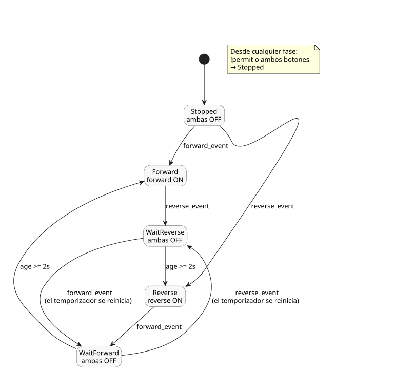

<!-- translation-source: examples/curriculum/pc-04-direction-interlock.ghost.en.md -->
[Original en inglés](pc-04-direction-interlock.ghost.en.md)
> Traducción de lectura. Para compilar, use el archivo original en coreano [`pc-04-direction-interlock.ghost.md`](pc-04-direction-interlock.ghost.md).

# PC-04 — Enclavamiento de cambio de sentido directo/inverso

<!-- ghostflow:anchor id=GF-INT-PC04-DIRECTION-INTERLOCK-V1 kind=intent status=confirmed origin=imported -->
> Escenario de aprendizaje: un escenario de aprendizaje basado en la etapa de giro
> directo/inverso del currículo de reemplazo de PLC del usuario. Este documento no
> es una cita directa del usuario.

El original en coreano enlazado es la única fuente canónica, literate y ejecutable
de PC-04. Conserva la lección existente
[E06 DirectionInterlock](../../docs/ProgrammingInGhostflow.es.md#e06--solicitar-ambos-sentidos-a-la-vez)
y hace referencia a ella; esa lección muestra una pequeña restricción de seguridad
que bloquea las solicitudes simultáneas de salida. Esta lección se basa en E06 y
hace explícitas tres cosas: un evento de arranque nuevo, un estado detenido y una
espera antes de cambiar de sentido.

Las entradas y salidas son:

- `forward_start` y `reverse_start` son entradas momentáneas: valen `true` mientras
  el pulsador está presionado.
- `stop_ok` y `overload_ok` son entradas normalizadas: valen `true` cuando la ruta
  de parada y la protección contra sobrecarga, respectivamente, permiten la
  operación.
- `forward_contactor` y `reverse_contactor` son órdenes lógicas a las bobinas de los
  contactores de giro directo e inverso, no evidencia de que el motor gire realmente.

Esta revisión explícita de entradas con calidad mantiene sin cambios la reproducción
(replay) con entradas sanas. Para los fallos de adquisición:

- Una solicitud START no disponible no puede arrancar ni rearmar el control. Una
  marcha existente puede continuar mientras STOP y la protección sigan sanos y
  permitan la operación.
- Una entrada STOP o de protección no disponible retira el permiso.
- Tras la recuperación, se requiere una liberación sana de START seguida de una
  nueva solicitud START.

La fuente anterior se conserva como historial no ejecutable en
`tests/fixtures/history/issue531/pc-04-direction-interlock.ghost.en.md.pre-input.txt`.

```ghost
// Source revision: issue531-approved-fault-restart-v1
control DirectionChangeInterlock {
  input forward_start, reverse_start, stop_ok, overload_ok: Bool;
  output forward_contactor, reverse_contactor: Bool;

  let reversal_wait = 2s;

  type Phase = Stopped | Forward | Reverse | WaitForward | WaitReverse;
  // ghostflow:link id=GF-INT-PC04-DIRECTION-INTERLOCK-V1 relation=implements
  state phase: Phase = Stopped;
  // ghostflow:link id=GF-INT-PC04-DIRECTION-INTERLOCK-V1 relation=implements
  state start_armed: Bool = false;
  // ghostflow:link id=GF-INT-PC04-DIRECTION-INTERLOCK-V1 relation=implements
  timer age = elapsed(phase);

  let forward_start_good = case forward_start { ok(_) => true; fault(_) => false; };
  let forward_start_value = forward_start |> recover(false);
  let reverse_start_good = case reverse_start { ok(_) => true; fault(_) => false; };
  let reverse_start_value = reverse_start |> recover(false);
  let stop_ok_good = case stop_ok { ok(_) => true; fault(_) => false; };
  let stop_ok_value = stop_ok |> recover(false);
  let overload_ok_good = case overload_ok { ok(_) => true; fault(_) => false; };
  let overload_ok_value = overload_ok |> recover(false);

  let permit = stop_ok_value && overload_ok_value;
  let requests_good = forward_start_good && reverse_start_good;
  let ambiguous = forward_start_value && reverse_start_value;
  let forward_event = requests_good && start_armed && forward_start_value && !reverse_start_value;
  let reverse_event = requests_good && start_armed && reverse_start_value && !forward_start_value;

  start_armed' = requests_good && permit && !forward_start_value && !reverse_start_value;

  phase' = case phase {
    Stopped =>
      if !permit || ambiguous then Stopped
      else if forward_event then Forward
      else if reverse_event then Reverse
      else Stopped;

    Forward =>
      if !permit || ambiguous then Stopped
      else if reverse_event then WaitReverse
      else Forward;

    Reverse =>
      if !permit || ambiguous then Stopped
      else if forward_event then WaitForward
      else Reverse;

    WaitForward =>
      if !permit || ambiguous then Stopped
      else if reverse_event then WaitReverse
      else if age >= reversal_wait then Forward
      else WaitForward;

    WaitReverse =>
      if !permit || ambiguous then Stopped
      else if forward_event then WaitForward
      else if age >= reversal_wait then Reverse
      else WaitReverse;
  };

  forward_contactor <- phase' == Forward;
  reverse_contactor <- phase' == Reverse;
  mutex(forward_contactor, reverse_contactor);
}
```

El diagrama de estados siguiente muestra las cinco fases y los eventos que hacen
pasar de una a otra. Una orden de contactor está en ON solo en `Forward` o `Reverse`.



Durante la operación normal, una nueva pulsación del botón opuesto lleva el control
a `WaitForward` o `WaitReverse`. Como `phase'` es una fase de espera en esa
transición, ambas órdenes de contactor se apagan de inmediato, en el mismo tick. El
sentido opuesto solo se ordena después de dos segundos de espera. Reglas durante la
espera:

- Seguir manteniendo pulsado el mismo botón de sentido no es un nuevo evento de
  cambio de sentido.
- Pulsar ambos botones a la vez, o perder el permiso de parada/sobrecarga, cancela
  la espera y vuelve a `Stopped`.
- Si el operador pulsa el botón opuesto durante la espera y vuelve a cambiar el
  sentido objetivo, el control entra en la fase Wait correspondiente y reinicia el
  retardo completo de dos segundos. Nunca puede arrancar tarde hacia el objetivo
  anterior.

`mutex` es una salvaguarda de seguridad por software. Una instalación real también
necesita enclavamientos eléctricos y mecánicos entre los contactores de giro directo
e inverso. La espera de dos segundos no demuestra que el motor se haya detenido, y
este ejemplo de aprendizaje no tiene ninguna entrada de retroalimentación de
velocidad cero. Por lo tanto, un PASS del verificador solo significa que coincide la
traza virtual/compilador/WASM de las órdenes a las bobinas de los contactores. No es
una aceptación física del cierre de contactos, de la aplicación de potencia ni de la
rotación del motor.

`tools/check-pc-04.mjs` crea un runtime WASM nuevo para cada caso y no recompila el
artefacto WASM existente. Con trazas reales del compilador/WASM, verifica:

- el bloqueo y el rearme ante solicitudes simultáneas;
- la autorretención normal;
- ambas salidas en OFF inmediatamente después de un cambio de sentido;
- que todavía espera a los 1999 ms;
- el sentido opuesto en ON exactamente a los 2000 ms;
- la cancelación por parada/sobrecarga durante la espera;
- un cambio de objetivo durante la espera, con el retardo reiniciado.
