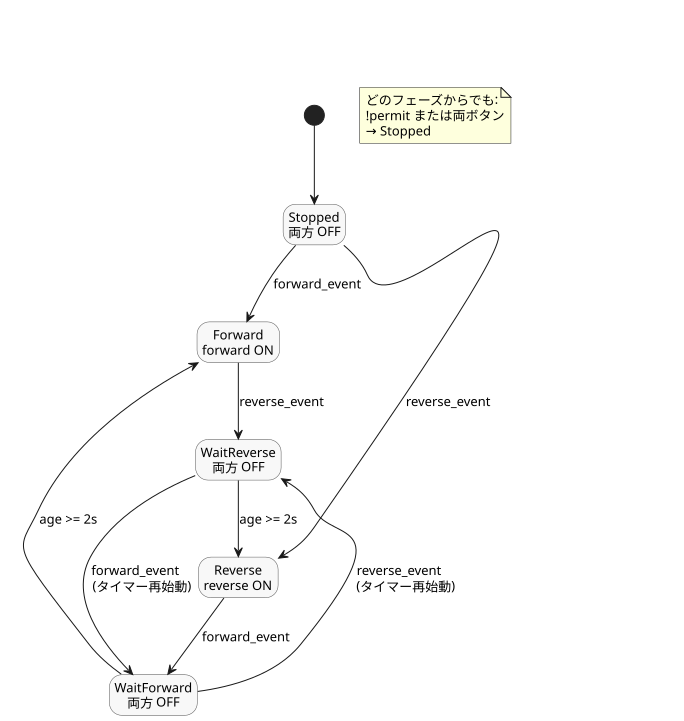

<!-- translation-source: examples/curriculum/pc-04-direction-interlock.ghost.en.md -->
[英語の原文](pc-04-direction-interlock.ghost.en.md)
> 閲覧用の翻訳です。コンパイルには、リンク先の韓国語の原本 [`pc-04-direction-interlock.ghost.md`](pc-04-direction-interlock.ghost.md) を使用してください。

# PC-04 — 正転/逆転の方向転換インターロック

<!-- ghostflow:anchor id=GF-INT-PC04-DIRECTION-INTERLOCK-V1 kind=intent status=confirmed origin=imported -->
> 学習シナリオ：ユーザーの PLC 置き換えカリキュラムにおける正転/逆転の段階に基づく学習シナリオ。この文書はユーザーの発言を直接引用したものではない。

リンク先の韓国語の原本が、PC-04 の唯一の正本となる、文芸的で実行可能なソースです。既存のレッスン [E06 DirectionInterlock](../../docs/ProgrammingInGhostflow.ja.md#e06--両方向を同時に要求する) をそのまま残して参照します。E06 は、同時の出力要求をブロックする小さな安全制約を示しています。このレッスンは E06 を土台に、新たな起動イベント、停止状態、方向転換前の待機という 3 点を明示します。

入力と出力は次のとおりです。

- `forward_start` と `reverse_start` はモーメンタリ入力で、ボタンが押されている間 `true` になります。
- `stop_ok` と `overload_ok` は正規化された入力で、それぞれ停止経路と過負荷保護が運転を許可しているときに `true` になります。
- `forward_contactor` と `reverse_contactor` は、正転用と逆転用の接触器コイルへの論理コマンドであり、モーターが実際に回転していることの証拠ではありません。

この入力品質を明示するリビジョンでは、正常入力のリプレイは変わりません。取得故障については次のとおりです。

- 利用できない START 要求は、`control` を起動することも再アームすることもできません。STOP と保護が正常で運転を許可している間は、既存の運転は継続できます。
- 利用できない STOP 入力または保護入力は、許可を取り除きます。
- 復旧後は、正常な START の解放と、それに続く新たな START 要求が必要です。

以前のソースは、実行不可能な履歴として `tests/fixtures/history/issue531/pc-04-direction-interlock.ghost.en.md.pre-input.txt` に保存されています。

```ghost
// Source revision: issue531-approved-fault-restart-v1
control DirectionChangeInterlock {
  input forward_start, reverse_start, stop_ok, overload_ok: Bool;
  output forward_contactor, reverse_contactor: Bool;

  let reversal_wait = 2s;

  type Phase = Stopped | Forward | Reverse | WaitForward | WaitReverse;
  // ghostflow:link id=GF-INT-PC04-DIRECTION-INTERLOCK-V1 relation=implements
  state phase: Phase = Stopped;
  // ghostflow:link id=GF-INT-PC04-DIRECTION-INTERLOCK-V1 relation=implements
  state start_armed: Bool = false;
  // ghostflow:link id=GF-INT-PC04-DIRECTION-INTERLOCK-V1 relation=implements
  timer age = elapsed(phase);

  let forward_start_good = case forward_start { ok(_) => true; fault(_) => false; };
  let forward_start_value = forward_start |> recover(false);
  let reverse_start_good = case reverse_start { ok(_) => true; fault(_) => false; };
  let reverse_start_value = reverse_start |> recover(false);
  let stop_ok_good = case stop_ok { ok(_) => true; fault(_) => false; };
  let stop_ok_value = stop_ok |> recover(false);
  let overload_ok_good = case overload_ok { ok(_) => true; fault(_) => false; };
  let overload_ok_value = overload_ok |> recover(false);

  let permit = stop_ok_value && overload_ok_value;
  let requests_good = forward_start_good && reverse_start_good;
  let ambiguous = forward_start_value && reverse_start_value;
  let forward_event = requests_good && start_armed && forward_start_value && !reverse_start_value;
  let reverse_event = requests_good && start_armed && reverse_start_value && !forward_start_value;

  start_armed' = requests_good && permit && !forward_start_value && !reverse_start_value;

  phase' = case phase {
    Stopped =>
      if !permit || ambiguous then Stopped
      else if forward_event then Forward
      else if reverse_event then Reverse
      else Stopped;

    Forward =>
      if !permit || ambiguous then Stopped
      else if reverse_event then WaitReverse
      else Forward;

    Reverse =>
      if !permit || ambiguous then Stopped
      else if forward_event then WaitForward
      else Reverse;

    WaitForward =>
      if !permit || ambiguous then Stopped
      else if reverse_event then WaitReverse
      else if age >= reversal_wait then Forward
      else WaitForward;

    WaitReverse =>
      if !permit || ambiguous then Stopped
      else if forward_event then WaitForward
      else if age >= reversal_wait then Reverse
      else WaitReverse;
  };

  forward_contactor <- phase' == Forward;
  reverse_contactor <- phase' == Reverse;
  mutex(forward_contactor, reverse_contactor);
}
```

下の状態図は、5 つのフェーズと、その間を移動させるイベントを示しています。接触器コマンドが ON になるのは `Forward` または `Reverse` のときだけです。



通常運転中に反対方向のボタンを新たに押すと、`control` は `WaitForward` または `WaitReverse` に移ります。その遷移では `phase'` が待機フェーズになるため、両方の接触器コマンドは同じ tick でただちにオフになります。反対方向がコマンドされるのは、2 秒間待機した後だけです。待機中のルール：

- 同じ方向のボタンを押し続けても、新たな方向転換イベントにはなりません。
- 両方のボタンを同時に押すか、停止/過負荷の許可を失うと、待機は取り消され `Stopped` に戻ります。
- 待機中にオペレーターが反対方向のボタンを押して目標方向を再び変えると、`control` は対応する Wait フェーズに入り、2 秒間の遅延を最初からやり直します。古い目標方向に向けて遅れて起動することは決してありません。

`mutex` はソフトウェアによる安全上のバックストップです。実際の設備では、正転と逆転の接触器の間に電気的および機械的なインターロックも必要です。2 秒間の待機はモーターが停止したことを証明するものではなく、この学習例にはゼロ速度のフィードバック入力もありません。したがって、チェッカーの PASS が意味するのは、接触器コイルコマンドの仮想/コンパイラ/WASM トレースが一致することだけです。接点の閉路、電力の印加、モーターの回転についての物理的な受け入れ検査ではありません。

`tools/check-pc-04.mjs` は、ケースごとに新しい WASM ランタイムを作成し、既存の WASM アーティファクトは再ビルドしません。実際のコンパイラ/WASM トレースを使って、次の点を検査します。

- 同時要求に対するブロックと再アーム
- 通常の自己保持
- 方向転換直後に両方の出力が OFF になること
- 1999 ms ではまだ待機中であること
- ちょうど 2000 ms で反対方向が ON になること
- 待機中の停止/過負荷による取り消し
- 待機中の目標変更と、それに伴う遅延のやり直し
