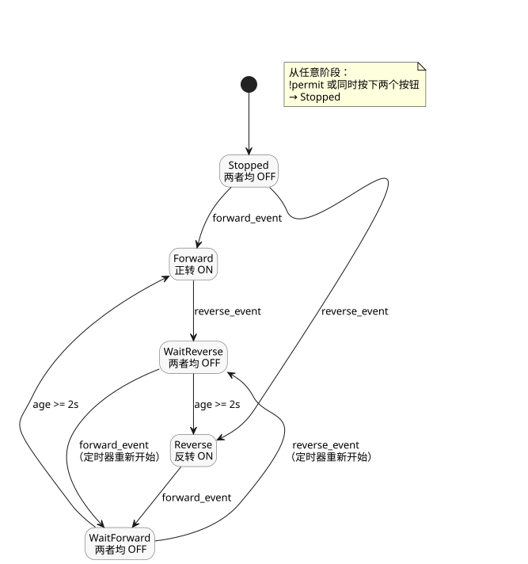

<!-- translation-source: examples/curriculum/pc-04-direction-interlock.ghost.en.md -->
[英文原文](pc-04-direction-interlock.ghost.en.md)
> 本文为阅读用译本。编译时请使用原始文件 `pc-04-direction-interlock.ghost.md`（韩文原文）。

# PC-04 — 正反转换向互锁

<!-- ghostflow:anchor id=GF-INT-PC04-DIRECTION-INTERLOCK-V1 kind=intent status=confirmed origin=imported -->
> 学习场景：基于用户 PLC 替换课程中正反转阶段的学习场景。本文档并非直接引用用户的话。

链接的韩文原文是 PC-04 唯一的规范、文学式、可执行源。它保留并引用现有课程 [E06 DirectionInterlock](../../docs/ProgrammingInGhostflow.zh.md#e06--同时请求两个方向)，该课程展示了一个阻止同时输出请求的小型安全约束。本课程以 E06 为基础，显式地表达了三件事：新的启动事件、停止状态，以及换向前的等待。

输入和输出如下：

- `forward_start` 和 `reverse_start` 是瞬时输入：按钮被按下期间为 `true`。
- `stop_ok` 和 `overload_ok` 是归一化输入：分别在停止路径和过载保护允许运行时为 `true`。
- `forward_contactor` 和 `reverse_contactor` 是发送给正转和反转接触器线圈的逻辑命令，而不是电机实际转动的证据。

这个显式的质量输入修订版保持健康输入的重放结果不变。对于采集故障：

- 不可用的 START 请求不能启动 `control`，也不能使其重新就绪。只要 STOP 和保护保持健康并允许运行，已有的运行就可以继续。
- 不可用的 STOP 或保护输入会撤销许可。
- 恢复之后，需要先有一次健康的 START 松开，再有一次新的 START 请求。

之前的源作为不可执行的历史记录保存在
`tests/fixtures/history/issue531/pc-04-direction-interlock.ghost.en.md.pre-input.txt`。

```ghost
// Source revision: issue531-approved-fault-restart-v1
control DirectionChangeInterlock {
  input forward_start, reverse_start, stop_ok, overload_ok: Bool;
  output forward_contactor, reverse_contactor: Bool;

  let reversal_wait = 2s;

  type Phase = Stopped | Forward | Reverse | WaitForward | WaitReverse;
  // ghostflow:link id=GF-INT-PC04-DIRECTION-INTERLOCK-V1 relation=implements
  state phase: Phase = Stopped;
  // ghostflow:link id=GF-INT-PC04-DIRECTION-INTERLOCK-V1 relation=implements
  state start_armed: Bool = false;
  // ghostflow:link id=GF-INT-PC04-DIRECTION-INTERLOCK-V1 relation=implements
  timer age = elapsed(phase);

  let forward_start_good = case forward_start { ok(_) => true; fault(_) => false; };
  let forward_start_value = forward_start |> recover(false);
  let reverse_start_good = case reverse_start { ok(_) => true; fault(_) => false; };
  let reverse_start_value = reverse_start |> recover(false);
  let stop_ok_good = case stop_ok { ok(_) => true; fault(_) => false; };
  let stop_ok_value = stop_ok |> recover(false);
  let overload_ok_good = case overload_ok { ok(_) => true; fault(_) => false; };
  let overload_ok_value = overload_ok |> recover(false);

  let permit = stop_ok_value && overload_ok_value;
  let requests_good = forward_start_good && reverse_start_good;
  let ambiguous = forward_start_value && reverse_start_value;
  let forward_event = requests_good && start_armed && forward_start_value && !reverse_start_value;
  let reverse_event = requests_good && start_armed && reverse_start_value && !forward_start_value;

  start_armed' = requests_good && permit && !forward_start_value && !reverse_start_value;

  phase' = case phase {
    Stopped =>
      if !permit || ambiguous then Stopped
      else if forward_event then Forward
      else if reverse_event then Reverse
      else Stopped;

    Forward =>
      if !permit || ambiguous then Stopped
      else if reverse_event then WaitReverse
      else Forward;

    Reverse =>
      if !permit || ambiguous then Stopped
      else if forward_event then WaitForward
      else Reverse;

    WaitForward =>
      if !permit || ambiguous then Stopped
      else if reverse_event then WaitReverse
      else if age >= reversal_wait then Forward
      else WaitForward;

    WaitReverse =>
      if !permit || ambiguous then Stopped
      else if forward_event then WaitForward
      else if age >= reversal_wait then Reverse
      else WaitReverse;
  };

  forward_contactor <- phase' == Forward;
  reverse_contactor <- phase' == Reverse;
  mutex(forward_contactor, reverse_contactor);
}
```

下面的状态图展示了五个阶段以及在它们之间切换的事件。只有在 `Forward` 或 `Reverse` 中，接触器命令才为 ON。



正常运行期间，再次按下反方向按钮会使 `control` 进入 `WaitForward` 或 `WaitReverse`。由于在该转换中 `phase'` 是等待阶段，两个接触器命令会在同一个 tick 中立即关闭。只有等待两秒之后，才会命令反方向运行。等待期间的规则：

- 继续按住同一方向按钮不是新的换向事件。
- 同时按下两个按钮，或失去停止/过载许可，会取消等待并返回 `Stopped`。
- 如果操作员在等待期间按下反方向按钮、再次改变目标方向，`control` 会进入相应的 Wait 阶段，并重新开始完整的两秒延时。它绝不会朝旧目标延迟启动。

`mutex` 是软件层面的安全兜底。实际设施还需要在正转和反转接触器之间设置电气和机械互锁。两秒等待并不能证明电机已经停止，并且这个学习示例没有零速反馈输入。因此，检查器 PASS 仅表示接触器线圈命令的虚拟/编译器/WASM 追踪一致。它并不是对触点闭合、通电或电机转动的物理验收。

`tools/check-pc-04.mjs` 为每个用例创建一个全新的 WASM 运行时，并且不会重新构建现有的 WASM 构件。它使用实际的编译器/WASM 追踪检查：

- 同时请求时的阻止与重新就绪；
- 正常自锁；
- 换向后两个输出立即 OFF；
- 1999 ms 时仍在等待；
- 恰好 2000 ms 时反方向 ON；
- 等待期间的停止/过载取消；
- 等待期间改变目标并重新开始延时。
