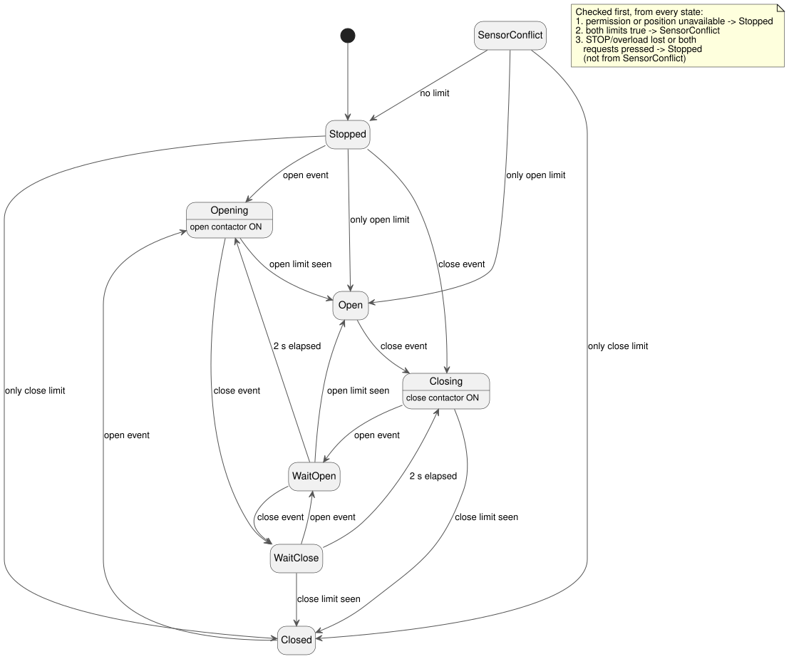

<!-- translation-source: examples/curriculum/pc-05-limit-feedback.ghost.md -->
[Korean original](pc-05-limit-feedback.ghost.md)
> Reading translation. Compile the linked original `.ghost.md` file.

# PC-05 — Limit feedback and valve direction changes

<!-- ghostflow:anchor id=GF-INT-PC05-LIMIT-FEEDBACK-V1 kind=intent status=confirmed origin=imported -->
> Learning scenario: based on the limit-switch stage of a user-supplied
> PLC-replacement curriculum. This document is not a direct quote of the user.

**What this lesson adds.** The linked Korean `.ghost.md` file is the only
canonical, executable literate source for PC-05. It keeps and builds on two
earlier lessons:

- [E06 DirectionInterlock](../../docs/ProgrammingInGhostflow.en.md#e06--requesting-both-directions-at-once):
  `mutex` blocks the two direction outputs from being on at the same time.
- [PC-04 direction-change interlock](./pc-04-direction-interlock.ghost.en.md):
  a wait state stops the motor from reversing straight into the opposite direction.

This lesson adds the valve's **actual end positions**, as reported by limit
switches.

**Inputs and outputs.**

| Name | Kind | Meaning |
| --- | --- | --- |
| `open_request`, `close_request` | Momentary request | True only while the button is held. |
| `open_limit`, `close_limit` | End-position observation (normalized) | True means the valve has reached the open end or the closed end. |
| `stop_ok`, `overload_ok` | Permission | Both must be healthy and true for the valve to move. |
| `valve_open_contactor`, `valve_close_contactor` | Output | Logical commands to the open and close contactor coils. |

An output being on is a command, not proof that the valve moved.

**Input quality.** Every input arrives with a quality from its producer:
`ok(value)` when the reading is available, `fault(_)` when it is not. This
revision treats "unavailable" differently from a healthy `false`:

- If permission or a position input is explicitly unavailable, the phase is `Stopped`.
- Only two **healthy** limits that are both true mean `SensorConflict`.
- Request quality guards the existing release/re-arm logic: a request counts
  only when both request inputs are available.
- Healthy button values are never used to guess at physical faults, and no new
  START input is added.

The previous version of this source is kept at
`tests/fixtures/history/issue531/pc-05-limit-feedback.ghost.en.md.pre-input.txt`.

```ghost
// Source revision: issue531-producer-quality-pc05-v1
control LimitFeedbackValve {
  input open_request, close_request, open_limit, close_limit, stop_ok, overload_ok: Bool;
  output valve_open_contactor, valve_close_contactor: Bool;

  let reversal_wait = 2s;

  type Phase = Stopped | Closed | Opening | Open | Closing | WaitOpen | WaitClose | SensorConflict;
  // ghostflow:link id=GF-INT-PC05-LIMIT-FEEDBACK-V1 relation=implements
  state phase: Phase = Stopped;
  // ghostflow:link id=GF-INT-PC05-LIMIT-FEEDBACK-V1 relation=implements
  state request_armed: Bool = false;
  // ghostflow:link id=GF-INT-PC05-LIMIT-FEEDBACK-V1 relation=implements
  timer age = elapsed(phase);

  let requests_good = case open_request { ok(_) => case close_request { ok(_) => true; fault(_) => false; }; fault(_) => false; };
  let open_requested = open_request |> recover(false);
  let close_requested = close_request |> recover(false);
  let permission_good = case stop_ok { ok(_) => case overload_ok { ok(_) => true; fault(_) => false; }; fault(_) => false; };
  let permit = (stop_ok |> recover(false)) && (overload_ok |> recover(false));
  let position_known = case open_limit { ok(_) => case close_limit { ok(_) => true; fault(_) => false; }; fault(_) => false; };
  // Fault branch payloads cannot reach a position decision: phase gates position_known first.
  let open_observed = case open_limit { ok(value) => value; fault(_) => false; };
  let close_observed = case close_limit { ok(value) => value; fault(_) => false; };
  let conflict = open_observed && close_observed;
  let known_open = open_observed && !close_observed;
  let known_closed = close_observed && !open_observed;
  let ambiguous = open_requested && close_requested;
  let open_event = requests_good && request_armed && open_requested && !close_requested;
  let close_event = requests_good && request_armed && close_requested && !open_requested;

  request_armed' = requests_good && permission_good && position_known && permit && !conflict && !open_requested && !close_requested;

  phase' = if !permission_good || !position_known then Stopped
    else if conflict then SensorConflict
    else if phase != SensorConflict && (!permit || ambiguous) then Stopped
    else case phase {
    Stopped =>
      if open_event then Opening
      else if close_event then Closing
      else if known_open then Open
      else if known_closed then Closed
      else Stopped;

    Closed =>
      if open_event then Opening
      else if known_closed then Closed
      else if known_open then Open
      else Stopped;

    Opening =>
      if close_event then WaitClose
      else if open_observed then Open
      else Opening;

    Open =>
      if close_event then Closing
      else if known_open then Open
      else if known_closed then Closed
      else Stopped;

    Closing =>
      if open_event then WaitOpen
      else if close_observed then Closed
      else Closing;

    WaitOpen =>
      if close_event then WaitClose
      else if open_observed then Open
      else if age >= reversal_wait then Opening
      else WaitOpen;

    WaitClose =>
      if open_event then WaitOpen
      else if close_observed then Closed
      else if age >= reversal_wait then Closing
      else WaitClose;

    SensorConflict =>
      if known_open then Open
      else if known_closed then Closed
      else Stopped;
  };

  valve_open_contactor <- phase' == Opening;
  valve_close_contactor <- phase' == Closing;
  mutex(valve_open_contactor, valve_close_contactor);
}
```

**How a request becomes an event.** `request_armed` becomes true only on a scan
where everything is healthy and permitted and **neither** button is pressed. An
`open_event` or `close_event` needs `request_armed` from the previous scan plus
exactly one pressed button. So each press is counted once; to issue another
request, the operator must release both buttons first.

The diagram below shows the main phase transitions. The note lists the checks
that run first, from every state.



**Safety checks that win everywhere.** If both end positions are true, in any
state, `SensorConflict` takes priority and both outputs turn off. Loss of
permission, or both requests at once, selects `Stopped` and also turns the
outputs off.

**Starting from an unknown position.** The control starts in `Stopped`. It does
not invent a physical position. It moves to `Open` or `Closed` only after
exactly one end position is observed. If the matching limit disappears while the
valve rests at an end, the control returns to `Stopped` instead of trusting its
old state. If only the opposite limit is observed, the end state is corrected to
match that physical observation.

**Reversing while moving.** While moving, the valve stops in `Open` or `Closed`
when the target end position is observed. If a new request for the opposite
direction arrives on the same scan, that request wins over the end position:
the phase enters `WaitOpen` or `WaitClose`, and both commands turn off at once.
Motion resumes only after two full seconds (`reversal_wait`), so the operator's
request is not silently lost. Another opposite request during the wait changes
the target and restarts the full wait.

**Known gap: no timeout.** If an end position never arrives, the control stays
in `Opening` or `Closing` with the command on. This learning example leaves the
timeout out on purpose. It is **not** ready for hardware deployment; PC-10 adds
timeout, fault latch, and reset. `mutex` is only a software backstop. It does not
replace real electrical or mechanical interlocks, or zero-speed or
position-feedback wiring.

**What the checker proves.** `tools/check-pc-05.mjs` creates a fresh WASM
`ControlRuntime` for each case and does not rebuild the existing WASM. Its result
is a compiler/WASM virtual trace. It is not physical evidence of contact
closure, valve movement, or fluid flow.
