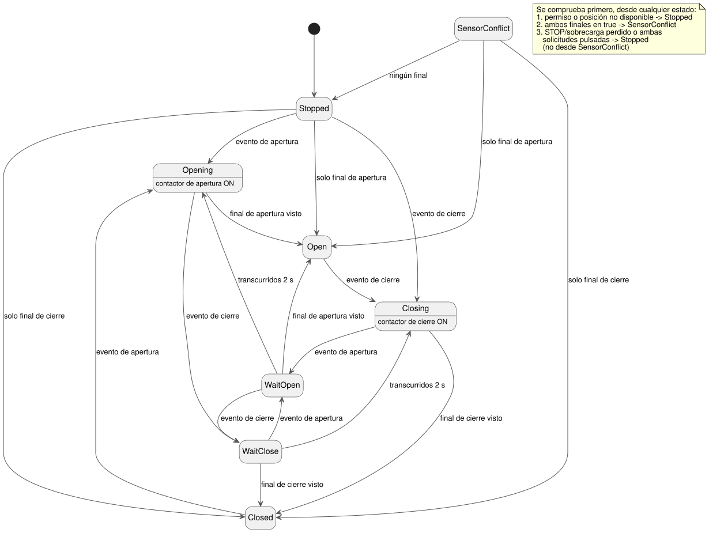

<!-- translation-source: examples/curriculum/pc-05-limit-feedback.ghost.en.md -->
[Original en inglés](pc-05-limit-feedback.ghost.en.md)

> Traducción de lectura. Para compilar, use el archivo original `.ghost.md`
> enlazado: [original en coreano](pc-05-limit-feedback.ghost.md).

# PC-05 — Retroalimentación de final de carrera y cambios de sentido de la válvula

<!-- ghostflow:anchor id=GF-INT-PC05-LIMIT-FEEDBACK-V1 kind=intent status=confirmed origin=imported -->
> Escenario de aprendizaje: basado en la etapa de finales de carrera de un
> currículo de sustitución de PLC aportado por un usuario. Este documento no es
> una cita directa del usuario.

**Qué añade esta lección.** El archivo `.ghost.md` en coreano enlazado es la
única fuente literaria (literate) canónica y ejecutable de PC-05. Conserva y
amplía dos lecciones anteriores:

- [E06 DirectionInterlock](../../docs/ProgrammingInGhostflow.es.md):
  `mutex` impide que las dos salidas de sentido estén activas al mismo tiempo.
- [Enclavamiento de cambio de sentido de PC-04](./pc-04-direction-interlock.ghost.es.md):
  un estado de espera impide que el motor invierta directamente al sentido contrario.

Esta lección añade las **posiciones finales reales** de la válvula, tal como las
informan los finales de carrera.

**Entradas y salidas.**

| Nombre | Tipo | Significado |
| --- | --- | --- |
| `open_request`, `close_request` | Solicitud momentánea | Es true solo mientras se mantiene pulsado el botón. |
| `open_limit`, `close_limit` | Observación de posición final (normalizada) | true significa que la válvula ha llegado al extremo abierto o al extremo cerrado. |
| `stop_ok`, `overload_ok` | Permiso | Ambas deben estar sanas y en true para que la válvula se mueva. |
| `valve_open_contactor`, `valve_close_contactor` | Salida | Comandos lógicos a las bobinas de los contactores de apertura y de cierre. |

Que una salida esté activa es un comando, no una prueba de que la válvula se
haya movido.

**Calidad de las entradas.** Cada entrada llega con una calidad asignada por su
productor: `ok(value)` cuando la lectura está disponible y `fault(_)` cuando no
lo está. Esta revisión trata "no disponible" de forma distinta a un `false`
sano:

- Si el permiso o una entrada de posición no está disponible de forma explícita, la fase es `Stopped`.
- Solo dos finales de carrera **sanos** que sean ambos true significan `SensorConflict`.
- La calidad de las solicitudes protege la lógica existente de liberación y
  rearme: una solicitud cuenta solo cuando ambas entradas de solicitud están
  disponibles.
- Los valores sanos de los botones nunca se usan para adivinar fallos físicos, y
  no se añade ninguna entrada START nueva.

La versión anterior de esta fuente se conserva en
`tests/fixtures/history/issue531/pc-05-limit-feedback.ghost.en.md.pre-input.txt`.

```ghost
// Source revision: issue531-producer-quality-pc05-v1
control LimitFeedbackValve {
  input open_request, close_request, open_limit, close_limit, stop_ok, overload_ok: Bool;
  output valve_open_contactor, valve_close_contactor: Bool;

  let reversal_wait = 2s;

  type Phase = Stopped | Closed | Opening | Open | Closing | WaitOpen | WaitClose | SensorConflict;
  // ghostflow:link id=GF-INT-PC05-LIMIT-FEEDBACK-V1 relation=implements
  state phase: Phase = Stopped;
  // ghostflow:link id=GF-INT-PC05-LIMIT-FEEDBACK-V1 relation=implements
  state request_armed: Bool = false;
  // ghostflow:link id=GF-INT-PC05-LIMIT-FEEDBACK-V1 relation=implements
  timer age = elapsed(phase);

  let requests_good = case open_request { ok(_) => case close_request { ok(_) => true; fault(_) => false; }; fault(_) => false; };
  let open_requested = open_request |> recover(false);
  let close_requested = close_request |> recover(false);
  let permission_good = case stop_ok { ok(_) => case overload_ok { ok(_) => true; fault(_) => false; }; fault(_) => false; };
  let permit = (stop_ok |> recover(false)) && (overload_ok |> recover(false));
  let position_known = case open_limit { ok(_) => case close_limit { ok(_) => true; fault(_) => false; }; fault(_) => false; };
  // Fault branch payloads cannot reach a position decision: phase gates position_known first.
  let open_observed = case open_limit { ok(value) => value; fault(_) => false; };
  let close_observed = case close_limit { ok(value) => value; fault(_) => false; };
  let conflict = open_observed && close_observed;
  let known_open = open_observed && !close_observed;
  let known_closed = close_observed && !open_observed;
  let ambiguous = open_requested && close_requested;
  let open_event = requests_good && request_armed && open_requested && !close_requested;
  let close_event = requests_good && request_armed && close_requested && !open_requested;

  request_armed' = requests_good && permission_good && position_known && permit && !conflict && !open_requested && !close_requested;

  phase' = if !permission_good || !position_known then Stopped
    else if conflict then SensorConflict
    else if phase != SensorConflict && (!permit || ambiguous) then Stopped
    else case phase {
    Stopped =>
      if open_event then Opening
      else if close_event then Closing
      else if known_open then Open
      else if known_closed then Closed
      else Stopped;

    Closed =>
      if open_event then Opening
      else if known_closed then Closed
      else if known_open then Open
      else Stopped;

    Opening =>
      if close_event then WaitClose
      else if open_observed then Open
      else Opening;

    Open =>
      if close_event then Closing
      else if known_open then Open
      else if known_closed then Closed
      else Stopped;

    Closing =>
      if open_event then WaitOpen
      else if close_observed then Closed
      else Closing;

    WaitOpen =>
      if close_event then WaitClose
      else if open_observed then Open
      else if age >= reversal_wait then Opening
      else WaitOpen;

    WaitClose =>
      if open_event then WaitOpen
      else if close_observed then Closed
      else if age >= reversal_wait then Closing
      else WaitClose;

    SensorConflict =>
      if known_open then Open
      else if known_closed then Closed
      else Stopped;
  };

  valve_open_contactor <- phase' == Opening;
  valve_close_contactor <- phase' == Closing;
  mutex(valve_open_contactor, valve_close_contactor);
}
```

**Cómo una solicitud se convierte en un evento.** `request_armed` se vuelve true
solo en un escaneo en el que todo está sano y permitido y **ninguno** de los dos
botones está pulsado. Un `open_event` o un `close_event` necesita
`request_armed` del escaneo anterior más exactamente un botón pulsado. Así, cada
pulsación se cuenta una sola vez; para emitir otra solicitud, el operador debe
soltar primero ambos botones.

El diagrama siguiente muestra las principales transiciones de fase. La nota
enumera las comprobaciones que se ejecutan primero, desde cualquier estado.



**Comprobaciones de seguridad que prevalecen en todas partes.** Si ambas
posiciones finales son true, en cualquier estado, `SensorConflict` tiene
prioridad y ambas salidas se apagan. La pérdida del permiso, o ambas solicitudes
a la vez, selecciona `Stopped` y también apaga las salidas.

**Arranque desde una posición desconocida.** El control arranca en `Stopped`. No
inventa una posición física. Pasa a `Open` o `Closed` solo después de observar
exactamente una posición final. Si el final de carrera correspondiente
desaparece mientras la válvula reposa en un extremo, el control vuelve a
`Stopped` en lugar de confiar en su estado anterior. Si solo se observa el final
de carrera opuesto, el estado final se corrige para coincidir con esa
observación física.

**Inversión durante el movimiento.** Mientras se mueve, la válvula se detiene en
`Open` o `Closed` cuando se observa la posición final de destino. Si en el mismo
escaneo llega una nueva solicitud para el sentido contrario, esa solicitud
prevalece sobre la posición final: la fase entra en `WaitOpen` o `WaitClose`, y
ambos comandos se apagan a la vez. El movimiento se reanuda solo después de dos
segundos completos (`reversal_wait`), de modo que la solicitud del operador no
se pierde en silencio. Otra solicitud opuesta durante la espera cambia el
destino y reinicia la espera completa.

**Limitación conocida: sin timeout.** Si nunca llega una posición final, el
control permanece en `Opening` o `Closing` con el comando activo. Este ejemplo
de aprendizaje omite el timeout a propósito. **No** está listo para desplegarse
en hardware; PC-10 añade timeout, latch de fallo y reinicio. `mutex` es solo un
respaldo de software. No sustituye los enclavamientos eléctricos o mecánicos
reales, ni el cableado de velocidad cero o de retroalimentación de posición.

**Qué demuestra el verificador.** `tools/check-pc-05.mjs` crea un
`ControlRuntime` WASM nuevo para cada caso y no recompila el WASM existente. Su
resultado es una traza virtual del compilador/WASM. No es evidencia física del
cierre de contactos, del movimiento de la válvula ni del flujo del fluido.
