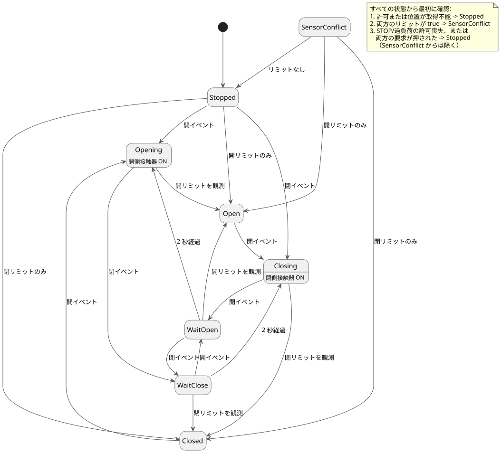

<!-- translation-source: examples/curriculum/pc-05-limit-feedback.ghost.en.md -->
[英語の原文](pc-05-limit-feedback.ghost.en.md)
> 閲覧用の翻訳です。コンパイルには、リンク先の韓国語の原本 [`pc-05-limit-feedback.ghost.md`](pc-05-limit-feedback.ghost.md) を使用してください。

# PC-05 — リミットフィードバックとバルブの方向切替

<!-- ghostflow:anchor id=GF-INT-PC05-LIMIT-FEEDBACK-V1 kind=intent status=confirmed origin=imported -->
> 学習シナリオ：ユーザーが提供した PLC 置き換えカリキュラムのリミットスイッチ段階に基づいています。この文書はユーザーの発言を直接引用したものではありません。

**このレッスンで追加すること。** リンク先の韓国語の `.ghost.md` ファイルが、PC-05 の唯一の正本であり、実行可能な文芸的ソース（literate source）です。このレッスンは、次の 2 つの既存レッスンをそのまま残し、その上に積み上げます。

- [E06 DirectionInterlock](../../docs/ProgrammingInGhostflow.ja.md#e06--両方向を同時に要求する)：`mutex` により、2 つの方向出力が同時にオンになることをブロックします。
- [PC-04 方向転換インターロック](./pc-04-direction-interlock.ghost.ja.md)：待機状態を設けることで、モーターが反対方向へ直接反転するのを防ぎます。

このレッスンでは、リミットスイッチが報告するバルブの**実際の端位置**を追加します。

**入力と出力。**

| 名前 | 種類 | 意味 |
| --- | --- | --- |
| `open_request`, `close_request` | モーメンタリ要求 | ボタンが押されている間だけ true です。 |
| `open_limit`, `close_limit` | 端位置の観測（正規化済み） | true は、バルブが開側または閉側の端に到達したことを意味します。 |
| `stop_ok`, `overload_ok` | 許可 | バルブが動くには、両方が正常で true でなければなりません。 |
| `valve_open_contactor`, `valve_close_contactor` | 出力 | 開側・閉側の接触器コイルへの論理コマンドです。 |

出力がオンであることはコマンドであり、バルブが動いたことの証拠ではありません。

**入力品質。** すべての入力は、それを生成する側（producer）から品質付きで届きます。値が取得できるときは `ok(value)`、取得できないときは `fault(_)` です。このリビジョンでは、「取得不能」を正常な `false` とは区別して扱います。

- 許可または位置の入力が明示的に取得不能な場合、phase は `Stopped` になります。
- `SensorConflict` を意味するのは、**正常な**リミットが 2 つとも true の場合だけです。
- 要求の品質は、既存の解放/再アームのロジックを保護します。要求は、両方の要求入力が取得可能なときにだけ数えられます。
- 正常なボタン値から物理的な故障を推測することは決してなく、新しい START 入力も追加しません。

このソースの以前の版は
`tests/fixtures/history/issue531/pc-05-limit-feedback.ghost.en.md.pre-input.txt` に保存されています。

```ghost
// Source revision: issue531-producer-quality-pc05-v1
control LimitFeedbackValve {
  input open_request, close_request, open_limit, close_limit, stop_ok, overload_ok: Bool;
  output valve_open_contactor, valve_close_contactor: Bool;

  let reversal_wait = 2s;

  type Phase = Stopped | Closed | Opening | Open | Closing | WaitOpen | WaitClose | SensorConflict;
  // ghostflow:link id=GF-INT-PC05-LIMIT-FEEDBACK-V1 relation=implements
  state phase: Phase = Stopped;
  // ghostflow:link id=GF-INT-PC05-LIMIT-FEEDBACK-V1 relation=implements
  state request_armed: Bool = false;
  // ghostflow:link id=GF-INT-PC05-LIMIT-FEEDBACK-V1 relation=implements
  timer age = elapsed(phase);

  let requests_good = case open_request { ok(_) => case close_request { ok(_) => true; fault(_) => false; }; fault(_) => false; };
  let open_requested = open_request |> recover(false);
  let close_requested = close_request |> recover(false);
  let permission_good = case stop_ok { ok(_) => case overload_ok { ok(_) => true; fault(_) => false; }; fault(_) => false; };
  let permit = (stop_ok |> recover(false)) && (overload_ok |> recover(false));
  let position_known = case open_limit { ok(_) => case close_limit { ok(_) => true; fault(_) => false; }; fault(_) => false; };
  // Fault branch payloads cannot reach a position decision: phase gates position_known first.
  let open_observed = case open_limit { ok(value) => value; fault(_) => false; };
  let close_observed = case close_limit { ok(value) => value; fault(_) => false; };
  let conflict = open_observed && close_observed;
  let known_open = open_observed && !close_observed;
  let known_closed = close_observed && !open_observed;
  let ambiguous = open_requested && close_requested;
  let open_event = requests_good && request_armed && open_requested && !close_requested;
  let close_event = requests_good && request_armed && close_requested && !open_requested;

  request_armed' = requests_good && permission_good && position_known && permit && !conflict && !open_requested && !close_requested;

  phase' = if !permission_good || !position_known then Stopped
    else if conflict then SensorConflict
    else if phase != SensorConflict && (!permit || ambiguous) then Stopped
    else case phase {
    Stopped =>
      if open_event then Opening
      else if close_event then Closing
      else if known_open then Open
      else if known_closed then Closed
      else Stopped;

    Closed =>
      if open_event then Opening
      else if known_closed then Closed
      else if known_open then Open
      else Stopped;

    Opening =>
      if close_event then WaitClose
      else if open_observed then Open
      else Opening;

    Open =>
      if close_event then Closing
      else if known_open then Open
      else if known_closed then Closed
      else Stopped;

    Closing =>
      if open_event then WaitOpen
      else if close_observed then Closed
      else Closing;

    WaitOpen =>
      if close_event then WaitClose
      else if open_observed then Open
      else if age >= reversal_wait then Opening
      else WaitOpen;

    WaitClose =>
      if open_event then WaitOpen
      else if close_observed then Closed
      else if age >= reversal_wait then Closing
      else WaitClose;

    SensorConflict =>
      if known_open then Open
      else if known_closed then Closed
      else Stopped;
  };

  valve_open_contactor <- phase' == Opening;
  valve_close_contactor <- phase' == Closing;
  mutex(valve_open_contactor, valve_close_contactor);
}
```

**要求がイベントになるまで。** `request_armed` が true になるのは、すべてが正常かつ許可されていて、**どちらの**ボタンも押されていないスキャンだけです。`open_event` または `close_event` には、前のスキャンの `request_armed` と、ちょうど 1 つの押されたボタンが必要です。そのため、1 回の押下は 1 回だけ数えられます。次の要求を出すには、オペレーターはまず両方のボタンを離さなければなりません。

次の図は、主な phase の遷移を示しています。注記には、すべての状態から最初に実行される確認を列挙しています。



**どこでも優先される安全確認。** どの状態でも、両方の端位置が true なら `SensorConflict` が優先され、両方の出力がオフになります。許可を失った場合、または両方の要求が同時に出た場合は `Stopped` が選ばれ、やはり出力がオフになります。

**位置が不明な状態からの起動。** `control` は `Stopped` から始まります。物理的な位置を勝手に想定することはしません。ちょうど 1 つの端位置が観測されて初めて、`Open` または `Closed` へ移ります。バルブが端で静止している間に対応するリミットが消えた場合、`control` は古い状態を信頼せずに `Stopped` へ戻ります。反対側のリミットだけが観測された場合は、端の状態をその物理的な観測に合わせて修正します。

**移動中の反転。** 移動中のバルブは、目標の端位置が観測されると `Open` または `Closed` で停止します。同じスキャンに反対方向の新しい要求が届いた場合は、その要求が端位置より優先されます。phase は `WaitOpen` または `WaitClose` に入り、両方のコマンドが直ちにオフになります。動作が再開するのは丸 2 秒（`reversal_wait`）経過した後だけなので、オペレーターの要求が黙って失われることはありません。待機中に反対方向の要求がさらに届くと、目標が変わり、待機が最初からやり直しになります。

**既知の制限：タイムアウトなし。** 端位置がいつまでも届かない場合、`control` はコマンドをオンにしたまま `Opening` または `Closing` にとどまります。この学習用の例では、タイムアウトを意図的に省いています。ハードウェアへの導入にはまだ**対応していません**。PC-10 でタイムアウト、故障ラッチ、リセットを追加します。`mutex` はソフトウェア上の最後の防護策にすぎません。実際の電気的・機械的インターロックや、ゼロ速度・位置フィードバックの配線の代わりにはなりません。

**チェッカーが証明すること。** `tools/check-pc-05.mjs` はケースごとに新しい WASM `ControlRuntime` を作成し、既存の WASM を再ビルドしません。その結果はコンパイラ/WASM の仮想トレースです。接点の閉路、バルブの移動、流体の流れの物理的な証拠ではありません。
