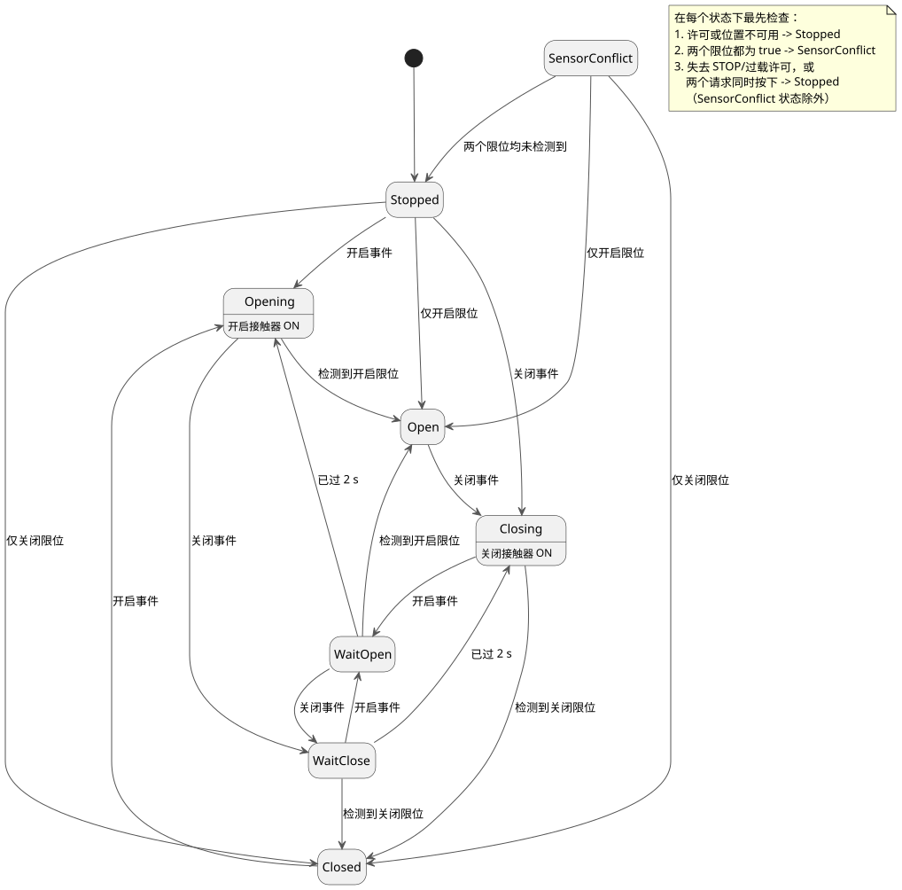

<!-- translation-source: examples/curriculum/pc-05-limit-feedback.ghost.en.md -->
[英文原文](pc-05-limit-feedback.ghost.en.md)
> 本文为阅读用译本。编译时请使用链接的原始 `.ghost.md` 文件：[韩文原文](pc-05-limit-feedback.ghost.md)。

# PC-05 — 限位反馈与阀门换向

<!-- ghostflow:anchor id=GF-INT-PC05-LIMIT-FEEDBACK-V1 kind=intent status=confirmed origin=imported -->
> 学习场景：基于用户提供的 PLC 替换课程中的限位开关阶段。本文档并非直接引用用户的话。

**本课新增内容。** 链接的韩文 `.ghost.md` 文件是 PC-05 唯一的规范、可执行的文学式源文件（literate source）。它保留并扩展了之前的两节课：

- [E06 DirectionInterlock](../../docs/ProgrammingInGhostflow.zh.md#e06--同时请求两个方向)：
  `mutex` 阻止两个方向输出同时为开。
- [PC-04 换向互锁](./pc-04-direction-interlock.ghost.zh.md)：
  等待状态阻止电机直接反转到相反方向。

本课加入由限位开关报告的阀门**实际终端位置**。

**输入和输出。**

| 名称 | 类别 | 含义 |
| --- | --- | --- |
| `open_request`, `close_request` | 瞬时请求 | 仅在按钮被按住期间为 true。 |
| `open_limit`, `close_limit` | 终端位置观测（归一化） | true 表示阀门已到达开启端或关闭端。 |
| `stop_ok`, `overload_ok` | 许可 | 二者都必须健康且为 true，阀门才能动作。 |
| `valve_open_contactor`, `valve_close_contactor` | 输出 | 发送给开启和关闭接触器线圈的逻辑命令。 |

输出为开只是一条命令，并不能证明阀门已经移动。

**输入质量。** 每个输入都带有其生产者给出的质量：读数可用时为 `ok(value)`，不可用时为 `fault(_)`。本修订版将“不可用”与健康的 `false` 区别对待：

- 如果许可或位置输入被明确报告为不可用，阶段为 `Stopped`。
- 只有两个**健康**的限位同时为 true，才表示 `SensorConflict`。
- 请求质量保护现有的松开/重新就绪逻辑：只有当两个请求输入都可用时，请求才会被计入。
- 绝不使用健康的按钮值去推测物理故障，也不新增 START 输入。

本源文件的上一版本保存在
`tests/fixtures/history/issue531/pc-05-limit-feedback.ghost.en.md.pre-input.txt`。

```ghost
// Source revision: issue531-producer-quality-pc05-v1
control LimitFeedbackValve {
  input open_request, close_request, open_limit, close_limit, stop_ok, overload_ok: Bool;
  output valve_open_contactor, valve_close_contactor: Bool;

  let reversal_wait = 2s;

  type Phase = Stopped | Closed | Opening | Open | Closing | WaitOpen | WaitClose | SensorConflict;
  // ghostflow:link id=GF-INT-PC05-LIMIT-FEEDBACK-V1 relation=implements
  state phase: Phase = Stopped;
  // ghostflow:link id=GF-INT-PC05-LIMIT-FEEDBACK-V1 relation=implements
  state request_armed: Bool = false;
  // ghostflow:link id=GF-INT-PC05-LIMIT-FEEDBACK-V1 relation=implements
  timer age = elapsed(phase);

  let requests_good = case open_request { ok(_) => case close_request { ok(_) => true; fault(_) => false; }; fault(_) => false; };
  let open_requested = open_request |> recover(false);
  let close_requested = close_request |> recover(false);
  let permission_good = case stop_ok { ok(_) => case overload_ok { ok(_) => true; fault(_) => false; }; fault(_) => false; };
  let permit = (stop_ok |> recover(false)) && (overload_ok |> recover(false));
  let position_known = case open_limit { ok(_) => case close_limit { ok(_) => true; fault(_) => false; }; fault(_) => false; };
  // Fault branch payloads cannot reach a position decision: phase gates position_known first.
  let open_observed = case open_limit { ok(value) => value; fault(_) => false; };
  let close_observed = case close_limit { ok(value) => value; fault(_) => false; };
  let conflict = open_observed && close_observed;
  let known_open = open_observed && !close_observed;
  let known_closed = close_observed && !open_observed;
  let ambiguous = open_requested && close_requested;
  let open_event = requests_good && request_armed && open_requested && !close_requested;
  let close_event = requests_good && request_armed && close_requested && !open_requested;

  request_armed' = requests_good && permission_good && position_known && permit && !conflict && !open_requested && !close_requested;

  phase' = if !permission_good || !position_known then Stopped
    else if conflict then SensorConflict
    else if phase != SensorConflict && (!permit || ambiguous) then Stopped
    else case phase {
    Stopped =>
      if open_event then Opening
      else if close_event then Closing
      else if known_open then Open
      else if known_closed then Closed
      else Stopped;

    Closed =>
      if open_event then Opening
      else if known_closed then Closed
      else if known_open then Open
      else Stopped;

    Opening =>
      if close_event then WaitClose
      else if open_observed then Open
      else Opening;

    Open =>
      if close_event then Closing
      else if known_open then Open
      else if known_closed then Closed
      else Stopped;

    Closing =>
      if open_event then WaitOpen
      else if close_observed then Closed
      else Closing;

    WaitOpen =>
      if close_event then WaitClose
      else if open_observed then Open
      else if age >= reversal_wait then Opening
      else WaitOpen;

    WaitClose =>
      if open_event then WaitOpen
      else if close_observed then Closed
      else if age >= reversal_wait then Closing
      else WaitClose;

    SensorConflict =>
      if known_open then Open
      else if known_closed then Closed
      else Stopped;
  };

  valve_open_contactor <- phase' == Opening;
  valve_close_contactor <- phase' == Closing;
  mutex(valve_open_contactor, valve_close_contactor);
}
```

**请求如何成为事件。** 只有在一切健康且被允许、并且两个按钮**都没有**按下的扫描中，`request_armed` 才会变为 true。`open_event` 或 `close_event` 需要上一次扫描的 `request_armed`，再加上恰好一个被按下的按钮。因此每次按下只计一次；要发出下一个请求，操作员必须先松开两个按钮。

下图展示主要的阶段转换。注释列出了在每个状态下都最先执行的检查。



**在任何状态下都优先的安全检查。** 在任何状态下，只要两个终端位置都为 true，`SensorConflict` 就优先生效，两个输出都关闭。失去许可，或同时出现两个请求，会选择 `Stopped`，同样关闭输出。

**从未知位置启动。** `control` 从 `Stopped` 开始。它不会臆造物理位置。只有在恰好观测到一个终端位置之后，它才进入 `Open` 或 `Closed`。如果阀门停在某一端时对应的限位消失，`control` 会回到 `Stopped`，而不是信任旧状态。如果只观测到相反一侧的限位，终端状态会被修正为与该物理观测一致。

**运动中换向。** 运动过程中，观测到目标终端位置时，阀门停在 `Open` 或 `Closed`。如果在同一次扫描中到达一个相反方向的新请求，该请求优先于终端位置：阶段进入 `WaitOpen` 或 `WaitClose`，两个命令立即关闭。只有在整整两秒（`reversal_wait`）之后才恢复运动，因此操作员的请求不会被悄悄丢弃。等待期间再出现相反方向的请求，会改变目标并重新开始完整的等待。

**已知缺口：没有超时。** 如果终端位置始终没有到达，`control` 会停留在 `Opening` 或 `Closing`，命令保持开启。这个学习示例有意省略了超时。它**尚不能**用于硬件部署；PC-10 加入了超时、故障锁存和复位。`mutex` 只是软件层面的最后防线。它不能取代真实的电气或机械互锁，也不能取代零速或位置反馈接线。

**检查器能证明什么。** `tools/check-pc-05.mjs` 为每个用例创建一个新的 WASM `ControlRuntime`，不会重新构建现有的 WASM。其结果是编译器/WASM 的虚拟追踪，而不是触点闭合、阀门移动或流体流动的物理证据。
