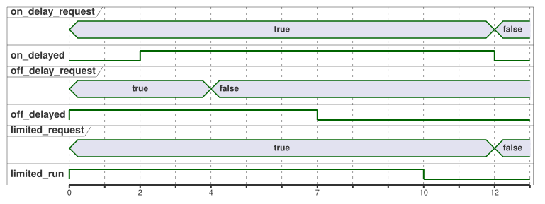

<!-- translation-source: examples/curriculum/pc-06-timer-patterns.ghost.md -->
[Korean original](pc-06-timer-patterns.ghost.md)
> Reading translation. Compile the linked original `.ghost.md` file.

# PC-06 — Maintained requests and independent timer patterns

<!-- ghostflow:anchor id=GF-INT-PC06-INDEPENDENT-TIMERS-V1 kind=intent status=confirmed origin=imported -->
> Learning scenario: learn how to combine delayed ON, delayed OFF, and a maximum
> run time in one control cabinet. The example separates a maintained demand,
> which is read again on every scan, from a momentary START event, which starts
> from a single button change.

**What this lesson adds.** The linked Korean `.ghost.md` file is the only
canonical, executable literate source for PC-06. It keeps and builds on:

- [E08 DelayedStart](../../docs/ProgrammingInGhostflow.en.md#e08--turning-on-after-an-input-persists-for-two-seconds),
  which introduces a single state and `elapsed(phase)`;
- [tutorial/02-watering](../tutorial/02-watering.ghost.md), which shows a real
  watering sequence.

This lesson extends those ideas to **three independent demand channels**.

**Maintained demand, not START events.** `on_delay_request`,
`off_delay_request`, and `limited_request` are maintained demands. Each demand
exists for as long as its input stays true. They are not momentary START events.

| Channel | Demand input | Setting | Output behavior |
| --- | --- | --- | --- |
| ON-delay | `on_delay_request` | `on_delay = 2s` | `on_delayed` turns on after the demand has held for 2 s. |
| OFF-delay | `off_delay_request` | `off_delay = 3s` | `off_delayed` is on with the demand and stays on for 3 s after it is released. |
| LIMIT | `limited_request` | `max_run = 10s` | `limited_run` is on with the demand, but never longer than the hard maximum of 10 s. |

If `stop_ok` is not true, all three channels return to a safe idle state at
once. This example does not guarantee any physical safety device or real load
behavior.

**Input quality.** This revision reads the quality that each input's producer
reports. It does not diagnose physical button faults.

- A healthy `false` (Good(false)) is a normal observation.
- An unknown request does not count as a new request or as a release. Where no
  observation justifies a transition, the current state is kept.
- Protection permission still requires a confirmed Good(true), and the hard time
  limit still applies.
- No new START input or global restart policy is added.

```ghost
// Source revision: issue531-producer-quality-pc06-v1
control TimerPatterns {
  input on_delay_request, off_delay_request, limited_request, stop_ok: Bool;
  output on_delayed, off_delayed, limited_run: Bool;

  let on_delay_request_true = case on_delay_request { ok(value) => value; fault(_) => false; };
  let on_delay_request_false = case on_delay_request { ok(value) => !value; fault(_) => false; };
  let off_delay_request_true = case off_delay_request { ok(value) => value; fault(_) => false; };
  let off_delay_request_false = case off_delay_request { ok(value) => !value; fault(_) => false; };
  let limited_request_true = case limited_request { ok(value) => value; fault(_) => false; };
  let limited_request_false = case limited_request { ok(value) => !value; fault(_) => false; };
  let stop_ok_true = case stop_ok { ok(value) => value; fault(_) => false; };
  let stop_ok_false = case stop_ok { ok(value) => !value; fault(_) => false; };

  let on_delay = 2s;
  let off_delay = 3s;
  let max_run = 10s;

  type OnPhase = OnIdle | OnWaiting | OnActive;
  // ghostflow:link id=GF-INT-PC06-INDEPENDENT-TIMERS-V1 relation=implements
  state on_phase: OnPhase = OnIdle;
  // ghostflow:link id=GF-INT-PC06-INDEPENDENT-TIMERS-V1 relation=implements
  timer on_age = elapsed(on_phase);

  type OffPhase = OffIdle | OffActive | OffHolding;
  // ghostflow:link id=GF-INT-PC06-INDEPENDENT-TIMERS-V1 relation=implements
  state off_phase: OffPhase = OffIdle;
  // ghostflow:link id=GF-INT-PC06-INDEPENDENT-TIMERS-V1 relation=implements
  timer off_age = elapsed(off_phase);

  type LimitPhase = LimitIdle | LimitRunning | LimitReached;
  // ghostflow:link id=GF-INT-PC06-INDEPENDENT-TIMERS-V1 relation=implements
  state limit_phase: LimitPhase = LimitIdle;
  // ghostflow:link id=GF-INT-PC06-INDEPENDENT-TIMERS-V1 relation=implements
  timer limit_age = elapsed(limit_phase);

  on_phase' = case on_phase {
    OnIdle => if stop_ok_true && on_delay_request_true then OnWaiting else OnIdle;
    OnWaiting =>
      if !stop_ok_true || on_delay_request_false then OnIdle
      else if on_delay_request_true && on_age >= on_delay then OnActive
      else OnWaiting;
    OnActive => if !stop_ok_true || on_delay_request_false then OnIdle else OnActive;
  };

  off_phase' = case off_phase {
    OffIdle => if stop_ok_true && off_delay_request_true then OffActive else OffIdle;
    OffActive =>
      if !stop_ok_true then OffIdle
      else if off_delay_request_false then OffHolding
      else OffActive;
    OffHolding =>
      if !stop_ok_true then OffIdle
      else if off_delay_request_true then OffActive
      else if off_age >= off_delay then OffIdle
      else OffHolding;
  };

  limit_phase' = case limit_phase {
    LimitIdle => if stop_ok_true && limited_request_true then LimitRunning else LimitIdle;
    LimitRunning =>
      if !stop_ok_true || limited_request_false then LimitIdle
      else if limit_age >= max_run then LimitReached
      else LimitRunning;
    LimitReached =>
      if !stop_ok_true || limited_request_false then LimitIdle
      else LimitReached;
  };

  on_delayed <- on_phase' == OnActive;
  off_delayed <- off_phase' == OffActive || off_phase' == OffHolding;
  limited_run <- limit_phase' == LimitRunning;
}
```

**Independent channels.** Each channel has its own state and its own timer. So
while the OFF-delay channel counts its three seconds after the demand is
released, the LIMIT channel's ten-second maximum is still measured separately by
`limit_age`.

The timeline below shows all three channels when each demand turns on at 0 s,
the OFF-delay demand is released at 4 s, and the other two demands are released
at 12 s. It assumes the control is scanned exactly at each marked time.



**The LIMIT channel does not restart by itself.** Once LIMIT reaches
`LimitReached`, it stays there while the demand remains true; it does not go
back to `LimitRunning`. To start a new run, the operator must release the demand
and request it again.

**Outputs follow the next state.** Each output is read from the computed next
state (for example `on_phase'`), not the current one. So on the scan where a
state changes, the output already shows the result.

**What the checker proves.** The checker runs the same logical timestamps and
input tape under two wall-clock pacing labels, x1 and x1000. It does not
actually wait, and it does not change the VM inputs; the two results must match.
This comparison shows that the control logic depends on the logical `nowMs`, not
on an accelerated Web-host implementation.
