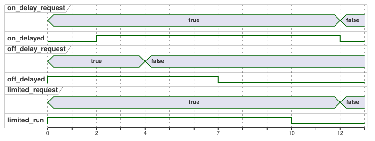

<!-- translation-source: examples/curriculum/pc-06-timer-patterns.ghost.en.md -->
[Original en inglés](pc-06-timer-patterns.ghost.en.md)

> Traducción de lectura. Para compilar, use el archivo original `.ghost.md`
> enlazado: [original en coreano](pc-06-timer-patterns.ghost.md).

# PC-06 — Solicitudes mantenidas y patrones de temporizador independientes

<!-- ghostflow:anchor id=GF-INT-PC06-INDEPENDENT-TIMERS-V1 kind=intent status=confirmed origin=imported -->
> Escenario de aprendizaje: aprender a combinar retardo a la conexión, retardo a
> la desconexión y un tiempo máximo de marcha en un mismo armario de control. El
> ejemplo separa una demanda mantenida, que se vuelve a leer en cada escaneo, de
> un evento START momentáneo, que parte de un único cambio de botón.

**Qué añade esta lección.** El archivo `.ghost.md` en coreano enlazado es la
única fuente literaria (literate) canónica y ejecutable de PC-06. Conserva y
amplía:

- [E08 DelayedStart](../../docs/ProgrammingInGhostflow.es.md),
  que presenta un único estado y `elapsed(phase)`;
- [tutorial/02-watering](../tutorial/02-watering.ghost.es.md), que muestra una
  secuencia de riego real.

Esta lección extiende esas ideas a **tres canales de demanda independientes**.

**Demanda mantenida, no eventos START.** `on_delay_request`,
`off_delay_request` y `limited_request` son demandas mantenidas. Cada demanda
existe mientras su entrada siga en true. No son eventos START momentáneos.

| Canal | Entrada de demanda | Ajuste | Comportamiento de la salida |
| --- | --- | --- | --- |
| ON-delay (retardo a la conexión) | `on_delay_request` | `on_delay = 2s` | `on_delayed` se activa después de que la demanda se haya mantenido 2 s. |
| OFF-delay (retardo a la desconexión) | `off_delay_request` | `off_delay = 3s` | `off_delayed` está activa con la demanda y sigue activa 3 s después de que se suelte. |
| LIMIT | `limited_request` | `max_run = 10s` | `limited_run` está activa con la demanda, pero nunca más allá del máximo estricto de 10 s. |

Si `stop_ok` no es true, los tres canales vuelven a la vez a un estado de reposo
seguro. Este ejemplo no garantiza ningún dispositivo de seguridad físico ni el
comportamiento real de la carga.

**Calidad de las entradas.** Esta revisión lee la calidad que informa el
productor de cada entrada. No diagnostica fallos físicos de los botones.

- Un `false` sano (Good(false)) es una observación normal.
- Una solicitud desconocida no cuenta como una solicitud nueva ni como una
  liberación. Cuando ninguna observación justifica una transición, se mantiene
  el estado actual.
- El permiso de protección sigue exigiendo un Good(true) confirmado, y el límite
  de tiempo estricto sigue aplicándose.
- No se añade ninguna entrada START nueva ni ninguna política global de
  rearranque.

```ghost
// Source revision: issue531-producer-quality-pc06-v1
control TimerPatterns {
  input on_delay_request, off_delay_request, limited_request, stop_ok: Bool;
  output on_delayed, off_delayed, limited_run: Bool;

  let on_delay_request_true = case on_delay_request { ok(value) => value; fault(_) => false; };
  let on_delay_request_false = case on_delay_request { ok(value) => !value; fault(_) => false; };
  let off_delay_request_true = case off_delay_request { ok(value) => value; fault(_) => false; };
  let off_delay_request_false = case off_delay_request { ok(value) => !value; fault(_) => false; };
  let limited_request_true = case limited_request { ok(value) => value; fault(_) => false; };
  let limited_request_false = case limited_request { ok(value) => !value; fault(_) => false; };
  let stop_ok_true = case stop_ok { ok(value) => value; fault(_) => false; };
  let stop_ok_false = case stop_ok { ok(value) => !value; fault(_) => false; };

  let on_delay = 2s;
  let off_delay = 3s;
  let max_run = 10s;

  type OnPhase = OnIdle | OnWaiting | OnActive;
  // ghostflow:link id=GF-INT-PC06-INDEPENDENT-TIMERS-V1 relation=implements
  state on_phase: OnPhase = OnIdle;
  // ghostflow:link id=GF-INT-PC06-INDEPENDENT-TIMERS-V1 relation=implements
  timer on_age = elapsed(on_phase);

  type OffPhase = OffIdle | OffActive | OffHolding;
  // ghostflow:link id=GF-INT-PC06-INDEPENDENT-TIMERS-V1 relation=implements
  state off_phase: OffPhase = OffIdle;
  // ghostflow:link id=GF-INT-PC06-INDEPENDENT-TIMERS-V1 relation=implements
  timer off_age = elapsed(off_phase);

  type LimitPhase = LimitIdle | LimitRunning | LimitReached;
  // ghostflow:link id=GF-INT-PC06-INDEPENDENT-TIMERS-V1 relation=implements
  state limit_phase: LimitPhase = LimitIdle;
  // ghostflow:link id=GF-INT-PC06-INDEPENDENT-TIMERS-V1 relation=implements
  timer limit_age = elapsed(limit_phase);

  on_phase' = case on_phase {
    OnIdle => if stop_ok_true && on_delay_request_true then OnWaiting else OnIdle;
    OnWaiting =>
      if !stop_ok_true || on_delay_request_false then OnIdle
      else if on_delay_request_true && on_age >= on_delay then OnActive
      else OnWaiting;
    OnActive => if !stop_ok_true || on_delay_request_false then OnIdle else OnActive;
  };

  off_phase' = case off_phase {
    OffIdle => if stop_ok_true && off_delay_request_true then OffActive else OffIdle;
    OffActive =>
      if !stop_ok_true then OffIdle
      else if off_delay_request_false then OffHolding
      else OffActive;
    OffHolding =>
      if !stop_ok_true then OffIdle
      else if off_delay_request_true then OffActive
      else if off_age >= off_delay then OffIdle
      else OffHolding;
  };

  limit_phase' = case limit_phase {
    LimitIdle => if stop_ok_true && limited_request_true then LimitRunning else LimitIdle;
    LimitRunning =>
      if !stop_ok_true || limited_request_false then LimitIdle
      else if limit_age >= max_run then LimitReached
      else LimitRunning;
    LimitReached =>
      if !stop_ok_true || limited_request_false then LimitIdle
      else LimitReached;
  };

  on_delayed <- on_phase' == OnActive;
  off_delayed <- off_phase' == OffActive || off_phase' == OffHolding;
  limited_run <- limit_phase' == LimitRunning;
}
```

**Canales independientes.** Cada canal tiene su propio estado y su propio
temporizador. Así, mientras el canal OFF-delay cuenta sus tres segundos después
de que se suelte la demanda, el máximo de diez segundos del canal LIMIT se sigue
midiendo por separado con `limit_age`.

La cronología siguiente muestra los tres canales cuando cada demanda se activa
en 0 s, la demanda OFF-delay se suelta en 4 s y las otras dos demandas se
sueltan en 12 s. Supone que el control se escanea exactamente en cada instante
marcado.



**El canal LIMIT no se reinicia por sí solo.** Una vez que LIMIT llega a
`LimitReached`, permanece ahí mientras la demanda siga en true; no vuelve a
`LimitRunning`. Para iniciar una nueva marcha, el operador debe soltar la
demanda y volver a solicitarla.

**Las salidas siguen al estado siguiente.** Cada salida se lee del estado
siguiente calculado (por ejemplo `on_phase'`), no del actual. Así, en el
escaneo en el que cambia un estado, la salida ya muestra el resultado.

**Qué demuestra el verificador.** El verificador ejecuta las mismas marcas de
tiempo lógicas y la misma cinta de entradas con dos etiquetas de ritmo de reloj
de pared, x1 y x1000. No espera realmente ni cambia las entradas de la VM; los
dos resultados deben coincidir. Esta comparación muestra que la lógica de
control depende del `nowMs` lógico, no de una implementación acelerada del host
web.
