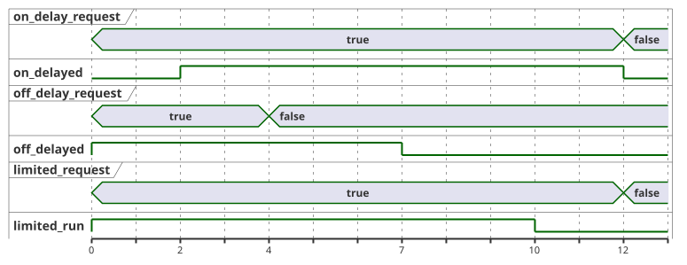

<!-- translation-source: examples/curriculum/pc-06-timer-patterns.ghost.en.md -->
[英語の原文](pc-06-timer-patterns.ghost.en.md)
> 閲覧用の翻訳です。コンパイルには、リンク先の韓国語の原本 [`pc-06-timer-patterns.ghost.md`](pc-06-timer-patterns.ghost.md) を使用してください。

# PC-06 — 維持型の要求と独立したタイマーパターン

<!-- ghostflow:anchor id=GF-INT-PC06-INDEPENDENT-TIMERS-V1 kind=intent status=confirmed origin=imported -->
> 学習シナリオ：1 つの制御盤で、遅延 ON、遅延 OFF、最大運転時間を組み合わせる方法を学びます。この例では、スキャンごとに読み直される維持型の要求（maintained demand）と、1 回のボタン変化から始まるモーメンタリな START イベントを区別します。

**このレッスンで追加すること。** リンク先の韓国語の `.ghost.md` ファイルが、PC-06 の唯一の正本であり、実行可能な文芸的ソース（literate source）です。このレッスンは、次の既存の内容をそのまま残し、その上に積み上げます。

- [E08 DelayedStart](../../docs/ProgrammingInGhostflow.ja.md#e08--入力が-2-秒間続いたらオンにする)：単一の状態と `elapsed(phase)` を導入します。
- [tutorial/02-watering](../tutorial/02-watering.ghost.ja.md)：実際の灌水シーケンスを示します。

このレッスンでは、これらの考え方を**3 つの独立した要求チャネル**へ拡張します。

**START イベントではなく維持型の要求。** `on_delay_request`、`off_delay_request`、`limited_request` は維持型の要求です。それぞれの要求は、その入力が true である間だけ存在します。モーメンタリな START イベントではありません。

| チャネル | 要求入力 | 設定 | 出力の振る舞い |
| --- | --- | --- | --- |
| ON-delay | `on_delay_request` | `on_delay = 2s` | 要求が 2 秒間続くと `on_delayed` がオンになります。 |
| OFF-delay | `off_delay_request` | `off_delay = 3s` | `off_delayed` は要求とともにオンになり、要求が解除された後も 3 秒間オンのままです。 |
| LIMIT | `limited_request` | `max_run = 10s` | `limited_run` は要求とともにオンになりますが、10 秒という絶対的な上限を超えることはありません。 |

`stop_ok` が true でない場合、3 つのチャネルはすべて同時に安全なアイドル状態へ戻ります。この例は、物理的な安全装置や実際の負荷の振る舞いを何も保証しません。

**入力品質。** このリビジョンでは、各入力の producer が報告する品質を読み取ります。物理的なボタンの故障は診断しません。

- 正常な `false`（Good(false)）は通常の観測です。
- 不明な要求は、新しい要求とも解除とも見なしません。遷移を正当化する観測がない場合は、現在の状態を保持します。
- 保護の許可には、引き続き確定した Good(true) が必要であり、絶対的な時間上限も引き続き適用されます。
- 新しい START 入力や全体的な再起動ポリシーは追加しません。

```ghost
// Source revision: issue531-producer-quality-pc06-v1
control TimerPatterns {
  input on_delay_request, off_delay_request, limited_request, stop_ok: Bool;
  output on_delayed, off_delayed, limited_run: Bool;

  let on_delay_request_true = case on_delay_request { ok(value) => value; fault(_) => false; };
  let on_delay_request_false = case on_delay_request { ok(value) => !value; fault(_) => false; };
  let off_delay_request_true = case off_delay_request { ok(value) => value; fault(_) => false; };
  let off_delay_request_false = case off_delay_request { ok(value) => !value; fault(_) => false; };
  let limited_request_true = case limited_request { ok(value) => value; fault(_) => false; };
  let limited_request_false = case limited_request { ok(value) => !value; fault(_) => false; };
  let stop_ok_true = case stop_ok { ok(value) => value; fault(_) => false; };
  let stop_ok_false = case stop_ok { ok(value) => !value; fault(_) => false; };

  let on_delay = 2s;
  let off_delay = 3s;
  let max_run = 10s;

  type OnPhase = OnIdle | OnWaiting | OnActive;
  // ghostflow:link id=GF-INT-PC06-INDEPENDENT-TIMERS-V1 relation=implements
  state on_phase: OnPhase = OnIdle;
  // ghostflow:link id=GF-INT-PC06-INDEPENDENT-TIMERS-V1 relation=implements
  timer on_age = elapsed(on_phase);

  type OffPhase = OffIdle | OffActive | OffHolding;
  // ghostflow:link id=GF-INT-PC06-INDEPENDENT-TIMERS-V1 relation=implements
  state off_phase: OffPhase = OffIdle;
  // ghostflow:link id=GF-INT-PC06-INDEPENDENT-TIMERS-V1 relation=implements
  timer off_age = elapsed(off_phase);

  type LimitPhase = LimitIdle | LimitRunning | LimitReached;
  // ghostflow:link id=GF-INT-PC06-INDEPENDENT-TIMERS-V1 relation=implements
  state limit_phase: LimitPhase = LimitIdle;
  // ghostflow:link id=GF-INT-PC06-INDEPENDENT-TIMERS-V1 relation=implements
  timer limit_age = elapsed(limit_phase);

  on_phase' = case on_phase {
    OnIdle => if stop_ok_true && on_delay_request_true then OnWaiting else OnIdle;
    OnWaiting =>
      if !stop_ok_true || on_delay_request_false then OnIdle
      else if on_delay_request_true && on_age >= on_delay then OnActive
      else OnWaiting;
    OnActive => if !stop_ok_true || on_delay_request_false then OnIdle else OnActive;
  };

  off_phase' = case off_phase {
    OffIdle => if stop_ok_true && off_delay_request_true then OffActive else OffIdle;
    OffActive =>
      if !stop_ok_true then OffIdle
      else if off_delay_request_false then OffHolding
      else OffActive;
    OffHolding =>
      if !stop_ok_true then OffIdle
      else if off_delay_request_true then OffActive
      else if off_age >= off_delay then OffIdle
      else OffHolding;
  };

  limit_phase' = case limit_phase {
    LimitIdle => if stop_ok_true && limited_request_true then LimitRunning else LimitIdle;
    LimitRunning =>
      if !stop_ok_true || limited_request_false then LimitIdle
      else if limit_age >= max_run then LimitReached
      else LimitRunning;
    LimitReached =>
      if !stop_ok_true || limited_request_false then LimitIdle
      else LimitReached;
  };

  on_delayed <- on_phase' == OnActive;
  off_delayed <- off_phase' == OffActive || off_phase' == OffHolding;
  limited_run <- limit_phase' == LimitRunning;
}
```

**独立したチャネル。** 各チャネルはそれぞれ独自の状態とタイマーを持ちます。そのため、OFF-delay チャネルが要求の解除後に 3 秒を数えている間も、LIMIT チャネルの 10 秒の上限は `limit_age` によって別々に測られます。

次のタイムラインは、各要求が 0 秒でオンになり、OFF-delay の要求が 4 秒で解除され、残りの 2 つの要求が 12 秒で解除される場合の 3 つのチャネルを示しています。`control` は、印の付いた各時刻ちょうどにスキャンされると仮定しています。



**LIMIT チャネルは自動では再始動しません。** LIMIT が一度 `LimitReached` に達すると、要求が true のままである間はそこにとどまり、`LimitRunning` へは戻りません。新しい運転を始めるには、オペレーターが要求を解除してから、もう一度要求しなければなりません。

**出力は次状態に従います。** 各出力は、現在の状態ではなく、計算された次状態（たとえば `on_phase'`）から読み取られます。そのため、状態が変わるスキャンで、出力にはすでにその結果が表れています。

**チェッカーが証明すること。** チェッカーは、同じ論理タイムスタンプと入力テープを、x1 と x1000 という 2 つの壁時計ペーシングのラベルで実行します。実際に待つことはなく、VM の入力も変えません。2 つの結果は一致しなければなりません。この比較により、制御ロジックが加速された Web ホストの実装ではなく、論理的な `nowMs` に依存していることがわかります。
