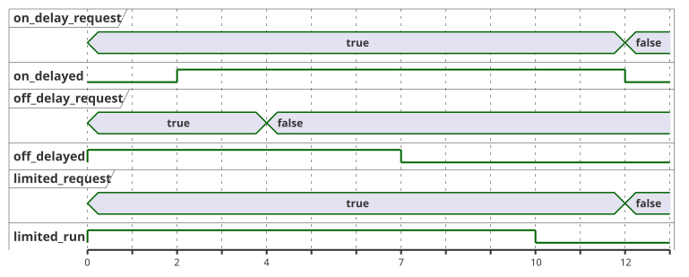

<!-- translation-source: examples/curriculum/pc-06-timer-patterns.ghost.en.md -->
[英文原文](pc-06-timer-patterns.ghost.en.md)
> 本文为阅读用译本。编译时请使用链接的原始 `.ghost.md` 文件：[韩文原文](pc-06-timer-patterns.ghost.md)。

# PC-06 — 保持型请求与独立定时器模式

<!-- ghostflow:anchor id=GF-INT-PC06-INDEPENDENT-TIMERS-V1 kind=intent status=confirmed origin=imported -->
> 学习场景：学习如何在一个控制柜中组合延时接通、延时断开和最长运行时间。本示例将保持型需求（每次扫描都会重新读取）与瞬时 START 事件（由一次按钮变化触发）区分开来。

**本课新增内容。** 链接的韩文 `.ghost.md` 文件是 PC-06 唯一的规范、可执行的文学式源文件（literate source）。它保留并扩展了：

- [E08 DelayedStart](../../docs/ProgrammingInGhostflow.zh.md#e08--输入持续两秒后开启)，
  它引入了单一状态和 `elapsed(phase)`；
- [tutorial/02-watering](../tutorial/02-watering.ghost.zh.md)，它展示了一个真实的浇水序列。

本课将这些思路扩展到**三个独立的需求通道**。

**保持型需求，而不是 START 事件。** `on_delay_request`、`off_delay_request` 和 `limited_request` 是保持型需求。只要对应输入保持为 true，需求就一直存在。它们不是瞬时 START 事件。

| 通道 | 需求输入 | 设置 | 输出行为 |
| --- | --- | --- | --- |
| ON-delay（通电延时） | `on_delay_request` | `on_delay = 2s` | 需求持续 2 s 后，`on_delayed` 开启。 |
| OFF-delay（断电延时） | `off_delay_request` | `off_delay = 3s` | `off_delayed` 随需求开启，并在需求撤除后继续保持开启 3 s。 |
| LIMIT | `limited_request` | `max_run = 10s` | `limited_run` 随需求开启，但绝不超过 10 s 的硬性上限。 |

如果 `stop_ok` 不为 true，三个通道会同时回到安全的空闲状态。本示例不保证任何物理安全装置或真实负载的行为。

**输入质量。** 本修订版读取每个输入的生产者所报告的质量。它不诊断物理按钮故障。

- 健康的 `false`（Good(false)）是正常观测。
- 未知的请求既不算作新请求，也不算作撤除。在没有观测能支持状态转换的地方，保持当前状态。
- 保护许可仍然需要明确的 Good(true)，硬性时间上限仍然有效。
- 不新增 START 输入，也不新增全局重启策略。

```ghost
// Source revision: issue531-producer-quality-pc06-v1
control TimerPatterns {
  input on_delay_request, off_delay_request, limited_request, stop_ok: Bool;
  output on_delayed, off_delayed, limited_run: Bool;

  let on_delay_request_true = case on_delay_request { ok(value) => value; fault(_) => false; };
  let on_delay_request_false = case on_delay_request { ok(value) => !value; fault(_) => false; };
  let off_delay_request_true = case off_delay_request { ok(value) => value; fault(_) => false; };
  let off_delay_request_false = case off_delay_request { ok(value) => !value; fault(_) => false; };
  let limited_request_true = case limited_request { ok(value) => value; fault(_) => false; };
  let limited_request_false = case limited_request { ok(value) => !value; fault(_) => false; };
  let stop_ok_true = case stop_ok { ok(value) => value; fault(_) => false; };
  let stop_ok_false = case stop_ok { ok(value) => !value; fault(_) => false; };

  let on_delay = 2s;
  let off_delay = 3s;
  let max_run = 10s;

  type OnPhase = OnIdle | OnWaiting | OnActive;
  // ghostflow:link id=GF-INT-PC06-INDEPENDENT-TIMERS-V1 relation=implements
  state on_phase: OnPhase = OnIdle;
  // ghostflow:link id=GF-INT-PC06-INDEPENDENT-TIMERS-V1 relation=implements
  timer on_age = elapsed(on_phase);

  type OffPhase = OffIdle | OffActive | OffHolding;
  // ghostflow:link id=GF-INT-PC06-INDEPENDENT-TIMERS-V1 relation=implements
  state off_phase: OffPhase = OffIdle;
  // ghostflow:link id=GF-INT-PC06-INDEPENDENT-TIMERS-V1 relation=implements
  timer off_age = elapsed(off_phase);

  type LimitPhase = LimitIdle | LimitRunning | LimitReached;
  // ghostflow:link id=GF-INT-PC06-INDEPENDENT-TIMERS-V1 relation=implements
  state limit_phase: LimitPhase = LimitIdle;
  // ghostflow:link id=GF-INT-PC06-INDEPENDENT-TIMERS-V1 relation=implements
  timer limit_age = elapsed(limit_phase);

  on_phase' = case on_phase {
    OnIdle => if stop_ok_true && on_delay_request_true then OnWaiting else OnIdle;
    OnWaiting =>
      if !stop_ok_true || on_delay_request_false then OnIdle
      else if on_delay_request_true && on_age >= on_delay then OnActive
      else OnWaiting;
    OnActive => if !stop_ok_true || on_delay_request_false then OnIdle else OnActive;
  };

  off_phase' = case off_phase {
    OffIdle => if stop_ok_true && off_delay_request_true then OffActive else OffIdle;
    OffActive =>
      if !stop_ok_true then OffIdle
      else if off_delay_request_false then OffHolding
      else OffActive;
    OffHolding =>
      if !stop_ok_true then OffIdle
      else if off_delay_request_true then OffActive
      else if off_age >= off_delay then OffIdle
      else OffHolding;
  };

  limit_phase' = case limit_phase {
    LimitIdle => if stop_ok_true && limited_request_true then LimitRunning else LimitIdle;
    LimitRunning =>
      if !stop_ok_true || limited_request_false then LimitIdle
      else if limit_age >= max_run then LimitReached
      else LimitRunning;
    LimitReached =>
      if !stop_ok_true || limited_request_false then LimitIdle
      else LimitReached;
  };

  on_delayed <- on_phase' == OnActive;
  off_delayed <- off_phase' == OffActive || off_phase' == OffHolding;
  limited_run <- limit_phase' == LimitRunning;
}
```

**独立的通道。** 每个通道都有自己的状态和自己的定时器。因此，当 OFF-delay 通道在需求撤除后计数三秒时，LIMIT 通道的十秒上限仍由 `limit_age` 单独计量。

下面的时间线展示了三个通道的行为：每个需求都在 0 s 开启，OFF-delay 需求在 4 s 撤除，另外两个需求在 12 s 撤除。这里假设 `control` 恰好在每个标记时刻被扫描。



**LIMIT 通道不会自行重新启动。** LIMIT 一旦到达 `LimitReached`，只要需求保持为 true，就一直停留在该状态；它不会回到 `LimitRunning`。要开始新的一次运行，操作员必须先撤除需求，再重新发出请求。

**输出跟随下一状态。** 每个输出都从计算得到的下一状态（例如 `on_phase'`）读取，而不是从当前状态读取。因此在状态发生变化的那次扫描中，输出就已经反映了结果。

**检查器能证明什么。** 检查器在 x1 和 x1000 两种墙钟节奏标签下，运行相同的逻辑时间戳和输入带。它并不真的等待，也不改变 VM 输入；两次结果必须一致。这一比较表明，控制逻辑依赖逻辑时间 `nowMs`，而不依赖加速的 Web 宿主实现。
