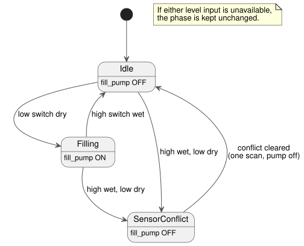

<!-- translation-source: examples/curriculum/pc-07-tank-hysteresis.ghost.md -->
[Korean original](pc-07-tank-hysteresis.ghost.md)
> Reading translation. Compile the linked original `.ghost.md` file.

# PC-07 — Two-point tank-level control and conflict safety

<!-- ghostflow:anchor id=GF-INT-PC07-TANK-HYSTERESIS-V1 kind=intent status=confirmed origin=imported -->
> Learning scenario: learn upper/lower tank-level control from the
> PLC-replacement curriculum, using two digital level switches and explicit
> state transitions. This document is not a direct quote of the user.

**What this lesson covers.** The linked Korean `.ghost.md` file is the only
canonical, executable literate source for PC-07. It keeps and refers to
[tutorial/03-moisture](../tutorial/03-moisture.ghost.md), a separate example
that combines a continuous moisture sensor with median filtering, quality states,
and hysteresis. This lesson is different: it fills a tank using two **physical
level switches** (lower and upper), not analog values or continuous-sensor
processing.

**Inputs and output.**

| Name | Meaning when true |
| --- | --- |
| `low_level_reached` | Water has reached and wetted the lower switch. |
| `high_level_reached` | Water has reached and wetted the upper switch. |
| `fill_pump` (output) | Logical command to the filling contactor. It is not feedback that the pump actually runs. |

Water reaches the lower switch before the upper one. So
`high_level_reached=true` with `low_level_reached=false` cannot happen in a
healthy tank; it is a **sensor conflict**.

Common stop/protection permissions such as `stop_ok` are deliberately left out
of this lesson. PC-08 and PC-10 add them back.

**Input quality.** This revision reads the quality that each input's producer
reports. It does not diagnose physical faults.

- A healthy `false` (Good(false)) is a normal observation.
- If either level input is unknown, the phase stays as it is
  (`if !levels_good then phase`); an unknown observation never justifies a
  transition.
- No new START input or global restart policy is added.

```ghost
// Source revision: issue531-producer-quality-pc07-v1
control TankLevelHysteresis {
  input low_level_reached, high_level_reached: Bool;
  output fill_pump: Bool;

  type Phase = Idle | Filling | SensorConflict;
  // ghostflow:link id=GF-INT-PC07-TANK-HYSTERESIS-V1 relation=implements
  state phase: Phase = Idle;

  let low_level_reached_true = case low_level_reached { ok(value) => value; fault(_) => false; };
  let low_level_reached_false = case low_level_reached { ok(value) => !value; fault(_) => false; };
  let high_level_reached_true = case high_level_reached { ok(value) => value; fault(_) => false; };
  let high_level_reached_false = case high_level_reached { ok(value) => !value; fault(_) => false; };
  let levels_good = case low_level_reached { ok(_) => case high_level_reached { ok(_) => true; fault(_) => false; }; fault(_) => false; };

  let conflict = high_level_reached_true && low_level_reached_false;

  phase' = if !levels_good then phase else case phase {
    Idle =>
      if conflict then SensorConflict
      else if low_level_reached_false then Filling
      else Idle;

    Filling =>
      if conflict then SensorConflict
      else if high_level_reached_true then Idle
      else Filling;

    SensorConflict =>
      if conflict then SensorConflict
      else Idle;
  };

  fill_pump <- phase' == Filling;
}
```

**Why a state is needed (hysteresis).** The pump starts when the water drops
below the lower switch and stops only when it reaches the upper switch. Between
the two switches, the switch values alone (`low=true, high=false`) cannot tell
whether the tank is filling or draining. The control therefore also looks at
`phase`:

- In `Filling`, the phase stays `Filling` while the lower switch is wet and
  changes to `Idle` when the upper switch becomes wet.
- In `Idle`, the phase stays `Idle` until the lower switch becomes dry.

The state diagram below summarizes these rules.



**Conflict comes first.** In every state, a conflict is checked before anything
else, and it turns the pump command off.

**Startup.** At startup, `low_level_reached=true, high_level_reached=false`
means the level is already above the lower switch, so the pump stays off. If both
switches are false at startup, the tank is treated as below the lower level, and
filling starts on the next scan.

**Recovering from a conflict.** The scan on which a conflict clears always
recovers to `Idle` with the pump off, once. Normal automatic evaluation resumes
only on the following scan. This prevents an immediate restart from incomplete
or not-yet-understood inputs just after the conflict. If both switches are false
after the conflict clears, the next scan treats the tank as low and may start
filling.

**Scope limits.** This example assumes both normalized inputs are healthy. Under
that assumption, `low_level_reached=false, high_level_reached=false` means
"below the lower level". The example does not try to infer wire breaks, stuck
switches, or unknown quality from the same Bool combination. Those diagnostics,
and the common stop/protection permissions, are left to PC-08/PC-10. Correct
switch wiring, water movement, pump rotation, and flow are outside the evidence
this logic example and its checker provide. PC-10 extends this boundary with
timeout, fault latch, and reset.

**What the checker proves.** `tools/check-pc-07.mjs` creates a fresh WASM
`ControlRuntime` for each case and does not rebuild the existing WASM. A checker
PASS means the literate source compiled with the current compiler and its
logical command trace matched expectations on the existing WASM. To pin down
exactly what was tested, the checker prints SHA-256 hashes of the source,
checker, compiler, toolchain, literate extractor, WASM, adapter, and expected
values.
