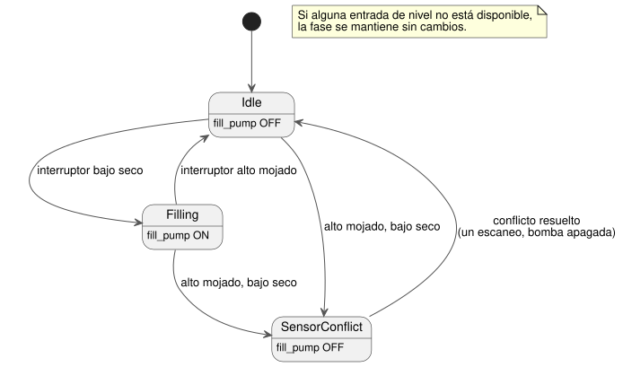

<!-- translation-source: examples/curriculum/pc-07-tank-hysteresis.ghost.en.md -->
[Original en inglés](pc-07-tank-hysteresis.ghost.en.md)

> Traducción de lectura. Para compilar, use el archivo original `.ghost.md`
> enlazado: [original en coreano](pc-07-tank-hysteresis.ghost.md).

# PC-07 — Control de nivel de tanque de dos puntos y seguridad ante conflictos

<!-- ghostflow:anchor id=GF-INT-PC07-TANK-HYSTERESIS-V1 kind=intent status=confirmed origin=imported -->
> Escenario de aprendizaje: aprender el control de nivel superior/inferior de un
> tanque del currículo de sustitución de PLC, usando dos interruptores de nivel
> digitales y transiciones de estado explícitas. Este documento no es una cita
> directa del usuario.

**Qué cubre esta lección.** El archivo `.ghost.md` en coreano enlazado es la
única fuente literaria (literate) canónica y ejecutable de PC-07. Conserva y
hace referencia a [tutorial/03-moisture](../tutorial/03-moisture.ghost.es.md),
un ejemplo aparte que combina un sensor de humedad continuo con filtrado por
mediana, estados de calidad e histéresis. Esta lección es distinta: llena un
tanque usando dos **interruptores de nivel físicos** (inferior y superior), no
valores analógicos ni procesamiento de sensores continuos.

**Entradas y salida.**

| Nombre | Significado cuando es true |
| --- | --- |
| `low_level_reached` | El agua ha llegado al interruptor inferior y lo ha mojado. |
| `high_level_reached` | El agua ha llegado al interruptor superior y lo ha mojado. |
| `fill_pump` (salida) | Comando lógico al contactor de llenado. No es retroalimentación de que la bomba funcione realmente. |

El agua llega al interruptor inferior antes que al superior. Por eso
`high_level_reached=true` con `low_level_reached=false` no puede ocurrir en un
tanque sano; es un **conflicto de sensores**.

Los permisos comunes de paro/protección, como `stop_ok`, se dejan fuera de esta
lección a propósito. PC-08 y PC-10 los vuelven a añadir.

**Calidad de las entradas.** Esta revisión lee la calidad que informa el
productor de cada entrada. No diagnostica fallos físicos.

- Un `false` sano (Good(false)) es una observación normal.
- Si alguna de las entradas de nivel es desconocida, la fase se mantiene tal
  cual (`if !levels_good then phase`); una observación desconocida nunca
  justifica una transición.
- No se añade ninguna entrada START nueva ni ninguna política global de
  rearranque.

```ghost
// Source revision: issue531-producer-quality-pc07-v1
control TankLevelHysteresis {
  input low_level_reached, high_level_reached: Bool;
  output fill_pump: Bool;

  type Phase = Idle | Filling | SensorConflict;
  // ghostflow:link id=GF-INT-PC07-TANK-HYSTERESIS-V1 relation=implements
  state phase: Phase = Idle;

  let low_level_reached_true = case low_level_reached { ok(value) => value; fault(_) => false; };
  let low_level_reached_false = case low_level_reached { ok(value) => !value; fault(_) => false; };
  let high_level_reached_true = case high_level_reached { ok(value) => value; fault(_) => false; };
  let high_level_reached_false = case high_level_reached { ok(value) => !value; fault(_) => false; };
  let levels_good = case low_level_reached { ok(_) => case high_level_reached { ok(_) => true; fault(_) => false; }; fault(_) => false; };

  let conflict = high_level_reached_true && low_level_reached_false;

  phase' = if !levels_good then phase else case phase {
    Idle =>
      if conflict then SensorConflict
      else if low_level_reached_false then Filling
      else Idle;

    Filling =>
      if conflict then SensorConflict
      else if high_level_reached_true then Idle
      else Filling;

    SensorConflict =>
      if conflict then SensorConflict
      else Idle;
  };

  fill_pump <- phase' == Filling;
}
```

**Por qué hace falta un estado (histéresis).** La bomba arranca cuando el agua
baja por debajo del interruptor inferior y se detiene solo cuando alcanza el
interruptor superior. Entre los dos interruptores, los valores de los
interruptores por sí solos (`low=true, high=false`) no pueden decir si el tanque
se está llenando o vaciando. Por eso el control también mira `phase`:

- En `Filling`, la fase sigue en `Filling` mientras el interruptor inferior está
  mojado y cambia a `Idle` cuando el interruptor superior se moja.
- En `Idle`, la fase sigue en `Idle` hasta que el interruptor inferior se seca.

El diagrama de estados siguiente resume estas reglas.



**El conflicto va primero.** En todos los estados, el conflicto se comprueba
antes que cualquier otra cosa y apaga el comando de la bomba.

**Arranque.** Al arrancar, `low_level_reached=true, high_level_reached=false`
significa que el nivel ya está por encima del interruptor inferior, así que la
bomba permanece apagada. Si ambos interruptores son false al arrancar, se
considera que el tanque está por debajo del nivel inferior, y el llenado empieza
en el siguiente escaneo.

**Recuperación tras un conflicto.** El escaneo en el que se resuelve un conflicto
siempre se recupera a `Idle` con la bomba apagada, una vez. La evaluación
automática normal se reanuda solo en el escaneo siguiente. Esto evita un
rearranque inmediato a partir de entradas incompletas o todavía no entendidas
justo después del conflicto. Si ambos interruptores son false después de
resolverse el conflicto, el siguiente escaneo trata el tanque como bajo y puede
empezar a llenar.

**Límites del alcance.** Este ejemplo supone que ambas entradas normalizadas
están sanas. Con ese supuesto, `low_level_reached=false, high_level_reached=false`
significa "por debajo del nivel inferior". El ejemplo no intenta deducir cables
rotos, interruptores atascados ni calidad desconocida a partir de la misma
combinación de Bool. Esos diagnósticos, y los permisos comunes de
paro/protección, se dejan para PC-08/PC-10. El cableado correcto de los
interruptores, el movimiento del agua, la rotación de la bomba y el caudal
quedan fuera de la evidencia que aportan este ejemplo lógico y su verificador.
PC-10 amplía este límite con timeout, latch de fallo y reinicio.

**Qué demuestra el verificador.** `tools/check-pc-07.mjs` crea un
`ControlRuntime` WASM nuevo para cada caso y no recompila el WASM existente. Un
PASS del verificador significa que la fuente literaria se compiló con el
compilador actual y que su traza de comandos lógicos coincidió con lo esperado
sobre el WASM existente. Para fijar exactamente qué se probó, el verificador
imprime los hashes SHA-256 de la fuente, el verificador, el compilador, la
cadena de herramientas, el extractor literario, el WASM, el adaptador y los
valores esperados.
