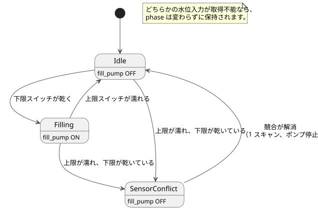

<!-- translation-source: examples/curriculum/pc-07-tank-hysteresis.ghost.en.md -->
[英語の原文](pc-07-tank-hysteresis.ghost.en.md)
> 閲覧用の翻訳です。コンパイルには、リンク先の韓国語の原本 [`pc-07-tank-hysteresis.ghost.md`](pc-07-tank-hysteresis.ghost.md) を使用してください。

# PC-07 — 2 点式タンク水位制御と競合時の安全

<!-- ghostflow:anchor id=GF-INT-PC07-TANK-HYSTERESIS-V1 kind=intent status=confirmed origin=imported -->
> 学習シナリオ：PLC 置き換えカリキュラムから、2 つのデジタル水位スイッチと明示的な状態遷移を使ったタンクの上限/下限水位制御を学びます。この文書はユーザーの発言を直接引用したものではありません。

**このレッスンで扱うこと。** リンク先の韓国語の `.ghost.md` ファイルが、PC-07 の唯一の正本であり、実行可能な文芸的ソース（literate source）です。このレッスンは、[tutorial/03-moisture](../tutorial/03-moisture.ghost.ja.md) をそのまま残して参照します。これは、連続値の水分センサに中央値フィルタ、品質状態、ヒステリシスを組み合わせた別の例です。このレッスンはそれとは異なり、アナログ値や連続センサの処理ではなく、2 つの**物理的な水位スイッチ**（下限と上限）を使ってタンクに給水します。

**入力と出力。**

| 名前 | true のときの意味 |
| --- | --- |
| `low_level_reached` | 水が下限スイッチに達し、スイッチが濡れています。 |
| `high_level_reached` | 水が上限スイッチに達し、スイッチが濡れています。 |
| `fill_pump`（出力） | 給水用接触器への論理コマンドです。ポンプが実際に回っていることのフィードバックではありません。 |

水は上限スイッチより先に下限スイッチに達します。そのため、`high_level_reached=true` かつ `low_level_reached=false` は正常なタンクでは起こりえません。これは**センサの競合**です。

`stop_ok` のような共通の停止/保護の許可は、このレッスンでは意図的に省いています。PC-08 と PC-10 で再び追加します。

**入力品質。** このリビジョンでは、各入力の producer が報告する品質を読み取ります。物理的な故障は診断しません。

- 正常な `false`（Good(false)）は通常の観測です。
- どちらかの水位入力が不明な場合、phase はそのまま保持されます（`if !levels_good then phase`）。不明な観測が遷移を正当化することはありません。
- 新しい START 入力や全体的な再起動ポリシーは追加しません。

```ghost
// Source revision: issue531-producer-quality-pc07-v1
control TankLevelHysteresis {
  input low_level_reached, high_level_reached: Bool;
  output fill_pump: Bool;

  type Phase = Idle | Filling | SensorConflict;
  // ghostflow:link id=GF-INT-PC07-TANK-HYSTERESIS-V1 relation=implements
  state phase: Phase = Idle;

  let low_level_reached_true = case low_level_reached { ok(value) => value; fault(_) => false; };
  let low_level_reached_false = case low_level_reached { ok(value) => !value; fault(_) => false; };
  let high_level_reached_true = case high_level_reached { ok(value) => value; fault(_) => false; };
  let high_level_reached_false = case high_level_reached { ok(value) => !value; fault(_) => false; };
  let levels_good = case low_level_reached { ok(_) => case high_level_reached { ok(_) => true; fault(_) => false; }; fault(_) => false; };

  let conflict = high_level_reached_true && low_level_reached_false;

  phase' = if !levels_good then phase else case phase {
    Idle =>
      if conflict then SensorConflict
      else if low_level_reached_false then Filling
      else Idle;

    Filling =>
      if conflict then SensorConflict
      else if high_level_reached_true then Idle
      else Filling;

    SensorConflict =>
      if conflict then SensorConflict
      else Idle;
  };

  fill_pump <- phase' == Filling;
}
```

**状態が必要な理由（ヒステリシス）。** ポンプは水位が下限スイッチを下回ると始動し、上限スイッチに達したときにだけ停止します。2 つのスイッチの間では、スイッチの値（`low=true, high=false`）だけでは、タンクに給水中なのか排水中なのかを区別できません。そこで `control` は `phase` も参照します。

- `Filling` では、下限スイッチが濡れている間は `Filling` のままで、上限スイッチが濡れると `Idle` に変わります。
- `Idle` では、下限スイッチが乾くまで `Idle` のままです。

次の状態図は、これらの規則をまとめたものです。



**競合が最優先。** どの状態でも、競合は他の何よりも先に確認され、ポンプのコマンドをオフにします。

**起動時。** 起動時に `low_level_reached=true, high_level_reached=false` であれば、水位はすでに下限スイッチより上にあるので、ポンプはオフのままです。起動時に両方のスイッチが false であれば、タンクは下限水位より下にあると見なされ、次のスキャンで給水が始まります。

**競合からの復帰。** 競合が解消したスキャンでは、必ず一度ポンプをオフにして `Idle` へ復帰します。通常の自動評価が再開するのは、その次のスキャンからです。これにより、競合の直後に、不完全な入力やまだ把握できていない入力によって即座に再始動することを防ぎます。競合の解消後に両方のスイッチが false であれば、次のスキャンでタンクを低水位と見なし、給水を始めることがあります。

**適用範囲の制限。** この例は、正規化された 2 つの入力がどちらも正常であることを前提としています。この前提のもとでは、`low_level_reached=false, high_level_reached=false` は「下限水位より下」を意味します。この例は、同じ Bool の組み合わせから断線、スイッチの固着、品質不明を推測しようとはしません。そうした診断と、共通の停止/保護の許可は、PC-08/PC-10 に委ねます。正しいスイッチ配線、水の動き、ポンプの回転、流量は、このロジックの例とそのチェッカーが提供する証拠の範囲外です。PC-10 では、タイムアウト、故障ラッチ、リセットによってこの範囲を拡張します。

**チェッカーが証明すること。** `tools/check-pc-07.mjs` はケースごとに新しい WASM `ControlRuntime` を作成し、既存の WASM を再ビルドしません。チェッカーの PASS は、文芸的ソースが現在のコンパイラでコンパイルされ、その論理コマンドトレースが既存の WASM 上で期待値と一致したことを意味します。何がテストされたかを正確に特定できるよう、チェッカーはソース、チェッカー、コンパイラ、ツールチェーン、文芸的ソース抽出器、WASM、アダプタ、期待値の SHA-256 ハッシュを出力します。
