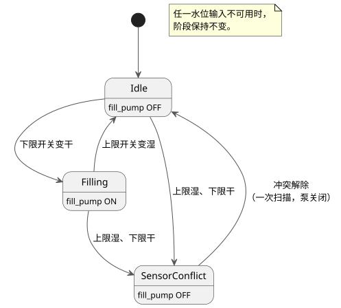

<!-- translation-source: examples/curriculum/pc-07-tank-hysteresis.ghost.en.md -->
[英文原文](pc-07-tank-hysteresis.ghost.en.md)
> 本文为阅读用译本。编译时请使用链接的原始 `.ghost.md` 文件：[韩文原文](pc-07-tank-hysteresis.ghost.md)。

# PC-07 — 水箱两点式水位控制与冲突安全

<!-- ghostflow:anchor id=GF-INT-PC07-TANK-HYSTERESIS-V1 kind=intent status=confirmed origin=imported -->
> 学习场景：学习 PLC 替换课程中的水箱上/下限水位控制，使用两个数字水位开关和显式的状态转换。本文档并非直接引用用户的话。

**本课内容。** 链接的韩文 `.ghost.md` 文件是 PC-07 唯一的规范、可执行的文学式源文件（literate source）。它保留并引用了 [tutorial/03-moisture](../tutorial/03-moisture.ghost.zh.md)，那是另一个示例，将连续的湿度传感器与中值滤波、质量状态和迟滞结合在一起。本课则不同：它使用两个**物理水位开关**（下限和上限）给水箱注水，而不是使用模拟量或连续传感器处理。

**输入和输出。**

| 名称 | 为 true 时的含义 |
| --- | --- |
| `low_level_reached` | 水已到达并浸湿下限开关。 |
| `high_level_reached` | 水已到达并浸湿上限开关。 |
| `fill_pump`（输出） | 发送给注水接触器的逻辑命令。它不是泵实际运转的反馈。 |

水总是先到达下限开关，再到达上限开关。因此，在健康的水箱中不可能出现 `high_level_reached=true` 且 `low_level_reached=false`；这种情况属于**传感器冲突**。

本课有意省略了 `stop_ok` 等通用的停止/保护许可。PC-08 和 PC-10 会把它们加回来。

**输入质量。** 本修订版读取每个输入的生产者所报告的质量。它不诊断物理故障。

- 健康的 `false`（Good(false)）是正常观测。
- 如果任一水位输入未知，阶段保持不变（`if !levels_good then phase`）；未知的观测绝不能支持状态转换。
- 不新增 START 输入，也不新增全局重启策略。

```ghost
// Source revision: issue531-producer-quality-pc07-v1
control TankLevelHysteresis {
  input low_level_reached, high_level_reached: Bool;
  output fill_pump: Bool;

  type Phase = Idle | Filling | SensorConflict;
  // ghostflow:link id=GF-INT-PC07-TANK-HYSTERESIS-V1 relation=implements
  state phase: Phase = Idle;

  let low_level_reached_true = case low_level_reached { ok(value) => value; fault(_) => false; };
  let low_level_reached_false = case low_level_reached { ok(value) => !value; fault(_) => false; };
  let high_level_reached_true = case high_level_reached { ok(value) => value; fault(_) => false; };
  let high_level_reached_false = case high_level_reached { ok(value) => !value; fault(_) => false; };
  let levels_good = case low_level_reached { ok(_) => case high_level_reached { ok(_) => true; fault(_) => false; }; fault(_) => false; };

  let conflict = high_level_reached_true && low_level_reached_false;

  phase' = if !levels_good then phase else case phase {
    Idle =>
      if conflict then SensorConflict
      else if low_level_reached_false then Filling
      else Idle;

    Filling =>
      if conflict then SensorConflict
      else if high_level_reached_true then Idle
      else Filling;

    SensorConflict =>
      if conflict then SensorConflict
      else Idle;
  };

  fill_pump <- phase' == Filling;
}
```

**为什么需要状态（迟滞）。** 水位降到下限开关以下时泵启动，只有到达上限开关时才停止。在两个开关之间，仅凭开关值（`low=true, high=false`）无法判断水箱是在注水还是在排水。因此 `control` 还要查看 `phase`：

- 在 `Filling` 中，只要下限开关是湿的，阶段就保持 `Filling`；当上限开关变湿时，阶段变为 `Idle`。
- 在 `Idle` 中，阶段保持 `Idle`，直到下限开关变干。

下面的状态图总结了这些规则。



**冲突优先。** 在每个状态下，都会先于其他任何判断检查冲突，冲突会关闭泵命令。

**启动。** 启动时，`low_level_reached=true, high_level_reached=false` 表示水位已经高于下限开关，因此泵保持关闭。如果启动时两个开关都为 false，水箱被视为低于下限水位，注水从下一次扫描开始。

**从冲突中恢复。** 冲突解除的那次扫描总是先恢复到 `Idle`，泵关闭，且仅此一次。正常的自动判定从下一次扫描才恢复。这可以防止在冲突刚结束时，根据不完整或尚未理解的输入立即重新启动。如果冲突解除后两个开关都为 false，下一次扫描会将水箱视为低水位，并可能开始注水。

**范围限制。** 本示例假设两个归一化输入都是健康的。在此假设下，`low_level_reached=false, high_level_reached=false` 表示“低于下限水位”。本示例不尝试从相同的 Bool 组合推断断线、开关卡死或未知质量。这些诊断以及通用的停止/保护许可留给 PC-08/PC-10。开关接线是否正确、水的流动、泵的转动和流量，都不在这个逻辑示例及其检查器所提供的证据范围之内。PC-10 通过超时、故障锁存和复位扩展了这一边界。

**检查器能证明什么。** `tools/check-pc-07.mjs` 为每个用例创建一个新的 WASM `ControlRuntime`，不会重新构建现有的 WASM。检查器 PASS 表示：文学式源文件已用当前编译器编译，且其逻辑命令追踪在现有 WASM 上符合预期。为了精确锁定测试对象，检查器会输出源文件、检查器、编译器、工具链、文学式提取器、WASM、适配器以及期望值的 SHA-256 哈希。
